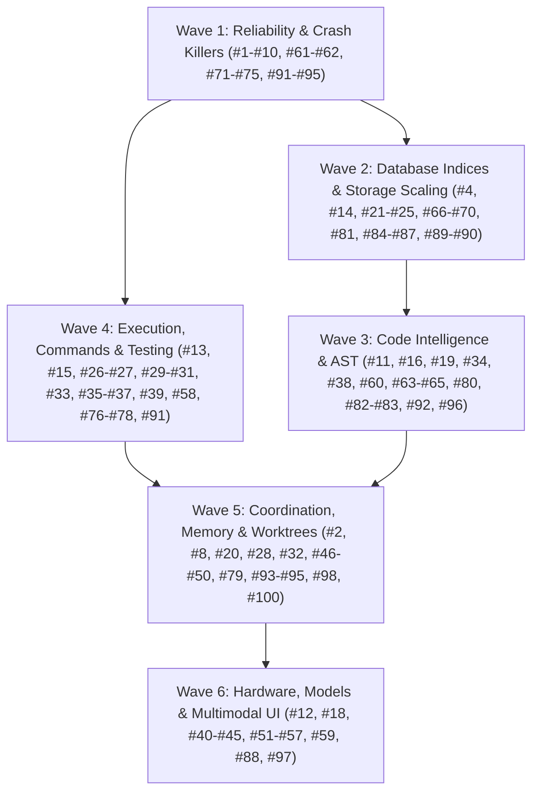

# Local AI Hub: Master Implementation Plan for 100 Ergonomics, Quality & Performance Enhancements

## Active goal extension: single local owner, no tenancy — 2026-10-18

**Separate-target conversion completed, production cutover pending:** All eight
inventoried durable stores now have verified separate targets and provenance
under `state/single-owner-conversion-20261018-1d55c3d703/converted-state/`.
The converter checked original component hashes before/after publication. The
operator configuration also has a separate converted target; only the two
retired per-tenant scheduler assignments were removed. No original source file,
live configuration or production database was replaced.
Agent State conversion retains 295,169 live-table rows; 39 retired schema-table
rows remain typed in the explicit external archive. The 82 old memory advice
envelopes remain fully preserved in pinned provenance, with no fabricated v2
identity. Telemetry conversion retains all 121,770 inventoried rows and sequence
high-water marks. Failed private-copy attempts were not published as targets.

Real conversion exposed a normalized-vs-raw SQL hash comparison and a 100,000
entry provenance bound below the actual telemetry requirement. The offline bound
is now 200,000, checked during planning, with existing per-value limits retained.
Eight named SQLite iterators now close explicitly on early errors so Windows
temporary-file cleanup cannot hide the actual refusal. Three focused regression
cases passed in 0.52 seconds; the preceding packet returned 114 passes and one
fixture-index omission, now corrected. The 100k-row root-memory case passed in
that focused packet. Test-local app configuration explicitly disables model
autostart. Full pytest at `fd90b924` was interrupted around 4% after an observed
failure while these conversion defects were investigated; its partial log
`lah-single-owner-full-7be229960d21450ab289a2477aa12d53.log` is not acceptance.
Whole-suite and actual installed-runtime acceptance remain outstanding.

**Offline preservation bundle source checkpoint:** The complete focused packet
passed 110 tests in 2.34 seconds; log: operator temp
`lah-single-owner-offline-repairs-7233f80e1fe34314a344fe9ad45f7eb7.log`.
Compilation passed. Registered historical index transforms remain offline-only;
canonical stores retain their current contracts. Artifact paging conversion
preserves actual names/truncation and binds their checksum to the artifact ID.
All supported AUTOINCREMENT tables retain their registered sequence high-water
marks. RAG now refuses a corrupt nonempty SQLite header before SQLite can modify
the original WAL/SHM; the byte-preservation regression passed.
Main review corrected the Agent State historical-index classification and a
transposed work-order SQL fingerprint; the exact source comparison now agrees.
All eight inventoried durable-store dry plans report supported/no collisions,
including 295,208 inventoried Agent State rows. Plans and manifests remain under
the ignored preservation staging directory above. No conversion or cutover has
been applied. Whole-suite and installed-runtime acceptance remain pending.

**Unit regression checkpoint:** The assembled runtime/fixture bundle returned
3,978 passes, 13 skips and one failure in 226.49 seconds; log: operator temp
`lah-single-owner-integrated-unit-0adc8cdcae00498bb2a0cf8404eec0f9.log`.
The remaining fixture incorrectly interpreted a logical repository ID as a
physical root. Its root-mismatch assertion now supplies an actual conflicting
`repo_root`; logical IDs retain their independent contract. This correction
awaits validation with the offline conversion repair bundle.
Static AST inspection found zero runtime tenant/principal function parameters;
the only SQL candidate mentioning tenant provenance is the explicit startup
refusal guard. Static inspection does not establish installed-runtime acceptance.

Preservation drafts are retained under ignored local state at
`state/single-owner-conversion-20261018-1d55c3d703/` (not applied). They pin 197
JSON records, including explicit archival dispositions for 82 historical memory
advice envelopes lacking coordination proof, and three writer mappings to the
actual source task owner. No record collision was found in the bounded main
Agent State inventory. The dry plan still refuses historical index contracts;
additional-store plans also identified exact historical artifact paging and
telemetry/index layouts that need offline-only handling. No live state or config
was replaced. Root paths containing ordinary spaces must be preserved while
noncanonical padding, control characters and symlink/reparse aliases still reject.

**Repository identity bundle assembled:** HTTP task creation now derives the
logical repository ID from the authorized physical root's project coordination
identity. Supplied mismatches and unavailable project identities reject; SDK
preflight never interprets logical IDs as filesystem paths. Explicit physical
root confinement and clone/worktree/branch/task/session identities remain.
The last focused diagnostic returned three failures and three passes; its
remaining fixtures now preserve the receipt owner and target the actual lexical
and unguarded adaptive dispatch paths. These changes await validation. No live
configuration, durable conversion or running service has been changed.

**Root repair checkpoint:** The focused known-failure run returned 83 passes
and 11 failures in 124.08 seconds; log: operator temp
`lah-single-owner-root-repairs-61f03c1c0bd54fada5ee684ec467c96a.log`.
The preceding selector-only attempt ran no tests because two fixture node IDs
had changed; its collection error is not validation evidence.
Current source repairs require canonical JSON artifact persistence, reject
missing/conflicting physical task roots before persisting receipt evidence, and
publish a returned receipt only after its execution record is durable. Stored
success exit codes require actual integers, never boolean or float substitutes.
Task root matching follows filesystem case rules without merging distinct
case-sensitive project paths. Remaining fixture repairs use real artifact stores,
explicit broker revision evidence and current adaptive-context dispatch.
All changes await integrated validation. No config/state conversion or service
activation has occurred; the goal remains active.

**Root regression bundle in assembly:** The full-scope diagnostic was deliberately
interrupted with a task-owned console signal after collecting 93 failures,
1,505 passes and 19 skips in 749.06 seconds; this is incomplete, not acceptance.
Log: operator temp `lah-single-owner-full-381eda70630846bc8f726180254e0039.log`.
Source fingerprint before that run:
`d5d42d65a744e7961ee29f322279076ea81ab9b9d17068c44f7197b9ebcb0d25`
(1,352 files); the mid-run comparison found zero changed recorded files.
The new bundle updates remaining root SDK/jobs/command/memory fixtures without
restoring removed arguments or synthesizing verification authority. Network
fixtures preserve the current trace-header and HMAC credential names; unknown
mutating transaction coverage opts into the actual unknown-command policy.
Transaction coordination no longer inspects provider signatures to silently
discard the project coordination identity. Missing canonical provider support
must fail, while owner, paths, fences and current coordination binding remain.
No tests run while this source bundle is being assembled.

**Regression bundle 5 source complete, validation pending:** The traced unit run
returned 3,950 passes, 12 failures and 13 skips in 301.34 seconds. Log: operator
temp `lah-single-owner-unit-b92b7a3a884c4477bc4155aaed5a1ab9.log`.
Global tracing inflated an isolated memory-peak test; do not relax its limit,
and use normal allocation conditions for the next acceptance run. Allocation
evidence identified additional unclosed fixture connections; explicit closing
now preserves transaction semantics. The remaining direct SQLite contexts in
the fencing fixtures were corrected as well.
Production worktree cleanup now validates its repository against the exact
server-managed v2 task scope, never a logical repository ID or cwd. Existing
recovery and response-budget-before-mutation tests retain distinct logical IDs
and physical roots. Converter fixes retain exact source/index contracts and
source-pinned owner mappings. No configuration or durable conversion applied.

**Regression bundle 4 in assembly:** A full unit run completed with 3,890 passes,
67 failures, 13 skips and two setup errors in 229.32 seconds. Log: operator temp
`lah-single-owner-unit-f1eb6bb2c3b342498a34d917bea31307.log`.
Confirmed production repairs remove the empty first SQL predicate that generated
`WHERE AND` during RAG search and honor an explicit plain API-token permission
instead of inferring a weaker permission from the HTTP method. Read-only tokens
must not authorize an explicitly requested write; regression coverage retains
that check across both GET and POST. Converter and remaining fixture repairs are
being assembled before further testing. Data conversion and runtime activation
remain pending; no release acceptance is claimed.

**Regression bundle 3 in assembly:** First complete-unit-scope diagnostic run
with a 50-failure cap returned 1,799 passes, 41 failures, three skips and nine
setup errors in 74.48 seconds. Log: operator temp
`lah-single-owner-unit-4f0dfcce17e64a638966be7183182c8e.log`.
Repairs update stale incident/artifact/job/RAG/generation fixtures, retain
malformed-input and project-isolation assertions, restore tight text-cap behavior,
and correct HTTP fixture configuration without retired routing keys.
No claim of final validation is made. No tests run during bundle assembly.

The offline converter now also supports explicit, raw-row-pinned archival of
legacy memory advice when its coordination identity cannot be proven. Full old
contents and the disposition reason remain in external provenance, with original
databases unchanged. This is an opt-in manifest operation, never an automatic
fallback or supported runtime contract. No real archival or conversion applied.

**Regression bundle 2 in assembly:** The next whole-scope diagnostic run
returned 44 failures, 875 passes, one skip and six setup errors in 420.72 seconds.
Log: operator temp `lah-single-owner-pytest-ee4ff36be67d4378988476fd0d93e3a1.log`.
This is not integrated acceptance. Current source repairs normalize both sides
of Windows active-task root comparisons and stop a shared MCP TTL default from
forcing memory expiry or invalidating unrelated coordination actions. Omitted
TTL preserves each action's default; explicit values remain subject to validation.
Task worktree creation and memory adoption no longer infer a physical root from
logical repository IDs; resume uses the server-managed v2 scope exclusively.
Artifact projection tests now require the canonical explicit failure envelope
for a retired backend response rather than expecting an invalid wire envelope.
Fixture repairs retain real broker receipts, exact roots and separate project,
task, session and owner-global scopes. No tests run during assembly; after this
bundle, validate the complete unit suite before continuing whole-suite regression.

Offline conversion remains unapplied. Source-pinned writer schema classification
and explicit JSON pointer dispositions are being corrected. Old memory snapshots
without provable coordination identity remain preserved and block activation;
neither an empty context nor a fabricated identity may bypass that proof.

**Regression bundle 1 in assembly:** Whole-suite scope with `--maxfail=50`
returned 50 failures / 385 passes in 119 seconds; this is diagnostic, not final
acceptance. Exact log: operator temp
`lah-single-owner-pytest-8c8442fae65840408a8105bcfe69ea69.log`.
Confirmed production fixes: HTTP authorization no longer references removed
`users`; config projection rejects retired users settings; command-record reader
now accepts only the producer's v2 contract and rejects `tenant_identity`;
patch/repair no longer invent receipts or fallback artifacts from command success.
Missing requested receipts are reported without granting completion authority.
Systematic fixture repairs cover keyword-only hybrid/artifact calls, actual
root/coordination/task/session matching, strict legacy receipt refusal and
real bounded broker-produced positive receipt evidence. No tests run while this
repair bundle is being assembled. Canonical prompts now describe receipt forwarding.

Private-copy preservation inventory: 228 tasks, 187 version-1 scope markers,
41 absent markers, 144 currently existing marker roots and 43 historical missing
roots; all 307 receipt metadata envelopes already use the current schema.
Offline explicit scope upgrades now preserve exact canonical historical paths
without inventing missing roots, while live writer/root checks remain strict.
Absent markers remain absent. No durable conversion or service activation yet.

**Integrated validation attempt and preservation-identity correction:** The
assembled source passed compileall and `release_check --allow-installed`.
Broker review `req_94b1497c8af4` and command `req_69fa9e592660` failed before
transport write (`terminal=true`, `retryable=false`), so validation used native
master commands. The first whole-scope pytest attempt accumulated failures and
was explicitly stopped at about 4%; it is not a completed suite or acceptance
receipt. The next run will retain whole-suite scope with a 50-failure cap for a
single regression-fix batch. Logs: operator temp prefix
`lah-single-owner-pytest-e8f4be1d47194816958543222546fbf0`.

Correction to earlier inventory labels: `9814b91b16d127a6ed67195023ccbd8888588ccfd455e455466f6c6fb683539e`
is the component-metadata fingerprint (names, sizes and component hashes), not
the raw main-file hash. The raw main-file SHA-256 is
`6fea03b368154f050fc969e162de240dac70632f97122b2ee8ce72a867e1e3a8`.
An inspection initially refused because these two evidence identities were
incorrectly compared; that refusal did not establish source drift. A subsequent
private-copy inspection confirmed the exact preceding supported `lease_waits`
definition. The offline source registry stores two exact accepted hashes for
this historical definition; the converter is being corrected to use set
membership, without expanding supported runtime or target contracts.
No operator configuration, durable data, or service activation was changed.

**SU4 normalized-pin source fix assembled:** Agent State source, archive and
target expected-object checks now use the runtime's whitespace/case-normalized
SQL hash representation. Generated FTS/internal object pins retain their distinct
raw-SQL representation; no schema pins or accepted definitions were relaxed.
Added an unexecuted regression fixture. No further source DB access was needed.
Conversation/telemetry control guards now inspect only the declared envelope and
one direct control layer, preserving opaque nested domain data. Unit non-Agent
fixture migration is assembled; remaining root integration families continue.

**SU4 source-pin normalization correction pending:** The subsequent dry plan
reached the exact Agent State index check and exposed raw-SQL hashing against
registry hashes of whitespace-normalized, case-folded SQL. Converter source and
target checks are being aligned with the runtime's exact hash representation;
definitions/pins must not be broadened to bypass this mismatch. Diagnostic:
operator temp artifact `lah-single-owner-plan-d5a3ae82f3524d90af3a63b7d95ab591.json`.
No further live inventories until the source package closes. The assigned memory
fixture family and unit Agent OS fixtures have been rewritten; other historical
root/unit families remain in progress. Validation and installed cutover pending.

**SU4 current-data inventory checkpoint:** The canonical store path is
`server.state_dir/agent_state.sqlite` (app constructor), not the historical
`.sqlite3` filename. A private-copy dry inventory reached source-classification
errors; these exposed and prompted fixes in both supported-table classifiers.
Retained diagnostic metadata: operator temp artifact
`lah-single-owner-plan-5df5da08a6b844eaad07a1176730c045.json`, input main-file
SHA-256 `9814b91b16d127a6ed67195023ccbd8888588ccfd455e455466f6c6fb683539e`.
This was inventory only, not an applied conversion or passing acceptance test.
No original SQLite connection, source/config mutation or daemon cutover occurred.
Final preservation/validation must use a fresh stopped-writer snapshot; this
live inventory does not establish the final source identity or data acceptance.

**SU4/SU6 conversion and fixture checkpoint:** Writer conversion now requires
explicit source-row and actual task-row hashes (including blocked task rows),
canonical version-2 physical-root scope, complete map usage and collision
preflight. Main-file SHA and SQLite/WAL component provenance remain distinct.
No owner, receipt authority or root is inferred from former tenant values.
Standalone leases lacking trusted task facts refuse conversion. Source review
also tightened direct ScopeContext parsing to its six canonical identities.
All eight schemas were rendered using an in-memory defaults profile, without
loading operator config or starting services/models. Canonical policies and API
coverage documents were regenerated. Remaining historical fixture families are
being rewritten to current scope/authorization contracts before any tests run.
No test execution, durable conversion, service restart or acceptance claim.

**SU3/SU5 repository RAG boundary source checkpoint:** HTTP project RAG index,
search and document/diagram ingestion now pass through the existing authorized
root binder. Repository context, tool-agent and preprocessing RAG search check
the workspace's stored physical-root binding before revision/cache/content
access. Explicit custom workspace labels remain supported within their bound
root; populated unbound workspaces require explicit offline disposition.
File indexing skips symlinks and Windows reparse points. Document/diagram
ingestion is receiving required root arguments and diagram confinement; global
docsets remain separate. These changes are source-only and unvalidated. No
tests, durable conversion or running-instance activation have occurred.

**SU2/SU5 preservation and zero-shims checkpoint:** Offline conversion now has private source-file snapshots, source/WAL/journal hash pins, exact JSON/TOML retired-setting paths, collision refusal, external removed-field provenance and partial-publication preservation. Artifact/memo/journal conversion supports the preceding source contracts; supplemental store registries retain exact DDL/index/FK definitions and refuse missing JSON/owner/scope transforms. AgentState source registry now includes all 65 current canonical object pins (59 literal DDL objects and six engine-generated objects), including the later cursor/search/outbox registry update. The one-time tool separately pins 68 preceding-source input objects to d40d268f60ba8b27686b652f76cb8edf80c699c4; supported runtime remains current-only. Registry and conversion fixtures are unexecuted; actual input compatibility and conversion remain unverified. No converter or fixture was executed. Installed settings were read only to confirm two retired scheduler keys; no credential values were printed and no settings were changed.

**Additional source correction:** Writer fencing no longer performs startup ALTERs/backfills: final table/index DDL is declared once, existing incompatible data refuses before WAL, all schema checks have a two-second SQLite progress deadline. Removed acceptance of inactive AgentState migration/version tables. Stored receipt decoding now requires the current metadata schema and strict bit/generation values instead of treating missing/unknown metadata as defaults; removed unused legacy envelope helpers. Dedicated regression fixtures were authored, not run. Existing historical receipts and state remain untouched pending explicit offline dispositions and final validation. JSON dispositions now use exact store/table/column/key and raw-content pins; known provenance removals and task-scope conversion are explicit, with actual checkpoint/state_data paths rather than opaque goal metadata. Projection context is the direct six-field ScopeContext object, with declared omitted defaults and no schema_version; version 2 belongs to task-scope/compiled-memory envelopes. Receipt metadata is checked per row, and unrelated details/snapshot content remain opaque. Explicit JSON-disposition integration is assembled but unexecuted; remaining writer/scope/store conditions still reject instead of being inferred. Complete converter integration, legacy writer mapping, remaining supported-store transforms and generated coverage still need closure before tests. Existing state/configuration, old receipts and public targets are preserved; no tool was executed against durable stores.

**Packaging and ingress source checkpoint:** Root and packaged defaults both remove rag.scope and obsolete multi-tenancy guidance. CORS no longer advertises retired tenant headers, including the browser preflight path; retired requested headers reject explicitly. Kept opaque project content outside tenancy-field rejection while preserving structured provenance/scope checks. Updated positive conversation, journal, speculative lint, SDK, trace, command-cache and Windows lease-path fixtures; negative retired-field cases stay explicit. No tests have run. Master remains d40d268f with preserved uncommitted bundle; this checkpoint does not claim integration/runtime acceptance.

**SU4/SU6 surface assembly checkpoint:** The canonical install/update policy blocks and current configuration, HTTP, SDK, security, operations, installation and browser documentation have been updated; historical runtime evidence is not promoted. Rendered all eight source catalogue schemas using an in-memory feature profile without loading operator configuration or activating a model. Removed unused rag.scope from defaults and made that retired setting reject by presence. Updated CLI/doctor/release/benchmark producers to the ownerless contracts. Context HTTP endpoints explicitly reject generic identity by presence; bundle scope guards preserve opaque project document/value content even when the project's own domain mentions tenant. Source fixtures remain unexecuted. Offline SQLite conversion remains unfinished; no operator state/config conversion, installation, restart, final suite or runtime acceptance has occurred.

**SU1/SU3/SU4 source assembly checkpoint — transport, context and operator surface:** Removed the HTTP principal-selection module and its api_token_tenant/api_token_principal fallback chain. security.users now rejects by presence; existing installed settings were not edited. HTTP dispatch and producer calls use ownerless work/jobs/conversations/browser/artifact/memo/lease/service contracts. Request-ID journaling is keyed by request ID plus action and exact payload fingerprint; legacy journal schemas refuse read-only before WAL/DDL. ContextRequest, task-context building and ContextLedger remove the generic identity selector while retaining actual root/task/session and structured repository identities. Source fixtures were updated, not executed.

**Additional bounded source units:** Workspace memos, speculative-lint debounce, tool-agent scheduling/RAG calls, browser staged capabilities and global token quotas no longer partition by tenant. Browser protections retain random capabilities, origins, tab/window/request IDs, expiry, reservations and cancellation. Dashboard tenant columns/filter projections were removed while actual agent/project/session views remain. Bundle export/import now preserves RAG embedding-space and project-file owner rows under real workspace/root scopes. MCP work producers expose explicit task_id separately from work_id. HTTP integration is still under source review; generated surfaces, mixed fixtures, offline conversion and full integrated/runtime acceptance remain pending. No tests, installation, restart or data conversion were run for this checkpoint.

**SU3/SU4 follow-through checkpoint — verification and orchestration:** Removed trusted_tenant from shared receipt evaluation and command-proof lookup; current command provenance is `command_execution_record.v2`. Verification completion now derives its physical root only from the server-managed version-2 task scope; session-as-tenant and flat/worktree/context-repository-ID root reconstruction are removed. A supplied project_root cannot override task scope. Swarm storage/API is tenant-free and retains actual swarm writer ownership; regenerated its DDL pin only after reproducing the previous source pin. WorkOrchestrator drops tenant partitions/admin bypass and has a distinct explicit optional payload.task_id; work IDs remain work-order/journal identity. Bound receipts require the matching real Agent OS task owner/root. Missing task association fails closed; MCP/SDK work producers must still expose and supply task_id for verified completion (no fake task/owner records were created).

**SU3/SU5 remaining producer integration:** ContextLedger preserves actual session IDs in entries, pointers and materialization checks. Debug trace storage/start/projections have no tenant routing fields; captured semantic/debug content remains intact. Ruff/Biome process pools use actual executable/root identity and keyword-only paths; vision inputs and token-router APIs are tenant-free. All these module fixtures are source-only and unexecuted. HTTP dispatch/identity helpers, MCP/SDK work-task linkage, browser and other producer source changes have since been assembled. Remaining mandatory work includes complete offline store conversion and explicit collision/scope dispositions, remaining fixture and generated-coverage integration, final integrated tests, installation and actual runtime proof. Source broadening is not a passing validation receipt or release claim.

**SU2/SU3/SU4 integration checkpoint — services, stores and writer ownership:** `services.py` now has no tenant arguments/routing; semantic, repository, multimodal, embedding, evaluation, proxy and command producers use the new provider contracts. Command streaming requires a real stream_id/task_id rather than an invented tenant stream; command.log identifies its emitting broker component. Pipeline root authorization and canonical task/mode inputs reject invalid values instead of selecting cwd/default authority. Bounded GPT-6 Luna implementations removed tenancy from command execution records/caches/cancellation (new v2 records retain actual task-owner and execution/repository/revision pins), telemetry events/errors, vision input/artifact paths, token routing and Ruff/Biome pool identities. Primary integrated direct HTTP/service/pipeline producers and ownerless artifact calls in browser capture, context ledger, receipt evidence retrieval and work orchestration. These are source changes, not validation receipts; remaining producer/test/schema/documentation sweeps still required.

**RAG/artifact data-preservation review:** Removed RAG automatic corruption rename/WAL deletion, legacy table reset and fingerprint-triggered content deletion. Runtime preflight checks canonical schema and fingerprint read-only; incompatible stored content requires explicit offline conversion/rebuild. Full integrity checking belongs to the offline verifier, not an unbounded startup scan. ArtifactStore now uses owner-global content IDs, strict artifact/paging DDL and keyword-only selectors/kind; tenant-only metadata table/marker and collision routing are removed. Old schemas reject before WAL/setup, preserving the original database and sidecars. Artifact hardening/paging/binary/rollback fixtures were adapted; none executed. No durable data conversion has run.

**Writer leases are retained, not replaced by human partitions:** Lease rows and wait edges use explicit actual writer `owner` identities (task/execution), never a constant installation owner or credential-derived namespace. Claim/batch/release/renew take named owner inputs; retired release_tenant has no alias. Root inference from arbitrary absolute paths is removed. HTTP derives repository coordination identity and rejects caller mismatch; MCP/SDK now send owner/purpose explicitly. Lease DDL pins were regenerated from literal source only after reproducing old hashes; removed the old alternate quoted-table DDL acceptance. Added unexecuted cross-repository conflict, wrong-writer mutation, retired-input and old-database preservation fixtures. Swarm/work-orchestrator lease consumers and all remaining mixed fixtures still need integration before acceptance.

**SU2/SU3 jobs/conversations/query-focus source checkpoint:** Two bounded GPT-6 Luna implementation scopes removed tenancy from AsyncJobManager and ConversationStore. Jobs retain actual repository/task/session/clone/worktree/branch fields, reject retired identity fields (including nested structured batch tasks with depth/item/cycle bounds), and preflight existing schemas/payloads/results before WAL initialization. No stored data was converted. Conversation IDs/reservations/TTL/capacity remain; constructors are keyword-only and retired fields reject by presence in structured settings/messages. Main updated job HTTP invocations and the app executor callback to the new job contract, plus generation/conversation/delegate/reason/review/second-opinion producers. Remaining semantic/tool-agent/service/HTTP producers still require integration. Query expansion now uses actual repository/session focus, with owner-global scope when neither is supplied; cache identity includes current focus, without a manufactured tenant. Added unexecuted scope/rejection/store fixtures. RAG source removal is under bounded SQL/fixture review; provider dependencies, complete source sweep, offline converter, schema/doc generation, final tests and live activation remain open.

**Tool-state note (source integration only):** Context/solve evidence for jobs/RAG: `req_f7fe6f647f4f` / `req_45665006974a`; conversations: `req_7e15395bb487` / `req_92c6600ee2a2`. Later command `req_1311034bbaf1` returned terminal `outcome_unknown` and was not repeated. Other command/review requests explicitly returned `request_not_sent`, terminal/nonretryable transport failures (`req_d016d700c7e3`, `req_aba2f2f94578`, `req_ee5401e83cde`). Used one bounded native source lookup and one native `git diff --check` fallback; no tests/imports/builds/install/restart/data conversion. Hub review produced no approval or passing validation evidence.

**SU2/SU3 generation source checkpoint:** `_generate` no longer accepts or propagates a tenant. Source and priority are explicit keyword-only inputs; updated all 12 direct service callers and five pipeline callers, including adaptive relevance. Removed tenant metadata from this generation path's telemetry and artifact dispatch without replacing it by a constant identity. Added unexecuted retired-keyword/falsy/positional-identity guards. Artifact/telemetry provider contracts and remaining service/public producers still need coordinated source conversion; this is not an executable-completion claim.

**SU2/SU3 watchdog/warmup and adaptive-context source checkpoint:** Watchdog inventory reads explicit version-2 task roots in bounded cursor pages, authorizes each root against current allowed_roots/API-token configuration and reaps within that root only. Reaping selects at most 64 expired tasks per root and keeps status/heartbeat/CAS fences, shutdown cancellation and a monotonic pass deadline; denied or failing roots cannot permanently starve later pages. No global reaper bypass or synthetic owner identity. Warmup uses canonical authorized roots and actual task/session IDs, rechecks authorization, task update/root/status and active nondegraded mode before cache prediction. Adaptive preloads receive the resolved repository coordination ID; hybrid context APIs and RAG calls remove tenant arguments in favor of explicit workspace keywords. Added source-only watchdog/warmup/pagination/input-boundary fixtures; tests remain unexecuted. Services generation, remaining producers/storage, async jobs/RAG integration, converter, generated contracts and final installed runtime validation still pending. No claim of complete removal, measured watchdog latency or deployment.

**SU2/SU3 TaskStore scope/lifecycle source checkpoint:** Removed the final TaskStore tenant hash/helper and tenant arguments from active-task selection, reaping, zombie recovery and dataset export. Creation pins server-managed `_agent_task_scope={version:2,repo_root:...}` without trace/credential identity; old or extra-field contracts require offline conversion. Removed physical/context-root reconstruction fallbacks in active selection. Reaping still revalidates repository/task identity, original status, heartbeat expiry and cutoff through its expected-reap/CAS path. Scoped data exports retain root confinement, serialized byte bounds and explicit task filtering; format is canonical json/jsonl. Root paths reject scalar/whitespace/null-byte and symlink coercions; supplied task IDs and reaper timestamps reject invalid values. TaskStore startup preflights existing checkpoint scope/snapshot contracts without rewriting them. HTTP task membership/context compilation now use this server-managed physical root and preserve the task's independent repository ID/session; task context inputs no longer string-coerce invalid identity fields. Repo briefing now selects active tasks by its own root. Updated existing scope/race/tamper/export fixtures and added unexecuted retired-argument/version/data-preservation tests. App watchdog/root enumeration, warmup/service producers, other tenancy modules and final converter/validation/runtime activation remain unfinished; no lifecycle runtime claim.

**SU2/SU3 question-store source checkpoint:** Removed the tenant column, index component, schema declaration, API arguments and SQL predicates/projections/parameters from `agent_questions` and TaskStore ask/answer. Canonical root and actual session remain required for ask/retrieval; stored session is retained on answer, and supplied task association must match for retrieval/answer. Question IDs/task IDs reject scalar/whitespace/null-byte coercion; row decoding requires the new exact 11-column shape. Idempotent identical answers, rejection of overwritten decisions, BEGIN IMMEDIATE transactions and complete-response budget preflight remain. Updated HTTP question scope and dispatch without tenant selector. Both original table/index SQL hashes were reproduced from AST literals before regenerating their new canonical pins; no SQLite connection or project-code import used for this generation. Updated existing question fixtures and added unexecuted retired-input/schema/task/budget/preservation tests. Old question databases require separate offline preservation/conversion and are not rewritten by runtime. Task ownership/reaping and remaining tenant-producing services still await conversion; no whole-bundle or live acceptance claim.

**SU2/SU3 consistency and task-memory producer source checkpoint:** Removed tenant from `ConsistencyRequest`, its serialization and guard candidate provenance/idempotency keys; retired serialized inputs reject and invalid retired metadata cannot publish through a root fallback. Guard publication still requires canonical server-derived coordination ID. Converted task-memory collection, expiry diagnostics, compiler/materialization calls and advisory snapshots to a single `schema_version=2` contract carrying explicit root/coordination/task/session/clone/worktree/branch context. Removed tenant hashes, trace-derived ownership, tenant filters and the retired repository_root alias from this adoption path. Owner-global memory remains global; scoped records retain identity/root checks and current task ID comes from the actual task operation. Snapshot fitting, audit validation and `task_memory_wire` preserve context, reject old/tenant-key contracts and maintain the 512-token bound and used-memory-ID audit requirement. Added unexecuted retired-input/version/audit/wire tests. Task question storage, server-managed task scope/reaping, remaining request producers and old fixtures still await conversion; existing snapshots/data are not rewritten and no validation/runtime activation is claimed.

**SU2/SU3 memory API/HTTP source checkpoint:** Removed remaining `MemoryStore` tenant parameters from get/find/delete/promote/quarantine, their SQL/provenance filters, and the embedding transport-only tenant argument. Retained scope identities, exact repository coordination ID, task roots, expiry, permission/approval rules and transactional mutation/event guards. Scoped task/clone/worktree/branch deletion still needs a root, and physical-root SQL no longer accepts `repository_id` as a root alias. Converted HTTP memory scope resolution, reads/finds/recording/deletion/promotion/quarantine identity dictionaries and provenance binding without tenant extraction. Removed cwd identity substitution and session-then-global retry lookup; owner-global defaults resolve once. Repository provenance requires server-resolved coordination ID and matching canonical project root; provided task/session attribution does not change an explicit repository scope. Added unexecuted public retired-argument and isolated scope/read/delete/provenance tests. Other services/task/consistency producers and older fixtures still need updating; this does not close the whole source bundle, authorize conversion, or prove runtime/validation.

**SU2/SU3 memory-context source checkpoint:** Removed tenancy from memory context SQL, pure scope matching, task retrieval context keys, `find_for_context`, and excluded-memory diagnostics. Owner-global context remains shared; repository selection requires exact resolved coordination ID, and task/session/clone/worktree/branch selection preserves its identity and canonical root boundary. Removed `ContextRequest.tenant`, tenant context/cache serialization and tenant-based consumer filtering; the compiler now independently verifies declared scope/coordination/root identity. Updated compiler/consistency/task-retrieval callers for these contracts. `MemoryRecord` rejects tenant provenance and serialized top-level tenant fields by presence. Removed the tenant provenance index and its canonical schema pin. Memory-store initialization explicitly refuses existing tenant-bearing JSON before its own schema writes, requiring separate offline preservation/conversion; it does not delete or collapse records. Context lease display now expects actual `owner` authorship; the lease-provider contract still needs conversion. Added unexecuted in-memory scope SQL and tmp-path durable-preservation tests. Generic memory get/find/delete/promote/quarantine, remaining context/task producers, durable event history and HTTP dispatch still need conversion; no complete-memory, migration, validation or runtime acceptance claim.

**SU1/SU3 HTTP binding source checkpoint:** Replaced 20 root/identity binding methods with authorized repository-only confinement across memory, task creation, incidents, swarms, direct repository operations, cross-project roots, context, task events, boards and workspace memory. Removed root-tenant HMAC and tenant-qualified task-memory scope helpers. Owner-global memory is no longer rewritten to a credential-derived session; actual session IDs are preserved and session-scoped access needs explicit matching identity. Task membership checks its repository rather than equating session with tenant; context can resolve its authoritative root from the stored task and still checks any supplied root/session. Both retired tenant headers reject, including empty values; JSON bodies and GET query inputs reject retired fields by presence. The installation now owns one bounded deque-based request-rate window instead of per-tenant buckets. Existing credential matching, action/resource permissions, allowed roots, task/board restrictions and native process controls remain. Added unexecuted scope/rate regression coverage and updated rate-limit fixture signatures. Direct memory/receipt/task dispatch, telemetry/services/jobs and durable stores still contain tenancy and must be converted before activation; no test, data conversion or restart occurred.

**SU6 SDK fixture source checkpoint:** Replaced obsolete routing/principal-fallback expectations in `tests/test_client_tenant_override.py` with the new no-tenancy SDK contract covered in `tests/unit/test_single_owner_client.py`. Retained nine transport/security test functions for start-lock process identity, bounded/cancellable response waits, cancellation before send, one cold daemon start for concurrent clients, separate repository requests sharing a task/request ID, empty/outside root allowlists, invalid/symlink roots and required roots. Canonical memory scopes reject aliases, coercions and conflicting values before transport; no tenant adapter was retained to satisfy old tests. Tests remain unexecuted until the whole source bundle closes.

**SU1 generic SDK source checkpoint:** `HubClient` no longer accepts constructor/request/get/post tenant arguments, stores a tenant property, derives principal/root tenants, emits tenant headers (including SSE), or partitions request coalescing by tenancy. The constructor is keyword-only so an old positional tenant cannot silently become a config path. Retired `LOCAL_AI_TENANT`, payload/query identity fields and coordination kwargs reject before transport; preflight failures explicitly identify requests as not sent. Root-only task/memory preflight retains allowed-root containment and matching repository hints; repository/clone/worktree/branch/task access still needs root, while owner-global memory has no synthetic partition. API token emission, request IDs, cancellation, bounded transport and replay logic remain. Added unexecuted SDK regression coverage. Older SDK fixtures/callers and server/store tenancy still require whole-bundle conversion; this is source progress only.

**SU4 MCP source checkpoint:** Removed the public `local_ai_coord.tenant` parameter and its propagation into question, memory, incident and writer-lease requests. Incident operations validate explicit absolute repository roots before `_client_root` can substitute a workspace; record root overrides and retired identity fields reject. MCP startup no longer creates an agent/workspace-derived tenant or passes one to HubClient, and explicitly rejects `LOCAL_AI_TENANT`. Private tool accounting no longer emits a tenant field; context-ledger session evidence uses the actual supplied `session_id`. Updated existing incident-scope and incident/MCP forwarding fixtures and authored public retired-input/root rejection coverage without execution. Generic HubClient tenancy, other HTTP/storage routes, generated catalogs and data conversion remain unfinished; no deployable or passing-release claim.

**SU4 incident-contract source checkpoint:** Canonical coordination contracts for incident decision and negative knowledge no longer accept tenant; each requires explicit nonempty repository root. HTTP credential verification no longer derives a tenant from global/action/supervisor/user credentials; token matching, permission checks and credential-based audit actors remain. Other transport binders still require removal before release. Integrated test and live-process evidence remain pending the entire source bundle.

**SU1/SU2 incident-transport source checkpoint:** Incident HTTP binding and client POST now use the shared `repository_scope.py` directory/allowlist contract, without deriving or sending tenant identity for this route. API token headers and the existing operation/resource authorization remain in place. The server rejects both retired tenant headers by presence; payload/record/provenance/metadata tenant fields reject even when null or empty. Coordination incident wrappers no longer inject tenant fields or a relative-root default, and a record cannot override the outer repository root. `tests/unit/test_single_owner_repository_scope.py` adds unexecuted confinement and retired-field cases. Generic SDK tenant parameters and other HTTP routes still await removal; this partial source bundle is not ready for activation. No tests, data conversion or service restart performed.

**SU2 incident-store source checkpoint:** `ToolOutcome.tenant`, `IncidentRecord.tenant_key`, the incident table column, scope-index component, SQL predicates/projections/window partitions and returned provenance have been removed. Supplied tenant fields in record/provenance/metadata reject, never map to a constant. Repository retry and negative-knowledge operations now require a canonical explicit root before state access; command/HTTP store calls and task-memory incident adoption use repository provenance only. Source review found that resolving or ignoring a fingerprint family could update other repositories; both mutations now include the selected record's repository key. Canonical table/index pins in `AgentStateStore` were regenerated using stdlib AST/string extraction after reproducing all five old source DDL hashes; only the incident table and scope index pins changed. No SQLite connection, project-code import, live data conversion or test execution was used for pin generation. `tests/unit/test_single_owner_incidents.py` adds isolated tmp-path coverage for repository separation, same-repository agent aggregation, tenant rejection and missing-root rejection (unexecuted). Remaining work includes incident HTTP/client root binding without tenancy, older incident/task/command fixtures, preservation/conversion proof and all broader no-tenancy store/transport work. This checkpoint does not claim SU2 complete or the partial source bundle deployable.

**Binding specification:** `docs/superpowers/specs/2026-10-18-single-user-no-tenancy.md`. This extends the active completion goal and the entire unfinished source bundle. It supersedes every older requirement below that calls for tenant routing/isolation, principal-derived tenant identity, tenant-qualified receipts, or tenant database partitions. Historical evidence remains historical; no removal, conversion, or runtime acceptance is claimed yet.

**Architecture:** One installation serves one human. Remove tenant identity rather than replacing it with a constant, empty identity, parameter adapter, or hidden partition. Preserve independently meaningful project/repository/clone/worktree/branch/task/session identities and the local owner's global scope. Keep API token checks, resource/capability permissions, command authorization, path confinement, task fences, and writer leases. Actor/agent identities remain only where they represent actual authorship, work ownership, or permission decisions, never a replacement tenancy key.

**Integrated implementation ledger (tests execute only after all source steps close):**

- [ ] SU1 — Configuration and identity: remove tenancy configuration/defaults, `api_token_tenant`/`api_token_principal` fallback chain, derivation keys and tenant-only principal routing in `config.py`, `http_identity.py`, `http_server.py`, `client.py`, `mcp_server.py`, and setup/install producers. Explicitly reject retired fields and headers; keep API tokens, allowed roots and scoped authorization. Preserve operator `config.toml` until explicit offline conversion.
- [ ] SU2 — Scope and durable stores: remove tenant fields, predicates, columns, indexes and identity hashing from `agent_identity.py`, `agent_events.py`, `agent_memory.py`, `agent_tasks.py`, `agent_verification.py`, `agent_incidents.py`, `artifacts.py` and their schema validators. Missing required repository/task/etc. identity still rejects; global data belongs to the single operator. No dual reads/writes or runtime migrations.
- [ ] SU3 — Runtime propagation: remove tenant context/state and arguments from app/services, jobs, async cancellation, caches/RAG, browser/vision, work orchestration, accounting/traces, and coordination. Keep independent workspace/repository filters, task ownership, cancellation ownership, model admission and authorization.
- [ ] SU4 — Public surface: remove tenant inputs/outputs/headers from HTTP, MCP, Python/TypeScript SDKs, command producers, generated schemas/manifests and dashboard. Retired public fields fail explicitly rather than being ignored or translated. Wire-level tests must exercise rejection and preserved authorization.
- [ ] SU5 — Offline preservation: implement a separately invoked one-time state/config conversion tool and explicit collision manifest. It must not be imported by or offered as fallback from supported runtime. Do not execute conversion before the preservation procedure below is verified against isolated fixtures.
- [ ] SU6 — Documentation and fixtures: align configuration reference, setup/update instructions, both canonical install/update prompts and policy generators; replace tenant-isolation cases with genuine project/repository/clone/worktree/branch/task/session scope and credential-permission cases. Keep historical docs clearly archival. Preserve all existing dirty work.
- [ ] SU7 — Final integrated acceptance after source closure: run compileall, release_check --allow-installed, unit/full suites, selftest/doctor and current-artifact install checks; verify retired-input rejection, all retained scopes and authorization, collision refusal and successful lossless offline conversion, then capture current-version daemon/HTTP/MCP/dashboard and actual process/RAM/CPU evidence. No release claim from historical results.

**SU1/SU6 source checkpoint:** `config.py` now rejects supplied `security.api_token_tenant`, `security.api_token_principal`, `security.tenant_derivation_key`, `browser_bridge.tenant`, and `security.users.<name>.tenant` by presence, including null/empty/false values. Credentials and scoped permissions retain their validators. `tests/unit/test_single_owner_config.py` covers retired-input rejection and supported credentials (unexecuted). A canonical single-owner release requirement is now generated into tool policy and recorded at the start of both install/update prompts; the managed blocks were regenerated. Transport/runtime propagation, database contracts, remaining old documentation and fixture replacement are still incomplete. Operator configuration and durable stores have not been changed; do not activate this partial source bundle.

**SU3 scheduler source checkpoint:** `scheduler.py` no longer stores `Job.tenant`, tenant queue/inflight counters, quotas, virtual runtimes, status partitions or fallback identities. Queue/admission/model-resource limits, foreground preemption, idle policy, cancellation, deadlines and dispatch accounting remain. Within an effective priority tier selection is oldest-first with deterministic job-ID ties; wait accounting measures requests rather than tenant rotation. `submit`/`enqueue` require keyword-only source/execute arguments and `Job` construction is keyword-only so retired positional inputs reject instead of shifting fields. Runtime callers in services/preprocessing/Ollama/benchmark and the model-free harness use the new contract. Root/packaged defaults and hardware overlays omit tenant quotas; config and scheduler constructors reject the retired settings by presence. The synthetic harness now emits `same_priority_wait_ms`, with no tenant benchmark buckets. New single-owner scheduler cases and several affected fixtures were authored/adapted but remain unexecuted. Remaining scheduler mocks/fixtures in reliability/backpressure/model-idle/T12 integration tests still require conversion before source closure; tenant-bearing benchmark scenario inputs elsewhere, dashboard consumers and the broader SU2/SU3/SU4 work also remain open. No live restart, configuration rewrite, DB conversion, test or benchmark execution occurred.

**SU3 fixture/scenario continuation:** AST-guided edits converted scheduler calls and `Job` construction in the known model-availability, reliability, backpressure and T12 test modules, followed by manual repairs of scheduler-shaped service/benchmark mocks, global-queue harnesses and same-priority wait expectations. Source review corrected duplicate keyword-only separators and references to removed local variables introduced by the mechanical pass. Overload fixtures now reject the second submission under a lock; prompt-size grouping observes actual prompt ordering rather than tenant labels. This is source authoring/review, not executed test evidence. `OllamaRuntime.run_benchmark_scenario` now rejects supplied `scenario_inputs.tenant` and per-item tenant fields by presence (including null/empty/false), does not normalize a fallback tenant, and omits tenant from observations. The T12 scenario producer in `tools/benchmark_surfaces.py` and its runtime fixtures use only item ID/prompt identities; explicit retired-field regressions were added. Complete fixture coverage, dashboard consumers, all other tenancy subsystems and final integrated tests remain open. Canonical prompt regeneration ran as source generation. No inference, tests, benchmarks, durable conversion or restart were executed in this continuation.

**Offline preservation procedure:** Inventory configured state stores and operator settings without mutating originals; classify disposable derived data separately. For durable SQLite, create consistent SQLite-backup snapshots (including committed WAL state), retain originals and provenance outside runtime, and export per-table schemas/counts/identifiers plus checksums. Derive each new uniqueness key from the explicit target schema, excluding only retired tenant components. Report every colliding record, including byte-identical records, and block conversion until an explicit per-record disposition is supplied; never select a winner, silently merge, deduplicate, rename, or delete. Embedded payload identities, artifact paths/checksums and receipt bindings require explicit conversion rules too. Build separate target databases from canonical new DDL; copy all retained fields and verify counts, IDs, referential links, artifact bytes and receipt provenance. At activation, stop the shared service, revalidate snapshot freshness, preserve complete rollback copies, and atomically replace only the validated targets. Configuration conversion removes only retired keys, keeps token values/permissions/operator settings, and records an explicit before/after diff. A failure leaves the old installation recoverable. Source implementation, isolated conversion proof and live activation remain separate acceptance gates.

**Ruling:** The operator's source-bundle-first instruction overrides per-task TDD execution sequencing: author regression coverage with each change, execute it only after the complete integrated source bundle is assembled. Previous partial learning/truncation/policy changes remain part of that bundle; tenancy removal is mandatory before its final validation.

**Critical audit P1 source disposition (2026-10-18; tests deferred):** Current source inspection confirms mitigations for F01/F02/F03 (no destructive DAG rollback; command steps require the broker and bounded deadlines; no `rolled_back=true` success claim), F04 (bounded deduplicated Git inventory sorted before iteration), F05 (artifact `source` schema declares path and line bounds), F30 (root and packaged defaults are byte-identical), and F41 (type generation is bounded, root-contained, returns stub text, and rejects the retired `diff` input). F25 denies unknown commands by default and returns `execution_authorized=false`; subsequent source review confirmed that explicit opt-in still requires task worktree, write-set, fence, and private Docker transaction checks (details below). These are source findings only, not behavioral validation. Full unit/release/runtime tests remain deferred until source-bundle closure.

**Critical audit follow-up (2026-10-18; source-only):** F08 rejects batches over 16 before dispatch; F09 reports attempted/succeeded/failed database maintenance and only reports full success when none fail; F10 preflight rejects duplicate IDs and steps without exactly one callable or brokered argv command; F23 reports scan completeness and finding-limit truncation; F36 records bounded `lost_error_count` when error telemetry itself fails; F39 routes Windows command strings through `parse_windows_command_line`; F40 rechecks terminal job state after acquiring its waiter event to close the lost-wakeup window. F06 now exposes process liveness, data completeness and functional health dimensions, but runtime/browser acceptance remains open. F11 has source-path demotion for docs/plans in source-focused queries; retrieval quality still needs a bounded current-source gold evaluation. These source findings do not replace behavioral validation. Tests remain deferred until source-bundle closure.

**Canonical-boundary corrective pass (2026-10-18; validation deferred):** After shared commit `7ffe9910`, current-source review found that `AgentEvent.from_dict` again defaulted missing serialized `correlation_id`/`seq`, and lease handlers could replace dispatch's authenticated tenant with a configured principal or raw request header. The corrective source requires all nine serialized fields and consumes only the validated dispatch identity. Added missing-field, explicit-empty round-trip, and claim/release/renew identity regressions; repaired the hardening fixture to include canonical `seq`. No tests/builds run in this continuation. Current registered-worktree evidence shows only master and the clean, same-HEAD `codex/f34-dashboard-health` checkout; old worktree counts are historical. Full source reconciliation and integrated runtime/release acceptance remain open.

**F34 security-fixture follow-up (2026-10-18; final validation pending):** Commit `f2407c85` assembles credential-like test values dynamically in 12 test files while leaving the scanner unchanged. Candidate F34 is isolated from clean master `74569c78132a835592fd9a80876a2a8d96ef8773`; archived F31 worktree remains registered at `da2310de896e81e739c7f0bc845bb0639b424f8f`. The candidate includes a plan-only correction to this status record. `git diff --check` and targeted `py_compile` passed for the two files named in the prior audit report. Full `pytest -q` was launched after the candidate source bundle but did not return a terminal receipt before the wait was cancelled; outcome is unknown. The last candidate security-audit response still reports one HIGH and fourteen MEDIUM findings plus AST parse errors for those two files, despite the targeted syntax check passing; rerun the audit against final integrated bytes before acceptance. Gemini remains active per operator, so master integration is pending.

**F34 integration status correction (2026-10-18):** Current master is `d40d268f60ba8b27686b652f76cb8edf80c699c4`; bounded `git merge-base --is-ancestor f2407c85 master` returns exit 0, and `git worktree list` contains only the master checkout. The prior candidate-isolated and registered-F31-worktree statements above are stale. Integration is confirmed; the recorded security findings and unknown pytest outcome remain unresolved acceptance evidence, so final audit and release checks stay deferred.

**Archived branch source triage (2026-10-18; incomplete):** `gemini/wave-17-task-180` tip `a8f5dc5c` is an ancestor of master; its 48 commits from `77464e14` are already integrated. Current master also contains the canonical repository/coordination inputs, strict grant expiry and identity checks, bounded VRAM inputs, cache batch APIs, transaction cycle guards, and bounded circuit-breaker state, despite several archived refs not being ancestors. Patch-equivalent review found 125 archived tips diverged from master and 34 distinct unmatched patches; these still need item-level disposition. One concrete source gap so far: `sqlite_counts` lacked strict SQLite connection checks and explicit NUL rejection; candidate commit `d3451380` adds those guards and isolated `:memory:` unit cases. Its tests remain unexecuted until source-bundle closure. The older non-exported TypeScript extraction patch is intentionally not applied: current tests preserve public API scope.

**Candidate security-audit correction (2026-10-17):** Commit `1c573f09` replaces the multiline shell regex with Python AST call resolution, including scoped import aliases, positional `Popen.shell`, and effective literal `**` values. Added false-positive/false-negative regressions; both bounded reviews passed. Tests/builds remain deferred until the full source bundle closes.

**Candidate increment (2026-10-17):** Commits `87b6de56` and `8b08f608` preserve distinct `None`/empty `changed_paths` requests and input-order-sensitive cache identity; focused regressions are present. Two bounded reviews passed. No tests or builds run; source-bundle closure remains open.

**Candidate security scan disposition (2026-10-17):** `req_3f2ce37ef31f` reported 1,144 visited files and 32 findings (18 high, 14 medium), all marked as test findings; high findings remain untriaged. Its shell examples at `tests/test_auto_fix_repair_loop.py:60` and `tests/test_cloud_model_accelerators.py:24` conflict with candidate commit `1c573f09`'s call-aware AST detector: those lines are safe argv calls, while actual `shell=True` calls are at lines 261 and 54. Treat the shell samples as stale/non-candidate-bound evidence; do not dismiss the high credential-like fixtures. Re-run candidate-bound audit only with the final integrated source bundle and record fresh provenance.

**Current integration checkpoint (2026-10-18; source work active, tests deferred):** Primary `master` is at `d40d268f`. Current root has 13 intended dirty source, test, policy, and plan files; preserve these edits and Gemini's ongoing work. Local inventory shows one registered worktree (`C:\Users\Adam\.local-ai-hub` on `master`) and 391 local branches total; all non-master refs are already under `archived/`. The former `codex/f34-dashboard-health` ref is absent. Verified source candidates `f2407c85`, `a8f5dc5c`, `d3451380`, `1c573f09`, `87b6de56`, `8b08f608`, `1db7aa58`, `2f3125e0`, and `ba4055b3` are ancestors of current master. This inventory covers this repository's registration and local refs only; it does not establish Gemini's external checkout state. Remaining work: finish source reconciliation and the open audit requirements, then validate the integrated candidate, packaging/runtime, daemon, dashboard, scoped Agent OS memory, and process/RAM/CPU behavior. Tests/builds remain deferred until source-bundle closure. No worktree or branch cleanup is authorized while Gemini remains active.

**Agent identity, task budget, cleanup recovery and skill-retention repair (2026-10-17; tests deferred):** Candidate source now filters preloaded memory only with the explicit tenant and binds context identity to `coordination_id`; response-budget preflight measures full task payloads even without memory projection. Worktree cleanup persists a path/repository-bound intent before deletion, reconciles retries against Git registration and requested branch state, and leaves partial branch deletion pending. Skill replacement retains the pinned prior tree in tracked quarantine instead of recursively deleting its path. Added regressions for each contract, including cleanup path tampering. GPT-6 Luna spec and quality reviews passed; no tests/builds run.

**Question response-budget review (2026-10-17; tests deferred):** the prior F14 review concern is already addressed in `TaskStore.ask_question`: budgets are validated before lookup and the retrieved stored question is preflighted before return. `tests/unit/test_question_lookup_budget.py` covers the existing-question path. Source inspected; no test was run.

**F14 mutation-budget source pass (2026-10-17; tests deferred):** `task_zombie_reap` now forwards response budgets through MCP/HTTP, and `TaskStore.reap_expired_heartbeats` preflights the largest scoped response before database access or state mutation. Cleanup, reap, and question-mutation preflight projections include the current request identity that HTTP `_send` may add to the JSON body; cleanup also preserves the typed budget rejection so HTTP returns its non-mutating 413 receipt. Added unit cases for MCP budget forwarding, over-budget rejection, request-ID accounting, and canonical task identity; no tests run. Complete wire-level acceptance remains part of final bundle validation.

**F14 MCP wire-budget follow-up (2026-10-17; tests deferred):** commit `f891c265` removes all dispatch and registered-wire overrides that bypass the configured response-token cap, rejects explicit fractional/bool/subminimum budgets before tool execution, and preserves mutation outcome flags in minimal text responses. Added regressions for dispatch and registered-wire caps plus text-only mutation receipts. Spec and quality reviews passed; no tests run.

**F31 candidate source pass (2026-10-17; tests deferred):** tools/skill_ownership.py now serializes install/uninstall mutations with a bounded cross-process ownership-manifest lock, checks tree identity after atomic moves, and quarantines uninstall targets before deletion. Added deferred deterministic concurrency and post-quarantine mutation regressions in tests/unit/test_skill_ownership.py. No tests or builds run; Windows locking and adversarial filesystem behavior remain for integrated review/verification.

**Task54/61 current-source audit (2026-10-17; tests deferred):** Task54 live Windows Job Object fixture exists at tests/unit/test_windows_job_process_tree_kill.py and covers parent/child/grandchild termination; it remains unexecuted. Task61 `canonical_path` implementation and `tests/unit/test_windows_path_normalization.py` are committed as `fd9c9316`; the fixture remains unexecuted. Earlier line 384 inventory note is stale on these source/file locations. No tests/builds run.

**Task63 current-source verification (2026-10-17; tests deferred):** Bounded git-history filters are present in master and candidate DeterministicEngine.git_history_search: author, --since-as-filter, --until, and pathspec after --end-of-options/HEAD/--. The existing bounded-insight test is identical in both trees and covers literal author/date/path inputs and malformed filters. Candidate adds assertions for --until and exact end-of-options/pathspec placement; no tests run.
**Canonical semantic input source pass (2026-10-17; tests deferred):** Candidate commits 96b49313, c6620667, fd3a9530, and 33819327 reject retired route/reason/review/delegate/speculative-draft/scaffold aliases and remove stale cross-repo action wording. Focused rejection tests were added but not executed. Candidate now includes merge commit a08da981, integrating committed master through ad5a9814. Primary has uncommitted generator.py and untracked user_data/, which remain untouched; full repair bundle and integrated validation remain open.

**F16 routing-policy source repair (2026-10-17; tests deferred):** Generated policy and skill guidance now reuse fresh sufficient evidence, route exact file/symbol lookup directly, and preprocess only for missing or stale indexes. Removed mandatory first-operation/context ritual and obsolete 1.5B foreground assignment. AGENTS.md plus install/update prompts were regenerated from the canonical policy source. Regression assertions were authored but not run; setup sync parity and generated install behavior remain final-bundle checks.

**F16 policy drift correction (2026-10-18; tests deferred):** Reconciled generated policy, the global discovery gate, and MCP documentation that had regressed to unconditional context-first/preprocess-first wording. Updated `features.py`, `generator.py`, both MCP repository descriptions and its operation guidance/docstring, `tool-orchestration` and `local-ai-orchestrator` prompts, and regenerated `AGENTS.md` plus install/update prompts. Added `tests/unit/test_repository_guidance_fresh_evidence.py`; all checks remain deferred until the complete source bundle is assembled.

**Agent-learning canonical constructor repair (2026-10-18; tests deferred):** `ImprovementCandidate`, `RollbackTrigger`, and `PromotionDecision` constructors now reject coerced/noncanonical identity, status, metric-map, boolean, and mapping-key inputs instead of stripping NULs or defaulting invalid status to `candidate`. JSON `from_dict` remains the canonical string boundary; safe numeric fallback remains unchanged. Updated normalization expectations and added direct-constructor/factory rejection cases; no tests run.

**Repository revision boundary fixture (2026-10-17; tests deferred):** Added cases requiring empty, whitespace, NUL, non-string and boolean `base` revisions to reject before execution. Current source already enforces this boundary; no tests were run.

**AgentEvent canonical deserialization hardening (2026-10-17; tests deferred):** `AgentEvent.from_dict` now requires every serialized field (`event_id`, `stream_id`, `kind`, `payload`, `idempotency_key`, `correlation_id`, `actor`, `created_at`, `seq`) and rejects unknown keys. Regression cases cover missing optional-valued fields and a retired extra field. Tests remain unrun until the source bundle is complete.

**Artifact list tenant isolation repair (2026-10-17; tests deferred):** `/api/artifact/list` now rejects caller-supplied tenant fields and coercive limits, requires a nonempty authenticated tenant, and passes only that tenant to `ArtifactStore.list`; this closes the empty-tenant path that lists all artifact rows. The store now rejects boolean, noninteger, and nonpositive limits before database initialization. Focused regressions were added; tests remain unrun until the source bundle is complete.

**Lease HTTP identity/input hardening (2026-10-18; tests deferred):** Claim, release, and renew now use only the authenticated tenant and reject tenant overrides, unknown fields, coercive identifiers/paths/TTLs, and release requests without a specific lease ID (which otherwise releases every lease owned by that tenant). Regression cases were added; tests remain deferred.

**SSE replay zero-shims repair (2026-10-17; tests deferred):** Removed the legacy `events()` adapter, signature probing, manual snapshot emulation, and `TypeError` retry that could replay without `through_seq`. SSE replay now uses the canonical bounded `event_page` contract; a regression case records provider failure without fallback. No tests or runtime checks have run.

**2026-10-17 hardening ancestry correction:** `git rev-list --count 77464e14..a8f5dc5c` returns 48, and master `ab02ce59` descends from `a8f5dc5c`; the full hardening stack is already in master history. This supersedes the older "Next: integrate" sentence below. Ancestry proves commit inclusion, not present-day semantic equivalence or final runtime acceptance.

**Artifact paging zero-compatibility repair (2026-10-17; tests deferred):** Candidate rejects the previous paging sidecar DDL before opening write initialization; it does not rebuild or migrate derived metadata. The regression asserts `UnsupportedArtifactSchema` and unchanged durable artifact and prior sidecar rows. Unknown schemas also reject. `git diff --check` passed; tests and imports remain deferred until the complete source bundle is assembled. This remains isolated in `codex/f34-dashboard-health`; do not merge into Gemini-owned master yet.

**Release wheel activation check (2026-10-17; tests deferred):** The tag release job now runs the existing installed-wheel smoke from the runner temp directory after checking tag/version and wheel dependencies. It exercises isolated package provenance, HTTP startup, MCP stdio `local_ai_status` roundtrip and bounded shutdown instead of stopping at import checks. A release receipt now verifies the smoke SHA-256 against exactly one built wheel, binds the commit, and is included in `SHA256SUMS.txt`. Workflow execution remains pending until the repair bundle is complete.

**F20/F21 CI matrix implementation (2026-10-17; execution deferred):** Keep all three operating systems and Python 3.11–3.14 in CI. Ubuntu/Python 3.14 owns the primary full suite; the other combinations run the subprocess cleanup, Windows/path, SQLite, client startup, wheel startup, worktree/config and registered MCP contract cohorts. Keep measured branch coverage for both, with distinct full-suite and compatibility artifact labels. An explicit `workflow_dispatch` `full_matrix` boolean restores the full suite in every combination for release risk checks. Package validation depends on those jobs and removes its duplicate full-suite run. A clean dependency-installed wheel environment must perform a real local MCP health round-trip, verify the imported module belongs to that environment, disable model backends/autostart, use disposable configuration/state and close its processes/server. This does not establish live model quality or performance. Duration/runner-minute savings and runtime acceptance remain unproven until the final integrated checks and CI run.

**Integrated corrective bundle checkpoint (2026-10-16; validation deferred):** Source/spec/quality-reviewed units now include canonical command failure distillation (`c6e423cc`), removal of the unbounded Git inventory `TypeError` compatibility wait (`1cabbff4`), bounded concurrency fixtures (`e2263096`), authorized isolated rollback fixtures (`1b82ceeb`), repository-bound atomic memory fixtures (`f00ddc32`), canonical SDK route fixtures (`403205f4`), and rooted benchmark cache preparation verification with fingerprinted pytest synthetic fixtures (`5aa61c46`). SDK and benchmark repairs retain strict authorization, repository/tenant identities, artifact boundaries and truthful measurement gates. No post-repair tests, package build/install or runtime restart have occurred. The original complete-suite result on `95f4d32f` remains 355 failed, 9748 passed, 113 skipped and 1 error; it is historical failure evidence, not acceptance of the current source. Remaining regression families and all 44 audit requirements still need complete coverage before a new frozen integrated validation run. Exact packaging/install provenance, shared daemon/HTTP/MCP/dashboard, scoped Agent OS memory checks, actual process/RAM/CPU evidence and safe retained-worktree dispositions remain open. Preserve Gemini's active work and operator configuration; never claim a single branch/worktree while those remain active.

**Preserved historical branch dispositions against `9d51ac3e` (2026-10-16):** Five archived non-Gemini branch families retain eleven patch-unique historical commits; they are not evidence of eleven missing features. `archived/codex/canonical-event-schema` has identical schema initialization, read-only preflight and classification method ASTs and byte-identical migration/fresh-init tests. Its five incident-object fingerprints differ from current master; a static extraction of current incident DDL, canonicalized without IF NOT EXISTS, matches all five current master hashes, so do not restore the older values (SQLite runtime verification remains pending). `canonical-repo-remaining-inputs` retains byte-identical canonical-input tests already on master. `canonical-http-incidents` differs in its canonical-input test only by removing the current assertion's diagnostic payload. `canonical-swarm-worktree-inputs` lacks current fixture mode/accounting isolation and carries older default-field assertions; keep current canonical explicit-false/omitted-default handling. `original-git-history-hotspots` lacks current dirty-file identity rejection assertions. These comparisons support retaining current canonical implementations/test coverage rather than blindly replaying older source trees; all five archived refs remain recoverable. No tests, project imports, builds, database access or runtime acceptance were performed in this source audit.

**Coordination forwarding fixture isolation (2026-10-16):** Historical `negative_knowledge_find` failure was `success=false` without its response body in the assertion. Current source already forwards canonical `query`/`limit`, with strict range validation. Source inspection found that API/RPC forwarding fixtures replace the backend but still let the instrumented wrapper read ambient operational mode. Both helpers now own an explicit active mode snapshot, following existing mode-isolated tests; the failing assertion retains the actual response for future diagnosis. No production mode/configuration was changed and no tests/imports/builds were run for this fixture-only continuation. The historical failure's exact cause and final integrated validation remain unproven.

**Consolidation checkpoint at master `6674f800` (2026-10-16):** 153 non-Gemini local branches not checked out anywhere and proven ancestry-merged into pinned master were renamed to `archived/<original>` with commit IDs preserved; checked-out, changed, already archived and Gemini refs were excluded. Audit: operator TEMP `lah-archived-merged-branches-20261016.json`. The owned hardening candidate also incorporates `6674f800` while retaining authorized artifact tenant forwarding and required binary artifact identity/checksum metadata. The broadened inline-Python classifier is constrained so imported modules cannot inherit generic string-method permissions (notably `os.read/write`); explicit standard-output calls remain supported. Ten isolated classifier/handler/schema regression cases passed (`req_3a9216f0be6f`). Latest master snapshot became clean, permitting integration after review; final complete master validation and remaining inactive-worktree dispositions are still required.

**Candidate refresh to master `b046e8ad` (2026-10-16):** The preserved `de21799e` hardening merge is combined with the twelve newer master commits in the owned candidate. Five conflicts retain strict token-count inputs, safe prompt limit validation, string feature names, and matching canonical adaptive-context prompt text. Further integrated coverage corrected stale incoming convenience-API/coercion expectations without adding aliases. Semantic BLOB comparisons now reject nonfinite provider vectors and prevent malformed/zero/nonfinite stored vectors from winning even at threshold zero. Bounded spec and quality reviews closed their reported blockers. The assembled source passed 243 tests across 60 explicitly selected modules (`req_df6b589bca27`), compileall (`req_cf50db602b0d`), and release_check --allow-installed (`req_7828ac086bdd`), before this progress-note update. These are isolated candidate checks, not final master acceptance. Concurrent dirty master files remain untouched; an external process removed the seven completed Wave 2 worktree directories before Codex's cleanup began, so no cleanup success or ignored-file backup is attributed to Codex. Final master integration, complete unit/full-suite validation and remaining branch/worktree reconciliation remain OPEN.

**Hardening integration candidate (2026-10-16):** The pinned 48-commit stack `77464e14..a8f5dc5c` is assembled in the existing Codex-owned `lah-reconcile-branches` worktree on base `5a402679`. Conflict resolution preserves current DDL, strict canonical fields, bounded retrieval sampling, optional lazy NumPy, and exact cache lookup. Incoming permissive identity sanitizers, scalar pagination defaults, and CWD/shared-temp database fallbacks are superseded by strict validation and configured/private state handling. Corrupt serialized AgentEvent provenance now rejects instead of inventing IDs or timestamps; malformed cache-clear scopes cannot broaden to global deletion. Incoming tests that expected coercion were updated to assert canonical rejection, with valid-path and round-trip coverage retained. Focused candidate validation returned 67 passed, followed by 57 passed after event/priority/lifecycle corrections (overlapping scopes; do not sum). Spec review and bounded quality review closed their reported source blockers. This is candidate evidence only; master integration and full final validation remain pending. Gemini continues separately, including new master edits observed during integration; those changes and its active worktrees/branches remain protected.

**Git consolidation (2026-10-16, primary Codex owner, in progress):** Seven Wave 2 overlays are preserved in commits `7d5b6c05` (22), `b0354688` (23), `f15ea51d` (24), `8a9e7e38` (25), `1a2d29bc` (27), `b926fc2b` (28), and `ab0eac9d` (29), and merged into master. Tasks 24 and 28 source/test bytes already matched master. Task 25 binary float32 BLOB storage and disposable stale-table rebuild already exist in master; its older eager NumPy import and deletion of exact lookup are superseded by current lazy optional inference and exact-cache behavior. Plan conflicts retain current correctness-preserving file identity checks (22), exact default RAG scoring (28), and indexed import-edge graph (29); task 27's recovery-journal details are retained. No tests have run on this consolidation yet. Next: integrate all valuable changes from the pinned 48-commit `77464e14..a8f5dc5c` stack with canonical contracts, classify and recoverably archive inactive leftovers, then validate integrated master. Current inventory had 144 worktrees and 398 branches; operator explicitly permits Gemini to continue, so active Gemini worktrees/branches must remain protected until finished. Full single-worktree/single-active-branch completion is not claimed.

**Regression bundle source checkpoint (2026-10-16; validation still deferred):** Reviewed commits `3cc40a37`, `edfe10f7` and `d05957fb` close Git inventory stdout, bound child waits, correct isolated Whisper cancellation fixtures, authenticate SDK HTTP fixtures and align MCP coordination payload assertions. These are source changes, not passing test or runtime receipts. The complete repair bundle remains open; `negative_knowledge_find`, SQLite allocation provenance, remaining original failure clusters and all final integrated release/runtime criteria still require adjudication. Do not restart tests until the full repair bundle is assembled.

**2026-10-17 scoped identity repair (tests deferred):** Context filtering and request-scope matching now require canonical `AgentScope` values and compare tenant strings exactly. Memory deletion rejects non-string scope/tenant coercion and requires exact non-empty tenant provenance for every non-global record, failing closed when provenance is absent or malformed. `MemoryStore.find`, `get`, task retrieval scoping, and the context SQL builder reject non-string tenant filters and preserve exact strings instead of trimming/coercing them. HTTP question scope rejects non-string tenant values and requires exact equality with authenticated tenant. Regression coverage was added for whitespace/coercion and unscoped tenant cases; no tests were run. Changes remain in `codex/f34-dashboard-health` pending integrated bundle validation and Gemini-owned master availability.

**Scoped reaper source repair (2026-10-16, not runtime-validated):** MCP `task_zombie_reap` now requires a concrete task ID and forwards its resolved root. HTTP `reap_expired` validates the single task against authenticated repository/tenant identity and strict boolean recovery policy before invoking the existing store fence. The store restricts candidate SQL to that task and propagates unexpected persistence failures. Authored actual-store regressions cover sibling and foreign scope preservation, malformed inputs, fresh tasks, concurrent heartbeat renewal and persistence failure; no tests have run on this repair. Final integrated validation and installed activation remain open.

> **For agentic workers:** Follow the governing simplified integration process below. Execute and review bounded tasks directly; optional independent implementation agents follow the same criteria. Steps use checkbox (`- [ ]`) syntax for tracking.

**Goal:** Transform Local AI Hub into a rock-solid, ultra-fast, and deeply capable local engine for cloud and local coding agents by executing all 100 identified enhancements across 6 modular waves.

**Current operator execution gate:** Regression repair is open. The complete suite on candidate `02b5d14787eb84c6f81a982df7d2eb1ba997c941` finished with 540 failed, 9027 passed, 110 skipped and 6 errors; its before/after tracked-source digest and HEAD were unchanged. Assemble the full repair bundle before restarting tests. Reviewed corrections currently cover canonical cache/snapshot/completion fixtures, isolated verified Whisper cache fixtures, independent MCP root/cwd inputs, canonical eight-field callgraph rows, priority status expectations, the lean status description's `detail` selector, and task-owned T02 manifest/receipt fixtures. These source reviews are not runtime success or full regression closure. Remaining failure causes, final candidate validation, packaging refresh, installed shared-runtime acceptance, scoped memories, process measurements and retained-branch dispositions remain open.

**Validation-phase release hygiene correction (2026-10-16):** Candidate `3a1c45883402d83c98462d81197610eb9e3f869a` exposed 131 accidentally tracked generated `.merge-checks/` entries from `bc16be73`: 99 regular fixture files and 32 gitlinks, under `pytest`, `pytest-final`, and `pytest-junction-final`. Preserve every filesystem entry; remove only Git tracking, add the root ignore and sdist prune, and reject this scratch directory in ordinary/post-test/strict release trees while allowing retained installed-checkout fixtures. Regression coverage belongs in the existing release-check working-tree suite. Re-freeze the corrected candidate before validation. The original pytest execution `731083c2d6b3426fb57b3cd6e50aa904` ended after transport expiry without a recoverable result; it is not passing evidence. Wheel/sdist and clean-install proofs in operator TEMP `lah-release-3a1c4588-2ab40d54f89a47ea9e9c4f20d16710ed` cover only the earlier `3a1c4588` candidate and must be refreshed for the corrected release.

Correction review and focused evidence: Luna spec and quality reviews passed. Index-only removal preserved all 131 paths (`req_73988f9dfe24`). The assembled release working-tree suite passed 11 tests (`req_ebcba408754d`); the live-checkout release command passed (`req_22370eb81883`). These scoped results do not establish full-suite, installed-runtime or final release acceptance.

**Fresh MCP wire proof (2026-10-16):** an owned hidden stdio process loaded source a17b2ef6 and connected to the live managed daemon. Initialize plus four actual tools/call operations passed: status guide, exact source slice, repository callers (req_06bb76e02737), repository impact (req_21aae538820f). Wrapper and SDK sessions exited cleanly with exit 0 in approximately seven seconds; logs are operator TEMP lah-mcp-fresh-a17b2ef6.stdout.log / stderr.log. This validates new-client wire behavior without killing the chat's pre-existing MCP connection. The already-open Codex connection still retains old modules and is not represented as reloaded. Full-suite and final installed-candidate acceptance remain OPEN.

**HTTP principal parity (2026-10-16):** callers/impact failures came from generic HubClient requests forwarding the MCP workspace label as X-LocalAI-Tenant while guarded server routes validate the actual principal. Server and generic client now share request_principal_tenant selection, preserving configured identities, all prior per-route tokenless defaults and browser identity. Explicit mismatching hints reject; Agent OS root HMAC derivation and allowlists remain unchanged. The initial three-module check returned 42 passed / 6 failed / 1 skipped; remaining failures were obsolete client-header expectations and invalid test config/transport-root setup. Final client module passed 35 / skipped one Windows directory-symlink privilege case (req_199ebc53058b, receipt rcpt_5d55e0583824); shared-helper and live isolated HTTP identity cases passed in the initial bundle. Review returned unrelated_output / usable=false (req_0faba6c015f0), so it is not approval evidence; primary review retained all security checks and server defaults. Both canonical prompts were synced. Existing running MCP stdio code remains old until reconnected; no unauthorized tenant/scope bypass or operator config rewrite was used. Broader regression and fresh final package acceptance remain OPEN.

**Activation / RAG follow-up (2026-10-16):** exact e7b76259 wheel SHA256 6af7bb976f0f3f0a6a34233fc8cec219883f4dce1b62d24c30e68e22a9f7235d passed fresh package verification (TEMP lah-package-e7b76259-kbxgc2l_/receipt.json), was hash-checked and installed into .venv. Managed service restarted once; config.toml hash remained unchanged during activation. Hub PID 34064 / parent 12376 started at 2026-10-15T22:27:03.942Z, active mode; dashboard Healthy / supervisor restarts 0, doctor passed (req_76a22c4ddc19). A bounded Windows event check at 22:29:21.057Z found zero Python Application-1000 crashes since that process started (req_b353c887882a), working set 669.81 MiB. This approximately 137-second window is not long-run stability proof. Screenshot: operator TEMP lah-dashboard-e7b76259-active.jpg. Existing Codex MCP stdio process still needs separate reconnect/activation; no blind process kill was used. Cached-regression selection returned 91 passed / 7 failed / 1 skipped in 33.45 seconds (req_d650dde74e3a). RAG cosine scoring now reuses the norm array; SQL intercept fixtures match qualified columns, fake embedding cache implements set_many, and transcription uses isolated valid WAV/mock policy data. Completed RAG/audio bundle passed 19 / skipped one opt-in benchmark (req_b57a913f7ddf, receipt rcpt_2665170cf337). This later RAG source change is not covered by the installed e7b76259 wheel. Callers and impact actions both return tenant_binding_mismatch and remain a separate diagnosis; no authorization bypass was attempted. Full release remains OPEN.

**Native crash reproduction and repair (2026-10-16):** an owned, hidden, 35-second-bounded child reproduced exit -1073741819 while parsing treesitter_parser.py; faulthandler points into Python extraction (TEMP lah-parser-native-0c13f833 stderr/stdout). Independent-cursor traversal and rebuilding Parser from pack Language did not prevent the crash and were discarded. Both pack and individual Python-wheel grammars reproduced the failure. Upstream tree-sitter v0.26.0 binding/point.c row/column getters return borrowed PyTuple_GetItem references; inference: property access corrupts reference counts for non-small row integers, with later access-violation locations varying. All native Point coordinate reads now use canonical tuple indexing, retaining process isolation and locks. Analyzer v15 invalidates derived parser results. In the actual .venv, the four-module bundle passed 22 / skipped 2 (req_d6a39a318562); the enhanced real native regression passed both grammar providers across three large current source files, exact symbol lines above 256, same-tree reuse and incremental line shifts (req_daffb68c2888, receipt rcpt_f262679d4119). The two skips concern parent-process native availability, not the separate successful child regression. No package/dependency/operator configuration change was needed for this repair. Activation and final release acceptance remain OPEN.

**Windows child dialog hardening (2026-10-16):** Application event 1000 confirms isolated pythonw.exe PID 0x9174 crashed in python313.dll with 0xc0000005 at 2026-10-15T21:50:21.540Z (req_162a91ddde29). Managed Hub PID 3844 retained its original creation identity (req_680d1db4a24b). Both installed interpreters have tree-sitter 0.26.0 and language-pack 1.18.0; no dependency changes were made. Worker initialization now preserves existing GetErrorMode bits and sets SEM_FAILCRITICALERRORS/SEM_NOGPFAULTERRORBOX alongside existing strict WER_NO_UI behavior. Parent and operator settings remain untouched. All 15 isolated-worker tests passed (req_31f3871772f3, receipt rcpt_e1d82d21c6d6). This is child-dialog hardening, not native-crash root-cause closure or current-process activation. Indexed impact returned terminal tenant_binding_mismatch (req_0894541fd2cf); no scope bypass or retry was attempted.

**Operation fixture closure (2026-10-16):** the eleven outstanding operation-contract cases now use the current source action, action-specific artifact limits, context query, complete consumer signature, canonical eval task input and selector rejection. HTTP search retains its distinct RAG top_k alongside lexical limit/offset; no runtime compatibility alias was added. The full module reached 54 passed / 3 failed; all remaining failed cases passed in the final 13-case selection (req_ae7e0888d6fc, receipt rcpt_9dc54d143081). These overlapping results are not a fresh full-suite pass.

**Runtime and guide/cache checkpoint (2026-10-16):** managed Hub PID 3844 started at 2026-10-15T21:49:08.532Z after reversible offline artifact and durable-schema repairs. Full original backups and receipts remain under state/recovery/artifact-layout-20261015T234524 and durable-layout-20261015T234837; artifact canonical contents (182 rows) and every remaining durable table were preserved. Doctor and selftest passed (req_e5e155602ec7, req_5f403dd86163). Dashboard showed Healthy, approximately 15 minutes uptime and zero supervisor restarts; historical failures remain visible separately. Two obsolete project registrations were unregistered without purging indexes. A real 5.2497315-second process sample (req_14cff93687dc, execution de6e5cecfb5f47038e47acadbeb496c1, 2026-10-15T22:10:16.1254249Z) measured 12.7053% host CPU, 1049.8711 MiB working set and 2058.9492 MiB private memory under active preprocessing; this is not idle or whole-family acceptance. Candidate 508065ce was packaged, isolated-installed and SDK-smoked, then its exact wheel installed locally; subsequent source changes are not covered by that package proof. Source-slice and hotspot Windows identity repairs retain cross-source dev/ino/size/mtime checks plus per-API before/after ctime; latest source-slice module passed 9 with one host-permission symlink skip. The guide/cache bundle preserves authored empty guide requirements, canonical query/memory_find examples, classify output and cache provenance; volatile host observations no longer use repository-result caching. Its completed repair bundle passed 50 tests in 7.65 seconds (req_8faa5f61671e, receipt rcpt_36faac695de2). The preceding broader three-module run returned 91 passed / 13 failed; two failures are covered by this follow-up, eleven operation-contract regressions remain OPEN. Model review returned unusable output (req_0ec1134409df), so it is not approval evidence. Native parser worker crashes remain contained but unresolved; frozen full-suite, new exact package/MCP activation and final runtime/model acceptance remain OPEN. Goal remains active.

**Current execution phase (2026-10-15):** candidate `8721a837` passed compileall and release_check --allow-installed; its full pytest reached approximately 34% before the 1800-second deadline without a final failure summary. This is incomplete validation. A subsequent diagnostic stopped at 25 failures with 969 passed and one skipped in 456.40 seconds (operator TEMP lah-first25-8721a837.stdout.log). Three disjoint Luna fixture worktrees were reviewed, integrated and removed cleanly with branch refs retained. Primary review rejected an ungrounded ten-year hotspot window and preserved the seven-day contract. Integrated follow-ups returned 214 passed / 8 failed, then 242 passed / 2 failed, then 250 passed / 1 failed at `cdf25051`; the final seven-case indexed-cycle module passed after correcting its stale-state assertion. Production repairs fix canonical Git NUL framing, Windows path-versus-handle ctime comparison while retaining independent before/after identity checks, the missing CodeIndex method binding, and absolute/member/relative Python import edges in both parsers. Parser analyzer version v14 invalidates obsolete derived results. GoalContract rejects explicit nonstring scopes while omission retains TASK; MemoryStore.get rejects retired scope aliases before database access. Current tests cover both parser routes, no cold source scanning, cross-root graph isolation, changed-file rejection, explicit receipt booleans, selective checkpoint budgets and command nonexecution. All testing followed completion of each entire repair bundle. Full-suite completion remains OPEN; narrow results are not release acceptance. Packaging/install, live crash containment, dashboard/HTTP/MCP and resource/model acceptance remain OPEN. Operator configuration and durable data remain preserved.

**Integrated regression phase:** candidate `706c22cb` passed compileall and `release_check.py --allow-installed`; API inventory regeneration reported 622 rows and no drift. Full pytest was interrupted after widespread failures at approximately 6%, so it is NOT passing evidence. A bounded diagnostic run returned eight concrete failures: removed dashboard adoption-panel fixture, orphaned status `action` reference, WER worker initialization ERROR_NOT_FOUND, missing canonical memory fixture identity, and consistency-guard writer/reader provenance gaps. Fix these together before another broad run. Logs are retained under the operator TEMP `lah-final-706c22cb` directory and `lah-regression-diagnosis.log`; interrupted-run socket cleanup warnings are not an accepted resource result. API coverage is static source evidence only.

**Regression results:** the first repaired bundle at `fda1e89a` returned 142 passed / 8 failed across 150 selected cases. The follow-up at `4a5ce02a` returned 61 passed across all three affected files, including real worker-backed transitive test selection, canonical context diagnostics and channel pricing. This does not cover the full suite. The next stored-failure diagnostic found producer/schema fingerprint disagreement for four incident indexes and additional old memory fixtures; their corrections form the next source bundle. No release/runtime completion is claimed.

**State/memory follow-up:** the combined `2d81f6b8` run returned 113 passed / 20 failed before its failure cap. Repairs through `cb63df43` remove later overrides of incident table/index fingerprints, pass repository identity through task memory materialization/diagnostics/expiry checks, and update remaining explicit fixture identities. Its seven-file run returned 127 passed / 2 failed; both remaining assertions expected physical-root/scope-ID separation despite an identical trusted repository namespace and tenant. `8fcd3eae` replaces those with namespace/tenant rejection and same-namespace cross-worktree acceptance; these last fixture edits are not yet executed. Current production state-schema reopening, task create/resume tenant isolation and crash-recovery tests in that run passed. The full suite remains incomplete. All four owned regression worktrees were removed after clean tracked/untracked/ignored checks; source refs remain recoverable. A bounded current MCP status call still returned the old orphaned-action NameError, so running processes have not adopted these source fixes.

**Canonical import/identity regression bundle:** the d0096052 stored-failure run returned 20 failed / 5 passed at its cap. Reviewed fixture commits 55984d3c, 6015add2 and 450d5f06 adopt canonical checkpoint objects, database filename and explicit repository/tenant identities. Production fixes bound SQLite append attempts to 250 ms, resolve repository identity for implicit project exports, rebind imported project memory to the target namespace, reject incomplete/current-schema-invalid memory without metadata-dropping or generated-ID fallback, and keep HTTP non-Git reader identity consistent with its writer. The six-file bundle returned 40 passed / 3 failed; remaining identity fixtures and the HTTP reader were then corrected, and the two affected files returned 32 passed in 129.30 seconds. A final MemoryStore.find retired-scope alias was removed; its scoped search plus seven invalid-scope cases returned 8 passed. The new test initially had a missing pytest import and an incorrect assumption that store construction never initializes SQLite; both test defects were corrected before the passing result. Install/update prompts match the import contract. Both owned fixture worktrees were removed cleanly with branch refs retained. Runtime package metadata resolves to the regular installed 4.0.0 wheel from 2026-10-13 (SHA256 c290c765ec10d5b53033f4260d10f18237dd004d6695405c54233edd66a385b8), not current checkout source. No install, restart, mode change or release completion occurred. Full integrated validation and fresh package/runtime acceptance remain OPEN.

**Task/transport durable regression follow-up:** the 886f4319 stored-failure diagnostic returned 20 failed / 7 passed at its cap. Reviewed fixture integrations 593f67d6, 04f88bde and c4a94044 provide current namespace, trusted principal, canonical database/checkpoint/receipt inputs and preserve missing-identity, cross-root/tenant, invalid-scope and untouched-durable-state rejection. Production fixes move incident snapshot drift inside the existing bounded busy retry, create incident schema atomically, establish the task projection dependency for a fresh standalone VerificationStore without attaching optional task callbacks, pass coordination_id through configured memory preload, and enforce exact namespace/tenant during task memory materialization across worktrees. Initial five-file run: 112 passed / 8 failed. Follow-up selected 21 cases: 19 passed / 2 failed; concurrency, durable reopening and volatile-memory audit cases passed. Two unclosed SQLite connections in new tests were corrected rather than suppressing warnings. Further transport review preserves all supplied provenance constraints; HTTP session selectors no longer get overwritten by the tenant, conflicting selectors reject, mutation task IDs use the same server binding as reads, and mutation lookups derive the repository namespace from the resolver. Old omnibus fixture expectations (incomplete status/context payloads, disabled features, missing receipt.passed, retired task-to-candidate input, missing-ID deletion and old 404-for-invalid-input) were corrected. MCP dispatch then passed in the two-case run (one remaining HTTP failure); the final full HTTP scope/root/session/mutation scenario passed separately in 7.98 seconds. No full-suite, package, installation, process-restart or runtime-release acceptance is claimed. Both owned fixture worktrees were removed cleanly; refs retained.

**Cached regression closure / canonical derived cache and POST inventory:** the db1ed20e remaining-failure diagnostic reached its end with 3 failed / 1 passed (111 deselected): archive relation fixture and two T18 registry checks. Archive rows lacked the current src_name/dst_name producer fields; fixture data now supplies them, without adding a retrieval fallback. Existing CodeIndex in-place ALTER/backfill compatibility was removed; obsolete derived schemas reuse the serialized archive/rebuild path, with three isolated old-schema cases preserving archived rows/columns. All four code-index cases passed in the two-file run (27 passed / 2 registry failures overall). Registry implementation 4eb2b399 was reviewed and completed with the full explicit canonical delta: 58 path overrides and five added routes across 163 rows, retired aliases rejected, historical preimages immutable. AST gate coverage distinguishes initial mode checking, payload-sensitive mode checking, request-ID validation, recovery claims and raw ZIP gating; it no longer treats a generic unknown-route rejection as a dispatch branch. The complete registry module returned 25 passed in 0.86 seconds. All formerly cached failures are covered by these completed repair bundles; this is not a full-suite result. The last owned implementation worktree was removed after clean tracked/untracked/ignored checks; refs retained. Full frozen-candidate verification, packaging/install and runtime/resource acceptance remain OPEN.

**Architecture:** The primary agent owns the 6 waves, implementation, review, and integration on current `master`, under the governing [simplified integration process](../specs/2026-10-07-simplified-worktree-integration.md). Optional parallel implementations require disjoint write scopes and isolation where needed. All unit state uses temporary databases. Apply TDD to behavior changes: failing regression, minimal implementation, passing targeted tests, review, then commit.

**Tech Stack:** Python 3.11+, SQLite 3 (WAL mode, custom pragmas, recursive CTEs), NumPy, tree-sitter / regex AST fallbacks, pytest, MCP (Model Context Protocol), Windows Process Job Objects.

---

## Development and Optional Subagent Protocol

> 📖 **Operational Playbook:** Detailed dispatch scripts, subagent prompts (Implementer, Spec Reviewer, Quality Reviewer), and worktree teardown routines are documented in [Subagent Dispatch Playbook](file:///c:/Users/Adam/.local-ai-hub/docs/superpowers/plans/2026-10-13-subagent-dispatch-playbook.md).

The October 7 governing process takes precedence over historical per-task worktree and mandatory reviewer-agent wording in this plan and all linked wave plans. Use the following isolation rules only when a separate implementation worker is warranted:

1. **Subagent Worktree Isolation:**
   - An independent writing subagent operates in an assigned isolated worktree (`git worktree add -b codex/<wave>-<task_id> ../wt-<task_id>`). Routine work stays on `master`.
   - Run verification commands against the worktree root.
2. **Database Isolation During Tests:**
   - Tests MUST use in-memory SQLite (`:memory:`) or isolated temporary state directories via `tmp_path` fixtures (`test_cfg["state_dir"] = str(tmp_path)`).
   - NEVER point unit tests to live databases in `c:\Users\Adam\.local-ai-hub\state\`.
3. **Two-Stage Review Process:**
   - The primary agent performs a specification review; a separate reviewer agent is optional:
     - Observable behavior and public contracts satisfy the task criteria; historical line numbers are navigation hints.
     - No extraneous edits or architectural drift.
   - The primary agent then performs a code-quality review:
     - Error handling, bounded timeouts, Windows process flags, type annotations, zero full-file rewrites.
4. **Integration Gate:**
   - Integrate each reviewed bounded change promptly after its relevant tests pass on integrated `master`. Run the full required suite at each wave/release gate. Preserve and classify every leftover before recoverable archival; no blanket stash/reset/rebase/merge.

---

## Wave Breakdown & Dependency DAG

### Integration checkpoint — 2026-10-15, remaining bundle

**Canonical-only operator instruction:** the operator explicitly rejects legacy behavior and backward compatibility. Remove obsolete action/route/field aliases, migration shims and permissive compatibility coercions; publish one current contract and reject invalid inputs. Preserve operator configuration and durable contents, with explicit current-schema rebuilding for disposable derived data. Historical receipts/snapshots remain archival evidence rather than active fallback implementations. Source cleanup and deferred regression updates are in progress; no whole-surface removal claim yet.

**Canonical source follow-up:** `6ec87b7b` removes eight remaining raw HTTP action aliases; `b5fd7d07` rejects every unregistered POST route before dispatch and registers the current context-pack route. `90cac078` aligns artifact HTTP/MCP wrappers with strict source offsets, limits, and exclusive multi-slice inputs. Source review only; deployed adapters and regression behavior remain unverified.

**Canonical artifact storage source integration:** `1d3fd818`, `7ed3752b`, `8d6db4ae` remove tenant/table conversion and migration backups. Existing durable databases require the exact supported rowid schema and tenant identities; incompatible layouts reject before persistent setup. Shared normalized creation definitions prevent validator/constructor drift; bounded read-only checks precede writer revalidation and WAL setup. WAL state with only one sidecar fails closed to avoid repair side effects. Derived paging metadata may rebuild independently. Source review caught fresh-reopen SQL formatting mismatch and unbounded identity validation; deferred no-write/reopen fixtures were authored, never executed. Installed startup and concurrency remain unverified.

**Canonical task contracts:** `0ad6393e`, `a1da1e6a` require a nonempty string `goal`, removing old title/description/summary/intent/task/name inference from persisted contracts and synthetic legacy-task labels. HTTP accepts a current contract object or declared goal/task shorthand; MCP and SDK current producers remain supported. Completion binds the full current project/command/environment/revision/mutation contract through VerificationStore without signature introspection or old evaluator fallback. Deferred parser/persisted-state/verifier fixtures only; no runtime acceptance. The integrated task-contract worktree was clean-checked and removed, with its branch retained.

**Canonical memory source:** `0d0fb3af`, `019c431e` remove repository physical-root fallback, the legacy-unscoped lookup flag/dispatch, and its diagnostic category. Repository context/find/delete requires repository identity plus exact tenant; generic unscoped find selects GLOBAL only. HTTP uses server-derived repository identity rather than accepting a client substitute. Existing rows remain stored; current HTTP writer already binds canonical provenance. Main review caught generic-scope bypass and dependent diagnostic rendering. Prompt and deferred fixture updates track the smaller diagnostic contract; no live-memory acceptance ran. `b0e0e80a` removes an unreachable retired POST pubsub validator alias, with no GET behavior change.

**Canonical embedding cache:** `3a9f6455` removes the injected-cache single-write compatibility path recorded in the older embedding-consumer checkpoint. Pending vector publication requires the current batch API; unsupported caches return explicit failure instead of per-key fallback. Vector completeness/dimension checks and cache-disabled behavior remain. Deferred fake-backend regression only; no inference, tests or performance measurement. Integrated memory, HTTP validator and embedding worktrees were clean-checked and removed with refs retained.

**Canonical shared state paths:** `5f4a7bcb`, `1c05dc23`, `edb515aa`, `d0329814`, `f5a712f7` remove automatic lease/blackboard/Agent State filename merges. Old-only state rejects explicitly; existing readable canonical SQLite state takes precedence without touching archived old files. Empty/corrupt/directory targets cannot hide old histories. Lease schemas reject unsupported object types, partial table groups and obsolete keys before WAL setup, without migration or mismatch backups. Bounded read-only probes handle absent/incomplete WAL sidecars without repair; expected SQL definitions have an 8-KiB materialization cap. Main source review caught empty-target precedence, sidecar creation, unsupported views/partial groups and unnecessary full schema SQL loading. Deferred rejection/coexistence fixtures only; no live databases, tests or startup validation ran. Event/incident source removal is integrated below; runtime acceptance remains deferred.

**Canonical event/incident integration:** `04dc244c` integrates the final source candidate through worker `84b4be12`; `08f7c164` aligns remaining retired-helper fixtures. Automatic event-layout conversions, sparse legacy payload overrides, incident ID/column fabrication and private migration-backup code are removed. Schema preflight uses a bounded temporary snapshot and rejects incompatible durable state without conversion. Only current constructor fingerprints remain, with SQL reads capped at 8 KiB. Main source review caught stale lease/swarm/incident fingerprints that would have rejected current producers; stdlib-only AST/text comparison grounded their replacements without importing or executing project code or touching SQLite. Fresh shared-store/reopen and byte-preservation fixtures remain unexecuted. Hub review `req_296067aa77e2` returned “No diff to review” after commit, which is not an independent approval.

**Current context/pubsub source pass (superseded by adaptive-only contract):** `1f936b96` removes pubsub provider signature introspection and old client keyword aliases/numeric coercion, preserving current sequence and timestamp filters. `ad578b5c`, `6a0fc85a` aligned omitted context mode with adaptive at HTTP Agent OS compile and service/client boundaries. The later initial-release contract removes `fast`/`full` retrieval modes entirely: omitted mode selects `adaptive`, and every other value rejects before retrieval across MCP, HTTP, SDK, service and generated schemas. Guarded query/focus/changed paths never select a separate strategy. Do not restore historical fast/full branches during integration.

**Current tenant identity source pass:** `dde10244`, `835d26ba`, `9dd8bdd0`, `28938da2`, `f6e882a4` remove tokenless client-header identity selection and the obsolete tenant header, retain sandbox configured-principal guards, clear principal/root state on reauthorization, remove the remaining POST repository-ID substitution, and align Agent State client activation/claim checks with server identity. Primary review rejected an unrelated guard removal and corrected an unverified empty-allowlist assumption from exact server source; empty/missing sandbox allowlists remain fail-closed. Tokenless unsandboxed requests retain the server's stable principal. Deferred same-handler/user/root, tokenless, configured-sandbox and POST memory identity fixtures remain unexecuted. No operator configuration or live durable state was rewritten. All three writing scopes in this pass used Luna and isolated worktrees; their exact commits are integrated, and clean/ignored-state checks precede removal. Global canonical-input/alias completion, original 100-item acceptance, branch inventory, release/install/runtime/resource proof and final tests remain OPEN.

**Canonical per-operation repo inputs:** `10cfa195` removes file/name/task-ID substitutions in eleven repo operations. File actions use required/optional path as declared; declaration uses query plus optional path filter; AST rename requires explicit old_symbol/new_symbol; context compilation and verification require task_id. Shared required/non-empty/allowed constraints govern registered raw MCP calls and pipeline validation; direct dispatcher payloads use only canonical inputs. Existing apply/staged behavior, optional whole-repository scopes and authorization remain unchanged. `ba4d66fa`, `48f35301` remove direct RAG/Work action normalization and isolate deferred fixtures with real feature/mode machinery and fake clients. No Work submission or model invocation occurred. Main specification/code-quality and stdlib AST source reviews precede integration; all deferred regression code is UNEXECUTED. Both prompts are synchronized. Semantic query/task dispatcher substitutions, cross_repo action synonyms, remaining configuration/input compatibility and full original-plan/audit acceptance remain OPEN.

**Current branch inventory limitation:** at primary source `9430b9d7`, bounded native Git inventory reported 300 local branch refs: 191 ancestry-merged and 109 not ancestry-merged (54 codex, 55 gemini); bounded stash listing was empty. Ancestry is not patch equivalence, integrated-code acceptance, ownership, or dirty-worktree proof. The preceding Hub command `run` for `git for-each-ref --format=%(refname:short) refs/heads`, reuse key `branch-ref-inventory-9430b9d7`, rejected `timeout_seconds` with status 400, terminal=true, retryable=false and no evidence ID; one bounded native Git inventory fallback followed under primary ownership, without writes, tests, or validation execution. No foreign ref/worktree was reset, merged, deleted or declared reconciled. Historical selective dispositions above still govern; remaining refs require source assessment.

**Canonical repo wrapper/blackboard fields:** `eb8c92cf` removes repo cwd/symbol/paths/files signature and schema aliases and their normalization. Existing raw MCP operation validation rejects undeclared fields before provider dispatch; separate current command/coordination fields remain. Relation limit/offset scope and strict validation are synchronized into operation contracts, fixing the mismatch left by the first paging unit. `e93b3d08`, `4a419916` isolate deferred boundary fixtures from asynchronous telemetry and operator operational-mode state; main source review caught both fixture dependencies. `fd8fb0e5` rejects retired HTTP blackboard key/value/approver/sections/record fields, including conflicting canonical values, before task binding; downstream substitutions are removed. Task identity and the omitted task-owned board default retain their scope checks. Canonical content retains falsey values. Both prompts are synchronized; source AST review executes/imports no project code. All deferred tests remain UNEXECUTED. Remaining action-specific repo payload fallbacks, direct MCP action normalization, configuration aliases, original 100-item/audit acceptance and release/runtime/resource gates remain OPEN.

**Canonical Agent OS selectors:** `468888b5` rejects non-string, whitespace, hyphen and case aliases before POST dispatch; direct bind helpers reject malformed inputs without coercion. Current client/MCP producers ground the single HTTP blackboard, cleanup, dataset and verification action names. Retired semantic action aliases are removed. Main source review caught an attempted alias rename that would have enabled a previously denied reaper mutation; the retired implementation was removed and canonical `reap_expired` retains its scoped-contract policy denial. Both public prompts are synchronized. Deferred unit fixtures cover malformed selectors, defaults, helper guards and current/retired actions; no tests or runtime commands ran. Remaining field/config aliases and functional scoped reaper acceptance remain OPEN.

**Relation paging source integration:** `4d26627e`, `a8c4bdc4`, `331fd456` add canonical query/limit/offset paging for callers, callees and implementations, replacing task/path/symbol aliases and max_tokens-as-limit. Whole records and actual counts/coverage/continuation survive projection and final serialized MCP budgeting; first-item overflow rejects. Indexed SQL uses stable lookahead pages and a one-second progress deadline rather than whole-table counts; exact totals are emitted only when proven. Same-snapshot cheap availability evidence controls empty-index fallback without broad status scans. Python fallback has a cooperative three-second deadline and file/byte/directory bounds, directed syntactic edges, reparse/containment checks, archived-source exclusion, and explicit mixed-language/ambiguity/incompleteness diagnostics. Main source reviews corrected prior list clipping, stale implementations counts, false budget overflow before metadata convergence, unbounded status scans, absent-index behavior and public symbol alias normalization. Deferred temporary-DB and registered-MCP fixtures remain unexecuted. Stdlib AST source review imported/executed no project code. Both prompts now distinguish complete-prefix code-index/relation behavior from full-page search. Source quality/latency, installed adapter behavior and integrated acceptance remain OPEN.

**Indexed review limitation:** the HTTP indexed-impact attempt at `468888b5` returned no result before its waiting cell was terminated (cell 968); outcome is unknown, no evidence ID or approval was obtained, and the operation was not repeated. Main source review and previously retained terminal source-retrieval fallback grounded this checkpoint; no test, lint, compile, build, install, inference, live validation or restart ran.

**Post-edit indexed observation:** caller lookup `req_775026f0409d` identified HTTP context handlers and the context-warmup caller, with freshness `not_checked`; it is navigation evidence rather than current candidate acceptance. Its compact live adapter response reported 35 callers/coverage-returned while emitting five caller entries under a truncated response budget. Candidate source attribution and bounded-projection metadata require a focused follow-up; the still-running installed adapter was not restarted or claimed to execute the integrated revision. Search `policy-blocking-canonical-08fca96c` returned explicit terminal/nonretryable 413 at the requested 1,000-token budget; native bounded source inspection found an enforced-denial comment/current always-true internal state, not a working old authorization switch. Neither result authorizes force refresh, a larger retry, or a passing-runtime claim.

**Integration incident disposition:** a 109-line migration-backup-test deletion appeared in the primary checkout and matched the assigned worker's committed cleanup; its origin remains uncertain. The reviewed intended cleanup was preserved as `1a2d7c54`, without stash/reset or dropping dirty bytes. Continuing the previously failed cherry-pick skipped its first candidate and conflicted; the sequencer was ended and the eight exclusively owned unit paths were integrated from the reviewed final candidate in `04dc244c`. T08 fixture cleanup merged separately with the already integrated state-path edits. Primary checkout is clean; candidate refs retain the full source history. All owned worktrees from this canonical pass are integrated and clean-removed; global foreign branch/worktree acceptance remains unverified. Remaining canonical input/configuration/retrieval contracts and the original 100-item/audit acceptance gates remain OPEN. No tests, lint, compile, build, install, inference, live-state probes or service restarts ran in this pass.

**Owned worktree disposition:** the integrated Biome and artifact-schema worktrees were removed only after clean tracked/untracked/ignored status. Biome's ignored `.serena` directory was moved intact to `C:\Users\Adam\.local-ai-hub-archives\2026-10-15-owned-biome-serena` before removal; branch refs remain recoverable. This does not certify historical worktree cleanup or all foreign branch contents. The subsequently completed canonical lease/blackboard, task contract, memory and event units are recorded above; this earlier checkpoint is not their current ownership state.

**T91 owned Biome source integration:** `17e64fc4`, `e01f3ff7`, `29bad884`, `c94c2813` add persistent foreground-owned Windows Biome 2.5.15 LSP sessions. Named-pipe server PID must match the retained child before writes; shared daemon discovery/start/stop is forbidden. Sessions enforce tenant/root identity, bounded source snapshots, aggregate deadlines, bounded queues and verified cleanup ownership. Main source review corrected partial writes, deferred-message replay, snapshot races, cleanup accounting, and the exact upstream `Version: 2.5.15` output. Other versions/platforms explicitly reject. Deferred fixtures were authored; no installed binary, test, lint, compile, runtime, latency or cross-platform acceptance ran. T91 remains open for final acceptance.

**Integrated canonical contracts through `7bad7d45`:** `dd19a1c7`, `316ab667`, `b6bfc562`, `a282a18b` remove short MCP action aliases, status action selectors, alias schema branches, history query/task controls and generated compatibility claims; canonical async request identity remains published. Whole-repository history remains available with `staged=true` and no path. `8cd45e6d` gives duplicate POST route groups one canonical path; raw-handler alias rejection is a separate follow-up still under source review. `da3bfb5d` requires structured supervisor owner records and canonical llama.cpp inventory/endpoint receipts, accepting the producer's coherent empty case without claiming reclaimed VRAM. Deferred old alias/lock/inventory fixtures are updated but unexecuted. Remaining automatic durable-state migration branches, memory/event compatibility, configuration/input fallbacks and retrieval-mode behavior require further canonical-contract review; this checkpoint does not claim global legacy removal.

**F44 source integration:** `3f322c62`, `31e5d3f5`, `83d82914` use one read snapshot and incremental SQLite TEXT reads for every artifact body, preserving Unicode/NUL and bounded spans without read-side writes. A shared five-second deadline, bounded metadata materialization, section/window clamps, capped heading/JSON parsing and strict integer/string inputs replace full-body fallback and silent coercion. Primary review caught cross-section reads, partial UTF decoding, omitted-section metadata and unbounded scan waits; regression fixtures cover those cases. The MCP/HTTP artifact wire boundary rejects boolean/coercive offsets and invalid slice ranges; `tests/unit/test_artifact_wire_inputs.py` records these cases but remains unrun until the full source bundle is assembled. No measured peak-RSS, latency or installed adapter proof exists yet.

**F14 remaining mutation source integration:** `9452ff94` and `7bad7d45` extend full-memory response preflight to create/fail/transition/completion, forward actual per-action budgets, prepare/revalidate exact auto-worktree metadata before Git creation, and preserve a frozen completion response/content snapshot before intermediate transitions. Completion cleanup is uniformly scheduled and visible before preflight, then handled by the maintenance reaper with ownership/cleanliness checks. Primary review removed silent ordinary-task fallbacks, incorrect quota selection and the post-preflight warmup response field. Git creation followed by SQLite persistence failure remains a cross-store edge and is reported applied/unknown; no atomic rollback claim is made. Deferred store/client/registered MCP/cleanup tests are authored and unexecuted. Live/full-wire boundary acceptance remains open.

**F29 historical payload archival:** at source revision `71b3eca78c570260bbf78b3c3e5db0fec2587fca`, the four historical roots contained 6,121 tracked files / 384,834,984 Git-blob bytes: `handoff` 4,967 / 341,217,462; `artifacts` 870 / 32,559,851; `.t17-merge-tmp` 241 / 9,883,585; `.sync-checks` 43 / 1,174,086. Their owner-labelled overlays, receipt logs, reproducer inputs, source copies and stash snapshots are retained as historical/unaccepted candidate evidence; archiving does not declare their unique code integrated or their old tests current acceptance. No tracked/untracked overlay or registered Git worktree appeared under these roots. Ignored log/tmp files were present and moved together with the complete directories, without recursive deletion, to `C:\Users\Adam\.local-ai-hub-archives\2026-10-15-historical-payloads`. Git ref `archived/historical-payloads-20261015` retains every tracked original at the source revision; recover a tracked file with `git show archived/historical-payloads-20261015:<original-path>`, using a separate destination. The external directory retains ignored originals. Current runtime/tool source references were inspected: the paired benchmark runner's historical default manifest was the concrete file dependency. Following the canonical-only instruction, the runner now requires an explicit `--manifest` / `load_manifest(path)` instead of retaining a historical default. All four roots are ignored to prevent reintroducing scratch payloads. Old document references identify archival evidence and do not imply current files/results. No Git history rewrite, operator-state deletion, test execution, clone-size or latency claim follows; post-bundle relevance/resource verification remains required.

**Selective integration through `36dc958f`:** `7adfbf50` validates adoption-metric paths and numeric buckets before state access and bounds UTC report days; `34e9951d` preserves valid Python inline signatures and positional-only arguments; `3ef2aa83` rejects non-finite queue-wait telemetry. History scan series `b1b3bd25`, `53ad2b7b`, `be7bbe29` replaces the unsupported history branch with one bounded managed Git capture and a pure provenance parser. Scope is changed text in the requested reachable HEAD commits, not all refs/full historical trees. Malformed hunks, merge/binary omissions, limits and unconfirmed capture cannot establish completeness. `c69deae2` separates reported GPU metrics from conservative same-pool pressure estimates; `b8f50890` validates RuntimeTuner input before profile mutation and uses configured/private state. `36dc958f` preserves existing Python test paths in affected-test selection. Primary spec/source-quality review required bounded reads, hunk accounting, path normalization, raw-metric preservation and truthful derived-pressure provenance. Regression source is authored but UNEXECUTED; no runtime, performance, whole-release or global branch-ancestry acceptance follows. The three finished history/VRAM/tuner worktrees had empty tracked/untracked/ignored inventories before unforced removal; recovery refs remain.

**Gemini 101–127 selective source disposition:** 101/102/104/110/113/124 contribute the bounded adaptations above; 120's canonical JSON fast path and 125's grant expiry/delegation limits are being adapted independently. 103 adds unused SQLite aliases/error rephrasing; 105/127 rewrite durable identities/scopes and add convenience APIs without a demonstrated caller requirement. 106 weakens strict pagination; 107 replaces malformed CRDT state with invented values; 108 ignores malformed active fencing paths; 109 adds unsafe unlock targeting and unbounded process capture; 111 adds permissive state fallback and destructive reset APIs. 112 swallows context reset failures and rewrites identity; 114 silently defaults malformed context/budgets; 115 guesses model capabilities from names; 116 weakens priority ownership; 117/118 silently replace invalid output budgets. Commit `0703da5e` for 119 is already an ancestor of master; current `compact_result` returns explicit `<cycle>`/`<max-depth>` markers. Source inspection found a separate bound defect in `syntax_aware_truncate`: minimum prefix sizing and syntax-closing suffixes could exceed `max_chars`. The source now reserves suffix space and caps each closure; boundary regressions were added to `tests/unit/test_compact_edge_cases.py` (unexecuted). `ToolAwareLocalAgent._trim` also now includes its marker within `max_tool_chars`, with regression coverage added (unexecuted). 121 turns malformed exit codes into success zero; 122 turns malformed expiry into unlimited validity; 123 fabricates zero latency/cost and resets unknown lifecycle status; 125's broad patch downgrades unknown risks to READ and clears invalid counters; 126 rewrites task identity and defaults unknown lifecycle state. These mixed branches are preserved, not imported wholesale. No claim that all historical refs/worktrees are merged is made. Remaining original-plan/audit acceptance and archive classification remain open.

**Hub review limitation at this checkpoint:** post-integration `review_diff` and the subsequent bounded policy/routing `solve` did not return before cancellation; their outcomes are UNKNOWN and provide no review approval. They were not repeated. Primary review used exact bounded source patches under the retained explicit terminal artifact failure; all validation stays deferred by operator instruction.

**Additional integration through `d51d2f00`:** `53069da9` rejects expired/malformed authorizing grants, prevents delegation at invalid/exhausted depth and excludes inherited denials from child permissions. Primary review corrected an oversized pytest parameter and added invalid-expiry delegation cases. `0441e95b` removes the custom default only inside the existing canonical JSON fast-path gate; stdlib fallback and hash-byte parity semantics remain. `d51d2f00` preserves raw HTTP depth for strict validation, rejects non-boolean history flags and separates exact legacy MCP history controls from filenames (including `digital.env` and `history.env`). Deferred registered-adapter/pure regressions are authored, not executed. INSTALL/UPDATE prompts describe the same contracts. Other task mutation preflights, persistent Biome ownership, large legacy artifact read memory, archive classification, coverage regeneration and final integrated runtime/release acceptance remain OPEN.

**Worktree cleanup limitation:** all source commits from the bounded Biome, coverage, telemetry, priority/state, model lifecycle, checkpoint and dashboard worktrees were integrated before unforced removal; recovery branch refs remain. The checkpoint worktree's ignored-status inventory listed `.serena/`; its contents were not inventoried or archived before Git removed that worktree. Exact preservation of that ignored metadata is therefore NOT VERIFIED. No claim that every historical worktree, branch or ignored payload is reconciled follows from this cleanup. No project test, build, import, live validation or restart ran during these source integrations.

**F14 checkpoint source integration:** series `5b1c84fd` through `cdfe813b` adds a shared pure complete-memory wire projection, server-side preflight before checkpoint/event persistence, request identity preservation and typed non-mutation flags through both compaction layers. Canonical original-token metadata excludes private accounting and optional wrappers; actual returned-token accounting remains wire based. Optional capture and watchdog failure responses are preflighted before writes. Source review caught missing request identity, dropped flags, private-accounting mismatch and stale-checkpoint watchdog responses before integration. Registered MCP/SDK, malformed-audit, capture and watchdog regressions are authored but unexecuted. Other task mutations, exact boundary behavior and live adapter acceptance remain OPEN; no whole-surface mutation-preflight claim is made.

**F06/F34 adapter and UI source integration:** `cdc71d2b`, `6bff3877`, `ff3f2d2a`, `d22c035b` and `5dbb8691` preserve bounded writer interval/denominator metadata and stale report detail; dashboard health warns for incomplete advertised telemetry and current preprocessing project errors. Disabled preprocessing remains informational; historical error text alone is not a current failure. Primary source review required stale-cache propagation, producer-shaped MCP fixtures, full-health warning integration and missing-Node skip behavior. UI/HTTP/MCP/runtime tests and deployment remain deferred; source integration does not establish live health.

**F06 source checkpoint:** `16fc700d`, `30568db5` and `c8e134aa` distinguish attempted enqueue, accepted records, overflow rejection and accepted records lost by the writer. Writer metadata has an explicit current-process interval, separate denominator rates (null without observations), pending counts and accounting balance. Summary/dashboard cache paths refresh inexpensive writer evidence; a stale aggregate stays incomplete until a fresh SQL summary. Current MCP projection filters bounded numeric writer fields and preserves nullable rates plus accounting/activity flags; dashboard completeness requires observed activity, balanced accounting and no pending, dropped, writer-error, stale or incomplete data, with visible warnings for unknown/incomplete states. Source integration appears complete; fake-queue/cache regression tests and live loss-rate/runtime evidence remain unverified and belong to the final bundle gate.

**F19 coverage source checkpoint (2026-10-18):** `d6b5b40a`, `4fbd3349` and `bc7b6277` split the human index from complete structured coverage rows and make `--check` compare both artifacts. The old wide Markdown remains recoverable at revision `539090ad5c04e9c8d2b2cf09bce7bc6eb7c2bcfb`, blob `d9d677256582c0e8ebedce993851849a00ed9f98`. On clean source `a7bc460a`, `.venv/Scripts/python.exe tools/surface_inventory.py --write-doc --task-id lead-remaining-bundle-20261015` regenerated both artifacts: success=true, 613 rows, drift=[] (exit 0). Broker request `req_f2c5f461feb3` rejected the unclassified writing script with terminal=true/retryable=false; the single reviewed native fallback wrote only the two coverage files. Diff removes retired HTTP/SDK aliases and adds canonical `memory_delete`. This closes the stale/pending artifact source step; it is static generation evidence, not test execution, `--check` acceptance, installed-schema parity or runtime proof. Final frozen-candidate verification remains open.

**Additional Gemini patch dispositions:** branch 92's zero-timeout defect is addressed selectively by `f56e02bf`, with invalid waits rejected before admission and finite 30-second condition-wait pieces. Branch 96 contributes mapping/path validation before filesystem changes; public fallback reset/getter helpers and path rewriting are not adopted. Branch 95 contributes lock deduplication/deadline validation, implemented as `13911b59`; CUDA owner registration now precedes allocation and factory failure removes only new registrations. Its silent untrackable-owner success and backend alias expansion are not adopted. Branch 90's tenant-unscoped cancellation/map behavior is superseded by the current tenant/root LRU facade; arbitrary set input expansion is not adopted. Branch 91's raw mapping command environment is not adopted without matching typed execution semantics. Branch 93's swallowed context reset errors and additional aliases are not adopted. Branch 100's unrestricted iterable expansion and implicit base replacement are not adopted as-is. Historical refs remain recoverable; this is selective source disposition, not whole-branch ancestry or global worktree acceptance. All authored regressions are unexecuted.

**T91 Biome source checkpoint:** commit `539090ad` added explicit read-only `biome ci` routing when daemon mode is disabled. The source-only ownership gap was closed by `17e64fc4`: on Windows, installed Biome 2.5.15 uses a bounded process-owned foreground LSP pool, verifies named-pipe peer PIDs, isolates sessions by tenant and absolute project root, and never attaches to or stops a shared version-named daemon. Other versions and unsupported platforms fail closed. Prompt sync now documents this contract. Regressions exist but remain unexecuted; installed-capability and runtime acceptance remain open. No linter was installed or launched during the source work.

**Critical audit intake, 2026-10-15 (44 findings):** the supplied audit is snapshot-specific, not release acceptance. Prioritize F25/F41 source mutation boundaries; F01–F03/F10 DAG preservation and bounded execution; F04/F05/F38 navigation/registered contracts; F30 defaults parity; F40 lost wakeup; then remaining F06–F44 diagnostics, lifecycle, policy and performance findings. Classify each against current source before marking resolved. Existing source fixes and foreign dashboard work are not live proof. All validation remains deferred until the complete remaining source/integration bundle.

**Lease tenant binding review (2026-10-18; `11e9c322`):** review of `6fd53cc4` found that caller-provided `tenant` could bypass `HubClient`'s principal check on lease routes. Lease routes now use the same configured-principal binding as other non-memory routes; MCP omits the empty default and forwards explicit tenant hints for validation. Client and registered-MCP regressions cover mismatch rejection and matching identity propagation. `git diff --check` passed; regression tests remain deferred until the full source bundle is assembled.

**F07/F23 source checkpoint:** `security_audit` no longer auto-dismisses test-path findings; HIGH credentials remain release blockers, MEDIUM findings remain visible, and clean/triage/scan-complete are distinct. The scanner reports visited/eligible/skipped counts, unknown total eligibility, limit hits and bounded error metadata; read/file/aggregate-byte/time bounds fail completeness. Credential-like snippet values are omitted by default. MCP protects the coverage and decision fields across both compaction layers. Deferred regressions cover plausible test credentials, MEDIUM-only results, hidden later files after the finding limit, unreadable files, and the DAG's pre-existing dirty/untracked overlay. Post-edit indexed impact for F05/F38 returned terminal transport outcome_unknown (`req_c4f0a0f110da`); no duplicate request or successful-impact claim is made. `secret_scan` also retains matches at original severity regardless of test-path/placeholder metadata; focused regressions exist but remain unexecuted until the full source bundle gate.

**F44 source checkpoint:** Paging metadata lives in `artifact_paging_metadata`, transactionally maintained beside core artifact rows. Current schema requires exact core, metadata and paging table definitions plus complete one-to-one paging rows for text artifacts and no orphan/binary paging rows. Fresh databases create all three tables atomically; existing databases with missing or altered tables/rows fail during read-only preflight, before persistent PRAGMAs or writes. Startup migration, sidecar drop/rebuild, metadata backfill and missing-metadata read fallbacks are removed. JSON section parsing keeps a separate bounded source-size limit. Regression source asserts unsupported-schema rejection and byte-for-byte preservation, plus fresh-schema writes; the full suite remains deferred until the source bundle is assembled.

**F42 source checkpoint:** the old offline-weight fixture now invokes `Reranker.rerank(...allow_cpu_fallback=True)` directly to exercise its authorized offline loader failure, then asserts foreground RAG retains the CPU bypass and makes no second load attempt. Missing-weight error, unloaded state and non-reranked heuristic results remain asserted. The production CPU bypass and its dedicated regression are unchanged. This test-source correction is unexecuted until the full bundle gate.

**Windows Python crash-dialog follow-up (2026-10-16):** bounded Application Error events show repeated `python.exe`/`pythonw.exe` access violations in `python313.dll` (exception `0xc0000005`). Live process lineage confirms the managed HTTP server is currently running through the venv `pythonw.exe` launcher. Source changes now select the sibling console `python.exe` for the supervisor child, suppress inherited Windows crash UI for that child, and retain isolated Tree-sitter worker suppression. The currently running service predates these source changes; restart behavior and crash containment remain unverified until the complete source bundle and final validation gate.

**Wave 3 Task 40 source checkpoint (2026-10-16):** deterministic evidence now merges same-file ranges with matching source hashes when they overlap or are within one intervening line, re-reads the merged exact source, and rejects stale/out-of-root slices before storage. Regression tests cover merged text, consumer integration, and source changes; execution remains deferred to the whole-bundle gate.

**F43 source checkpoint:** integrated Whisper cache/download/device guard from the isolated implementation after primary source review. Immutable upstream registry pin is `04f449b8a437f1bbd3dba5c9f826aca972e7709a`; main independently checked that registry. Cache aliases and XDG handling, regular-file/identity checks, bounded chunked SHA-256 verification, strict download opt-in and explicit CPU flags are implemented. Source regressions are deferred; no cache weights were read by the agent, downloaded, loaded or transcribed. GPU transcription admission is explicitly unsupported; native WER/resource/install proofs remain open. Both default copies and bootstrap/update prompts are synchronized.

**F15/F39 source checkpoint:** README no longer promises zero cloud tool/context tokens, fixed 95% savings, or impossible OOM immunity; example foreground routes match the model capability matrix and installed inventory remains a separate gate. Windows broker strings use native Unicode `CommandLineToArgvW`/`LocalFree` (Microsoft API contract); structured invocation serialization uses `subprocess.list2cmdline` on Windows. Deferred native Windows argv regressions cover inline paths with spaces, empty/Unicode values, quotes/backslashes and literal metacharacters without launching child processes. No Windows runtime proof is claimed until final validation. F05/F38 source commit: `e3fddd37`.

**F08/F09 source checkpoint:** integrated `c45d7828` rejects batches above 16 before routing/delegation, reports exact counts and a full rejected range with at most 64 listed indices, and marks preflight rejection as terminal/not sent. Database maintenance counts only successful stores, handles busy checkpoint results as failures, reports partial state and a top-level error summary, and closes owned connections. Deferred tests use fake providers and temporary stores; no maintenance ran against live state.

**Audit source integration checkpoint:** F01–F03/F10 DAG preservation and brokered execution integrated as `63dd9c5f` + `383d080e`; F40 event capture/recheck and signal-before-eviction integrated as `cf543f95`; F41 readonly/root-confined/bounded type generation integrated as `33b6089c`. Primary specification and code-quality source reviews required corrections before integration (async lock order and test waiter isolation, DAG cancellation/deadline and argv handling, type-source growth/read bounds). These are source results only, with all authored regressions still unexecuted. The three isolated worktrees were verified clean and removed; their branch refs retain original commits for recovery.

**F05/F38 source checkpoint:** Ruling: publish one explicit `local_ai_artifact(action="source")` contract; artifact `get`/`slice` keep artifact-ID semantics. The unreachable path shortcut and undocumented source line aliases are removed. File/range/output bounds and workspace containment precede reads; exact bytes have SHA-256 provenance; source text and identity survive projection or the request fails explicitly. A newline-dense source uses streamed line iteration rather than a repository-sized line list. Every published output-envelope field is validated before FastMCP conversion, naming malformed fields without coercing unknown booleans. Deferred regressions exercise actual registered MCP calls, absolute/relative/symlink scope, budget rejection and nullable-flag errors. Live adapter behavior, complete registered surface parity and original unknown producer remain unverified until the final bundle gate.

**F04 source checkpoint:** exact Git search now sorts/deduplicates tracked plus untracked paths after successful process completion, under independent 128,000-path/32-MiB raw-path bounds and the existing Git/search deadlines. The 8,000 eligible-file scan cap remains separate. Deferred regressions cover mixed order, duplicate paths, Unicode and inventory overflow. Current-root exact query and memory/latency measurements remain unexecuted final-bundle gates. Broker source commit: `0a83fdf4`; attempted semantic diff review did not complete and is not review/validation proof.

**F25/F30 source checkpoint:** mandatory classification denial now precedes cache/identity/process handling. Explicitly opted-in unknown code follows mutation worktree/write-set/fence/private transaction gates; default unknown execution is disabled. Root defaults now match packaged defaults including idle release, Ruff daemon pooling and task-context warmup. New boundary regressions are authored but unexecuted; registered MCP mutation probes, allowed mutation behavior and release parity check remain final-bundle gates. OOM recovery committed separately as `4dae62ac`.

**Latest execution instruction, 2026-10-15:** the operator explicitly requires tests only after the whole remaining implementation/integration bundle. This supersedes per-task red/green execution for the remaining work. Continue implementation, source review, patch classification and integration; defer further test/build/benchmark acceptance commands until that bundle is implemented. Previously recorded test results remain historical candidate evidence, not final release acceptance.

Existing durable execution contract: `lead-remaining-bundle-20261015`, last confirmed status active / phase implementation (`req_77184827860d`). Hub retrieval/checkpoint access returned during the pubsub continuation; prior transport outcomes below remain recorded and were not reused as acceptance evidence. The contract supplements these plans and does not replace their task criteria.

**Read-only lifecycle finding, 2026-10-15:** `hubctl status` reported Hub online in active mode, listener PID 24124, with managed Windows launcher PID 23588 under supervisor PID 22208. Creation time of listener/launcher was 06:28:30 local. `state/supervisor.status.json` reported running/ready, zero restarts and empty last error. Historical supervisor logs contain repeated startup probe timeouts/recycling through 00:48; the stderr file (last written 00:44:31) contains an import-time `IndentationError` in `worktrees.py`. Commit `577c3159` already repairs that syntax error. These records identify a historical startup failure, not proof that every old timeout had the same cause. No current restart, configuration change, test, build or benchmark was performed during this diagnosis. Installed code/runtime parity and longer stability remain final acceptance work.

- Full local inventory: 244 branches and 106 registered worktrees; 105 worktrees clean, only the current master checkout dirty. No stashes. No worktree status errors.
- 56 branch refs are not ancestral to master. `git cherry` finds no patch-unique changes on `gemini/wave-6-task-77`, `gemini/wave-8-task-84`, `gemini/wave-9-task-87`, `gemini/wave-9-task-88`, or `gemini/wave-9-task-94`.
- The remaining 51 refs include unique patches and overlapping ancestry. In particular, tasks 100–127 form one stack ending at `gemini/wave-11-task-127`; refs are not independent implementation units.
- Preserve all refs and worktrees pending task-criterion and patch review. Ancestry or patch novelty alone does not authorize integration or deletion. No blanket merge, reset, stash, rebase, or cleanup was performed.

**Patch dispositions from source review (2026-10-15):**

- `gemini/wave-7-task-79` / `d0706fd5`: adapted the needed lifecycle fixes instead of importing its silent topic eviction/incomplete idle-subscriber policy. `SwarmPubSub` now caps cached topics (500), serialized cache charge (8 MiB), live subscriptions (256), aggregate queue slots (4096) and JSON message envelope bytes (64 KiB), with bounded 4096-node/32-level defensive snapshots. Cache byte accounting is serialized-data charge, not a claim about actual Python heap/RSS. Ephemeral capacity failure is explicit and preserves admitted history. Durable append/replay and strict idempotency continue when optional cache admission fails; opaque idempotency key bytes remain unchanged. TTL compaction reclaims cache and reports possible missing ephemeral history without disconnecting active subscribers. Input/cache/poll/fanout ownership is separated by bounded copies; existing live gap-marker logic is retained. Deferred temporary-DB/in-memory cases cover each limit independently, payload ownership, replay/restart/collision, expired retention, ring pagination and 30 default subscribers. No tests or benchmarks executed in this source phase. Original branch/tests retained; real concurrency/RAM/CPU and final integrated acceptance remain open.

**2026-10-15 continuation routing evidence:** root remains `C:\Users\Adam\.local-ai-hub`. Prior T93 solve returned terminal `outcome_unknown` (`req_d804966b8212`, exec cell 195); its result is not acceptance evidence and was not repeated. New branch-integration adaptive context (`req_42965c33dc84`) failed before send with `terminal=true`, `retryable=false`, `request_not_sent=true`; one bounded health attempt returned 503/transient unavailable. No retry/health loop, daemon restart or test execution followed. Continued exact native Git patch/source inspection and scoped edits under the allowed bounded fallback. `79ef6fa1` integrated the previously dirty dashboard/status/telemetry scope before this continuation; it is source provenance, not a current release or runtime-validation receipt.

- `gemini/wave-8-task-86` / `f6ff2d50`: adapted bounded breaker/key handling and stale-probe status into current master. The branch evicts open circuits when full and allocates uncapped new entries in `success`/`reset`; that can forget protective failures while claiming bounded capacity. Current adaptation caps all allocation paths and refuses unknown resources at capacity without evicting tracked open circuits/probes; existing resources can still probe/recover. Deferred cases cover churn, capacity/probe ownership and invalid keys. Unused reset/latency-window API extensions remain optional in the preserved branch. No test or live inference executed; final scheduler/provider acceptance remains open.

- `gemini/wave-8-task-82` / `050056dc`: integrated unified-content prefix cleanup across Python/TS/C#/Go/Rust and multiline Python signatures, with explicit header rejection and deferred cases. Did not import the branch's optional-export TypeScript regex: these helpers describe public API changes and treating internal functions/classes as public would change their contract. Current T49 Python AST structural diff remains independent and retained. Original branch kept; no test run or whole-branch replacement.
- `gemini/wave-8-task-83` / `f9df9677`: no required merge for `global_row_counts` error category; current missing-table failure is already `sqlite3.OperationalError`, a `sqlite3.DatabaseError` subclass accepted by current callers. Branch adds an unused initialization predicate and rephrases the exception without a demonstrated missing contract. Preserve optional helper/tests as a unique ref; do not expand the production API solely to absorb the commit.
- `gemini/wave-7-task-78` / `83449551`: preserve optional JSON sanitizer/BOM/memoryview work rather than import wholesale. Its new cycle/depth string sentinels and non-finite-to-null conversion can change payload data, while string-BOM stripping broadens stdlib parsing behavior. No current sanitizer caller or required lossful-serialization contract has been established; existing serializers reject unsupported/cyclic values. The patch is not evidence for current T90 OOM recovery despite its subject's item number.

- `gemini/wave-8-task-85` / `0fb83c08`: adapted pin validation and requested-context upper bound into current VRAM balancer, strengthening the branch to reject non-string/empty model names and non-positive/non-finite/bool TTL without changing an existing pin. Context recommendations now reject invalid base sizes and never grow a caller's requested window; invalid/non-finite hardware factors degrade conservatively. Deferred cases use mocked status, no GPU calls. Did not import branch fallback pairing changes: its fallback target `fast_code` / draft `draft_code` literals are not installed-model/capability evidence and cannot authorize altering operator model roles. Existing status-driven pairing remains. Original ref retained; final GPU/runtime acceptance open.

- `gemini/wave-7-task-80` / `b1b5d177`: integrated the reviewed patch into current transaction snapshots: both manifest scan and private copy reject repeated directory identity and excessive depth, and snapshot creation propagates the same limit through source/copy/revalidation. Retained existing Windows reparse/symlink rules, private Git index handling and exact dirty-input comparison. Added strict integer depth validation (1..512, default 64) before snapshot/Git operations; copied branch regression source and extended invalid-limit cases. Test execution remains deferred. This is transaction hardening, not the unrelated current T80 visual-diff criterion; original ref retained.

- `gemini/wave-8-task-81` / `d8afd721`: adapted ANSI OSC/private CSI/character-set stripping and correct zero/odd head-tail limits into current `token_economy.py`, preserving newer offline-tokenizer provenance. Replaced branch whole-input list materialization with a single-pass head/deque tail (retained line count bounded by requested output), and applied case-insensitive generated-directory pruning to both repo-map and tokcount. Deferred cases cover stream memory retention and edge outputs. Source integrated only; no tests executed and no performance acceptance claimed. Original branch retained.

- `codex/wave-2-task-26-repair` / `b5cf8bcc`: bounded four-worker lexical snapshot reads and both candidate/fallback call-site changes are already represented by master commit `aa11c0f4`; master also tracks `tests/unit/test_parallel_lexical_search.py`. Current `repo_tools.py` contains later exact-pagination and policy changes, so replacing it with the branch snapshot would regress newer work. Preserve the reference; no additional source merge is required for these hunks. This is source equivalence assessment, not a new runtime/performance result.
- `gemini/wave-5-task-62` / `6047e7fd`: adds a separate `StreamMultiplexer` and `run_parallel` API, absent from current master. The branch retains all output/events and partial lines without limits, submits every command future at once, permits duplicate IDs to overwrite results, and returns full aggregate output. Importing it wholesale would violate bounded-memory/response requirements. Preserve the unique patch as optional unaccepted work. This branch's task number does not establish a current requirement: actual Oct-13 T62 is arbitrary-revision Git diff, while #30 belongs to process-tree termination. Do not add a new parallel-command API solely to absorb this branch; current broker streaming already has bounded capture and callback queues. Its existing behavior still belongs in final command/concurrency validation.
- `gemini/wave-9-task-89` / `d6321759`: the directory/base validation and temporary-root `samefile` hunks are already present in the master-side `cf1cf9b2` lineage. Current master additionally contains later worktree functionality and the `577c3159` syntax repair. Do not replace the current file with this older branch. Its branch/test ref remains preserved; no merge or deletion performed.
- `gemini/wave-9-task-98` / `d917845b`: this mixed commit includes a worktree syntax correction already supplied by `577c3159`, plus optional logging helpers/config coercion. Its rollover reopening branch only runs when `delay=False`; the Hub creates its handler with `delay=True`. Current CPython 3.13 `FileHandler.emit` already reopens a missing append-mode stream. No demonstrated required runtime fix justifies importing this entire mixed commit. Preserve it as deferred optional API work; do not merge or delete it wholesale.
- The task-100–127 refs form a cumulative 28-commit stack. The dispositions below concern their own source hunks, not aggregate ancestry. Required bounded adaptations are integrated; rejected normalization and optional APIs remain recoverably preserved on their refs. These decisions do not establish test/runtime acceptance or merge the whole stack.
  - Task102 / `fb55be35`: malformed report-day fallback, acceptance of unknown stored outcomes and optional bucket broadening are not imported. Extending corrupt durable rows into the current report schema would hide invalid state. Preserve the patch as unaccepted optional work.
  - Task105 / `6aca45dd`: reject coercive scope parsing/unknown-record defaults and identity normalization without current namespace proof. Current scope parsing now rejects aliases and malformed supplied scope rather than substituting a default; HTTP memory uses the same canonical enum. Optional context helpers remain unaccepted.
  - Task115 / `89e0fe01`: optional operation helpers and model-size substring tier guesses do not establish installed-model capability. No new 70b/72b routing inference is imported. Current configured capability policy remains authoritative; preserve the patch.
  - Task116 / `28dc4e7c`: do not import malformed priority/timeout defaults or the separately callable unowned release API. Optional inspection/nonblocking APIs are not needed to satisfy the current cooperative-slot contract; preserve the patch.
  - Task117 / `6fe0e9dd`: malformed response limits must not silently become larger default budgets; response identities must not be rewritten/truncated. Optional presence-only budget helpers are not validation evidence. Preserve without importing.
  - Task118 / `a28d158d`: malformed token budgets becoming zero/default and scalar projection-field coercion are not imported. Optional profile helpers do not establish a required gap; preserve the patch.
  - Task119 / `0703da5e`: returning the original unbounded/cyclic value at depth/cycle limits defeats bounded projection. Coercive limit fallbacks and optional marker-inspection helpers are not imported; preserve the patch.
  - Task120 / `83043bbd`: reject fabricated element IDs, invalid confidence becoming 1.0, identity rewriting and malformed budgets becoming 4000. Optional context/link helpers are not required acceptance behavior; preserve the patch.
  - Task121 / `f3e9361f`: invalid exit codes becoming zero, fabricated incident IDs, invalid expiry becoming None and identity rewriting are rejected. Current signed/unsigned Windows exit-code and canonical incident boundaries remain authoritative; optional helpers stay unaccepted.
  - Task123 / `1ea338b5`: malformed latency/cost/error metrics must not become successful zero measurements; invalid candidate status must not become CANDIDATE. Promotion identity normalization and optional inspection helpers are not imported; preserve the patch.
  - Task126 / `a9839f54`: do not import scalar criteria iteration, identity rewriting, invalid status becoming DRAFT or invalid timestamps becoming zero. Current goal/checkpoint contracts remain authoritative; optional predicates/count APIs stay unaccepted.
  - Task127 / `77464e14`: reject fabricated record IDs, missing scope becoming GLOBAL, rewritten identity and scalar evidence iteration. Optional convenience constructors/resolver methods do not justify widening trust scope; preserve the patch.
  - Task109 / `bc6164bb`: current worktree cleanliness check already returns false on status failure/dirty output. Do not import the unlock fallback using a caller-derived absolute candidate beneath Git metadata; optional inspection helpers remain unaccepted. Preserve the patch.
  - Task110 / `6f62c5c7`: malformed configuration/measurement-to-default changes and optional tuner inspection/reset API do not establish a required source gap. In particular, missing/bad metrics must not become measured zeroes. Preserve as unaccepted optional work.
  - Task111 / `43924206`: reject automatic fallback on malformed configured paths and cleanup helpers that remove registry ownership before ignoring recursive-delete errors. Optional cache-dir APIs do not justify altering configured durable-state location; preserve the ref.
  - Task112 / `2170558b`: identity coercion/truncation and ignored context reset failures are not imported. Removed unused descriptive setter/resetter aliases from current trace source; optional scopes/clear API remain unaccepted.
  - Task113 / `a8912f68`: current source already bounds nonfinite metadata floats. Do not import malformed arguments-to-empty-mapping token accounting. Removed current metadata alias promotions and hardcoded per-event USD estimates; configured channel pricing belongs to TelemetryStore, while private events retain signed token counters. Optional signal helpers remain unaccepted; deferred fixtures only.
  - Task114 / `6bf02115`: do not import unordered-set context selection, identity NUL rewriting or invalid-budget-to-4000 normalization. These optional broadening changes do not establish a required source gap. Preserve the ref for explicit future criterion assessment.
  - Task107 / `604c4088`: adopted different-section merge rejection into the current blackboard and removed the retired internal CAS etag alias. Canonical expected-version validation precedes schema access. Do not import corrupt JSON-to-raw-content, fabricated clock/time/version defaults or optional inspection helpers; preserve the ref.
  - Task108 / `772a19f8`: adapted strict fencing input checks and fail-closed corrupt live lease scopes as `2e5f9d71`, with main review excluding mapping/set path containers. The branch's corrupt-path `continue` would grant potentially overlapping authority and is rejected; optional inspection helpers remain unaccepted. Deferred fixtures have not run.
  - Task106 / `32fe50c8`: optional clamping/mapping helpers silently accept string pagination and substitute malformed values. Current canonical pagination rejects these values; no required source gap justifies adding the alternative API. Preserve the branch without importing these helpers.
  - Task100 / `01d6dbfd`: optional test-impact wrapper helpers and coercive root/path/base handling do not establish missing required behavior; preserve the branch without importing its unrelated worktree change or fabricated defaults.
  - Task101 / `be99bb1c`: current master validates pin name/TTL, rejects invalid base budgets, bounds recommendations by the caller's size, and represents invalid GPU samples as unknown. Branch invalid-TTL-to-300 and malformed-telemetry-to-zero fallback would weaken this behavior. Optional pin-inspection helpers remain unaccepted; preserve the ref.
  - Task103 / `440f8e14`: optional count-inspection helpers and broader sequence acceptance do not establish a required gap. Existing transactional trigger installation remains. Catch-all database-error-to-None reporting and string-to-character table-list conversion are not imported; preserve the patch.
  - Task104 / `9167bcbd`: current `12314464`/`34e9951d` support unified diff prefixes, inline Python bodies and positional-only signatures. Do not replace the newer parser or add a duplicate Python `params` alias. C# generic-parameter splitting is already represented by `_split_bracket_aware` in `extract_cs_diff_defs` and `test_cs_diff_generic_parameter_splitting` (`Dictionary<string, int>`); the regression file matches this branch at HEAD (bounded Git comparison `req_f95d125ce87a`). Preserve the ref without merging its obsolete parser changes. Source disposition is closed; test execution remains deferred to the complete bundle.
  - Task124 / `90d58e93`: current `36dc958f` preserves actual Python test paths. Broader fixture/non-Python selection and unknown-kind-to-deterministic normalization are not imported; optional helpers remain unaccepted. Preserve the ref.
  - Task125 / `92e4888e`: current PolicyEngine already rejects expired and invalid expiry. Do not import unknown-risk-to-READ or invalid-expiry-to-None sanitizers. Strict current grant parsing is integrated as `f96d0f37`/`b28c8cf7`/`2144d08e`, preserving explicit deny precedence and immutable authority. Other unique helpers remain unaccepted.
  - Task122 / `70763631`: do not import expiry-to-None, identity rewriting or fabricated outcome defaults. Current receipt scalar validation is strengthened as `598eab8b`: malformed booleans/generations and nonfinite or coercive timestamps reject through constructor/factory/parser boundaries. Fresh source assessment found and removed remaining coercive dataclass sanitizers. `OutcomeRecord` requires explicit canonical kind, actor and timestamp at direct/serialized boundaries; its named factories deliberately supply named kind/current time and retain documented actor/optional metadata defaults. `ChangeIntent` validates collections before factory conversion, preserves path/prose text and requires explicit valid creation time; its existing routing fixture now supplies a timestamp. `CompletionResult` rejects malformed fields and structurally unsupported success: complete requires nonempty satisfied criteria, no unresolved criteria and matching passed evidence receipts. Freshness/revision/ownership/execution provenance remains the canonical evaluator's responsibility. Both prompts and deferred regressions are synchronized. Final spec and quality source reviews passed for all three dataclasses; source disposition is closed. Deferred fixtures have not run.

**Current source-only integration checkpoint:** includes source through `46d334de` (earlier T44/T47/T51/T52, subsequent Wave 3/4/6 implementations, T91 pool integration `510ed511`, native context/stream repairs `da300903`, T92 trace parity `0418168c`, T93 schema fixes `4b7acbef`, bounded branch adaptations `bd1a490a` / `628f7dbd` / `88b520df` / `12314464` / `46d334de`), pubsub lifecycle integration `b073e42a` and the integrated T90 recovery implementation described in Wave 6. Deferred regression source is not an executed result. Biome daemon disposition, remaining unique branch review/integration and API coverage source work still remain open, alongside pubsub/native OOM integrated acceptance and all relevant final release/runtime gates. No current installed-runtime or full-release acceptance is claimed.
- T79 source is committed as `6ce835de`; T74–T78 source was integrated via `da0ac0bb` and `4b1956c2`. Historical focused regression result: 86 passed (`req_b5c8cca96a18`) on the earlier candidate. It is not verification of the later integrated source; no repeat was run during this bundle deferral.



---

## Wave Manifest & Document Links

Each wave is detailed in its dedicated, fully specified plan document containing exact code diffs, failing tests, and verification steps:

1. **[Wave 1: Reliability & Bottlenecks Plan](file:///C:/Users/Adam/.local-ai-hub/docs/superpowers/plans/2026-10-13-wave-1-reliability-and-bottlenecks.md)**
   - Tasks: #1, #2, #3, #5, #6, #7, #8, #9, #10, #61, #62, #71, #72, #73, #74, #75, #91, #92, #93, #94, #95.
   - Focus: Removing GIL lockups in `dead_code`, 403 errors in `skeletonize`, 66s CPU reranker timeout bypass, parameter normalizers, projection data loss fixes.
2. **[Wave 2: Performance & Storage Plan](file:///C:/Users/Adam/.local-ai-hub/docs/superpowers/plans/2026-10-13-wave-2-performance-and-storage.md)**
   - Tasks: #4, #14, #17, #21, #22, #23, #24, #25, #66, #67, #68, #69, #70, #81, #84, #85, #86, #87, #89, #90.
   - Focus: SQLite B-Tree point index on `edges` (3000x speedup), GC & auto-vacuum of 75 dead worktrees (22.8 GB -> 8 GB), `orjson` serialization, multi-slice artifact reading, batch embedding lookups.
3. **[Wave 3: Code Intelligence & AST Plan](file:///C:/Users/Adam/.local-ai-hub/docs/superpowers/plans/2026-10-13-wave-3-code-intelligence-and-ast.md)**
   - Tasks: #11, #16, #19, #34, #38, #60, #63, #64, #65, #80, #82, #83, #96, #99, #100.
   - Focus: Exposing `callees`, `implementations`, `declaration` in MCP, AST-aware regex chunker for TS/C#/Rust on Windows, symbol signatures in index, overlapping line deduplication.
4. **[Wave 4: Execution & Testing Plan](file:///C:/Users/Adam/.local-ai-hub/docs/superpowers/plans/2026-10-13-wave-4-execution-and-transactions.md)**
   - Tasks: #13, #15, #26, #27, #29, #30, #31, #33, #35, #36, #37, #39, #58, #76, #77, #78.
   - Focus: Exposing `env` in `local_ai_command`, pipe buffer deadlock protection in subprocesses, interactive `stdin` support, structured test failure summarizer, in-memory patch dry-run, git diff between arbitrary revisions.
5. **[Wave 5: Coordination & Memory Plan](file:///C:/Users/Adam/.local-ai-hub/docs/superpowers/plans/2026-10-13-wave-5-agent-coordination-and-memory.md)**
   - Tasks: #20, #28, #32, #46, #47, #48, #49, #50, #79, #98.
   - Focus: Agent-to-human question channel, lease zombie auto-reaper, CAS updates on blackboard and memory, swarm DAG support, git worktree uncommitted change detection, verification receipt markdown exporter.
6. **[Wave 6: Hardware, Models & UI Plan](file:///C:/Users/Adam/.local-ai-hub/docs/superpowers/plans/2026-10-13-wave-6-hardware-models-and-ui.md)**
   - Tasks: #12, #18, #40, #41, #42, #43, #44, #45, #51, #52, #53, #54, #55, #56, #57, #59, #88, #97.
   - Focus: Exposing `browser_bridge` headless DOM & screenshots in MCP, local visual diffing via Qwen-VL, ephemeral port binding for mock server, non-blocking GPU telemetry, calibrated code tokenizer.

---

## Global Verification & Quality Matrix

**2026-10-16 retained-branch source assessment:** `codex/adoption-metric-inputs` (`9b6dc27e`) is represented by master `7adfbf50` plus stricter current input validation; its regression differs only in the current expected `TypeError` (`req_d34ab2d4a451`), and current windows use UTC. `gemini/wave-9-task-88` (`e6c776bb`) features are present in current `browser_bridge.py` (SHA256 `2a24ae3c4f69264626d73d3ca049ce14644de4c7bab2460ecb26ae48b094672b`): default HTTP/HTTPS ports are canonicalized, sensitive token/key fields are rejected and the captured initial identity is reused. Its regression file matches the branch (`req_ebd8b7eefdc5`). Preserve both refs without replacing newer source. Git reports 24 non-ancestor branch refs (`req_b5a5a51f9962`); this is not a claim that all branches are merged or all worktrees are disposable. Remaining refs still require final disposition reconciliation. No tests or runtime changes were executed during this assessment.

Before declaring completion of all 100 items:

**Retained-ref reconciliation (2026-10-16):** the remaining Gemini 89–99 refs are historical candidates, not instructions to replace current files. Fresh comparisons show Task94's status executor and regression file identical to current source (`req_02e6c25e0fd7`); its worktree dirty-status repair is represented by the newer `bc6164bb` lineage. Current worktrees retain samefile checks and dirty-worktree rejection; speculative lint retains bounded root tracking, path ordering and job-ID checks; verification rules retain command-environment merging; priority slots validate finite waits and admit an uncontended zero-timeout request; trace metadata uses the canonical setters; model lifecycle has the stricter `13911b59` ownership/timeout implementation; state paths preserve current configured/private-process isolation. Task97/98/99 dispositions are recorded in the continuation checkpoint below. The ten `codex/audit-*` refs retain the original implementations whose corrected integration checkpoints are already recorded here (artifact paging, batch/maintenance, complexity, DAG, async wakeup, read-only type generation, live smoke policy, secret scan, skill ownership and source-context ranking). Keep these refs recoverable; do not merge their whole older files over current contracts. Their source changes are represented or superseded by the documented integrated bundle. Historical worktree ownership/dirty-state cleanup remains separate from source validation; no worktree was removed during this reconciliation.

```bash
# 1. Compilation
python -m compileall -q src tests tools

# 2. Strict release check
python tools/release_check.py --allow-installed

# 3. Unit & Integration test suite
python -m pytest -q

# 4. Hub selftest
python tools/selftest.py

# 5. Doctor diagnostics
python tools/doctor.py
```


**Audit source checkpoint F14/F24/F31:** lifecycle operation/job/request identity and acceptance/completion flags now survive generic projection and budget protection; mutation budget preflight and full wire acceptance remain OPEN. Checkpoint memory audit is documented in the public nested schema and diagnostics name checkpoint validation accurately. Skill setup/uninstall preserves unmanaged or modified shared trees, records exact content ownership, stages replacements and restores the previous version on failure. Source review found and repaired sibling-import and rollback issues before integration. Deferred regression source added; no project tests, compile, build, install or restart executed in this checkpoint. F31 replacement concurrency/hostile filesystem races and final installed-instance behavior remain unverified.

**F14 source update (2026-10-17):** rollback, resume (including same-status idempotent retry), and heartbeat now forward the caller's response budget through MCP/HTTP and preflight the serialized task before event writes or rollback file restoration. Locked retry preflight uses the persisted task to avoid stale-snapshot false rejection. Regression source covers store ordering, MCP forwarding and HTTP 413 no-mutation receipts. Dual Luna review passed. No tests, compile, install, or live adapter verification run; other mutation boundaries and whole-wire acceptance remain OPEN.

**F14 cleanup boundary source update (2026-10-17):** `task_cleanup_worktree` now forwards the response budget through MCP and HTTP; `TaskStore` validates canonical positive integer budgets and preflights the projected task plus cleanup envelope before ownership checks or Git removal. HTTP maps budget rejection to a terminal 413 receipt with no mutation. Regression source covers preflight ordering, budget forwarding, invalid values and HTTP mapping. This source-only checkpoint is untested by request; remaining mutation boundaries and whole-wire acceptance remain OPEN.

**F14 question mutation source update (2026-10-17):** `ask` and `answer` now carry response budgets through MCP/client/HTTP. New questions preflight the exact projected response before table initialization or insert; answers preflight inside the ordered transaction before update, including idempotent retries. HTTP maps budget rejection to a terminal 413 with no mutation. Regression source covers ordering, persistence preservation, forwarding, invalid values and HTTP mapping. No tests or runtime validation run; whole-wire acceptance remains OPEN.

**F36 source checkpoint:** the CPU preprocessing failure handler called dict.get on sqlite3.Row before invoking telemetry, a concrete source-level AttributeError path. Row indexing replaces it; failed projects report recovered=false. Reporting failures increment lost_error_count and emit phase/type/fingerprint metadata without exception payload. Telemetry is attempted independently of failure-state persistence. Deferred in-memory row/callback-failure coverage added; historical runtime errors are not claimed fully localized or repaired until final validation.

**F37 source checkpoint:** deterministic command summaries reserve the final framework tail. Explicit pytest invocations parse bounded captured final summary lines into test_summary counts/elapsed metadata, protected across MCP projection and both budgets. Missing final output never infers counts from progress or fabricates a log artifact. Deferred long-skip/ANSI/incomplete-output fixtures added; transport and command execution remain unverified until the full bundle gate.

**F07/F23 secret-scan source checkpoint:** bounded traversal/reads/findings and explicit incomplete coverage replace unbounded collection and silent success. Dotfiles including .env and comment credentials are scanned; test/placeholder/low-entropy matches retain severity and require triage. File descriptor, regular-file, containment and post-read identity checks protect reads; snippets omit credential values. MCP protects scan coverage and clean/count state. At this earlier checkpoint, history scanning was unsupported. The integrated `b1b3bd25`/`53ad2b7b`/`be7bbe29` series above now provides bounded capture and patch parsing; history runtime/completeness acceptance remains deferred. Source review repaired omitted dotfiles, physical line numbers, file growth and findings-cap completeness. All regression source remains unexecuted.

**F20/F33 source checkpoint:** CI now measures existing configured branch coverage into runner-temp JSON and retains per-platform artifacts; no fabricated baseline threshold added. Wheel smoke installs declared dependencies and checks installed CLI help outside the source checkout. F33 smoke source uses one explicit installed inventory request, configured foreground routes, exact expected outputs and terminal async evidence; unavailable output/route is NOT_VERIFIED. No CI, wheel, smoke, model or test execution occurred. Installed MCP/HTTP round-trip, supported optional backend cohorts, measured coverage and quality remain OPEN.

**F13/F32/F38 source checkpoint:** exact ASCII symbol identifiers use indexed `root/lower(name)` lookup and return exact hits before fuzzy candidates; when no exact hit exists, Unicode/fuzzy fallback remains unchanged. The fallback scoring UDF now runs once per indexed candidate. Service and index cache identity includes raw query to distinguish token-equivalent fuzzy queries. Paired performance/parity remains NOT_VERIFIED. Install payload replacement is staged and verified, pins stop control to the installed config, fails closed on unknown stop and restores files on swap failure; restored files do not imply service recovery. F38 now has a concrete source producer: CodeIndex._apply_query_freshness emitted stale=null for unknown freshness despite a boolean envelope. Unknown optional stale is omitted, with freshness diagnostics retained; known current/stale flags stay boolean. Deferred source/fixture coverage only; actual MCP failure receipt is not yet rerun.

**F12/F28 source checkpoint:** code-index compaction selects a complete symbol prefix against aggregate and serialized MCP budgets, reports returned counts/next offset, and updates or omits affected per-page metadata. It cannot increase confidence or emit null stale flags; a first-item overflow remains 413. Complexity scanning prioritizes source within a bounded declared scope, counts only parsed files, protects incomplete coverage through MCP, rejects reparse paths and labels AST deadlines cooperative. Source reviews repaired stale rejection fields, shared-metadata mutation and nested count/freshness mismatch. Deferred registered-MCP and temporary-directory fixtures added. No test, lint, compile, build, install, service restart or live verification executed. F11 retrieval relevance, F14 full wire-level acceptance, Git-history acceptance, audit/branch dispositions and final integrated gates remain OPEN; the later history implementation checkpoint supersedes this source gap.

**F27 source checkpoint (2026-10-18; validation deferred):** Current topology already contains a bounded AST local-module graph, separate heuristic labels, stdlib counts and external records. This pass stops missing dotted imports from resolving to a parent module, resolves child imports for regular/namespace packages, rejects beyond-package relative imports, counts distinct source modules for hub indegree, and applies dependency-record/inventory/source-root bounds across the complete traversal. New `tests/unit/test_topology_import_resolution.py` contains deferred gold fixtures for those boundaries. Existing descriptor/path identity, containment and reparse checks remain. Source presence and review do not establish executed graph correctness, measured performance or runtime architecture; integrated validation remains open.

**Remaining-branch reassessment:** no stashes reported by bounded Git inventory req_857254b4a75e. Branch 74's cache batching and Windows lock work is already represented in current master: `TieredCache.set_many` rejects a missing/non-callable L2 batch method before coordination, leaves empty batches as no-ops, writes L2 before L1, and clears L1 on coordination failure; the Windows coordinator uses bounded `msvcrt` lock retries. `SQLiteCache.set_many` and `tests/unit/test_cache_batching_and_locking.py` are present, including bounded pruning and transaction rollback cases. Do not cherry-pick archived commits `8f1072df` or `74baea46`; their work is superseded. Source inspection only; tests remain deferred. Branch 75's old get_lines reads an entire artifact, allows an unbounded line range and queries removed core char_count; do not merge that obsolete implementation. Planned direct repository source line slicing is already represented by the bounded F05 source action; stored-artifact line expansion is not adopted without a current scoped contract. Branch 76 check_path reports no conflict on invalid namespace/path and chooses only the first overlap; do not merge its fail-open advisory into authorization. Branch 99 worktree dirty-check repair is already present in master; retrieval input normalization needs separate assessment after F11. Branch 97 empty-state-path/invalid-timeout safety was ported selectively as e359bd9f, preserving the strict mode enum and operator configuration. These dispositions do not classify all remaining refs or prove runtime behavior.

**F11/F19/branch-74 source checkpoint:** source-intent requests prioritize current source/config/CI candidates before historical plans and generated coverage prose before top-k selection and final evidence ordering. Explicit/pinned priority survives; clear documentation queries retain prior behavior and no documents are deleted. This is bounded lexical intent/ranking, not measured semantic quality. A synthetic hybrid source-ranking fixture is authored in `tests/test_adaptive_retrieval.py`; it remains unrun pending final bundle validation. Measured semantic quality remains NOT_VERIFIED. Branch 74 source concepts from 6d575554 were ported manually onto current cache ownership/generation behavior as b7b5162d/40cbbf84: shard-batched memory reads/writes, SQLite atomic writes, tier warming and bounded Windows nonblocking lock acquisition. Small batch-prune and rollback fixtures were strengthened in review. Consumer batch-write wiring was subsequently integrated and its old single-write fallback removed in `3a9f6455`; throughput and concurrency remain NOT_VERIFIED. Own completed worktrees were clean-checked and removed; their recovery refs remain. Historical refs/worktrees are not globally merged or removed.

**F26/embedding consumer source checkpoint:** tenant-scoped workspace memo access is intentionally denied by the HTTP authorization boundary. Generated project policy, repository AGENTS and both prompts now reuse supplied task memory or permitted scoped Agent OS memory_find/memory_record; a terminal 403 never authorizes scope bypass. No installed/global client policies were regenerated. Embedding writes now consume the batch cache API after final vector completeness/dimension checks, retaining one resolved identity (4f17b28a). The injected single-write compatibility fallback was subsequently removed in `3a9f6455`; the current batch API is required. Deferred fake-backend/cache fixtures only; no inference, model download or tests executed.

**F19 archived-source pollution checkpoint:** indexed caller evidence req_b6306a6c205a returned historical copied Python under docs/integration/archive before production callers. The shared archive predicate now narrowly filters archived source/source.txt payloads in that directory before traversal inclusion and legacy SQL LIMIT. Ordinary archived prose and current integration source remain available; no archive files were deleted or index refresh forced. Deferred in-memory SQL confirms the intended pre-LIMIT contract, but live index behavior remains unverified.

**2026-10-15 recurring Windows Python crash incident, source containment:** operator supplied a recurring “Python has stopped working” dialog. Windows Application Error records identify `C:\Python313\pythonw.exe`, `python313.dll`, exception `0xc0000005`; bounded command receipt `req_ec61a11ca2b4` records crashes at 18:12:20, 18:12:30 and 18:12:40. Process ownership receipts `req_ee91831aec28` and `req_e911376a6441` identify the Hub service/HTTP parent chain and multiprocessing workers. Current `state/logs/hub.log` independently records repeated Tree-sitter worker failures and ten-second timeouts. Source recreated a ProcessPoolExecutor after each failure. Candidate `a388eb40` adds a process-lifetime breaker before cleanup, a bounded serialized dispatch lock, and explicit disabling cause; cleanup failure cannot reenable dispatch. Main source/spec review completed; Hub advisory review `req_18ae9318d07f` returned unusable model output and is not approval. Deferred fixtures cover repeated failures and concurrent callers. Both agent prompts describe containment and activation limits. The exact underlying native crash remains unresolved; no runtime activation, restart, tests, build or import validation performed. Running broker reports revision `945be8cf`, distinct from this source candidate. Broader source bundle and integrated acceptance remain OPEN.

**2026-10-15 source integration checkpoint:** canonical cross-project action names integrated as `2de91a68`; remaining repository input contracts as `38264686`/`ae4b45ec`/`7fa0006b`/`8ae46d86`. Context now requires query, solve/delegate require task; direct and raw MCP reject retired alternate fields. Valid default inventory/current-Git-diff modes and explicit synthesize_commit task_id remain distinct supported behavior. Both prompts and AGENTS describe this contract. Original Task39 regex lexical RAG chunker integrated as `1f449982`/`c15118e7`/`7990244f`/`e4a00add`/`0408653f`; review corrected Rust lifetime offsets, duplicated brace-free input, ambiguous interpolation, whole-tail preservation and quadratic packing. Original Task67 current-file test matrix integrated as `0ffc2101`/`e0164822`/`6d3f88ce`/`6bc37917`; current files, post-read identities, explicit lexical coverage, structured argv, and pre-reserved bounded growth lookahead replace stale index rows. No tests executed.

**Original-100 source coverage and ownership:** current six wave plans contain 94 task headings covering enhancement IDs 1 through 100. This is inventory evidence, not completion. Source review found missing Task39, Task63 Git filters, Task65 recency weighting and Task67 current-file matrix behavior; Task39/67 now source-integrated, Task63/65 still isolated under direct main review. Planned Task54 Windows descendant termination fixture is being prepared without execution; existing Job Object creation/assignment/resume source and mocked ordering fixtures do not establish live descendant termination. Task61 has existing canonical_root/cache identity source and tests/test_canonical_root.py rather than the planned canonical_path fixture; exact plan disposition/runtime proof remain open. Four fully integrated owned worktrees were removed without force after clean-state and patch/content checks; their branch refs remain. Ignored .serena data from lah-wt-canonical-repo-remaining-inputs was moved intact to C:\Users\Adam\.local-ai-hub-archives\2026-10-15-owned-worktree-state\canonical-repo-remaining-inputs\.serena before removal. This makes no assertion about foreign worktrees or all remaining branches. Entire source bundle, integrated tests, installed runtime activation and release acceptance remain OPEN.

**2026-10-15 Task63/65 and Task54 source follow-up:** Git history filters and 90-day half-life hotspot scoring integrated as `7b4171be`/`b6ebdeda`/`5aacdae2`/`694c664f`. Main review corrected literal author escaping and author-email filtering, nonmonotonic-date traversal, unbounded growing-file reads, stale root/days-only caching, HTTP status parity, canonical hotspot days/limit, and shared-field action scoping. Integration retained canonical context/query contracts and removed retired PATH rejection for history; history max_tokens is retired. Direct-helper scope and falsey retired-alias rejection closed in candidate commit `71cc4580`; regression cases were added but remain unexecuted until the full source bundle closes. Both prompts document canonical inputs, bounded coverage and UTC date bounds. Original Task54 deferred Windows process tree fixture integrated as `eb022ae2`/`574b9646`; it checks live identities along bounded launcher ancestry before termination and checks those identities afterward, with owned-job cleanup. It has not executed and is not runtime proof. No tests, validation imports, builds, runtime activation or restarts performed. Original-100 source audit, canonical task-input cleanup, remaining branch dispositions and all integrated/release proof remain OPEN.

**2026-10-15 canonical task inputs checkpoint:** `adad5576`/`18d2867f`/`13a25ebd` remove alternate overloaded task inputs from eleven actions: hardware benchmark, speculative draft, vision, completion, scaffold, transcription, evaluation suite/drift, prompt evaluation, candidate creation and promotion. Canonical optional/default modes and distinct vision artifacts remain; explicit empty prompt-evaluation variables stay empty. Candidate creation no longer fabricates names/version fields; promotion no longer infers an ID or approver. Existing server authorization and receipt checks remain authoritative and have not been exercised. Shared/raw MCP and direct helpers reject retired aliases; both prompts document current fields. Deferred fake-client fixtures isolate active mode/accounting. Git insight direct scoping and fixture correction integrated as `9d7f4766`/`600c9bda`; code_index.limit remains valid and its rejection fixture now uses an unrelated route action. Git insight and canonical-task owned worktrees removed cleanly after integration, branch refs retained. The task_sync source still contained explicitly historical ttl_seconds cursor fallback plus selector/field aliases; a separate owned canonical-task-sync implementation is active. No project tests/import validation/runtime activation or restart performed; goal remains ACTIVE.

**2026-10-15 Task61/synchronization/cache isolation source checkpoint:** original Task61 now has canonical_path and its named deferred fixture, integrated `fd9c9316`. Canonical physical roots and workspace-ID hashing remain unchanged; only transient fingerprint/flight/invalidation keys use lexical Windows drive/slash normalization, with POSIX backslashes and component case preserved. Canonical task sync integrated `93562874`/`566d7baa`: explicit sync_action/stream_id/after_seq/limit/events replace historical alias/coercion behavior; import/export field exclusivity and pre-dispatch response-budget guards agree with shared schema. Source/spec review found and corrected the early-return budget bypass. Both prompts synchronized. Additional verified cache defect: _repo_cached omitted root while RepoStateTracker fingerprint hashed HEAD/dirty metadata without root, so distinct clean clones could share cached root/paths and single-flight work. `78b597ea`/`a3a8ff80` add canonical physical-root identity, bypass cache/flight for invalid fingerprints, retain degradation reasons and deep-copy results. Deferred concurrency/root-alias/invalid-fingerprint fixtures added. Three owned worktrees removed cleanly after integration; refs retained. Remaining coord context/verification/ask/answer aliases, including synthetic receipt passed=true, are in a separate owned implementation. No tests, project imports, build, runtime activation or restart executed. Full source closure and integrated acceptance remain OPEN.

**2026-10-15 explicit coordination proof and worker dialog source checkpoint:** `bb719fe6`/`8fc286c5`/`8a6572ea` remove ID/text/status/checkpoint fallback inputs from ask/answer, context compilation, cleanup and verification. Receipt is an explicit object; no automatic passed=true is constructed. Review restored legitimate task association and repository-revision metadata, then fixed missing task-ID dispatch. Existing consumer fixtures updated as `ddfc2b13`/`995c6a1f`, preserving explicit mock evidence identity and removing an overwritten duplicate test definition. `c7f54279`/`de3cc373`/`a603bebf` reject stale nonempty completion pins before verifier execution, preserve no-pin defaults and remove the old-signature fingerprint retry. Deferred loopback fixtures use isolated state and canonical tokenless principal; they have not run. Indexed impact `req_ffc81862d368` reports HIGH risk and 83 caller records, including historical documentation; surfaced test references include agent_state_transport, agent_task_query and mcp_agent_routing. This is navigation evidence, not proof all callers are current or validated.

**Python crash dialog containment follow-up:** `b2dc9f52`/`3dad82ca`/`d3954a89` register a Windows worker-only initializer using WerGetFlags and the one-argument WerSetFlags ABI; preserved flags are ORed with WER_FAULT_REPORTING_NO_UI. Main review caught and corrected an incorrect two-argument ABI before integration, plus a success mock lacking an integer HRESULT. No registry/parent process changes, added upload flags, Windows API calls or runtime activation occurred. Microsoft primary API documentation: https://learn.microsoft.com/en-us/windows/win32/api/werapi/nf-werapi-wersetflags and https://learn.microsoft.com/en-us/windows/win32/api/werapi/nf-werapi-wergetflags ; flag value also confirmed in upstream Go runtime source. The unit entrypoint fixture now mocks native parsing instead of executing it in the test runner process. Underlying native crash cause and live WER behavior remain unproven. Four additional owned worktrees removed cleanly with refs retained; source master clean before this documentation update. Remaining blackboard/swarm/pubsub/worktree/negative-knowledge adapter aliases and raw incident HTTP field fallbacks need source disposition before closing the canonical-only bundle. All integrated tests, packaging/install provenance, runtime/resource acceptance and goal completion remain OPEN.

**2026-10-15 canonical adapters and crash-report checkpoint:** source integration includes SDK verification (031df5dd), board/pubsub (4d327503), swarm/worktree/dataset contracts (6e3e0c0d/e8bf5b19), incidents (7f053532/849042c2), SDK validator binding (653bc831), export-default preservation (4cd3ef1f), and isolated deferred fixtures (283a545c/13a908b9). Main review corrected duplicate author registration, preserved both board/swarm author scopes, retained actual worktree release defaults, and kept optional branch normalization out of string-schema validation. Incident record schemas are action-scoped rather than constraining unrelated memory records; valid Windows signed/unsigned 32-bit exits remain accepted. A critical unactivated repo-wrapper regression was found statically: partial field maps were passed to a validator that also enforces required query/path/task inputs. 3b7f2eff/344bb189 preserve required canonical values in scoped checks without filtering forbidden fields out of the original full action-specific validator. Deferred fixtures cover positive dispatch and rejection; no tests or project imports ran.

**Current user-reported Python dialog evidence:** bounded Windows Application Event 1000 inspection via Hub req_c3627d8bbfab and compact req_b09f72fc3a8a found pythonw.exe / C:\Python313\python313.dll access violations (0xc0000005), latest 18:29:32 local, preceding events spaced about ten seconds. Inspection at approximately 19:12–19:16 local found no later matching event in the bounded latest-event sample. Hub req_3ba338b97f2c identified the current HTTP/service process generations as started around 11:58, before later source fixes; this does not prove their loaded source revision. No WerFault process was in that process snapshot. Worker breaker and worker-local WER containment remain source changes, not demonstrated prevention or a proven native root cause. No runtime restart, activation, project tests, builds, imports, installation or model probing was performed. Entire-source closure, caller reconciliation, branch disposition, packaging/install provenance and integrated runtime/resource acceptance remain OPEN; goal stays ACTIVE.

**Owned-worktree cleanup:** five worktrees for canonical-board-pubsub, canonical-http-incidents, canonical-sdk-verification, canonical-swarm-worktree-inputs and repo-scoped-required-validation removed with ordinary git worktree remove after clean tracked/untracked checks and reviewed integration. Incident-worktree ignored .serena state was preserved intact at C:\Users\Adam\.local-ai-hub-archives\2026-10-15-owned-worktree-state\canonical-http-incidents\.serena. Branch refs retained; no foreign worktree or branch removed. This does not dispose of remaining historical branches. No validation or activation ran.

**2026-10-15 caller closure and selective branch integration:** source-only AST inspection found 34 coord call/field discrepancies before consumer changes; this included legitimate SDK since_timestamp fields and deliberate rejection fixtures, so the count is not 34 defects. ef4ce664/fab00959 update positive MCP consumers in test_mcp_agent_routing and test_mcp_coord_operation_acceptance, retaining forwarding assertions. Main review caught four missed swarm callers and an incomplete incident fingerprint before integration. edecc593 retains distinct sequence/timestamp filters and explicitly rejects expected_version on pubsub_poll, with fake mode/accounting isolation. No tests ran.

**Fresh branch evidence:** Hub read command req_5df71c85a8b1, pinned HEAD 9ca7a8fc, counted 321 local refs and 131 not ancestry-merged (76 codex, 55 gemini), including cherry-picked reviewed worker refs. No ancestry/patch equivalence claim is inferred. Branch gemini/wave-9-task-99 tip a0eae72e contains useful retrieval canonicalization plus unrelated worktree edits and coercive limits. Only retrieval improvements were reimplemented as 76671f21/cbb51d14: lexical PurePosixPath dedup preserves parent segments, case and UNC; malformed optional groups/entries degrade; strict positive integer limits reject coercions; giant weight integers no longer overflow during float conversion. Review replaced output-limit-derived sampling with fixed 4096-entry backend bounds to retain late rank-300 agreement. Deferred fixtures are UNEXECUTED. Original branch is retained; unrelated worktree hunks are not imported or declared reconciled. Remaining historical refs still require disposition.

**Runtime boundary:** a subsequent adaptive F17 context request returned operational_mode_blocked / gaming / terminal=false / retryable=true. No retry, mode change, runtime restart, installation, test, build or project import was performed. Repository AGENTS and canonical install/update prompts contain no ensure-tools invocation; the unavailable helper remains mentioned in external personal instructions, outside these repository-owned prompt files. Packaging/install/runtime/resource proof and final acceptance remain OPEN.

**2026-10-15 active-mode continuation / canonical L2 batch source:** operator restored active and adaptive context succeeded; existing task lead-remaining-bundle-20261015 was retrieved (req_d6fb927800ba) and checkpointed without creating another task. Explicit branch tip inspection req_97398abaa936 / req_dddb629e14d7 / req_d9fbd6fa47a2 confirmed 6047e7fd, 6d575554 and ceddbcd7. Existing source dispositions above remain authoritative: do not reimport the unbounded parallel-command helper or confuse its item labels with current plan task criteria. Current cache source already contains batch implementations in MemoryLRUCache, SQLiteCache and TieredCache plus bounded LK_NBLCK acquisition. Inspection found one remaining explicit TieredCache compatibility path: absent L2 set_many degraded into per-entry writes. 70dda32e removes it and resolves/checks the canonical callable before coordinator/L1/L2 work. Supported batch and empty-no-op paths remain; fake-provider regressions are deferred. Main specification and code-quality review used exact source/diff; indexed callers req_7710d38a47a1 reported zero and is not whole-consumer proof. Artifact source request remains rejected by the live get/slice/list surface with terminal 400; one bounded native source fallback followed. No tests, builds, project imports, restart, install, inference/benchmark acceptance, durable data rewrite or operator configuration change was performed. Original-source closure, remaining unique branch criteria and all final acceptance gates remain OPEN.

**Source-only continuation:** root context request req_8cb85ba04b4f failed terminally before transport write (request_not_sent=true, retryable=false, outcome_unknown=false); bounded native source fallback followed. The interrupted receipt solve was not repeated or claimed as evidence; its following worktree creation did not occur. Existing capability-grant candidate was reviewed and corrected before integration. No tests, project imports, builds, runtime restart, installation or durable-data rewrite ran. Release/source closure remains OPEN.

**2026-10-16 continuation:** Current master contains the Tree-sitter worker breaker and WER suppression. Root cause of the Windows popup is confirmed: Python 3.13 `pythonw.exe` worker crashed with `0xc0000005`; at the same second the Hub logged abrupt Tree-sitter worker termination. Commit `e7b76259` fixes unsafe native `Point.row`/`column` reads with tuple access. Managed service restarted after that commit; no later `python313.dll` Application Error appeared in the bounded event query, supervisor reported `running` with `restarts=0`, but Hub status still reports degraded. Agent State is currently `ok`; the old unsupported-table traceback is stale, and active DB now has canonical `agent_state_schema_versions`. Task97 changes are superseded by stricter master validation. Task99 path-fusion contracts and tests already exist on master; its unique worktree change removes dirty-worktree protection and is not adopted. Task98 stream-reopen recovery is adapted in source and regression test; spec and quality reviewers both approved. Full pytest attempt timed out without a result. The HTTP context fixture now stubs `_hybrid_context` before successful requests. No tests/imports/builds have run after these pending edits. Full source/branch disposition, integrated suite, packaging/install provenance, current daemon and resource acceptance remain OPEN.

**2026-10-16 current-state reconciliation:** `master` is `f5f431fa`; a bounded read-only inventory found 106 registered worktrees (none missing), only the primary master checkout dirty (34 changed paths), 338 local branches, 121 not ancestry-merged, and no stashes. `git cherry master <branch>` classified 93 of those unmerged refs as patch-equivalent and 28 branches as carrying 34 unique commits. Those unique refs remain preserved; this is not a blanket merge decision, and their per-criterion dispositions remain open. The current dirty source/test bundle has not been tested; its recent three fixture-contract corrections are also unverified. Per operator instruction, source closure precedes any test/build/release gate. No branch or worktree was mutated in this inventory.

**2026-10-16 task 74 source disposition:** The earlier note saying batch cache and Windows locking still needed porting is stale. Current master already has batch cache behavior from `b7b5162d` and the stricter required L2 `set_many` contract from `70dda32e`; current Windows locking uses non-blocking `msvcrt.LK_NBLCK` with a bounded deadline, introduced by `b7b5162d`. Branch `6d575554` adds no remaining source behavior established by this comparison, so retain its ref without merging or deleting it. Final regression coverage and integrated validation remain pending until source closure.

**2026-10-16 task 90 source disposition:** Current `speculative_lint.py` already accepts set/frozenset changed paths, rejects null bytes, bounds tracked roots, validates `job_id`, and removes root tracking only after successful cancellation. Branch `687e6124` adds no missing source behavior established by this comparison; preserve its ref without merging. Regression coverage and integrated validation remain pending until source closure.

**2026-10-16 semantic-cache optional-NumPy source follow-up:** lazy module import remains optional; exact SQLite matches now persist and resolve across processes without NumPy; empty vectors score zero during similarity lookup; vector selection uses the lazy `numpy` binding; embedding failures degrade to cache misses. Added isolated deferred coverage for import-without-NumPy, cross-process exact persistence, vector similarity and embedding failures. Two GPT-6 Luna reviewers approved the source/spec changes; Hub `review_diff` returned unusable model output and is not approval. Tests/imports/builds remain deferred until source closure. Remaining branch, API coverage, packaging, installed-runtime, daemon and resource acceptance work stays open.

**2026-10-16 telemetry branch disposition:** unique commits `73125fc9` and `a8a6d08c` reviewed against current master. Master already exposes independently validated input/output pricing, reports incomplete totals when row/boundary/channel evidence is insufficient, and contains tracked `test_telemetry_canonical_rates.py` coverage for canonical rates, missing coverage, overlapping counters and signed deltas. Branch implementation is not copied; its candidate diff is older/different and current master contains broader row-level handling. Branch refs remain preserved. No tests/imports/builds run.

**2026-10-16 capability-grant branch disposition:** commits `7ddfa3cf`, `5bfdf610` and test-only `4b26051d` reviewed against current master. `agent_policy.py` already enforces canonical string identities/actions, immutable allow/deny sets, finite numeric expiry and explicit-deny precedence; tracked `test_capability_grant_canonical_inputs.py` covers canonical construction and deny-over-allow. No branch source/test cherry-pick needed; preserve refs. Tests remain deferred.

**2026-10-16 source-slice branch disposition:** commits `d139a543` and `ce296174` reviewed against current dirty source. Current `source_slice.py` binds the opened descriptor to the resolved in-workspace path and checks file identity before/after the bounded read; current deferred unit coverage includes mismatched descriptor identity and path replacement. Current source retains an additional identity check compared with the branch tip. No branch cherry-pick needed; preserve refs. Tests remain deferred.

**2026-10-16 retrieval-fusion branch disposition:** commits `a352485f` and `4d37dcb5` reviewed against current master. `git diff HEAD 4d37dcb5` is empty for both `src/local_ai_hub/retrieval.py` and `tests/unit/test_retrieval_fusion_canonical_paths.py`; these branch paths already match current master, so no source/test copy is needed. Preserve branch refs. Tests remain deferred.

**2026-10-16 fencing/WER branch disposition:** unique branch `0dd6fec7` changes `work_fencing.py`, but its diff against current master removes current input/path and live-lease validation; current source is stricter, so no branch copy is needed. The `671d1aa3` WER candidate is also older than current `treesitter_parser.py`: current master retains the worker-only Windows error-mode suppression and bounded HRESULT handling absent from that branch diff. Preserve both refs; tests remain deferred.

**2026-10-16 canonical-coordination branch disposition:** older candidates `0461f09f`, `a520c05f`, `678e2722` and `8e7ea483` were compared with current `client.py`, `mcp_server.py`, `http_server.py` and `operation_contracts.py`. Their large reverse diffs reflect superseded overloaded/alias contracts; retain current canonical task/action/receipt fields and no-legacy policy. Do not cherry-pick the older implementations. Preserve refs pending the remaining source audit and final integrated validation.

**2026-10-16 completion-pin source disposition:** current `http_server.py` validates an optional opaque `repository_revision`, recomputes a forced repository fingerprint, rejects stale/degraded snapshots, and fails closed without a current non-empty revision. This covers the behavior in branch `9dbc69cd` with the stricter current canonical HTTP contract; no cherry-pick is needed. Its fixtures remain part of the deferred integrated test phase.

**2026-10-16 consistency-memory tenant hardening:** `ConsistencyRequest` now requires the exact built-in `str` tenant type and rejects padded or over-limit identities as the first operation in `__post_init__`, before any other field normalization or path processing. `_record_memory` applies the same exact-type rule and fails closed for missing/invalid tenant values before resolving or writing repository memory. The HTTP context route passes its handler tenant into both context compilation and `ConsistencyRequest`; it does not read tenant from the request payload at that construction point. Deferred isolated cases cover numeric, boolean, padded, over-limit, and deceptive `str`-subclass tenants, and assert invalid tenant rejection precedes path-hint processing; canonical tenant and missing-tenant cases remain covered. Spec and quality reviews found no remaining issue in this focused patch. Prompt files already state the exact server-derived tenant contract. No tests/imports/builds run.


**Partial reviewed hardening integration (2026-10-16):** 20 reviewed source paths from preserved candidate 01c9842f are transferred into master as one bounded unit while Gemini continues. Actual paths: src/local_ai_hub/autotune.py, src/local_ai_hub/model_lifecycle.py, src/local_ai_hub/priority_gate.py, src/local_ai_hub/resilience.py, src/local_ai_hub/retrieval.py, src/local_ai_hub/scheduler.py, src/local_ai_hub/semantic_cache.py, src/local_ai_hub/speculative_lint.py, src/local_ai_hub/status_executor.py, src/local_ai_hub/token_economy.py, src/local_ai_hub/trace_context.py, src/local_ai_hub/verification_rules.py, src/local_ai_hub/vram_balancer.py, src/local_ai_hub/work_fencing.py, src/local_ai_hub/token_router.py, src/local_ai_hub/preprocess.py, src/local_ai_hub/process_utils.py, src/local_ai_hub/state_paths.py, src/local_ai_hub/http_server.py, src/local_ai_hub/operation_contracts.py. All paths changed on master since ba19e3fa and all dirty paths are excluded. Candidate tests remain historical isolated evidence; no tests/imports/builds run for this source transfer, and the full stack ancestry and remaining candidate source/tests are still pending. Inactive archival preserves 246 branch refs: 153 ancestry-merged, another 88 patch-equivalent and five with unique commits awaiting source disposition. Operator configuration, durable state and foreign staged/dirty files are preserved.

### Consolidation continuation: canonical provenance reconciliation

Merged current master 9d41e54e into preserved candidate 01c9842f in the owned consolidation worktree. Retained strict AgentEvent serialized identities, exact row shapes and explicit corrupt JSON failures. TaskState rejects malformed identities, statuses, timestamps and receipts; deserialization requires actual persisted contract/context/checkpoint/time fields instead of inventing defaults. Artifact line ranges reject bools and coercive or nonpositive bounds before storage access. JSON keeps BOM, memoryview, safe-float and circular-reference support; sanitation flags require booleans and explicit depth is bounded to integer 0..128. Consistency request roots and tenants reject NUL identity aliases. Regression sources reconcile old coercive expectations and add independent invalid-input and supported-roundtrip coverage. Tests are intentionally deferred until the full source bundle is assembled. Spec source review passed; quality source review and final integrated validation remain separate gates. Active Gemini edits/worktrees remain protected by the operator's explicit concurrency instruction.

### Preserved Wave 9 comparison and logging corrections — 2026-10-16

Master c21056df contains the complete pinned hardening stack a8f5dc5c and the Wave 2 overlays. Subsequent inventory observed 26 registered worktrees, no dirty worktrees, 407 local refs and 150 nonarchived nonmaster refs; these are observation-time values under active Gemini concurrency. Of thirteen worktree heads outside master ancestry, tasks 87, 88 and 94 are patch-equivalent. Ten heads have patch differences and remain recoverable; source-level function comparisons are recorded in C:/Users/Adam/AppData/Local/Temp/lah-preserved-function-comparison-20261016.json. Patch inequality alone does not imply missing behavior: current worktree ancestor validation, priority status/active helpers, trace scoped contexts/metadata and model release are structurally identical; current identity, root, criterion, operational-mode and retrieval validation is stricter. Do not replay the old normalization aliases or fallback/reset helpers blindly. Other differences remain subject to bounded source disposition before archival.

The task 98 comparison exposed a missing logging configuration guard. Commit 24e4fde2 validates mapping/path/level and bounded positive nonboolean integer sizes before logger or filesystem side effects; valid defaults and supported minimum sizes remain. Commit 2de4d96e fixes a separately confirmed logging lifecycle defect: bounded sentinel admission and worker join share a two-second deadline, saturated metadata queues can make room for shutdown with balanced task accounting, timeout preserves the live worker, handler and logger identity, and startup failure closes its delayed file handler before publishing logger state. Spec and quality source review approved both units. Deterministic queue/worker/state regressions and valid configuration coverage are written but not executed; this is source evidence, not integrated runtime or release acceptance.

The owned integration worktree remains protected by the app's pinned-task/workspace guard. Its ignored Serena files were preserved in C:/Users/Adam/AppData/Local/Temp/lah-consolidation-serena-20261016-c21056df.zip and archive entries were checked before the failed app archival attempt. The worktree remains locked; no alternate deletion bypass was used. Gemini remains explicitly authorized to work concurrently. Historical broad-suite failures are diagnostic leads only; for example the old T10 SnapshotReader.max_file_bytes failure already has a current explicit fixture field and cannot establish a current regression. Final full-suite, packaging/install, live shared-runtime and resource evidence remains unproven until the complete source bundle and exact candidate are validated.

### Historical source disposition closed; canonical gate and search incident repair — 2026-10-16

The ten patch-unique Wave 9 heads were reviewed at function scope against current master. Task 89's directory/samefile/ancestor checks are retained with stronger input validation. Task 90's set inputs, NUL rejection and bounded tracking are retained with tenant-separated jobs and stronger cancellation ownership. Task 91's environment merge and root handling are retained with stricter criterion/root guards. Task 92's status/is_active helpers match; timeout handling is stricter. Task 93's scoped context/observer/metadata match; retired efficiency aliases remain removed. Task 95 retains deduplicated bounded locks, safe CUDA registration/release and stronger factory failure handling; unused CUDA inspection helpers are not restored. Task 96 retains typed state paths and process-scoped lookup without restoring an unused fallback reset helper. Task 97 retains finite timeout/state guards; the remaining action and mode normalization aliases were removed in c7c15cf7, along with nonboolean heavy-work flag and NUL-state-path allowances. Task 98's rollover reopening is present; its useful validation gap was fixed by 24e4fde2 and its separately confirmed lifecycle defect by 2de4d96e; string/None config compatibility and unused logging inspection helpers were not restored. Task 99's useful fusion guards are retained with bounded independent backend iteration and canonical path handling that preserves parent segments. Exact tracked src/tests Git search found no references to the five omitted inspection/reset helpers. All historical refs remain recoverable; this source disposition does not authorize removing active Gemini worktrees or bypassing pinned-worktree protection.

Observed command req_e53d88a53894 recorded incident inc_d292ca0fe3fd for direct read-class Git grep exit 1 with empty complete output (normal absent-match outcome). The broker now conservatively recognizes only complete direct rg/ripgrep or Git grep no-match outcomes for incident/distillation/remediation suppression. It preserves success=false and exact exit-code evidence, so an absent match cannot mint passing validation. Real errors, non-read commands, shell wrappers, preprocessing commands, syntax failures, Windows crash codes, cancellation, timeout, unknown cleanup, truncated/dropped output and unconfirmed/dropped log callback delivery retain normal failure handling. Predicate and broker-level fake-execution regressions use isolated tmp state; no tests have been executed in this source batch. Spec and quality reviews approved the canonical operational-mode and search-incident units, including the delivery uncertainty guard.

The currently identified historical-source reconciliation batch is assembled for final integrated verification. Remaining acceptance requires current-candidate compile/release/full-suite evidence, disposition-preserving cleanup, packaging/install provenance, live shared daemon/dashboard/HTTP/MCP checks, scoped Agent OS memory checks and real resource measurements. No overall release or complete-goal claim follows from these source reviews.

### 2026-10-16 integrated validation and repair checkpoint

Candidate `95f4d32f4737c655bb9820dbd485036e84bb2d4c` passed compileall and the installed-checkout release checker, but its complete suite failed: 355 failed, 9748 passed, 113 skipped, 1 error, 23 subtests passed. The bounded native supervisor confirmed child cleanup, unchanged candidate HEAD, clean tracked tree and unchanged operator configuration hash. Full console, JUnit, supervisor receipt and all failure records are preserved under `C:/Users/Adam/AppData/Local/Temp/lah-final-95f4d32f-native-7ot5adyj`. This is a failed candidate, not release acceptance.

Commit `ebf6a223` removes the ignored DAG coordinator compatibility keyword and fixes stale index reuse when file size/mtime or caller-supplied hashes remain unchanged. Both index paths establish bounded current content before using the content-addressed parse cache. The same-size rewrite regression covers single/batch updates with omitted/stale supplied hashes. Canonical snapshot-reader, completion-receipt, worktree-preparation, telemetry accounting/thread-cleanup and secret-scan wire fixtures were repaired without loosening production authorization. Scoped spec and quality reviews approved these changes; no tests have run after this commit. Assemble the remaining failure-repair bundle before further validation, per operator instruction.

Gemini remains active with explicit operator authorization. Preserve its worktrees, branches and dirty work; coordinate overlapping paths rather than requiring shutdown. Protected chat-owned worktrees must not be removed by bypassing app protection. Consolidation and release remain incomplete until remaining changes, integrated validation and runtime/install evidence are resolved.

Further source-only repair units: `a6edeed8` supplies canonical repository identity and matching provenance to relevance/snapshot/namespace fixtures, including missing/foreign-ID negatives and authenticated test principals; `7157d7b9` binds deletion/FTS/embedding/replay/rollback fixtures to explicit repository identity; isolated commit `9dfe90b1` supplies canonical receipt-backed completion fixtures and is integrated into master. The chat-owned worktree was clean and synchronized through integration commit `3e9da710` before the next bounded MCP-dispatch implementation began there. Spec and quality reviewers approved these scoped units; their runtime results remain unverified until the whole repair bundle is assembled.

The model-free claim validator now takes explicit manifest and receipt paths rather than deleted historical handoff defaults. Its unit inputs are explicitly synthetic partial evidence and cannot establish current release acceptance. Count validation rejects booleans, floats and strings instead of accepting Python numeric equality; 18 invalid-count cases retain the existing overclaim/inference/count guards. Installation and update prompts describe the same contract. No tests have run during this repair phase.

**2026-10-16 audit source disposition spot-check (F31/F32/F43):** On base commit `42667c76`, F31 ownership is already enforced by `tools/skill_ownership.py`: install records content hashes, replacement preserves modified or unmanaged trees, and uninstall removes only a manifest-owned tree whose current hash still matches. F32 is already handled by `tools/update_transaction.py`: stage and digest-check payload, require confirmed runtime stop before live swap, retain old payload, roll back failures, and report retained recovery state. F43 is already handled by `src/local_ai_hub/whisper_policy.py` and `services.py`: model-cache preflight, downloads opt-in, explicit device argument; `tests/unit/test_skill_ownership.py`, `tests/unit/test_update_transaction.py`, and `tests/unit/test_whisper_download_device_policy.py` exist. No tests, imports, or builds ran in this spot-check; defer them until full source bundle is complete. These three source findings need no reimplementation; runtime and download acceptance remain unverified.


**2026-10-16 audit source disposition spot-check (F24):** Current `agent_tasks.py` validates nested `state_data.memory_audit`, reports actionable field paths, accepts either used IDs or a nonempty `not_used_reason`, and rejects unavailable IDs. The install/update prompts and `tests/test_task_memory_checkpoint_audit.py` describe and cover the contract, including ordinary checkpoints without injected memory. No tests ran in this continuation; retain integrated validation for the final bundle.


**2026-10-16 audit source disposition (F20/F21 CI):** Current `.github/workflows/ci.yml` runs one primary full suite by default, targeted platform/interpreter cohorts on the remaining matrix cells, and publishes coverage JSON; `full_matrix` retains the full-suite opt-in. Release still runs the full suite. Commit `add10def` upgrades installed-wheel smoke from `--no-deps` import/version check to declared-dependency install, `pip check`, installed CLI version validation, and MCP server module import. This improves packaging evidence but does not yet prove an MCP protocol tool call, optional-backend cohorts, or measured coverage threshold. No workflow or test execution ran in this source phase; complete those only after source bundle closure.

**2026-10-17 selective hardening — persisted agent-learning candidates:** `ImprovementCandidate.from_dict()` now rejects missing or noncanonical fields, unknown statuses, malformed mappings, booleans/nonfinite numbers, and invalid timestamps. SQLite row decoding uses the same strict parser and fails clearly on malformed JSON instead of fabricating a candidate. Regression cases cover valid row round-trip, corrupt rows, and numeric overflow. Focused source and spec/quality reviews passed; tests remain deferred until the complete source bundle is closed.

**2026-10-17 selective hardening — routing budgets and token-router config:** `RouteRequest.cost_limit` rejects boolean/null coercion to the positive default; `LosslessTokenRouter` accepts only exact boolean `enabled` values and disables malformed values while retaining the absent-key default. Constructor-level regression tests stub both caches and resolve state into `tmp_path`. Spec and quality reviews passed; tests remain deferred until the complete source bundle is closed.

**2026-10-17 F04 completion source note:** `_git_files()` now retains only the lexically earliest unique paths in O(limit) memory, scans combined tracked/untracked output under 128,000-path and 32-MiB bounds, and returns `complete=False` on result or scan truncation. Git process termination and wait cleanup stay bounded. Regression tests cover ASCII and Unicode ordering, duplicates, truncation, and both caps. GPT-6 Luna spec and quality reviews passed. Tests remain deferred until full source bundle closure.

**2026-10-17 F01–F03/F05 source reconciliation:** Current `swarm.py` no longer invokes Git rollback, `shell=True`, or unchecked status-setting after cleanup; brokered commands use explicit argv, timeout, owner task, path write-set, attempt fence, and cancellation. Result objects report no rollback performed and completed work preserved. `execute_swarm_dag` remains a library API; no production caller was found in the bounded source search, and callback steps remain cooperatively cancellable by contract. The registered `local_ai_artifact(action="source")` contract now aligns with its schema and bounded reader; deferred wire regressions cover five-line relative/absolute reads, workspace escape rejection, and response-budget bounds. Source-only reconciliation; no tests were run.

**2026-10-17 canonical raw repo input source note:** Commits `71cc4580` and `9b6e0e1b` preserve MCP repo input omission as `None` until action-specific retired-field checks, so supplied empty strings and zero values reject. The follow-up applies presence checks to `dependency_slice.relation` and read-only `generate_types.diff`, removing their redundant truthy-only branches. Deferred tests cover falsey search, history, dependency-slice, type-generation and hotspots aliases. No tests ran before source bundle closure.

**2026-10-18 F31 skill-ownership follow-up:** Install staging cleanup uses atomic `rmdir`, which succeeds only when empty; failures preserve and report staged data, including when an owned target changes during replacement staging. Source and regression coverage already exist for symlink/hardlink lock rejection, POSIX `O_NOFOLLOW` absence, cross-process serialization, quarantine collisions, and post-move quarantine mutation. New deferred regression sources cover an external stage write after manifest creation and target mutation during replacement staging. No tests have run, per the full-bundle testing gate. Remaining F31 acceptance is execution on supported Windows/POSIX filesystems and integrated installed-instance evidence; arbitrary filesystem writers remain outside the Hub ownership lock.

**2026-10-17 F30 source parity recheck:** In candidate `f68ffb77`, `defaults.toml` and `src/local_ai_hub/defaults.toml` have identical SHA-256 `209BD6C349F71495CF475A1266EBBCCED172956A7A20A38066A1C63C55164AC7`. This verifies current bytes only; the release checker and root-versus-wheel behavior remain untested until source-bundle closure.

**2026-10-17 F25/F41 source recheck:** Candidate `CommandBroker.run` rejects `dangerous`, `allowed is not True`, and unauthorized `unknown` classifications before execution; unknown commands enter mutating worktree/write-set/fence checks when authorized. `generate_types` rejects the retired `diff` input in MCP, and the deterministic helper resolves the file under the repository root and returns stub text without writing a stub path. These are source findings only; no mutation probes or tests ran in this continuation.

**2026-10-17 F12 source repair:** A live master code-index request for `_code_index_candidate_score` with a 1,200-token response budget returned terminal 413. Candidate `_code_index_page_with_prefix` now compacts coverage/freshness when `has_more` is true even if the current result array holds one symbol, and `_code_index_prefix_fitting` has a final `name`/`path`/`line` shape that can omit oversized optional metadata with explicit `omitted_fields`. A registered `mcp.call_tool("local_ai_repo", ...)` regression stubs only the deterministic backend and checks identity, pagination and response-budget accounting. Candidate-only source; no tests/builds run and master is unchanged.

**2026-10-17 F13 source reassessment and correction:** Candidate `CodeIndex.query` reuses SQL `_score` and computes one fuzzy score per candidate. Review found the exact-match fast path had filtered fuzzy candidates from totals/pages despite the existing regression contract; the candidate now assigns exact names score 1000 with a `CASE` expression while retaining fuzzy rows in the complete indexed scope. The existing `test_exact_identifier_keeps_fuzzy_matches_with_one_materialized_score_pass` covers inclusion/order and scorer count; it remains unexecuted. `candidate_limit` remains `None` to preserve exact totals and pagination; bounded-candidate relevance and paired performance measurement remain open. No tests or benchmarks run.

**2026-10-17 hardening-stack ancestry check:** `77464e14..a8f5dc5c` contains 48 commits, and `a8f5dc5c` is an ancestor of pinned master `60713042`. This establishes commit ancestry for the requested `gemini/wave-17-task-180` stack; it does not replace source-contract review or final integrated validation.

**2026-10-17 worktree reconciliation checkpoint:** Read-only `git worktree list` now shows 7 registered checkouts (master plus six Codex worktrees), all with clean status; five non-current side checkouts also have no ignored or untracked files. Artifact-sidecar source/test blobs already match the integration candidate but differ from master, so they remain pending master integration; release-workflow source matches candidate and master. The detached release-workflow checkouts have no unique commits, while the source-bundle checkout's three history commits contain two plan notes already present and a workflow blob identical to master. Codex `archive_worktree` refused four attempts (artifact-sidecar, CI-coverage, source-bundle and release-workflow-candidate) because each checkout is protected by a pinned task or workspace; no force removal was attempted. Gemini remains active on master. External `lah-wt-*` paths, all branch refs, and protected worktree disposition remain unclassified; cleanup is not complete.

**2026-10-17 canonical adapter alias source disposition:** Candidate source review found no legacy value forwarding in the remaining blackboard/pubsub, swarm/worktree, negative-knowledge, or incident adapters. `mcp_server.py` validates canonical action fields and rejects noncanonical supplied values; incident HTTP validation in `http_server.py` uses action-specific allowlists and rejects retired/unknown fields; `client.py` validates canonical incident payloads before dispatch. `operation_contracts.py` defines canonical field sets. Deferred fixtures already exist in `tests/unit/test_coord_swarm_worktree_canonical_inputs.py` and `tests/unit/test_incident_canonical_inputs.py`. No source change was needed from this review. Tests remain deferred until the full source bundle is closed; the findings are not a runtime acceptance claim.

**2026-10-17 hardening-stack ancestry check:** `archived/gemini/wave-17-task-180` contains exactly 48 commits after `77464e14`; its HEAD `a8f5dc5c` is an ancestor of current `master`. The hardening stack is already integrated in master history. No cherry-pick/rebase is needed; compare resulting current-tree behavior during the deferred full-bundle validation rather than replaying those commits.

**2026-10-17 Wave 2 integration ancestry check:** Master history contains Task 24 cache batching `f15ea51d`, Task 25 embedding BLOB storage `8a9e7e38`, and Task 28 RAG centroid filtering `b926fc2b`. Master also contains the plan-progress integrations for Tasks 22 (`746d6fcf`), 23 (`9925e105`), 27 (`0dd60f79`), and 29 (`dc65c6ec`). These requested Wave 2 commits are already integrated; no replay is needed. Relevant tests remain deferred until the complete source bundle is ready.

**2026-10-17 protected worktree cleanup follow-up:** After confirming the release-workflow-sync checkout had no unique source delta, recoverable archival was attempted once. Codex returned `This worktree is protected by a pinned task or workspace.` No force-removal or filesystem deletion was used. Protected checkouts remain registered pending release of their owning pins; the six Local AI Hub checkouts are the only project candidates under `.codex/worktrees`, and no `C:\Users\Adam\lah-wt-*` directories exist.

**2026-10-17 artifact sidecar review disposition:** GPT-6 Luna quality review identified that text artifacts written before the canonical artifact-ID/checksum sidecar are rejected by the new reader. This is an intentional zero-legacy contract decision: no old-format read fallback or migration shim will be added. The old rows are not deleted by this change; retrieval of unexpired pre-contract rows is not guaranteed. No installed artifact database was inspected, and upgrade/runtime impact remains unverified until the separately authorized final acceptance pass.

**2026-10-17 lease-store canonicalization:** Scope lease claims now accept only ordered sequences of strings; Path objects and unordered collections reject. `release` requires one exact nonempty lease ID; explicit `release_tenant` is reserved for swarm-owner cleanup and recovery. Added regression coverage; tests remain deferred until the complete source bundle is assembled.

**2026-10-17 lease identity validation:** Scope lease claim now rejects non-string tenant/root/purpose and non-string or whitespace-padded project coordination IDs before database work; tenant cleanup uses the same nonempty tenant rule. Regression cases are authored but remain unexecuted until the complete source bundle is assembled.

**2026-10-17 lease query and renewal contracts:** Renew now rejects malformed tenant/lease identities; list/waits/check_path reject scalar coordination IDs and non-string paths instead of coercing them. Regression cases are authored; validation remains deferred until the complete source bundle is assembled.

**2026-10-17 corrupt lease-scope handling:** Overlap checks now normalize both live and requested scopes; malformed persisted paths conservatively block claims/checks, and a repository-root scope overlaps every child. Temporary-database regression coverage uses explicit connection closing; tests remain deferred.

**2026-10-17 lease TTL contract:** Claim and renew now reject booleans, floats, and nonpositive TTLs instead of silently substituting the default; positive integer TTLs retain the existing 30–7200 second effective bounds. Regression cases are authored but unexecuted.

**2026-10-17 HTTP server startup cleanup:** `serve()` now protects every operation after binding and closes the server, partially initialized `LocalAIApp`, telemetry session, and owned PID file if startup or serving exits. A focused mocked regression covers telemetry startup failure without opening a port; tests remain deferred.

**2026-10-17 canonical secret_scan inputs:** MCP secret_scan no longer treats empty query/task aliases as omitted and rejects empty or non-string path values before transport; omitted path remains null. A regression covers explicit empty aliases and malformed path types. Tests remain deferred until the source bundle is complete.

**Negative-knowledge scope/input hardening (2026-10-17; validation deferred):** `negative_knowledge_find` now requires a non-empty canonical query, repository root and tenant; NUL/whitespace-coerced values reject. The request and storage boundaries enforce integer `limit` 1–100 (default 100), and the store no longer stringifies queries or silently treats non-positive limits as an empty result. Coordination and wire fixtures now provide the explicit tenant required by the canonical contract. Tests were added but remain unrun until the complete source bundle is assembled.

Source-only follow-up: existing-question lookup now validates and preflights the response budget before returning stored content; regression test added but intentionally unrun until the complete source bundle is assembled.

**2026-10-17 F13 exact fuzzy candidate index:** Added per-field Unicode-lowercased trigram postings with same-transaction refresh on symbol replacement and cleanup on delete, unindexable, excluded, and prune paths. Long-term queries score only the complete union of trigram candidates; short terms or unavailable postings use the full scan, preserving exact totals and pagination. Older derived code-index DBs archive/rebuild without migration. Added deferred parity, paging, Unicode/repeated-gram, short-term, scorer-reduction, replacement, unindexable, prune, and rebuild coverage; tests and paired benchmark remain unrun until source-bundle closure.

**2026-10-17 candidate security audit provenance follow-up:** A fresh `local_ai_repo(action="security_audit")` request for this candidate returned `req_6f2664fa7bba`: 1,144 files scanned, 32 findings (18 high, 14 medium), all classified as test findings and still untriaged. It again flags the safe argv examples at `tests/test_auto_fix_repair_loop.py:60` and `tests/test_cloud_model_accelerators.py:24`, despite candidate commit `1c573f09` routing Python shell checks through `_python_shell_injection_lines()`. The audit response includes candidate root but no source revision or analyzer revision; code-index freshness for `deterministic.py` was `not_checked`. Master remains at `dd61182e` for that file, while candidate is 138 commits ahead. Treat this audit as unbound to candidate source; do not clear or dismiss findings from it. Re-run after source integration with explicit analyzer/source revision evidence. `local_ai_status(detail="full")` returned degraded Hub status (`req_2d0776e0f577`); runtime cause remains unresolved. Tests remain deferred until source-bundle closure.

**2026-10-17 installed runtime provenance snapshot:** `python tools/hubctl.py status` (`req_abf966e402c7`) reports Local AI Hub 4.0.0 online, active mode, PID 21428, Ollama `qwen2.5-coder:7b`, 8 installed models, and 0 Agent OS tasks/leases. PID 21428 runs `C:\Python313\python.exe -m local_ai_hub.http_server`; `pip show local-ai-hub` (`req_77793b7ccaa4`) reports version 4.0.0 at editable source `C:\Users\Adam\.local-ai-hub\src` (master), not candidate worktree. This explains why candidate-only `1c573f09` is not active in the daemon. One process snapshot (`req_e416cf535348`) recorded 1,089,933,312-byte working set (~1.02 GiB), 2,348,560,384-byte private memory (~2.19 GiB), and 5,703.1875 seconds cumulative CPU time (not CPU utilization); start time 2026-10-17 22:13:03. No restart or configuration change. `local_ai_status(detail="full")` separately returned degraded status (`req_2d0776e0f577`); reconcile that monitor result after integrated activation. This snapshot is observational, not runtime acceptance.
**2026-10-18 F25 explicit-opt-in fence review:** Unknown commands are denied unless both `commands.allow_unknown` and `commands.allow_mutating` are exactly `true`. When enabled, `CommandBroker.run` treats them as mutating and non-suppressable, requires the task's Git worktree and a non-empty declared write set, rejects a missing or invalid task-bound work-attempt fence, then routes execution through `_run_private_transaction`. That path requires Docker readiness, revalidates the fence against the source root, claims a lease for the declared paths, snapshots the write set, and executes inside the private transaction tree. Source review closes the previously open fence question; behavior, path-escape probes, and runtime guarantees remain unverified until the complete source bundle is assembled and final tests run.
**2026-10-18 F44 artifact schema review:** `ArtifactStore._init_db` validates existing SQLite files read-only against the full canonical artifact, tenant metadata, and paging schemas; it rejects unsupported schema, column, storage, tenant-marker, or paging state. Schema creation runs only for an empty/new database, and this path contains no `ALTER TABLE` migration or backup behavior. Source review closes the migration concern under the initial-release disposable-derived-state contract; SQLite runtime and migration probes remain unverified until final bundle validation.

**2026-10-18 candidate validation checkpoint:** On candidate revision `744e7727`, `compileall` and `release_check.py --allow-installed` passed. The full unit run reported four failures: a legacy-normalization expectation in `test_agent_policy_edge_cases`, two skill-ownership test setup mismatches (replacement primitive and unchanged-source no-op), and an MCP cleanup action alias expectation. The candidate's `pytest lastfailed` cache confirms those four cases. Regression fixtures now match the canonical action and no-replace contracts; the final unit suite is recorded below.

**2026-10-18 final candidate validation:** Commit `57018707` passed `compileall` (`req_deeff0e20239`), release check (`req_c4ffc3ce4a27`), and `tests/unit` (`req_2dbfba0b6af5`: 3,125 passed, 12 skipped, 235.62 seconds). The full repository `pytest -q` did not return a result: the broker call timed out after 900 seconds. This outcome is unknown; the identical command was not retried. One Hub status check then showed online but degraded with zero queued/inflight calls (`req_d181ef91e376`). `tools/selftest.py` passed (`req_ac1a6f36709d`). Candidate `tools/doctor.py` cannot start without the operator's `config.toml`; master doctor returned a cache hit (`req_8aa36baece2c`, probe timestamp 01:26Z), so current installed-instance doctor acceptance remains unverified.

**2026-10-18 candidate wheel and shared-runtime snapshot:** Candidate `e3408616` built `local_ai_hub-4.0.0-py3-none-any.whl` to `C:/Users/Adam/AppData/Local/Temp/lah-wheel-e3408616/`, 1,612,191 bytes, SHA-256 `96727a8878d193927a044d66876b585f1b7a6a9791dcdc62d7b1d851f23b562a`. The installed venv still resolves `local-ai-hub` 4.0.0 to editable source `C:/Users/Adam/.local-ai-hub/src` (`req_da486514ee92`); candidate wheel was not installed. Live PID 21428 runs that root's `.venv` `python -X utf8 -m local_ai_hub.http_server` (`req_6f4d0dea7788`), created 2026-10-17 20:13:03 UTC. One 36-second sample (`req_55bf5f02b940`, `req_cd60ee212845`) showed cumulative CPU rising 37 seconds and working set 2,313,836→2,317,328 KiB; on 16 logical CPUs this is approximately 103% of one core / 6.4% normalized. A later process snapshot (`req_1d09ef81f03a`) showed 2,274.3 MiB working set and 31,051.7 seconds cumulative CPU. No pytest process was present during that snapshot (`req_5a6a5964dc67`); the PID stayed alive, which only rules out a restart during the observed interval. Candidate `selftest.py` passed its live HTTP health/capabilities and Agent State checks; installed candidate runtime, dashboard browser, and end-to-end MCP client acceptance remain unverified.

**2026-10-18 integrated master checkpoint (`9761c992`):** The current master includes the dashboard-health integration and the HTTP context-guard/test-fixture corrections. On this revision, `tests/unit/` passed (**3,125 passed, 12 skipped; 233.3 seconds**, command evidence `fd8a2c014e334f2baa1b6ea77b4b5aaf`), `compileall -q src tools tests` passed (`req_dbdea452ddbc`), and `release_check.py --allow-installed` passed (`req_740b0843309e`). The full-repository `pytest -q --tb=short` broker call previously timed out after 900 seconds without a result; outcome remains unknown and the identical command was not retried. Do not report whole-suite acceptance from the unit result.

The worktree inventory currently has master plus two registered archived Codex worktrees (`f34-dashboard-health` and `lah-f31-rollback-race`); both are retained. All listed local branches are under `archived/` except `master`. Gemini remains active in a separate checkout by operator direction; do not clean or edit that checkout. Current security audit attempt returned a truncated response without usable findings, so no clean-audit claim is made.

Release/runtime acceptance remains open. The last wheel evidence belongs to older candidate `e3408616` (SHA-256 `96727a8878d193927a044d66876b585f1b7a6a9791dcdc62d7b1d851f23b562a`) and is not the current master artifact. The installed venv resolves editable source from this repository; no current-revision wheel install/reload receipt exists. Prior daemon and CPU/RAM samples also predate `9761c992`; they showed one bounded stable interval only and do not establish current-candidate stability or restart-loop resolution. Dashboard browser and end-to-end MCP acceptance remain unverified. Next: finish the assembled source/package/runtime bundle, capture current-revision package and shared-process evidence, resolve only candidate-bound findings, then run the final integrated suite once. Preserve operator configuration and durable state.

**2026-10-18 current master package/runtime evidence:** Source revision `d50e26be` produced wheel `local_ai_hub-4.0.0-py3-none-any.whl` (1,612,028 bytes, SHA-256 `cb5373038d785fd1c609f6d11b0f26821b14f21db7956b58d87fe5e25fa6ac76`) in `C:/Users/Adam/AppData/Local/Temp/lah-wheel-d50e26be/`. Build used the existing project Python environment with `pip wheel --no-deps --no-build-isolation`; broker rejected that unclassified build command, so one bounded native build fallback was used. The wheel has not been installed or smoke-tested from an isolated target.

Current `tools/doctor.py` passed (`req_ad9be5895c24`): Hub and Ollama online, active model `qwen2.5-coder:3b`, compact eight-tool MCP, Serena healthy; OpenVINO absent as optional. `hubctl status` passed (`req_7bfb67cd9c23`): PID 21428, mode `active`, eight installed models, zero Agent OS tasks/leases. A separate `local_ai_status(detail="full")` response reported `hub_online=true`, `ollama_online=true`, `degraded=true` (`req_c574a549a0ac`) but exposed no degradation reason; discrepancy remains open.

Two `Get-Process` samples for PID 21428, 15 seconds apart (`req_849956dc46a9`, `req_77af416d3146`), show same PID/start time, working set 2,016,800,768 to 2,017,951,744 bytes (+1,150,976 bytes), and cumulative CPU 37,624.5625 to 37,643.64 seconds. Approximate observed use is 1.2 CPU cores (7.6% of 16 logical CPUs). This bounded sample does not prove restart-loop resolution, current-source reload, or long-term stability. Do not restart the shared daemon during active operator use. Remaining: diagnose degraded status, install/inspect the wheel safely, establish current-source runtime/browser/MCP acceptance, reconcile protected worktrees under their owners, then run only final integrated tests after the full bundle is ready.

**2026-10-18 archived-branch integration audit:** `archived/gemini/wave-17-task-180` has zero commits absent from master (`git rev-list --left-right --count master...branch` = `785 0`), so all 48 hardening commits are reachable from master. Wave 2 branches `task-29`, `task-31`, and `task-34` likewise have zero branch-only commits (`928 0`, `931 0`, `932 0`). `archived/codex/wave-2-task-26-repair` has one branch-only commit (`b5cf8bcc`, parallel lexical file reads), but its bounded `_read_search_snapshots` implementation and regression `tests/unit/test_parallel_lexical_search.py` are already present on master with the canonical `limit` contract; cherry-picking would duplicate/supersede current code. No branch-only Wave 2 implementation remains to integrate from these refs. Two registered archived Codex worktrees remain; previous app cleanup rejected them as protected, so retain until their owner permits archival.

**2026-10-18 isolated wheel install receipt:** This supersedes the prior note that the current wheel had not been installed. Wheel `cb5373038d785fd1c609f6d11b0f26821b14f21db7956b58d87fe5e25fa6ac76` installed successfully with `--no-deps` into `C:/Users/Adam/AppData/Local/Temp/lah-wheel-target-d50e26be/` (outside the active environment). Its installed `local_ai_hub/http_server.py` SHA-256 exactly matches the source file (`5BDF59FB38083A010AAC37E44DCEBC8659DA7DE37F7652419A7BF0D8DA61BEFF`); package metadata identifies `local-ai-hub` 4.0.0. No import smoke test or shared-daemon reload was performed. Since wheel creation, master changes are documentation-only; current source behavior remains the unit-validated `9761c992` bundle. Final test suite remains deferred until remaining runtime acceptance is complete; the earlier whole-repository run remains outcome-unknown.

**2026-10-18 isolated wheel import smoke:** After isolated installation, `PYTHONPATH` pointed only to the temporary target and `import local_ai_hub` resolved to `C:/Users/Adam/AppData/Local/Temp/lah-wheel-target-d50e26be/local_ai_hub/__init__.py` successfully. This supersedes the prior “no import smoke test” note. The full test suite was not repeated: packaged module hash matches the unit-validated source, and the previous whole-repository pytest outcome is still unknown.
