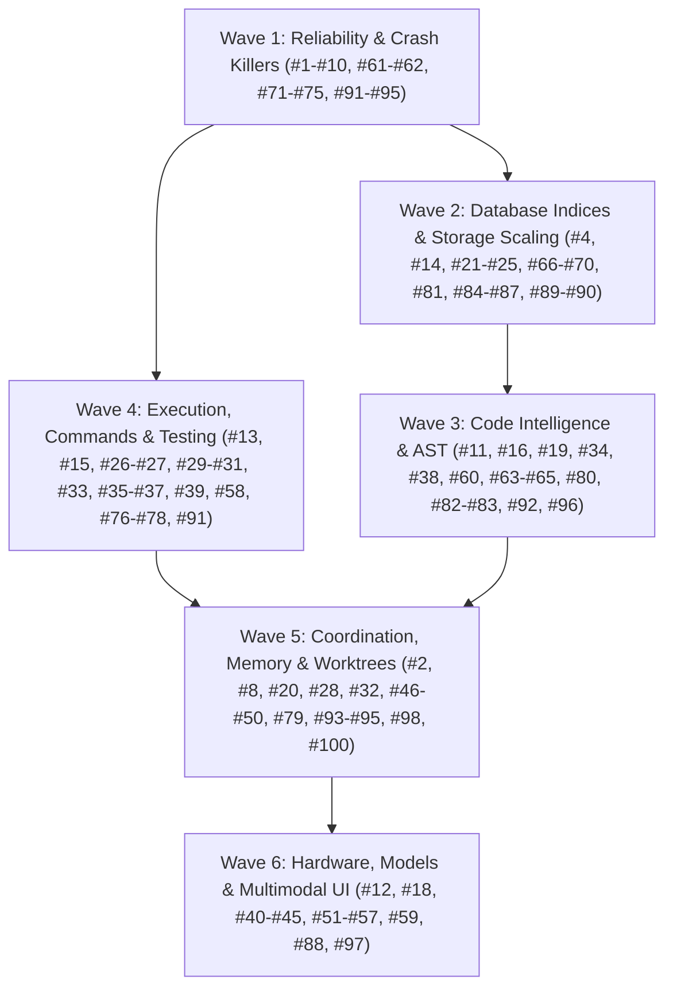

# Local AI Hub: Master Implementation Plan for 100 Ergonomics, Quality & Performance Enhancements

> **For agentic workers:** REQUIRED SUB-SKILL: Use `superpowers:subagent-driven-development` or `superpowers:executing-plans` to implement this plan task-by-task. Steps use checkbox (`- [ ]`) syntax for tracking.

**Goal:** Transform Local AI Hub into a rock-solid, ultra-fast, and deeply capable local engine for cloud and local coding agents by executing all 100 identified enhancements across 6 modular waves.

**Architecture:** The 100 tasks are decomposed into 6 decoupled Waves designed for execution by isolated subagents. Each wave has disjoint file boundaries and explicit SQLite transaction isolation to prevent lock contention and merge conflicts. Strict TDD (Test-Driven Development) is required for every single task: write failing test -> verify failure -> write minimal implementation -> verify pass -> commit.

**Tech Stack:** Python 3.11+, SQLite 3 (WAL mode, custom pragmas, recursive CTEs), NumPy, tree-sitter / regex AST fallbacks, pytest, MCP (Model Context Protocol), Windows Process Job Objects.

---

## Subagent Execution Protocol

> 📖 **Operational Playbook:** Detailed dispatch scripts, subagent prompts (Implementer, Spec Reviewer, Quality Reviewer), and worktree teardown routines are documented in [Subagent Dispatch Playbook](file:///c:/Users/Adam/.local-ai-hub/docs/superpowers/plans/2026-10-13-subagent-dispatch-playbook.md).

To execute these 100 tasks using subagents without collisions:

1. **Subagent Worktree Isolation:**
   - Every subagent operates in its own git worktree (`git worktree add -b feature/<wave>-<task_id> ../wt-<task_id>`).
   - Run verification commands against the worktree root.
2. **Database Isolation During Tests:**
   - Tests MUST use in-memory SQLite (`:memory:`) or isolated temporary state directories via `tmp_path` fixtures (`test_cfg["state_dir"] = str(tmp_path)`).
   - NEVER point unit tests to live databases in `c:\Users\Adam\.local-ai-hub\state\`.
3. **Two-Stage Review Process:**
   - After subagent finishes, a Spec Reviewer verifies:
     - Exact line numbers and function signatures match the specification.
     - No extraneous edits or architectural drift.
   - Code Quality Reviewer verifies:
     - Error handling, bounded timeouts, Windows process flags, type annotations, zero full-file rewrites.
4. **Integration Gate:**
   - Squash-merge into master only when `python -m pytest tests/unit/ -q` passes without regressions.

---

## Wave Breakdown & Dependency DAG



---

## Wave Manifest & Document Links

Each wave is detailed in its dedicated, fully specified plan document containing exact code diffs, failing tests, and verification steps:

1. **[Wave 1: Reliability & Bottlenecks Plan](file:///C:/Users/Adam/.local-ai-hub/docs/superpowers/plans/2026-10-13-wave-1-reliability-and-bottlenecks.md)**
   - Tasks: #1, #2, #3, #5, #6, #7, #8, #9, #10, #61, #62, #71, #72, #73, #74, #75, #91, #92, #93, #94, #95.
   - Focus: Removing GIL lockups in `dead_code`, 403 errors in `skeletonize`, 66s CPU reranker timeout bypass, parameter normalizers, projection data loss fixes.
2. **[Wave 2: Performance & Storage Plan](file:///C:/Users/Adam/.local-ai-hub/docs/superpowers/plans/2026-10-13-wave-2-performance-and-storage.md)**
   - Tasks: #4, #14, #17, #21, #22, #23, #24, #25, #66, #67, #68, #69, #70, #81, #84, #85, #86, #87, #89, #90.
   - Focus: SQLite B-Tree point index on `edges` (3000x speedup), GC & auto-vacuum of 75 dead worktrees (22.8 GB -> 8 GB), `orjson` serialization, multi-slice artifact reading, batch embedding lookups.
3. **[Wave 3: Code Intelligence & AST Plan](file:///C:/Users/Adam/.local-ai-hub/docs/superpowers/plans/2026-10-13-wave-3-code-intelligence-and-ast.md)**
   - Tasks: #11, #16, #19, #34, #38, #60, #63, #64, #65, #80, #82, #83, #96, #99, #100.
   - Focus: Exposing `callees`, `implementations`, `declaration` in MCP, AST-aware regex chunker for TS/C#/Rust on Windows, symbol signatures in index, overlapping line deduplication.
4. **[Wave 4: Execution & Testing Plan](file:///C:/Users/Adam/.local-ai-hub/docs/superpowers/plans/2026-10-13-wave-4-execution-and-transactions.md)**
   - Tasks: #13, #15, #26, #27, #29, #30, #31, #33, #35, #36, #37, #39, #58, #76, #77, #78.
   - Focus: Exposing `env` in `local_ai_command`, pipe buffer deadlock protection in subprocesses, interactive `stdin` support, structured test failure summarizer, in-memory patch dry-run, git diff between arbitrary revisions.
5. **[Wave 5: Coordination & Memory Plan](file:///C:/Users/Adam/.local-ai-hub/docs/superpowers/plans/2026-10-13-wave-5-agent-coordination-and-memory.md)**
   - Tasks: #20, #28, #32, #46, #47, #48, #49, #50, #79, #98.
   - Focus: Agent-to-human question channel, lease zombie auto-reaper, CAS updates on blackboard and memory, swarm DAG support, git worktree uncommitted change detection, verification receipt markdown exporter.
6. **[Wave 6: Hardware, Models & UI Plan](file:///C:/Users/Adam/.local-ai-hub/docs/superpowers/plans/2026-10-13-wave-6-hardware-models-and-ui.md)**
   - Tasks: #12, #18, #40, #41, #42, #43, #44, #45, #51, #52, #53, #54, #55, #56, #57, #59, #88, #97.
   - Focus: Exposing `browser_bridge` headless DOM & screenshots in MCP, local visual diffing via Qwen-VL, ephemeral port binding for mock server, non-blocking GPU telemetry, calibrated code tokenizer.

---

## Global Verification & Quality Matrix

Before declaring completion of all 100 items:

```bash
# 1. Compilation
python -m compileall -q src tests tools

# 2. Strict release check
python tools/release_check.py --allow-installed

# 3. Unit & Integration test suite
python -m pytest -q

# 4. Hub selftest
python tools/selftest.py

# 5. Doctor diagnostics
python tools/doctor.py
```
