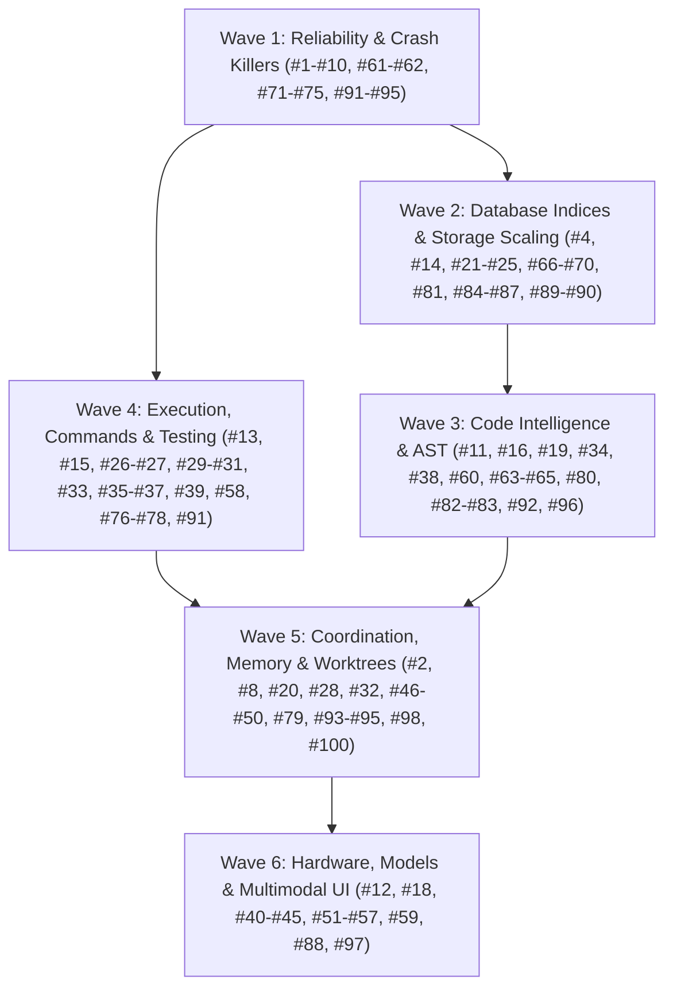

# Local AI Hub: Master Implementation Plan for 100 Ergonomics, Quality & Performance Enhancements

> **For agentic workers:** Follow the governing simplified integration process below. Execute and review bounded tasks directly; optional independent implementation agents follow the same criteria. Steps use checkbox (`- [ ]`) syntax for tracking.

**Goal:** Transform Local AI Hub into a rock-solid, ultra-fast, and deeply capable local engine for cloud and local coding agents by executing all 100 identified enhancements across 6 modular waves.

**Architecture:** The primary agent owns the 6 waves, implementation, review, and integration on current `master`, under the governing [simplified integration process](../specs/2026-10-07-simplified-worktree-integration.md). Optional parallel implementations require disjoint write scopes and isolation where needed. All unit state uses temporary databases. Apply TDD to behavior changes: failing regression, minimal implementation, passing targeted tests, review, then commit.

**Tech Stack:** Python 3.11+, SQLite 3 (WAL mode, custom pragmas, recursive CTEs), NumPy, tree-sitter / regex AST fallbacks, pytest, MCP (Model Context Protocol), Windows Process Job Objects.

---

## Development and Optional Subagent Protocol

> 📖 **Operational Playbook:** Detailed dispatch scripts, subagent prompts (Implementer, Spec Reviewer, Quality Reviewer), and worktree teardown routines are documented in [Subagent Dispatch Playbook](file:///c:/Users/Adam/.local-ai-hub/docs/superpowers/plans/2026-10-13-subagent-dispatch-playbook.md).

The October 7 governing process takes precedence over historical per-task worktree and mandatory reviewer-agent wording in this plan and all linked wave plans. Use the following isolation rules only when a separate implementation worker is warranted:

1. **Subagent Worktree Isolation:**
   - An independent writing subagent operates in an assigned isolated worktree (`git worktree add -b codex/<wave>-<task_id> ../wt-<task_id>`). Routine work stays on `master`.
   - Run verification commands against the worktree root.
2. **Database Isolation During Tests:**
   - Tests MUST use in-memory SQLite (`:memory:`) or isolated temporary state directories via `tmp_path` fixtures (`test_cfg["state_dir"] = str(tmp_path)`).
   - NEVER point unit tests to live databases in `c:\Users\Adam\.local-ai-hub\state\`.
3. **Two-Stage Review Process:**
   - The primary agent performs a specification review; a separate reviewer agent is optional:
     - Observable behavior and public contracts satisfy the task criteria; historical line numbers are navigation hints.
     - No extraneous edits or architectural drift.
   - The primary agent then performs a code-quality review:
     - Error handling, bounded timeouts, Windows process flags, type annotations, zero full-file rewrites.
4. **Integration Gate:**
   - Integrate each reviewed bounded change promptly after its relevant tests pass on integrated `master`. Run the full required suite at each wave/release gate. Preserve and classify every leftover before recoverable archival; no blanket stash/reset/rebase/merge.

---

## Wave Breakdown & Dependency DAG

### Integration checkpoint — 2026-10-15, master `6ce835de`

**Latest execution instruction, 2026-10-15:** the operator explicitly requires tests only after the whole remaining implementation/integration bundle. This supersedes per-task red/green execution for the remaining work. Continue implementation, source review, patch classification and integration; defer further test/build/benchmark acceptance commands until that bundle is implemented. Previously recorded test results remain historical candidate evidence, not final release acceptance.

Current durable execution contract: `lead-remaining-bundle-20261015`, status active, phase implementation (checkpoint request `req_d2f2cc63ceec`). This contract supplements the existing plans; it does not replace their task criteria.

**Read-only lifecycle finding, 2026-10-15:** `hubctl status` reported Hub online in active mode, listener PID 24124, with managed Windows launcher PID 23588 under supervisor PID 22208. Creation time of listener/launcher was 06:28:30 local. `state/supervisor.status.json` reported running/ready, zero restarts and empty last error. Historical supervisor logs contain repeated startup probe timeouts/recycling through 00:48; the stderr file (last written 00:44:31) contains an import-time `IndentationError` in `worktrees.py`. Commit `577c3159` already repairs that syntax error. These records identify a historical startup failure, not proof that every old timeout had the same cause. No current restart, configuration change, test, build or benchmark was performed during this diagnosis. Installed code/runtime parity and longer stability remain final acceptance work.

- Full local inventory: 244 branches and 106 registered worktrees; 105 worktrees clean, only the current master checkout dirty. No stashes. No worktree status errors.
- 56 branch refs are not ancestral to master. `git cherry` finds no patch-unique changes on `gemini/wave-6-task-77`, `gemini/wave-8-task-84`, `gemini/wave-9-task-87`, `gemini/wave-9-task-88`, or `gemini/wave-9-task-94`.
- The remaining 51 refs include unique patches and overlapping ancestry. In particular, tasks 100–127 form one stack ending at `gemini/wave-11-task-127`; refs are not independent implementation units.
- Preserve all refs and worktrees pending task-criterion and patch review. Ancestry or patch novelty alone does not authorize integration or deletion. No blanket merge, reset, stash, rebase, or cleanup was performed.

**Patch dispositions from source review (2026-10-15):**

- `gemini/wave-8-task-81` / `d8afd721`: adapted ANSI OSC/private CSI/character-set stripping and correct zero/odd head-tail limits into current `token_economy.py`, preserving newer offline-tokenizer provenance. Replaced branch whole-input list materialization with a single-pass head/deque tail (retained line count bounded by requested output), and applied case-insensitive generated-directory pruning to both repo-map and tokcount. Deferred cases cover stream memory retention and edge outputs. Source integrated only; no tests executed and no performance acceptance claimed. Original branch retained.

- `codex/wave-2-task-26-repair` / `b5cf8bcc`: bounded four-worker lexical snapshot reads and both candidate/fallback call-site changes are already represented by master commit `aa11c0f4`; master also tracks `tests/unit/test_parallel_lexical_search.py`. Current `repo_tools.py` contains later exact-pagination and policy changes, so replacing it with the branch snapshot would regress newer work. Preserve the reference; no additional source merge is required for these hunks. This is source equivalence assessment, not a new runtime/performance result.
- `gemini/wave-5-task-62` / `6047e7fd`: adds a separate `StreamMultiplexer` and `run_parallel` API, absent from current master. The branch retains all output/events and partial lines without limits, submits every command future at once, permits duplicate IDs to overwrite results, and returns full aggregate output. Importing it wholesale would violate bounded-memory/response requirements. Preserve the unique patch as optional unaccepted work. This branch's task number does not establish a current requirement: actual Oct-13 T62 is arbitrary-revision Git diff, while #30 belongs to process-tree termination. Do not add a new parallel-command API solely to absorb this branch; current broker streaming already has bounded capture and callback queues. Its existing behavior still belongs in final command/concurrency validation.
- `gemini/wave-9-task-89` / `d6321759`: the directory/base validation and temporary-root `samefile` hunks are already present in the master-side `cf1cf9b2` lineage. Current master additionally contains later worktree functionality and the `577c3159` syntax repair. Do not replace the current file with this older branch. Its branch/test ref remains preserved; no merge or deletion performed.
- `gemini/wave-9-task-98` / `d917845b`: this mixed commit includes a worktree syntax correction already supplied by `577c3159`, plus optional logging helpers/config coercion. Its rollover reopening branch only runs when `delay=False`; the Hub creates its handler with `delay=True`. Current CPython 3.13 `FileHandler.emit` already reopens a missing append-mode stream. No demonstrated required runtime fix justifies importing this entire mixed commit. Preserve it as deferred optional API work; do not merge or delete it wholesale.
- Remaining unique patches, including the task-100–127 stack, still require actual hunk/criterion review. Commit subjects are an inventory aid, not proof of equivalence or acceptance.

**Current source-only integration checkpoint:** `381349d2` includes T47 (`bcb5b73a`), T51 (`629da11a`), T52 (`dd6f84ff`) and the T44 impact-query follow-up. These implementations and their newly authored regression cases remain unexecuted under the operator's whole-bundle validation deferral. No current installed-runtime or full-release acceptance is claimed.
- T79 is committed as `6ce835de`; T74–T78 remain a dirty reviewed implementation candidate. Focused integrated regression command: `python -m pytest tests/test_agent_events.py tests/test_agent_events_fresh_init.py tests/test_agent_tasks.py tests/test_repo_tools.py tests/unit/test_agent_question_channel.py tests/unit/test_agent_question_scope.py tests/unit/test_cross_workspace_memory.py tests/unit/test_verify_completion_projection.py tests/unit/test_simulate_merge_projection.py tests/unit/test_worktree_dotgit_file.py -q --tb=short` — 86 passed, request `req_b5c8cca96a18`. This is candidate evidence, not full release acceptance.



---

## Wave Manifest & Document Links

Each wave is detailed in its dedicated, fully specified plan document containing exact code diffs, failing tests, and verification steps:

1. **[Wave 1: Reliability & Bottlenecks Plan](file:///C:/Users/Adam/.local-ai-hub/docs/superpowers/plans/2026-10-13-wave-1-reliability-and-bottlenecks.md)**
   - Tasks: #1, #2, #3, #5, #6, #7, #8, #9, #10, #61, #62, #71, #72, #73, #74, #75, #91, #92, #93, #94, #95.
   - Focus: Removing GIL lockups in `dead_code`, 403 errors in `skeletonize`, 66s CPU reranker timeout bypass, parameter normalizers, projection data loss fixes.
2. **[Wave 2: Performance & Storage Plan](file:///C:/Users/Adam/.local-ai-hub/docs/superpowers/plans/2026-10-13-wave-2-performance-and-storage.md)**
   - Tasks: #4, #14, #17, #21, #22, #23, #24, #25, #66, #67, #68, #69, #70, #81, #84, #85, #86, #87, #89, #90.
   - Focus: SQLite B-Tree point index on `edges` (3000x speedup), GC & auto-vacuum of 75 dead worktrees (22.8 GB -> 8 GB), `orjson` serialization, multi-slice artifact reading, batch embedding lookups.
3. **[Wave 3: Code Intelligence & AST Plan](file:///C:/Users/Adam/.local-ai-hub/docs/superpowers/plans/2026-10-13-wave-3-code-intelligence-and-ast.md)**
   - Tasks: #11, #16, #19, #34, #38, #60, #63, #64, #65, #80, #82, #83, #96, #99, #100.
   - Focus: Exposing `callees`, `implementations`, `declaration` in MCP, AST-aware regex chunker for TS/C#/Rust on Windows, symbol signatures in index, overlapping line deduplication.
4. **[Wave 4: Execution & Testing Plan](file:///C:/Users/Adam/.local-ai-hub/docs/superpowers/plans/2026-10-13-wave-4-execution-and-transactions.md)**
   - Tasks: #13, #15, #26, #27, #29, #30, #31, #33, #35, #36, #37, #39, #58, #76, #77, #78.
   - Focus: Exposing `env` in `local_ai_command`, pipe buffer deadlock protection in subprocesses, interactive `stdin` support, structured test failure summarizer, in-memory patch dry-run, git diff between arbitrary revisions.
5. **[Wave 5: Coordination & Memory Plan](file:///C:/Users/Adam/.local-ai-hub/docs/superpowers/plans/2026-10-13-wave-5-agent-coordination-and-memory.md)**
   - Tasks: #20, #28, #32, #46, #47, #48, #49, #50, #79, #98.
   - Focus: Agent-to-human question channel, lease zombie auto-reaper, CAS updates on blackboard and memory, swarm DAG support, git worktree uncommitted change detection, verification receipt markdown exporter.
6. **[Wave 6: Hardware, Models & UI Plan](file:///C:/Users/Adam/.local-ai-hub/docs/superpowers/plans/2026-10-13-wave-6-hardware-models-and-ui.md)**
   - Tasks: #12, #18, #40, #41, #42, #43, #44, #45, #51, #52, #53, #54, #55, #56, #57, #59, #88, #97.
   - Focus: Exposing `browser_bridge` headless DOM & screenshots in MCP, local visual diffing via Qwen-VL, ephemeral port binding for mock server, non-blocking GPU telemetry, calibrated code tokenizer.

---

## Global Verification & Quality Matrix

Before declaring completion of all 100 items:

```bash
# 1. Compilation
python -m compileall -q src tests tools

# 2. Strict release check
python tools/release_check.py --allow-installed

# 3. Unit & Integration test suite
python -m pytest -q

# 4. Hub selftest
python tools/selftest.py

# 5. Doctor diagnostics
python tools/doctor.py
```
