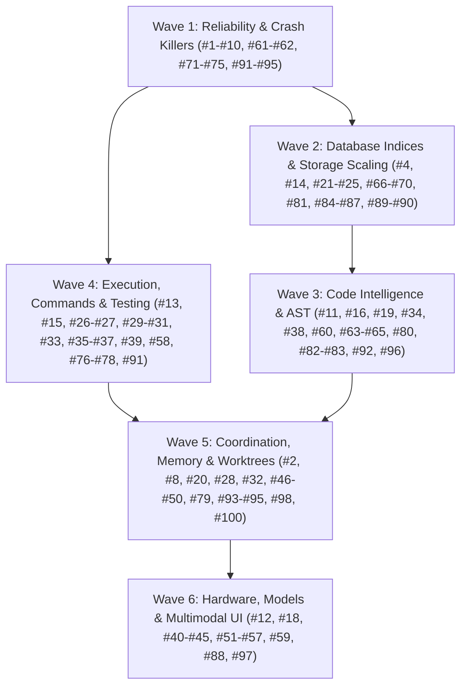

# Local AI Hub: Master Implementation Plan for 100 Ergonomics, Quality & Performance Enhancements

> **For agentic workers:** Follow the governing simplified integration process below. Execute and review bounded tasks directly; optional independent implementation agents follow the same criteria. Steps use checkbox (`- [ ]`) syntax for tracking.

**Goal:** Transform Local AI Hub into a rock-solid, ultra-fast, and deeply capable local engine for cloud and local coding agents by executing all 100 identified enhancements across 6 modular waves.

**Current execution phase (2026-10-15):** source integration closes at `492346ce` for the remaining bundle, including canonical scope/CAS/search/context inputs, lease ownership and channel pricing. Task100–127 source dispositions are recorded below; rejected optional patches remain preserved, not merged wholesale. Refresh generated API coverage from this source, then run integrated validation once against the frozen candidate. Historical OPEN source notes below describe earlier checkpoints. Current tests, package/install, live Windows crash containment, dashboard/MCP runtime and resource/model acceptance remain unverified until their final gates actually pass. Operator configuration and durable state have not been rewritten.

**Integrated regression phase:** candidate `706c22cb` passed compileall and `release_check.py --allow-installed`; API inventory regeneration reported 622 rows and no drift. Full pytest was interrupted after widespread failures at approximately 6%, so it is NOT passing evidence. A bounded diagnostic run returned eight concrete failures: removed dashboard adoption-panel fixture, orphaned status `action` reference, WER worker initialization ERROR_NOT_FOUND, missing canonical memory fixture identity, and consistency-guard writer/reader provenance gaps. Fix these together before another broad run. Logs are retained under the operator TEMP `lah-final-706c22cb` directory and `lah-regression-diagnosis.log`; interrupted-run socket cleanup warnings are not an accepted resource result. API coverage is static source evidence only.

**Regression results:** the first repaired bundle at `fda1e89a` returned 142 passed / 8 failed across 150 selected cases. The follow-up at `4a5ce02a` returned 61 passed across all three affected files, including real worker-backed transitive test selection, canonical context diagnostics and channel pricing. This does not cover the full suite. The next stored-failure diagnostic found producer/schema fingerprint disagreement for four incident indexes and additional old memory fixtures; their corrections form the next source bundle. No release/runtime completion is claimed.

**State/memory follow-up:** the combined `2d81f6b8` run returned 113 passed / 20 failed before its failure cap. Repairs through `cb63df43` remove later overrides of incident table/index fingerprints, pass repository identity through task memory materialization/diagnostics/expiry checks, and update remaining explicit fixture identities. Its seven-file run returned 127 passed / 2 failed; both remaining assertions expected physical-root/scope-ID separation despite an identical trusted repository namespace and tenant. `8fcd3eae` replaces those with namespace/tenant rejection and same-namespace cross-worktree acceptance; these last fixture edits are not yet executed. Current production state-schema reopening, task create/resume tenant isolation and crash-recovery tests in that run passed. The full suite remains incomplete. All four owned regression worktrees were removed after clean tracked/untracked/ignored checks; source refs remain recoverable. A bounded current MCP status call still returned the old orphaned-action NameError, so running processes have not adopted these source fixes.

**Canonical import/identity regression bundle:** the d0096052 stored-failure run returned 20 failed / 5 passed at its cap. Reviewed fixture commits 55984d3c, 6015add2 and 450d5f06 adopt canonical checkpoint objects, database filename and explicit repository/tenant identities. Production fixes bound SQLite append attempts to 250 ms, resolve repository identity for implicit project exports, rebind imported project memory to the target namespace, reject incomplete/current-schema-invalid memory without metadata-dropping or generated-ID fallback, and keep HTTP non-Git reader identity consistent with its writer. The six-file bundle returned 40 passed / 3 failed; remaining identity fixtures and the HTTP reader were then corrected, and the two affected files returned 32 passed in 129.30 seconds. A final MemoryStore.find retired-scope alias was removed; its scoped search plus seven invalid-scope cases returned 8 passed. The new test initially had a missing pytest import and an incorrect assumption that store construction never initializes SQLite; both test defects were corrected before the passing result. Install/update prompts match the import contract. Both owned fixture worktrees were removed cleanly with branch refs retained. Runtime package metadata resolves to the regular installed 4.0.0 wheel from 2026-10-13 (SHA256 c290c765ec10d5b53033f4260d10f18237dd004d6695405c54233edd66a385b8), not current checkout source. No install, restart, mode change or release completion occurred. Full integrated validation and fresh package/runtime acceptance remain OPEN.

**Task/transport durable regression follow-up:** the 886f4319 stored-failure diagnostic returned 20 failed / 7 passed at its cap. Reviewed fixture integrations 593f67d6, 04f88bde and c4a94044 provide current namespace, trusted principal, canonical database/checkpoint/receipt inputs and preserve missing-identity, cross-root/tenant, invalid-scope and untouched-durable-state rejection. Production fixes move incident snapshot drift inside the existing bounded busy retry, create incident schema atomically, establish the task projection dependency for a fresh standalone VerificationStore without attaching optional task callbacks, pass coordination_id through configured memory preload, and enforce exact namespace/tenant during task memory materialization across worktrees. Initial five-file run: 112 passed / 8 failed. Follow-up selected 21 cases: 19 passed / 2 failed; concurrency, durable reopening and volatile-memory audit cases passed. Two unclosed SQLite connections in new tests were corrected rather than suppressing warnings. Further transport review preserves all supplied provenance constraints; HTTP session selectors no longer get overwritten by the tenant, conflicting selectors reject, mutation task IDs use the same server binding as reads, and mutation lookups derive the repository namespace from the resolver. Old omnibus fixture expectations (incomplete status/context payloads, disabled features, missing receipt.passed, retired task-to-candidate input, missing-ID deletion and old 404-for-invalid-input) were corrected. MCP dispatch then passed in the two-case run (one remaining HTTP failure); the final full HTTP scope/root/session/mutation scenario passed separately in 7.98 seconds. No full-suite, package, installation, process-restart or runtime-release acceptance is claimed. Both owned fixture worktrees were removed cleanly; refs retained.

**Architecture:** The primary agent owns the 6 waves, implementation, review, and integration on current `master`, under the governing [simplified integration process](../specs/2026-10-07-simplified-worktree-integration.md). Optional parallel implementations require disjoint write scopes and isolation where needed. All unit state uses temporary databases. Apply TDD to behavior changes: failing regression, minimal implementation, passing targeted tests, review, then commit.

**Tech Stack:** Python 3.11+, SQLite 3 (WAL mode, custom pragmas, recursive CTEs), NumPy, tree-sitter / regex AST fallbacks, pytest, MCP (Model Context Protocol), Windows Process Job Objects.

---

## Development and Optional Subagent Protocol

> 📖 **Operational Playbook:** Detailed dispatch scripts, subagent prompts (Implementer, Spec Reviewer, Quality Reviewer), and worktree teardown routines are documented in [Subagent Dispatch Playbook](file:///c:/Users/Adam/.local-ai-hub/docs/superpowers/plans/2026-10-13-subagent-dispatch-playbook.md).

The October 7 governing process takes precedence over historical per-task worktree and mandatory reviewer-agent wording in this plan and all linked wave plans. Use the following isolation rules only when a separate implementation worker is warranted:

1. **Subagent Worktree Isolation:**
   - An independent writing subagent operates in an assigned isolated worktree (`git worktree add -b codex/<wave>-<task_id> ../wt-<task_id>`). Routine work stays on `master`.
   - Run verification commands against the worktree root.
2. **Database Isolation During Tests:**
   - Tests MUST use in-memory SQLite (`:memory:`) or isolated temporary state directories via `tmp_path` fixtures (`test_cfg["state_dir"] = str(tmp_path)`).
   - NEVER point unit tests to live databases in `c:\Users\Adam\.local-ai-hub\state\`.
3. **Two-Stage Review Process:**
   - The primary agent performs a specification review; a separate reviewer agent is optional:
     - Observable behavior and public contracts satisfy the task criteria; historical line numbers are navigation hints.
     - No extraneous edits or architectural drift.
   - The primary agent then performs a code-quality review:
     - Error handling, bounded timeouts, Windows process flags, type annotations, zero full-file rewrites.
4. **Integration Gate:**
   - Integrate each reviewed bounded change promptly after its relevant tests pass on integrated `master`. Run the full required suite at each wave/release gate. Preserve and classify every leftover before recoverable archival; no blanket stash/reset/rebase/merge.

---

## Wave Breakdown & Dependency DAG

### Integration checkpoint — 2026-10-15, remaining bundle

**Canonical-only operator instruction:** the operator explicitly rejects legacy behavior and backward compatibility. Remove obsolete action/route/field aliases, migration shims and permissive compatibility coercions; publish one current contract and reject invalid inputs. Preserve operator configuration and durable contents, with explicit current-schema rebuilding for disposable derived data. Historical receipts/snapshots remain archival evidence rather than active fallback implementations. Source cleanup and deferred regression updates are in progress; no whole-surface removal claim yet.

**Canonical source follow-up:** `6ec87b7b` removes eight remaining raw HTTP action aliases; `b5fd7d07` rejects every unregistered POST route before dispatch and registers the current context-pack route. `90cac078` aligns artifact HTTP/MCP wrappers with strict source offsets, limits, and exclusive multi-slice inputs. Source review only; deployed adapters and regression behavior remain unverified.

**Canonical artifact storage source integration:** `1d3fd818`, `7ed3752b`, `8d6db4ae` remove tenant/table conversion and migration backups. Existing durable databases require the exact supported rowid schema and tenant identities; incompatible layouts reject before persistent setup. Shared normalized creation definitions prevent validator/constructor drift; bounded read-only checks precede writer revalidation and WAL setup. WAL state with only one sidecar fails closed to avoid repair side effects. Derived paging metadata may rebuild independently. Source review caught fresh-reopen SQL formatting mismatch and unbounded identity validation; deferred no-write/reopen fixtures were authored, never executed. Installed startup and concurrency remain unverified.

**Canonical task contracts:** `0ad6393e`, `a1da1e6a` require a nonempty string `goal`, removing old title/description/summary/intent/task/name inference from persisted contracts and synthetic legacy-task labels. HTTP accepts a current contract object or declared goal/task shorthand; MCP and SDK current producers remain supported. Completion binds the full current project/command/environment/revision/mutation contract through VerificationStore without signature introspection or old evaluator fallback. Deferred parser/persisted-state/verifier fixtures only; no runtime acceptance. The integrated task-contract worktree was clean-checked and removed, with its branch retained.

**Canonical memory source:** `0d0fb3af`, `019c431e` remove repository physical-root fallback, the legacy-unscoped lookup flag/dispatch, and its diagnostic category. Repository context/find/delete requires repository identity plus exact tenant; generic unscoped find selects GLOBAL only. HTTP uses server-derived repository identity rather than accepting a client substitute. Existing rows remain stored; current HTTP writer already binds canonical provenance. Main review caught generic-scope bypass and dependent diagnostic rendering. Prompt and deferred fixture updates track the smaller diagnostic contract; no live-memory acceptance ran. `b0e0e80a` removes an unreachable retired POST pubsub validator alias, with no GET behavior change.

**Canonical embedding cache:** `3a9f6455` removes the injected-cache single-write compatibility path recorded in the older embedding-consumer checkpoint. Pending vector publication requires the current batch API; unsupported caches return explicit failure instead of per-key fallback. Vector completeness/dimension checks and cache-disabled behavior remain. Deferred fake-backend regression only; no inference, tests or performance measurement. Integrated memory, HTTP validator and embedding worktrees were clean-checked and removed with refs retained.

**Canonical shared state paths:** `5f4a7bcb`, `1c05dc23`, `edb515aa`, `d0329814`, `f5a712f7` remove automatic lease/blackboard/Agent State filename merges. Old-only state rejects explicitly; existing readable canonical SQLite state takes precedence without touching archived old files. Empty/corrupt/directory targets cannot hide old histories. Lease schemas reject unsupported object types, partial table groups and obsolete keys before WAL setup, without migration or mismatch backups. Bounded read-only probes handle absent/incomplete WAL sidecars without repair; expected SQL definitions have an 8-KiB materialization cap. Main source review caught empty-target precedence, sidecar creation, unsupported views/partial groups and unnecessary full schema SQL loading. Deferred rejection/coexistence fixtures only; no live databases, tests or startup validation ran. Event/incident source removal is integrated below; runtime acceptance remains deferred.

**Canonical event/incident integration:** `04dc244c` integrates the final source candidate through worker `84b4be12`; `08f7c164` aligns remaining retired-helper fixtures. Automatic event-layout conversions, sparse legacy payload overrides, incident ID/column fabrication and private migration-backup code are removed. Schema preflight uses a bounded temporary snapshot and rejects incompatible durable state without conversion. Only current constructor fingerprints remain, with SQL reads capped at 8 KiB. Main source review caught stale lease/swarm/incident fingerprints that would have rejected current producers; stdlib-only AST/text comparison grounded their replacements without importing or executing project code or touching SQLite. Fresh shared-store/reopen and byte-preservation fixtures remain unexecuted. Hub review `req_296067aa77e2` returned “No diff to review” after commit, which is not an independent approval.

**Current context/pubsub source pass:** `1f936b96` removes pubsub provider signature introspection and old client keyword aliases/numeric coercion, preserving the current sequence and timestamp filters. `ad578b5c`, `6a0fc85a` align omitted context mode with adaptive at HTTP Agent OS compile and service/client boundaries; query/focus/changed paths no longer implicitly choose fast/full. Explicit fast/full remain different current strategies, and invalid modes reject before context work. Main review required actual downstream default/branch changes beyond the first MCP description-only edit. AGENTS and both prompts now describe the same mode contract. Deferred provider/transport/MCP/HTTP/service fixtures only; no test, inference or performance execution.

**Current tenant identity source pass:** `dde10244`, `835d26ba`, `9dd8bdd0`, `28938da2`, `f6e882a4` remove tokenless client-header identity selection and the obsolete tenant header, retain sandbox configured-principal guards, clear principal/root state on reauthorization, remove the remaining POST repository-ID substitution, and align Agent State client activation/claim checks with server identity. Primary review rejected an unrelated guard removal and corrected an unverified empty-allowlist assumption from exact server source; empty/missing sandbox allowlists remain fail-closed. Tokenless unsandboxed requests retain the server's stable principal. Deferred same-handler/user/root, tokenless, configured-sandbox and POST memory identity fixtures remain unexecuted. No operator configuration or live durable state was rewritten. All three writing scopes in this pass used Luna and isolated worktrees; their exact commits are integrated, and clean/ignored-state checks precede removal. Global canonical-input/alias completion, original 100-item acceptance, branch inventory, release/install/runtime/resource proof and final tests remain OPEN.

**Canonical per-operation repo inputs:** `10cfa195` removes file/name/task-ID substitutions in eleven repo operations. File actions use required/optional path as declared; declaration uses query plus optional path filter; AST rename requires explicit old_symbol/new_symbol; context compilation and verification require task_id. Shared required/non-empty/allowed constraints govern registered raw MCP calls and pipeline validation; direct dispatcher payloads use only canonical inputs. Existing apply/staged behavior, optional whole-repository scopes and authorization remain unchanged. `ba4d66fa`, `48f35301` remove direct RAG/Work action normalization and isolate deferred fixtures with real feature/mode machinery and fake clients. No Work submission or model invocation occurred. Main specification/code-quality and stdlib AST source reviews precede integration; all deferred regression code is UNEXECUTED. Both prompts are synchronized. Semantic query/task dispatcher substitutions, cross_repo action synonyms, remaining configuration/input compatibility and full original-plan/audit acceptance remain OPEN.

**Current branch inventory limitation:** at primary source `9430b9d7`, bounded native Git inventory reported 300 local branch refs: 191 ancestry-merged and 109 not ancestry-merged (54 codex, 55 gemini); bounded stash listing was empty. Ancestry is not patch equivalence, integrated-code acceptance, ownership, or dirty-worktree proof. The preceding Hub command `run` for `git for-each-ref --format=%(refname:short) refs/heads`, reuse key `branch-ref-inventory-9430b9d7`, rejected `timeout_seconds` with status 400, terminal=true, retryable=false and no evidence ID; one bounded native Git inventory fallback followed under primary ownership, without writes, tests, or validation execution. No foreign ref/worktree was reset, merged, deleted or declared reconciled. Historical selective dispositions above still govern; remaining refs require source assessment.

**Canonical repo wrapper/blackboard fields:** `eb8c92cf` removes repo cwd/symbol/paths/files signature and schema aliases and their normalization. Existing raw MCP operation validation rejects undeclared fields before provider dispatch; separate current command/coordination fields remain. Relation limit/offset scope and strict validation are synchronized into operation contracts, fixing the mismatch left by the first paging unit. `e93b3d08`, `4a419916` isolate deferred boundary fixtures from asynchronous telemetry and operator operational-mode state; main source review caught both fixture dependencies. `fd8fb0e5` rejects retired HTTP blackboard key/value/approver/sections/record fields, including conflicting canonical values, before task binding; downstream substitutions are removed. Task identity and the omitted task-owned board default retain their scope checks. Canonical content retains falsey values. Both prompts are synchronized; source AST review executes/imports no project code. All deferred tests remain UNEXECUTED. Remaining action-specific repo payload fallbacks, direct MCP action normalization, configuration aliases, original 100-item/audit acceptance and release/runtime/resource gates remain OPEN.

**Canonical Agent OS selectors:** `468888b5` rejects non-string, whitespace, hyphen and case aliases before POST dispatch; direct bind helpers reject malformed inputs without coercion. Current client/MCP producers ground the single HTTP blackboard, cleanup, dataset and verification action names. Retired semantic action aliases are removed. Main source review caught an attempted alias rename that would have enabled a previously denied reaper mutation; the retired implementation was removed and canonical `reap_expired` retains its scoped-contract policy denial. Both public prompts are synchronized. Deferred unit fixtures cover malformed selectors, defaults, helper guards and current/retired actions; no tests or runtime commands ran. Remaining field/config aliases and functional scoped reaper acceptance remain OPEN.

**Relation paging source integration:** `4d26627e`, `a8c4bdc4`, `331fd456` add canonical query/limit/offset paging for callers, callees and implementations, replacing task/path/symbol aliases and max_tokens-as-limit. Whole records and actual counts/coverage/continuation survive projection and final serialized MCP budgeting; first-item overflow rejects. Indexed SQL uses stable lookahead pages and a one-second progress deadline rather than whole-table counts; exact totals are emitted only when proven. Same-snapshot cheap availability evidence controls empty-index fallback without broad status scans. Python fallback has a cooperative three-second deadline and file/byte/directory bounds, directed syntactic edges, reparse/containment checks, archived-source exclusion, and explicit mixed-language/ambiguity/incompleteness diagnostics. Main source reviews corrected prior list clipping, stale implementations counts, false budget overflow before metadata convergence, unbounded status scans, absent-index behavior and public symbol alias normalization. Deferred temporary-DB and registered-MCP fixtures remain unexecuted. Stdlib AST source review imported/executed no project code. Both prompts now distinguish complete-prefix code-index/relation behavior from full-page search. Source quality/latency, installed adapter behavior and integrated acceptance remain OPEN.

**Indexed review limitation:** the HTTP indexed-impact attempt at `468888b5` returned no result before its waiting cell was terminated (cell 968); outcome is unknown, no evidence ID or approval was obtained, and the operation was not repeated. Main source review and previously retained terminal source-retrieval fallback grounded this checkpoint; no test, lint, compile, build, install, inference, live validation or restart ran.

**Post-edit indexed observation:** caller lookup `req_775026f0409d` identified HTTP context handlers and the context-warmup caller, with freshness `not_checked`; it is navigation evidence rather than current candidate acceptance. Its compact live adapter response reported 35 callers/coverage-returned while emitting five caller entries under a truncated response budget. Candidate source attribution and bounded-projection metadata require a focused follow-up; the still-running installed adapter was not restarted or claimed to execute the integrated revision. Search `policy-blocking-canonical-08fca96c` returned explicit terminal/nonretryable 413 at the requested 1,000-token budget; native bounded source inspection found an enforced-denial comment/current always-true internal state, not a working old authorization switch. Neither result authorizes force refresh, a larger retry, or a passing-runtime claim.

**Integration incident disposition:** a 109-line migration-backup-test deletion appeared in the primary checkout and matched the assigned worker's committed cleanup; its origin remains uncertain. The reviewed intended cleanup was preserved as `1a2d7c54`, without stash/reset or dropping dirty bytes. Continuing the previously failed cherry-pick skipped its first candidate and conflicted; the sequencer was ended and the eight exclusively owned unit paths were integrated from the reviewed final candidate in `04dc244c`. T08 fixture cleanup merged separately with the already integrated state-path edits. Primary checkout is clean; candidate refs retain the full source history. All owned worktrees from this canonical pass are integrated and clean-removed; global foreign branch/worktree acceptance remains unverified. Remaining canonical input/configuration/retrieval contracts and the original 100-item/audit acceptance gates remain OPEN. No tests, lint, compile, build, install, inference, live-state probes or service restarts ran in this pass.

**Owned worktree disposition:** the integrated Biome and artifact-schema worktrees were removed only after clean tracked/untracked/ignored status. Biome's ignored `.serena` directory was moved intact to `C:\Users\Adam\.local-ai-hub-archives\2026-10-15-owned-biome-serena` before removal; branch refs remain recoverable. This does not certify historical worktree cleanup or all foreign branch contents. The subsequently completed canonical lease/blackboard, task contract, memory and event units are recorded above; this earlier checkpoint is not their current ownership state.

**T91 owned Biome source integration:** `17e64fc4`, `e01f3ff7`, `29bad884`, `c94c2813` add persistent foreground-owned Windows Biome 2.5.15 LSP sessions. Named-pipe server PID must match the retained child before writes; shared daemon discovery/start/stop is forbidden. Sessions enforce tenant/root identity, bounded source snapshots, aggregate deadlines, bounded queues and verified cleanup ownership. Main source review corrected partial writes, deferred-message replay, snapshot races, cleanup accounting, and the exact upstream `Version: 2.5.15` output. Other versions/platforms explicitly reject. Deferred fixtures were authored; no installed binary, test, lint, compile, runtime, latency or cross-platform acceptance ran. T91 remains open for final acceptance.

**Integrated canonical contracts through `7bad7d45`:** `dd19a1c7`, `316ab667`, `b6bfc562`, `a282a18b` remove short MCP action aliases, status action selectors, alias schema branches, history query/task controls and generated compatibility claims; canonical async request identity remains published. Whole-repository history remains available with `staged=true` and no path. `8cd45e6d` gives duplicate POST route groups one canonical path; raw-handler alias rejection is a separate follow-up still under source review. `da3bfb5d` requires structured supervisor owner records and canonical llama.cpp inventory/endpoint receipts, accepting the producer's coherent empty case without claiming reclaimed VRAM. Deferred old alias/lock/inventory fixtures are updated but unexecuted. Remaining automatic durable-state migration branches, memory/event compatibility, configuration/input fallbacks and retrieval-mode behavior require further canonical-contract review; this checkpoint does not claim global legacy removal.

**F44 source integration:** `3f322c62`, `31e5d3f5`, `83d82914` use one read snapshot and incremental SQLite TEXT reads for every artifact body, preserving Unicode/NUL and bounded spans without read-side writes. A shared five-second deadline, bounded metadata materialization, section/window clamps, capped heading/JSON parsing and strict integer/string inputs replace full-body fallback and silent coercion. Primary review caught cross-section reads, partial UTF decoding, omitted-section metadata and unbounded scan waits; deferred regressions cover those cases. Wire-wrapper strictness is being aligned separately. No measured peak-RSS, latency or installed adapter proof exists yet.

**F14 remaining mutation source integration:** `9452ff94` and `7bad7d45` extend full-memory response preflight to create/fail/transition/completion, forward actual per-action budgets, prepare/revalidate exact auto-worktree metadata before Git creation, and preserve a frozen completion response/content snapshot before intermediate transitions. Completion cleanup is uniformly scheduled and visible before preflight, then handled by the maintenance reaper with ownership/cleanliness checks. Primary review removed silent ordinary-task fallbacks, incorrect quota selection and the post-preflight warmup response field. Git creation followed by SQLite persistence failure remains a cross-store edge and is reported applied/unknown; no atomic rollback claim is made. Deferred store/client/registered MCP/cleanup tests are authored and unexecuted. Live/full-wire boundary acceptance remains open.

**F29 historical payload archival:** at source revision `71b3eca78c570260bbf78b3c3e5db0fec2587fca`, the four historical roots contained 6,121 tracked files / 384,834,984 Git-blob bytes: `handoff` 4,967 / 341,217,462; `artifacts` 870 / 32,559,851; `.t17-merge-tmp` 241 / 9,883,585; `.sync-checks` 43 / 1,174,086. Their owner-labelled overlays, receipt logs, reproducer inputs, source copies and stash snapshots are retained as historical/unaccepted candidate evidence; archiving does not declare their unique code integrated or their old tests current acceptance. No tracked/untracked overlay or registered Git worktree appeared under these roots. Ignored log/tmp files were present and moved together with the complete directories, without recursive deletion, to `C:\Users\Adam\.local-ai-hub-archives\2026-10-15-historical-payloads`. Git ref `archived/historical-payloads-20261015` retains every tracked original at the source revision; recover a tracked file with `git show archived/historical-payloads-20261015:<original-path>`, using a separate destination. The external directory retains ignored originals. Current runtime/tool source references were inspected: the paired benchmark runner's historical default manifest was the concrete file dependency. Following the canonical-only instruction, the runner now requires an explicit `--manifest` / `load_manifest(path)` instead of retaining a historical default. All four roots are ignored to prevent reintroducing scratch payloads. Old document references identify archival evidence and do not imply current files/results. No Git history rewrite, operator-state deletion, test execution, clone-size or latency claim follows; post-bundle relevance/resource verification remains required.

**Selective integration through `36dc958f`:** `7adfbf50` validates adoption-metric paths and numeric buckets before state access and bounds UTC report days; `34e9951d` preserves valid Python inline signatures and positional-only arguments; `3ef2aa83` rejects non-finite queue-wait telemetry. History scan series `b1b3bd25`, `53ad2b7b`, `be7bbe29` replaces the unsupported history branch with one bounded managed Git capture and a pure provenance parser. Scope is changed text in the requested reachable HEAD commits, not all refs/full historical trees. Malformed hunks, merge/binary omissions, limits and unconfirmed capture cannot establish completeness. `c69deae2` separates reported GPU metrics from conservative same-pool pressure estimates; `b8f50890` validates RuntimeTuner input before profile mutation and uses configured/private state. `36dc958f` preserves existing Python test paths in affected-test selection. Primary spec/source-quality review required bounded reads, hunk accounting, path normalization, raw-metric preservation and truthful derived-pressure provenance. Regression source is authored but UNEXECUTED; no runtime, performance, whole-release or global branch-ancestry acceptance follows. The three finished history/VRAM/tuner worktrees had empty tracked/untracked/ignored inventories before unforced removal; recovery refs remain.

**Gemini 101–127 selective source disposition:** 101/102/104/110/113/124 contribute the bounded adaptations above; 120's canonical JSON fast path and 125's grant expiry/delegation limits are being adapted independently. 103 adds unused SQLite aliases/error rephrasing; 105/127 rewrite durable identities/scopes and add convenience APIs without a demonstrated caller requirement. 106 weakens strict pagination; 107 replaces malformed CRDT state with invented values; 108 ignores malformed active fencing paths; 109 adds unsafe unlock targeting and unbounded process capture; 111 adds permissive state fallback and destructive reset APIs. 112 swallows context reset failures and rewrites identity; 114 silently defaults malformed context/budgets; 115 guesses model capabilities from names; 116 weakens priority ownership; 117/118 silently replace invalid output budgets. 119's cycle/depth guard returns the original cyclic/deep object, so it does not establish bounded serialization; its truncator can still exceed the requested character bound. 121 turns malformed exit codes into success zero; 122 turns malformed expiry into unlimited validity; 123 fabricates zero latency/cost and resets unknown lifecycle status; 125's broad patch downgrades unknown risks to READ and clears invalid counters; 126 rewrites task identity and defaults unknown lifecycle state. These mixed branches are preserved, not imported wholesale. No claim that all historical refs/worktrees are merged is made. Remaining original-plan/audit acceptance and archive classification remain open.

**Hub review limitation at this checkpoint:** post-integration `review_diff` and the subsequent bounded policy/routing `solve` did not return before cancellation; their outcomes are UNKNOWN and provide no review approval. They were not repeated. Primary review used exact bounded source patches under the retained explicit terminal artifact failure; all validation stays deferred by operator instruction.

**Additional integration through `d51d2f00`:** `53069da9` rejects expired/malformed authorizing grants, prevents delegation at invalid/exhausted depth and excludes inherited denials from child permissions. Primary review corrected an oversized pytest parameter and added invalid-expiry delegation cases. `0441e95b` removes the custom default only inside the existing canonical JSON fast-path gate; stdlib fallback and hash-byte parity semantics remain. `d51d2f00` preserves raw HTTP depth for strict validation, rejects non-boolean history flags and separates exact legacy MCP history controls from filenames (including `digital.env` and `history.env`). Deferred registered-adapter/pure regressions are authored, not executed. INSTALL/UPDATE prompts describe the same contracts. Other task mutation preflights, persistent Biome ownership, large legacy artifact read memory, archive classification, coverage regeneration and final integrated runtime/release acceptance remain OPEN.

**Worktree cleanup limitation:** all source commits from the bounded Biome, coverage, telemetry, priority/state, model lifecycle, checkpoint and dashboard worktrees were integrated before unforced removal; recovery branch refs remain. The checkpoint worktree's ignored-status inventory listed `.serena/`; its contents were not inventoried or archived before Git removed that worktree. Exact preservation of that ignored metadata is therefore NOT VERIFIED. No claim that every historical worktree, branch or ignored payload is reconciled follows from this cleanup. No project test, build, import, live validation or restart ran during these source integrations.

**F14 checkpoint source integration:** series `5b1c84fd` through `cdfe813b` adds a shared pure complete-memory wire projection, server-side preflight before checkpoint/event persistence, request identity preservation and typed non-mutation flags through both compaction layers. Canonical original-token metadata excludes private accounting and optional wrappers; actual returned-token accounting remains wire based. Optional capture and watchdog failure responses are preflighted before writes. Source review caught missing request identity, dropped flags, private-accounting mismatch and stale-checkpoint watchdog responses before integration. Registered MCP/SDK, malformed-audit, capture and watchdog regressions are authored but unexecuted. Other task mutations, exact boundary behavior and live adapter acceptance remain OPEN; no whole-surface mutation-preflight claim is made.

**F06/F34 adapter and UI source integration:** `cdc71d2b`, `6bff3877`, `ff3f2d2a`, `d22c035b` and `5dbb8691` preserve bounded writer interval/denominator metadata and stale report detail; dashboard health warns for incomplete advertised telemetry and current preprocessing project errors. Disabled preprocessing remains informational; historical error text alone is not a current failure. Primary source review required stale-cache propagation, producer-shaped MCP fixtures, full-health warning integration and missing-Node skip behavior. UI/HTTP/MCP/runtime tests and deployment remain deferred; source integration does not establish live health.

**F06 source checkpoint:** `16fc700d`, `30568db5` and `c8e134aa` distinguish attempted enqueue, accepted records, overflow rejection and accepted records lost by the writer. Writer metadata has an explicit current-process interval, separate denominator rates (null without observations), pending counts and accounting balance. Summary/dashboard cache paths refresh inexpensive writer evidence; a stale aggregate stays incomplete until a fresh SQL summary. Deferred fake-queue/cache regressions are authored, not run. MCP projection and dashboard warning integration remain in progress; no live loss rate or runtime fix is claimed.

**F19 coverage source checkpoint:** `d6b5b40a`, `4fbd3349` and `bc7b6277` split the human index from complete structured coverage rows and make `--check` compare both artifacts. The old wide Markdown is recoverable at revision `539090ad5c04e9c8d2b2cf09bce7bc6eb7c2bcfb`, blob `d9d677256582c0e8ebedce993851849a00ed9f98`. Current files explicitly mark refresh pending; no rows/counts or fresh acceptance are fabricated. After the entire source/integration bundle, `python tools/surface_inventory.py --write-doc` must regenerate both artifacts before the frozen acceptance candidate. The drift gate must reject the pending placeholders. Generator and regression execution remain deferred.

**Additional Gemini patch dispositions:** branch 92's zero-timeout defect is addressed selectively by `f56e02bf`, with invalid waits rejected before admission and finite 30-second condition-wait pieces. Branch 96 contributes mapping/path validation before filesystem changes; public fallback reset/getter helpers and path rewriting are not adopted. Branch 95 contributes lock deduplication/deadline validation, implemented as `13911b59`; CUDA owner registration now precedes allocation and factory failure removes only new registrations. Its silent untrackable-owner success and backend alias expansion are not adopted. Branch 90's tenant-unscoped cancellation/map behavior is superseded by the current tenant/root LRU facade; arbitrary set input expansion is not adopted. Branch 91's raw mapping command environment is not adopted without matching typed execution semantics. Branch 93's swallowed context reset errors and additional aliases are not adopted. Branch 100's unrestricted iterable expansion and implicit base replacement are not adopted as-is. Historical refs remain recoverable; this is selective source disposition, not whole-branch ancestry or global worktree acceptance. All authored regressions are unexecuted.

**T91 Biome source checkpoint:** integrated `539090ad` adds explicit read-only Biome `ci` routing only when daemon mode is disabled, and a terminal unsupported response for default persistent mode. Source review of upstream [Windows transport](https://github.com/biomejs/biome/blob/main/crates/biome_cli/src/service/windows.rs) and [daemon commands](https://github.com/biomejs/biome/blob/main/crates/biome_cli/src/commands/daemon.rs) found a shared version-named pipe, reuse of existing daemons and no proven private endpoint/process handle. Hub must not stop an unrelated daemon or claim ownership from process presence. Persistent Biome is an OPEN functional requirement; the persistent Ruff source path remains available. Both mode regressions are authored and unexecuted. The isolated worktree was clean and removed; its branch is retained. No linter was installed or launched.

**Critical audit intake, 2026-10-15 (44 findings):** the supplied audit is snapshot-specific, not release acceptance. Prioritize F25/F41 source mutation boundaries; F01–F03/F10 DAG preservation and bounded execution; F04/F05/F38 navigation/registered contracts; F30 defaults parity; F40 lost wakeup; then remaining F06–F44 diagnostics, lifecycle, policy and performance findings. Classify each against current source before marking resolved. Existing source fixes and foreign dashboard work are not live proof. All validation remains deferred until the complete remaining source/integration bundle.

**F07/F23 source checkpoint:** `security_audit` no longer auto-dismisses test-path findings; HIGH credentials remain release blockers, MEDIUM findings remain visible, and clean/triage/scan-complete are distinct. The scanner reports visited/eligible/skipped counts, unknown total eligibility, limit hits and bounded error metadata; read/file/aggregate-byte/time bounds fail completeness. Credential-like snippet values are omitted by default. MCP protects the coverage and decision fields across both compaction layers. Deferred regressions cover plausible test credentials, MEDIUM-only results, hidden later files after the finding limit, unreadable files, and the DAG's pre-existing dirty/untracked overlay. Post-edit indexed impact for F05/F38 returned terminal transport outcome_unknown (`req_c4f0a0f110da`); no duplicate request or successful-impact claim is made. A separate `secret_scan` path shares test/placeholder triage heuristics and remains an explicit source follow-up before the final bundle gate.

**F44 source checkpoint:** Ruling: paging fields are disposable derived data in a new `artifact_paging_metadata` sidecar, with no core-table column alteration or replacement of durable IDs/tenant/binary data. The existing legacy tenant backup/recovery path remains unchanged. Source integration uses sidecar upserts in the same transaction as core writes, bounded 128-ID startup backfill (one body at a time), qualified read joins and derived-row cleanup. Tests now specify preserved legacy/current rows, NUL-safe multislice reads past the backfill boundary, no read-side writes, rollback atomicity and stale binary metadata cleanup. A missing sidecar still reads the selected legacy body's full text; large legacy-body memory use is NOT VERIFIED and is retained as an explicit final resource gate. No ArtifactStore instance, schema migration or project validation was executed; Hub retrieval and coordination bookkeeping still writes runtime state.

**F42 source checkpoint:** the old offline-weight fixture now invokes `Reranker.rerank(...allow_cpu_fallback=True)` directly to exercise its authorized offline loader failure, then asserts foreground RAG retains the CPU bypass and makes no second load attempt. Missing-weight error, unloaded state and non-reranked heuristic results remain asserted. The production CPU bypass and its dedicated regression are unchanged. This test-source correction is unexecuted until the full bundle gate.

**F43 source checkpoint:** integrated Whisper cache/download/device guard from the isolated implementation after primary source review. Immutable upstream registry pin is `04f449b8a437f1bbd3dba5c9f826aca972e7709a`; main independently checked that registry. Cache aliases and XDG handling, regular-file/identity checks, bounded chunked SHA-256 verification, strict download opt-in and explicit CPU flags are implemented. Source regressions are deferred; no cache weights were read by the agent, downloaded, loaded or transcribed. GPU transcription admission is explicitly unsupported; native WER/resource/install proofs remain open. Both default copies and bootstrap/update prompts are synchronized.

**F15/F39 source checkpoint:** README no longer promises zero cloud tool/context tokens, fixed 95% savings, or impossible OOM immunity; example foreground routes match the model capability matrix and installed inventory remains a separate gate. Windows broker strings use native Unicode `CommandLineToArgvW`/`LocalFree` (Microsoft API contract); structured invocation serialization uses `subprocess.list2cmdline` on Windows. Deferred native Windows argv regressions cover inline paths with spaces, empty/Unicode values, quotes/backslashes and literal metacharacters without launching child processes. No Windows runtime proof is claimed until final validation. F05/F38 source commit: `e3fddd37`.

**F08/F09 source checkpoint:** integrated `c45d7828` rejects batches above 16 before routing/delegation, reports exact counts and a full rejected range with at most 64 listed indices, and marks preflight rejection as terminal/not sent. Database maintenance counts only successful stores, handles busy checkpoint results as failures, reports partial state and a top-level error summary, and closes owned connections. Deferred tests use fake providers and temporary stores; no maintenance ran against live state.

**Audit source integration checkpoint:** F01–F03/F10 DAG preservation and brokered execution integrated as `63dd9c5f` + `383d080e`; F40 event capture/recheck and signal-before-eviction integrated as `cf543f95`; F41 readonly/root-confined/bounded type generation integrated as `33b6089c`. Primary specification and code-quality source reviews required corrections before integration (async lock order and test waiter isolation, DAG cancellation/deadline and argv handling, type-source growth/read bounds). These are source results only, with all authored regressions still unexecuted. The three isolated worktrees were verified clean and removed; their branch refs retain original commits for recovery.

**F05/F38 source checkpoint:** Ruling: publish one explicit `local_ai_artifact(action="source")` contract; artifact `get`/`slice` keep artifact-ID semantics. The unreachable path shortcut and undocumented source line aliases are removed. File/range/output bounds and workspace containment precede reads; exact bytes have SHA-256 provenance; source text and identity survive projection or the request fails explicitly. A newline-dense source uses streamed line iteration rather than a repository-sized line list. Every published output-envelope field is validated before FastMCP conversion, naming malformed fields without coercing unknown booleans. Deferred regressions exercise actual registered MCP calls, absolute/relative/symlink scope, budget rejection and nullable-flag errors. Live adapter behavior, complete registered surface parity and original unknown producer remain unverified until the final bundle gate.

**F04 source checkpoint:** exact Git search now sorts/deduplicates tracked plus untracked paths after successful process completion, under independent 128,000-path/32-MiB raw-path bounds and the existing Git/search deadlines. The 8,000 eligible-file scan cap remains separate. Deferred regressions cover mixed order, duplicate paths, Unicode and inventory overflow. Current-root exact query and memory/latency measurements remain unexecuted final-bundle gates. Broker source commit: `0a83fdf4`; attempted semantic diff review did not complete and is not review/validation proof.

**F25/F30 source checkpoint:** mandatory classification denial now precedes cache/identity/process handling. Explicitly opted-in unknown code follows mutation worktree/write-set/fence/private transaction gates; default unknown execution is disabled. Root defaults now match packaged defaults including idle release, Ruff daemon pooling and task-context warmup. New boundary regressions are authored but unexecuted; registered MCP mutation probes, allowed mutation behavior and release parity check remain final-bundle gates. OOM recovery committed separately as `4dae62ac`.

**Latest execution instruction, 2026-10-15:** the operator explicitly requires tests only after the whole remaining implementation/integration bundle. This supersedes per-task red/green execution for the remaining work. Continue implementation, source review, patch classification and integration; defer further test/build/benchmark acceptance commands until that bundle is implemented. Previously recorded test results remain historical candidate evidence, not final release acceptance.

Existing durable execution contract: `lead-remaining-bundle-20261015`, last confirmed status active / phase implementation (`req_77184827860d`). Hub retrieval/checkpoint access returned during the pubsub continuation; prior transport outcomes below remain recorded and were not reused as acceptance evidence. The contract supplements these plans and does not replace their task criteria.

**Read-only lifecycle finding, 2026-10-15:** `hubctl status` reported Hub online in active mode, listener PID 24124, with managed Windows launcher PID 23588 under supervisor PID 22208. Creation time of listener/launcher was 06:28:30 local. `state/supervisor.status.json` reported running/ready, zero restarts and empty last error. Historical supervisor logs contain repeated startup probe timeouts/recycling through 00:48; the stderr file (last written 00:44:31) contains an import-time `IndentationError` in `worktrees.py`. Commit `577c3159` already repairs that syntax error. These records identify a historical startup failure, not proof that every old timeout had the same cause. No current restart, configuration change, test, build or benchmark was performed during this diagnosis. Installed code/runtime parity and longer stability remain final acceptance work.

- Full local inventory: 244 branches and 106 registered worktrees; 105 worktrees clean, only the current master checkout dirty. No stashes. No worktree status errors.
- 56 branch refs are not ancestral to master. `git cherry` finds no patch-unique changes on `gemini/wave-6-task-77`, `gemini/wave-8-task-84`, `gemini/wave-9-task-87`, `gemini/wave-9-task-88`, or `gemini/wave-9-task-94`.
- The remaining 51 refs include unique patches and overlapping ancestry. In particular, tasks 100–127 form one stack ending at `gemini/wave-11-task-127`; refs are not independent implementation units.
- Preserve all refs and worktrees pending task-criterion and patch review. Ancestry or patch novelty alone does not authorize integration or deletion. No blanket merge, reset, stash, rebase, or cleanup was performed.

**Patch dispositions from source review (2026-10-15):**

- `gemini/wave-7-task-79` / `d0706fd5`: adapted the needed lifecycle fixes instead of importing its silent topic eviction/incomplete idle-subscriber policy. `SwarmPubSub` now caps cached topics (500), serialized cache charge (8 MiB), live subscriptions (256), aggregate queue slots (4096) and JSON message envelope bytes (64 KiB), with bounded 4096-node/32-level defensive snapshots. Cache byte accounting is serialized-data charge, not a claim about actual Python heap/RSS. Ephemeral capacity failure is explicit and preserves admitted history. Durable append/replay and strict idempotency continue when optional cache admission fails; opaque idempotency key bytes remain unchanged. TTL compaction reclaims cache and reports possible missing ephemeral history without disconnecting active subscribers. Input/cache/poll/fanout ownership is separated by bounded copies; existing live gap-marker logic is retained. Deferred temporary-DB/in-memory cases cover each limit independently, payload ownership, replay/restart/collision, expired retention, ring pagination and 30 default subscribers. No tests or benchmarks executed in this source phase. Original branch/tests retained; real concurrency/RAM/CPU and final integrated acceptance remain open.

**2026-10-15 continuation routing evidence:** root remains `C:\Users\Adam\.local-ai-hub`. Prior T93 solve returned terminal `outcome_unknown` (`req_d804966b8212`, exec cell 195); its result is not acceptance evidence and was not repeated. New branch-integration adaptive context (`req_42965c33dc84`) failed before send with `terminal=true`, `retryable=false`, `request_not_sent=true`; one bounded health attempt returned 503/transient unavailable. No retry/health loop, daemon restart or test execution followed. Continued exact native Git patch/source inspection and scoped edits under the allowed bounded fallback. `79ef6fa1` integrated the previously dirty dashboard/status/telemetry scope before this continuation; it is source provenance, not a current release or runtime-validation receipt.

- `gemini/wave-8-task-86` / `f6ff2d50`: adapted bounded breaker/key handling and stale-probe status into current master. The branch evicts open circuits when full and allocates uncapped new entries in `success`/`reset`; that can forget protective failures while claiming bounded capacity. Current adaptation caps all allocation paths and refuses unknown resources at capacity without evicting tracked open circuits/probes; existing resources can still probe/recover. Deferred cases cover churn, capacity/probe ownership and invalid keys. Unused reset/latency-window API extensions remain optional in the preserved branch. No test or live inference executed; final scheduler/provider acceptance remains open.

- `gemini/wave-8-task-82` / `050056dc`: integrated unified-content prefix cleanup across Python/TS/C#/Go/Rust and multiline Python signatures, with explicit header rejection and deferred cases. Did not import the branch's optional-export TypeScript regex: these helpers describe public API changes and treating internal functions/classes as public would change their contract. Current T49 Python AST structural diff remains independent and retained. Original branch kept; no test run or whole-branch replacement.
- `gemini/wave-8-task-83` / `f9df9677`: no required merge for `global_row_counts` error category; current missing-table failure is already `sqlite3.OperationalError`, a `sqlite3.DatabaseError` subclass accepted by current callers. Branch adds an unused initialization predicate and rephrases the exception without a demonstrated missing contract. Preserve optional helper/tests as a unique ref; do not expand the production API solely to absorb the commit.
- `gemini/wave-7-task-78` / `83449551`: preserve optional JSON sanitizer/BOM/memoryview work rather than import wholesale. Its new cycle/depth string sentinels and non-finite-to-null conversion can change payload data, while string-BOM stripping broadens stdlib parsing behavior. No current sanitizer caller or required lossful-serialization contract has been established; existing serializers reject unsupported/cyclic values. The patch is not evidence for current T90 OOM recovery despite its subject's item number.

- `gemini/wave-8-task-85` / `0fb83c08`: adapted pin validation and requested-context upper bound into current VRAM balancer, strengthening the branch to reject non-string/empty model names and non-positive/non-finite/bool TTL without changing an existing pin. Context recommendations now reject invalid base sizes and never grow a caller's requested window; invalid/non-finite hardware factors degrade conservatively. Deferred cases use mocked status, no GPU calls. Did not import branch fallback pairing changes: its fallback target `fast_code` / draft `draft_code` literals are not installed-model/capability evidence and cannot authorize altering operator model roles. Existing status-driven pairing remains. Original ref retained; final GPU/runtime acceptance open.

- `gemini/wave-7-task-80` / `b1b5d177`: integrated the reviewed patch into current transaction snapshots: both manifest scan and private copy reject repeated directory identity and excessive depth, and snapshot creation propagates the same limit through source/copy/revalidation. Retained existing Windows reparse/symlink rules, private Git index handling and exact dirty-input comparison. Added strict integer depth validation (1..512, default 64) before snapshot/Git operations; copied branch regression source and extended invalid-limit cases. Test execution remains deferred. This is transaction hardening, not the unrelated current T80 visual-diff criterion; original ref retained.

- `gemini/wave-8-task-81` / `d8afd721`: adapted ANSI OSC/private CSI/character-set stripping and correct zero/odd head-tail limits into current `token_economy.py`, preserving newer offline-tokenizer provenance. Replaced branch whole-input list materialization with a single-pass head/deque tail (retained line count bounded by requested output), and applied case-insensitive generated-directory pruning to both repo-map and tokcount. Deferred cases cover stream memory retention and edge outputs. Source integrated only; no tests executed and no performance acceptance claimed. Original branch retained.

- `codex/wave-2-task-26-repair` / `b5cf8bcc`: bounded four-worker lexical snapshot reads and both candidate/fallback call-site changes are already represented by master commit `aa11c0f4`; master also tracks `tests/unit/test_parallel_lexical_search.py`. Current `repo_tools.py` contains later exact-pagination and policy changes, so replacing it with the branch snapshot would regress newer work. Preserve the reference; no additional source merge is required for these hunks. This is source equivalence assessment, not a new runtime/performance result.
- `gemini/wave-5-task-62` / `6047e7fd`: adds a separate `StreamMultiplexer` and `run_parallel` API, absent from current master. The branch retains all output/events and partial lines without limits, submits every command future at once, permits duplicate IDs to overwrite results, and returns full aggregate output. Importing it wholesale would violate bounded-memory/response requirements. Preserve the unique patch as optional unaccepted work. This branch's task number does not establish a current requirement: actual Oct-13 T62 is arbitrary-revision Git diff, while #30 belongs to process-tree termination. Do not add a new parallel-command API solely to absorb this branch; current broker streaming already has bounded capture and callback queues. Its existing behavior still belongs in final command/concurrency validation.
- `gemini/wave-9-task-89` / `d6321759`: the directory/base validation and temporary-root `samefile` hunks are already present in the master-side `cf1cf9b2` lineage. Current master additionally contains later worktree functionality and the `577c3159` syntax repair. Do not replace the current file with this older branch. Its branch/test ref remains preserved; no merge or deletion performed.
- `gemini/wave-9-task-98` / `d917845b`: this mixed commit includes a worktree syntax correction already supplied by `577c3159`, plus optional logging helpers/config coercion. Its rollover reopening branch only runs when `delay=False`; the Hub creates its handler with `delay=True`. Current CPython 3.13 `FileHandler.emit` already reopens a missing append-mode stream. No demonstrated required runtime fix justifies importing this entire mixed commit. Preserve it as deferred optional API work; do not merge or delete it wholesale.
- The task-100–127 refs form a cumulative 28-commit stack. The dispositions below concern their own source hunks, not aggregate ancestry. Required bounded adaptations are integrated; rejected normalization and optional APIs remain recoverably preserved on their refs. These decisions do not establish test/runtime acceptance or merge the whole stack.
  - Task102 / `fb55be35`: malformed report-day fallback, acceptance of unknown stored outcomes and optional bucket broadening are not imported. Extending corrupt durable rows into the current report schema would hide invalid state. Preserve the patch as unaccepted optional work.
  - Task105 / `6aca45dd`: reject coercive scope parsing/unknown-record defaults and identity normalization without current namespace proof. Current scope parsing now rejects aliases and malformed supplied scope rather than substituting a default; HTTP memory uses the same canonical enum. Optional context helpers remain unaccepted.
  - Task115 / `89e0fe01`: optional operation helpers and model-size substring tier guesses do not establish installed-model capability. No new 70b/72b routing inference is imported. Current configured capability policy remains authoritative; preserve the patch.
  - Task116 / `28dc4e7c`: do not import malformed priority/timeout defaults or the separately callable unowned release API. Optional inspection/nonblocking APIs are not needed to satisfy the current cooperative-slot contract; preserve the patch.
  - Task117 / `6fe0e9dd`: malformed response limits must not silently become larger default budgets; response identities must not be rewritten/truncated. Optional presence-only budget helpers are not validation evidence. Preserve without importing.
  - Task118 / `a28d158d`: malformed token budgets becoming zero/default and scalar projection-field coercion are not imported. Optional profile helpers do not establish a required gap; preserve the patch.
  - Task119 / `0703da5e`: returning the original unbounded/cyclic value at depth/cycle limits defeats bounded projection. Coercive limit fallbacks and optional marker-inspection helpers are not imported; preserve the patch.
  - Task120 / `83043bbd`: reject fabricated element IDs, invalid confidence becoming 1.0, identity rewriting and malformed budgets becoming 4000. Optional context/link helpers are not required acceptance behavior; preserve the patch.
  - Task121 / `f3e9361f`: invalid exit codes becoming zero, fabricated incident IDs, invalid expiry becoming None and identity rewriting are rejected. Current signed/unsigned Windows exit-code and canonical incident boundaries remain authoritative; optional helpers stay unaccepted.
  - Task123 / `1ea338b5`: malformed latency/cost/error metrics must not become successful zero measurements; invalid candidate status must not become CANDIDATE. Promotion identity normalization and optional inspection helpers are not imported; preserve the patch.
  - Task126 / `a9839f54`: do not import scalar criteria iteration, identity rewriting, invalid status becoming DRAFT or invalid timestamps becoming zero. Current goal/checkpoint contracts remain authoritative; optional predicates/count APIs stay unaccepted.
  - Task127 / `77464e14`: reject fabricated record IDs, missing scope becoming GLOBAL, rewritten identity and scalar evidence iteration. Optional convenience constructors/resolver methods do not justify widening trust scope; preserve the patch.
  - Task109 / `bc6164bb`: current worktree cleanliness check already returns false on status failure/dirty output. Do not import the unlock fallback using a caller-derived absolute candidate beneath Git metadata; optional inspection helpers remain unaccepted. Preserve the patch.
  - Task110 / `6f62c5c7`: malformed configuration/measurement-to-default changes and optional tuner inspection/reset API do not establish a required source gap. In particular, missing/bad metrics must not become measured zeroes. Preserve as unaccepted optional work.
  - Task111 / `43924206`: reject automatic fallback on malformed configured paths and cleanup helpers that remove registry ownership before ignoring recursive-delete errors. Optional cache-dir APIs do not justify altering configured durable-state location; preserve the ref.
  - Task112 / `2170558b`: identity coercion/truncation and ignored context reset failures are not imported. Removed unused descriptive setter/resetter aliases from current trace source; optional scopes/clear API remain unaccepted.
  - Task113 / `a8912f68`: current source already bounds nonfinite metadata floats. Do not import malformed arguments-to-empty-mapping token accounting. Removed current metadata alias promotions and hardcoded per-event USD estimates; configured channel pricing belongs to TelemetryStore, while private events retain signed token counters. Optional signal helpers remain unaccepted; deferred fixtures only.
  - Task114 / `6bf02115`: do not import unordered-set context selection, identity NUL rewriting or invalid-budget-to-4000 normalization. These optional broadening changes do not establish a required source gap. Preserve the ref for explicit future criterion assessment.
  - Task107 / `604c4088`: adopted different-section merge rejection into the current blackboard and removed the retired internal CAS etag alias. Canonical expected-version validation precedes schema access. Do not import corrupt JSON-to-raw-content, fabricated clock/time/version defaults or optional inspection helpers; preserve the ref.
  - Task108 / `772a19f8`: adapted strict fencing input checks and fail-closed corrupt live lease scopes as `2e5f9d71`, with main review excluding mapping/set path containers. The branch's corrupt-path `continue` would grant potentially overlapping authority and is rejected; optional inspection helpers remain unaccepted. Deferred fixtures have not run.
  - Task106 / `32fe50c8`: optional clamping/mapping helpers silently accept string pagination and substitute malformed values. Current canonical pagination rejects these values; no required source gap justifies adding the alternative API. Preserve the branch without importing these helpers.
  - Task100 / `01d6dbfd`: optional test-impact wrapper helpers and coercive root/path/base handling do not establish missing required behavior; preserve the branch without importing its unrelated worktree change or fabricated defaults.
  - Task101 / `be99bb1c`: current master validates pin name/TTL, rejects invalid base budgets, bounds recommendations by the caller's size, and represents invalid GPU samples as unknown. Branch invalid-TTL-to-300 and malformed-telemetry-to-zero fallback would weaken this behavior. Optional pin-inspection helpers remain unaccepted; preserve the ref.
  - Task103 / `440f8e14`: optional count-inspection helpers and broader sequence acceptance do not establish a required gap. Existing transactional trigger installation remains. Catch-all database-error-to-None reporting and string-to-character table-list conversion are not imported; preserve the patch.
  - Task104 / `9167bcbd`: current `12314464`/`34e9951d` support unified diff prefixes, inline Python bodies and positional-only signatures. Do not replace the newer parser or add a duplicate Python `params` alias. C# generic-parameter parsing still requires criterion assessment; preserve the ref.
  - Task124 / `90d58e93`: current `36dc958f` preserves actual Python test paths. Broader fixture/non-Python selection and unknown-kind-to-deterministic normalization are not imported; optional helpers remain unaccepted. Preserve the ref.
  - Task125 / `92e4888e`: current PolicyEngine already rejects expired and invalid expiry. Do not import unknown-risk-to-READ or invalid-expiry-to-None sanitizers. Strict current grant parsing is integrated as `f96d0f37`/`b28c8cf7`/`2144d08e`, preserving explicit deny precedence and immutable authority. Other unique helpers remain unaccepted.
  - Task122 / `70763631`: do not import expiry-to-None, identity rewriting or fabricated outcome defaults. Current receipt scalar validation is strengthened as `598eab8b`: malformed booleans/generations and nonfinite or coercive timestamps reject through constructor/factory/parser boundaries. Other dataclasses and optional helpers still require disposition. Deferred fixtures have not run.

**Current source-only integration checkpoint:** includes source through `46d334de` (earlier T44/T47/T51/T52, subsequent Wave 3/4/6 implementations, T91 pool integration `510ed511`, native context/stream repairs `da300903`, T92 trace parity `0418168c`, T93 schema fixes `4b7acbef`, bounded branch adaptations `bd1a490a` / `628f7dbd` / `88b520df` / `12314464` / `46d334de`), pubsub lifecycle integration `b073e42a` and the integrated T90 recovery implementation described in Wave 6. Deferred regression source is not an executed result. Biome daemon disposition, remaining unique branch review/integration and API coverage source work still remain open, alongside pubsub/native OOM integrated acceptance and all relevant final release/runtime gates. No current installed-runtime or full-release acceptance is claimed.
- T79 source is committed as `6ce835de`; T74–T78 source was integrated via `da0ac0bb` and `4b1956c2`. Historical focused regression result: 86 passed (`req_b5c8cca96a18`) on the earlier candidate. It is not verification of the later integrated source; no repeat was run during this bundle deferral.



---

## Wave Manifest & Document Links

Each wave is detailed in its dedicated, fully specified plan document containing exact code diffs, failing tests, and verification steps:

1. **[Wave 1: Reliability & Bottlenecks Plan](file:///C:/Users/Adam/.local-ai-hub/docs/superpowers/plans/2026-10-13-wave-1-reliability-and-bottlenecks.md)**
   - Tasks: #1, #2, #3, #5, #6, #7, #8, #9, #10, #61, #62, #71, #72, #73, #74, #75, #91, #92, #93, #94, #95.
   - Focus: Removing GIL lockups in `dead_code`, 403 errors in `skeletonize`, 66s CPU reranker timeout bypass, parameter normalizers, projection data loss fixes.
2. **[Wave 2: Performance & Storage Plan](file:///C:/Users/Adam/.local-ai-hub/docs/superpowers/plans/2026-10-13-wave-2-performance-and-storage.md)**
   - Tasks: #4, #14, #17, #21, #22, #23, #24, #25, #66, #67, #68, #69, #70, #81, #84, #85, #86, #87, #89, #90.
   - Focus: SQLite B-Tree point index on `edges` (3000x speedup), GC & auto-vacuum of 75 dead worktrees (22.8 GB -> 8 GB), `orjson` serialization, multi-slice artifact reading, batch embedding lookups.
3. **[Wave 3: Code Intelligence & AST Plan](file:///C:/Users/Adam/.local-ai-hub/docs/superpowers/plans/2026-10-13-wave-3-code-intelligence-and-ast.md)**
   - Tasks: #11, #16, #19, #34, #38, #60, #63, #64, #65, #80, #82, #83, #96, #99, #100.
   - Focus: Exposing `callees`, `implementations`, `declaration` in MCP, AST-aware regex chunker for TS/C#/Rust on Windows, symbol signatures in index, overlapping line deduplication.
4. **[Wave 4: Execution & Testing Plan](file:///C:/Users/Adam/.local-ai-hub/docs/superpowers/plans/2026-10-13-wave-4-execution-and-transactions.md)**
   - Tasks: #13, #15, #26, #27, #29, #30, #31, #33, #35, #36, #37, #39, #58, #76, #77, #78.
   - Focus: Exposing `env` in `local_ai_command`, pipe buffer deadlock protection in subprocesses, interactive `stdin` support, structured test failure summarizer, in-memory patch dry-run, git diff between arbitrary revisions.
5. **[Wave 5: Coordination & Memory Plan](file:///C:/Users/Adam/.local-ai-hub/docs/superpowers/plans/2026-10-13-wave-5-agent-coordination-and-memory.md)**
   - Tasks: #20, #28, #32, #46, #47, #48, #49, #50, #79, #98.
   - Focus: Agent-to-human question channel, lease zombie auto-reaper, CAS updates on blackboard and memory, swarm DAG support, git worktree uncommitted change detection, verification receipt markdown exporter.
6. **[Wave 6: Hardware, Models & UI Plan](file:///C:/Users/Adam/.local-ai-hub/docs/superpowers/plans/2026-10-13-wave-6-hardware-models-and-ui.md)**
   - Tasks: #12, #18, #40, #41, #42, #43, #44, #45, #51, #52, #53, #54, #55, #56, #57, #59, #88, #97.
   - Focus: Exposing `browser_bridge` headless DOM & screenshots in MCP, local visual diffing via Qwen-VL, ephemeral port binding for mock server, non-blocking GPU telemetry, calibrated code tokenizer.

---

## Global Verification & Quality Matrix

Before declaring completion of all 100 items:

```bash
# 1. Compilation
python -m compileall -q src tests tools

# 2. Strict release check
python tools/release_check.py --allow-installed

# 3. Unit & Integration test suite
python -m pytest -q

# 4. Hub selftest
python tools/selftest.py

# 5. Doctor diagnostics
python tools/doctor.py
```


**Audit source checkpoint F14/F24/F31:** lifecycle operation/job/request identity and acceptance/completion flags now survive generic projection and budget protection; mutation budget preflight and full wire acceptance remain OPEN. Checkpoint memory audit is documented in the public nested schema and diagnostics name checkpoint validation accurately. Skill setup/uninstall preserves unmanaged or modified shared trees, records exact content ownership, stages replacements and restores the previous version on failure. Source review found and repaired sibling-import and rollback issues before integration. Deferred regression source added; no project tests, compile, build, install or restart executed in this checkpoint. F31 replacement concurrency/hostile filesystem races and final installed-instance behavior remain unverified.

**F36 source checkpoint:** the CPU preprocessing failure handler called dict.get on sqlite3.Row before invoking telemetry, a concrete source-level AttributeError path. Row indexing replaces it; failed projects report recovered=false. Reporting failures increment lost_error_count and emit phase/type/fingerprint metadata without exception payload. Telemetry is attempted independently of failure-state persistence. Deferred in-memory row/callback-failure coverage added; historical runtime errors are not claimed fully localized or repaired until final validation.

**F37 source checkpoint:** deterministic command summaries reserve the final framework tail. Explicit pytest invocations parse bounded captured final summary lines into test_summary counts/elapsed metadata, protected across MCP projection and both budgets. Missing final output never infers counts from progress or fabricates a log artifact. Deferred long-skip/ANSI/incomplete-output fixtures added; transport and command execution remain unverified until the full bundle gate.

**F07/F23 secret-scan source checkpoint:** bounded traversal/reads/findings and explicit incomplete coverage replace unbounded collection and silent success. Dotfiles including .env and comment credentials are scanned; test/placeholder/low-entropy matches retain severity and require triage. File descriptor, regular-file, containment and post-read identity checks protect reads; snippets omit credential values. MCP protects scan coverage and clean/count state. At this earlier checkpoint, history scanning was unsupported. The integrated `b1b3bd25`/`53ad2b7b`/`be7bbe29` series above now provides bounded capture and patch parsing; history runtime/completeness acceptance remains deferred. Source review repaired omitted dotfiles, physical line numbers, file growth and findings-cap completeness. All regression source remains unexecuted.

**F20/F33 source checkpoint:** CI now measures existing configured branch coverage into runner-temp JSON and retains per-platform artifacts; no fabricated baseline threshold added. Wheel smoke installs declared dependencies and checks installed CLI help outside the source checkout. F33 smoke source uses one explicit installed inventory request, configured foreground routes, exact expected outputs and terminal async evidence; unavailable output/route is NOT_VERIFIED. No CI, wheel, smoke, model or test execution occurred. Installed MCP/HTTP round-trip, supported optional backend cohorts, measured coverage and quality remain OPEN.

**F13/F32/F38 source checkpoint:** exact ASCII symbol identifiers use the existing root/lower(name) index; service and index cache identity includes the raw query to distinguish token-equivalent fuzzy queries. Unicode/fuzzy fallback remains unchanged and paired performance/parity is NOT_VERIFIED. Install payload replacement is staged and verified, pins stop control to the installed config, fails closed on unknown stop and restores files on swap failure; restored files do not imply service recovery. F38 now has a concrete source producer: CodeIndex._apply_query_freshness emitted stale=null for unknown freshness despite a boolean envelope. Unknown optional stale is omitted, with freshness diagnostics retained; known current/stale flags stay boolean. Deferred source/fixture coverage only; actual MCP failure receipt is not yet rerun.

**F12/F28 source checkpoint:** code-index compaction selects a complete symbol prefix against aggregate and serialized MCP budgets, reports returned counts/next offset, and updates or omits affected per-page metadata. It cannot increase confidence or emit null stale flags; a first-item overflow remains 413. Complexity scanning prioritizes source within a bounded declared scope, counts only parsed files, protects incomplete coverage through MCP, rejects reparse paths and labels AST deadlines cooperative. Source reviews repaired stale rejection fields, shared-metadata mutation and nested count/freshness mismatch. Deferred registered-MCP and temporary-directory fixtures added. No test, lint, compile, build, install, service restart or live verification executed. F11 retrieval relevance, remaining F14 mutation boundaries, Git-history acceptance, audit/branch dispositions and final integrated gates remain OPEN; the later history implementation checkpoint supersedes this source gap.

**F27 source checkpoint:** topology reports bounded filename-based architectural hypotheses, never verified architecture or runtime blast radius. AST declared import names retain full qualified/relative names and ignore comment/string pseudo-imports; incoming counts deduplicate per source file. Reads enforce size, containment, descriptor/path identity and reparse checks, with explicit eligible-inventory/omission and cooperative-deadline coverage. MCP preserves the unverified/import-scope diagnostics. Resolved module graph and runtime architecture remain unproven.

**Remaining-branch reassessment:** no stashes reported by bounded Git inventory req_857254b4a75e. Branch 74 has legitimate missing batch cache/Windows lock work, now being ported onto current master in isolation. Branch 75's old get_lines reads an entire artifact, allows an unbounded line range and queries removed core char_count; do not merge that obsolete implementation. Planned direct repository source line slicing is already represented by the bounded F05 source action; stored-artifact line expansion is not adopted without a current scoped contract. Branch 76 check_path reports no conflict on invalid namespace/path and chooses only the first overlap; do not merge its fail-open advisory into authorization. Branch 99 worktree dirty-check repair is already present in master; retrieval input normalization needs separate assessment after F11. Branch 97 empty-state-path/invalid-timeout safety was ported selectively as e359bd9f, preserving the strict mode enum and operator configuration. These dispositions do not classify all remaining refs or prove runtime behavior.

**F11/F19/branch-74 source checkpoint:** source-intent requests prioritize current source/config/CI candidates before historical plans and generated coverage prose before top-k selection and final evidence ordering. Explicit/pinned priority survives; clear documentation queries retain prior behavior and no documents are deleted. This is bounded lexical intent/ranking, not measured semantic quality. Synthetic/hybrid gold fixtures are deferred. Branch 74 source concepts from 6d575554 were ported manually onto current cache ownership/generation behavior as b7b5162d/40cbbf84: shard-batched memory reads/writes, SQLite atomic writes, tier warming and bounded Windows nonblocking lock acquisition. Small batch-prune and rollback fixtures were strengthened in review. Consumer batch-write wiring was subsequently integrated and its old single-write fallback removed in `3a9f6455`; throughput and concurrency remain NOT_VERIFIED. Own completed worktrees were clean-checked and removed; their recovery refs remain. Historical refs/worktrees are not globally merged or removed.

**F26/embedding consumer source checkpoint:** tenant-scoped workspace memo access is intentionally denied by the HTTP authorization boundary. Generated project policy, repository AGENTS and both prompts now reuse supplied task memory or permitted scoped Agent OS memory_find/memory_record; a terminal 403 never authorizes scope bypass. No installed/global client policies were regenerated. Embedding writes now consume the batch cache API after final vector completeness/dimension checks, retaining one resolved identity (4f17b28a). The injected single-write compatibility fallback was subsequently removed in `3a9f6455`; the current batch API is required. Deferred fake-backend/cache fixtures only; no inference, model download or tests executed.

**F19 archived-source pollution checkpoint:** indexed caller evidence req_b6306a6c205a returned historical copied Python under docs/integration/archive before production callers. The shared archive predicate now narrowly filters archived source/source.txt payloads in that directory before traversal inclusion and legacy SQL LIMIT. Ordinary archived prose and current integration source remain available; no archive files were deleted or index refresh forced. Deferred in-memory SQL confirms the intended pre-LIMIT contract, but live index behavior remains unverified.

**2026-10-15 recurring Windows Python crash incident, source containment:** operator supplied a recurring “Python has stopped working” dialog. Windows Application Error records identify `C:\Python313\pythonw.exe`, `python313.dll`, exception `0xc0000005`; bounded command receipt `req_ec61a11ca2b4` records crashes at 18:12:20, 18:12:30 and 18:12:40. Process ownership receipts `req_ee91831aec28` and `req_e911376a6441` identify the Hub service/HTTP parent chain and multiprocessing workers. Current `state/logs/hub.log` independently records repeated Tree-sitter worker failures and ten-second timeouts. Source recreated a ProcessPoolExecutor after each failure. Candidate `a388eb40` adds a process-lifetime breaker before cleanup, a bounded serialized dispatch lock, and explicit disabling cause; cleanup failure cannot reenable dispatch. Main source/spec review completed; Hub advisory review `req_18ae9318d07f` returned unusable model output and is not approval. Deferred fixtures cover repeated failures and concurrent callers. Both agent prompts describe containment and activation limits. The exact underlying native crash remains unresolved; no runtime activation, restart, tests, build or import validation performed. Running broker reports revision `945be8cf`, distinct from this source candidate. Broader source bundle and integrated acceptance remain OPEN.

**2026-10-15 source integration checkpoint:** canonical cross-project action names integrated as `2de91a68`; remaining repository input contracts as `38264686`/`ae4b45ec`/`7fa0006b`/`8ae46d86`. Context now requires query, solve/delegate require task; direct and raw MCP reject retired alternate fields. Valid default inventory/current-Git-diff modes and explicit synthesize_commit task_id remain distinct supported behavior. Both prompts and AGENTS describe this contract. Original Task39 regex lexical RAG chunker integrated as `1f449982`/`c15118e7`/`7990244f`/`e4a00add`/`0408653f`; review corrected Rust lifetime offsets, duplicated brace-free input, ambiguous interpolation, whole-tail preservation and quadratic packing. Original Task67 current-file test matrix integrated as `0ffc2101`/`e0164822`/`6d3f88ce`/`6bc37917`; current files, post-read identities, explicit lexical coverage, structured argv, and pre-reserved bounded growth lookahead replace stale index rows. No tests executed.

**Original-100 source coverage and ownership:** current six wave plans contain 94 task headings covering enhancement IDs 1 through 100. This is inventory evidence, not completion. Source review found missing Task39, Task63 Git filters, Task65 recency weighting and Task67 current-file matrix behavior; Task39/67 now source-integrated, Task63/65 still isolated under direct main review. Planned Task54 Windows descendant termination fixture is being prepared without execution; existing Job Object creation/assignment/resume source and mocked ordering fixtures do not establish live descendant termination. Task61 has existing canonical_root/cache identity source and tests/test_canonical_root.py rather than the planned canonical_path fixture; exact plan disposition/runtime proof remain open. Four fully integrated owned worktrees were removed without force after clean-state and patch/content checks; their branch refs remain. Ignored .serena data from lah-wt-canonical-repo-remaining-inputs was moved intact to C:\Users\Adam\.local-ai-hub-archives\2026-10-15-owned-worktree-state\canonical-repo-remaining-inputs\.serena before removal. This makes no assertion about foreign worktrees or all remaining branches. Entire source bundle, integrated tests, installed runtime activation and release acceptance remain OPEN.

**2026-10-15 Task63/65 and Task54 source follow-up:** Git history filters and 90-day half-life hotspot scoring integrated as `7b4171be`/`b6ebdeda`/`5aacdae2`/`694c664f`. Main review corrected literal author escaping and author-email filtering, nonmonotonic-date traversal, unbounded growing-file reads, stale root/days-only caching, HTTP status parity, canonical hotspot days/limit, and shared-field action scoping. Integration retained canonical context/query contracts and removed retired PATH rejection for history; history max_tokens is retired. One direct-helper scope/fixture isolation follow-up remains under review. Both prompts document canonical inputs, bounded coverage and UTC date bounds. Original Task54 deferred Windows process tree fixture integrated as `eb022ae2`/`574b9646`; it checks live identities along bounded launcher ancestry before termination and checks those identities afterward, with owned-job cleanup. It has not executed and is not runtime proof. No tests, validation imports, builds, runtime activation or restarts performed. Original-100 source audit, canonical task-input cleanup, remaining branch dispositions and all integrated/release proof remain OPEN.

**2026-10-15 canonical task inputs checkpoint:** `adad5576`/`18d2867f`/`13a25ebd` remove alternate overloaded task inputs from eleven actions: hardware benchmark, speculative draft, vision, completion, scaffold, transcription, evaluation suite/drift, prompt evaluation, candidate creation and promotion. Canonical optional/default modes and distinct vision artifacts remain; explicit empty prompt-evaluation variables stay empty. Candidate creation no longer fabricates names/version fields; promotion no longer infers an ID or approver. Existing server authorization and receipt checks remain authoritative and have not been exercised. Shared/raw MCP and direct helpers reject retired aliases; both prompts document current fields. Deferred fake-client fixtures isolate active mode/accounting. Git insight direct scoping and fixture correction integrated as `9d7f4766`/`600c9bda`; code_index.limit remains valid and its rejection fixture now uses an unrelated route action. Git insight and canonical-task owned worktrees removed cleanly after integration, branch refs retained. The task_sync source still contained explicitly historical ttl_seconds cursor fallback plus selector/field aliases; a separate owned canonical-task-sync implementation is active. No project tests/import validation/runtime activation or restart performed; goal remains ACTIVE.

**2026-10-15 Task61/synchronization/cache isolation source checkpoint:** original Task61 now has canonical_path and its named deferred fixture, integrated `fd9c9316`. Canonical physical roots and workspace-ID hashing remain unchanged; only transient fingerprint/flight/invalidation keys use lexical Windows drive/slash normalization, with POSIX backslashes and component case preserved. Canonical task sync integrated `93562874`/`566d7baa`: explicit sync_action/stream_id/after_seq/limit/events replace historical alias/coercion behavior; import/export field exclusivity and pre-dispatch response-budget guards agree with shared schema. Source/spec review found and corrected the early-return budget bypass. Both prompts synchronized. Additional verified cache defect: _repo_cached omitted root while RepoStateTracker fingerprint hashed HEAD/dirty metadata without root, so distinct clean clones could share cached root/paths and single-flight work. `78b597ea`/`a3a8ff80` add canonical physical-root identity, bypass cache/flight for invalid fingerprints, retain degradation reasons and deep-copy results. Deferred concurrency/root-alias/invalid-fingerprint fixtures added. Three owned worktrees removed cleanly after integration; refs retained. Remaining coord context/verification/ask/answer aliases, including synthetic receipt passed=true, are in a separate owned implementation. No tests, project imports, build, runtime activation or restart executed. Full source closure and integrated acceptance remain OPEN.

**2026-10-15 explicit coordination proof and worker dialog source checkpoint:** `bb719fe6`/`8fc286c5`/`8a6572ea` remove ID/text/status/checkpoint fallback inputs from ask/answer, context compilation, cleanup and verification. Receipt is an explicit object; no automatic passed=true is constructed. Review restored legitimate task association and repository-revision metadata, then fixed missing task-ID dispatch. Existing consumer fixtures updated as `ddfc2b13`/`995c6a1f`, preserving explicit mock evidence identity and removing an overwritten duplicate test definition. `c7f54279`/`de3cc373`/`a603bebf` reject stale nonempty completion pins before verifier execution, preserve no-pin defaults and remove the old-signature fingerprint retry. Deferred loopback fixtures use isolated state and canonical tokenless principal; they have not run. Indexed impact `req_ffc81862d368` reports HIGH risk and 83 caller records, including historical documentation; surfaced test references include agent_state_transport, agent_task_query and mcp_agent_routing. This is navigation evidence, not proof all callers are current or validated.

**Python crash dialog containment follow-up:** `b2dc9f52`/`3dad82ca`/`d3954a89` register a Windows worker-only initializer using WerGetFlags and the one-argument WerSetFlags ABI; preserved flags are ORed with WER_FAULT_REPORTING_NO_UI. Main review caught and corrected an incorrect two-argument ABI before integration, plus a success mock lacking an integer HRESULT. No registry/parent process changes, added upload flags, Windows API calls or runtime activation occurred. Microsoft primary API documentation: https://learn.microsoft.com/en-us/windows/win32/api/werapi/nf-werapi-wersetflags and https://learn.microsoft.com/en-us/windows/win32/api/werapi/nf-werapi-wergetflags ; flag value also confirmed in upstream Go runtime source. The unit entrypoint fixture now mocks native parsing instead of executing it in the test runner process. Underlying native crash cause and live WER behavior remain unproven. Four additional owned worktrees removed cleanly with refs retained; source master clean before this documentation update. Remaining blackboard/swarm/pubsub/worktree/negative-knowledge adapter aliases and raw incident HTTP field fallbacks need source disposition before closing the canonical-only bundle. All integrated tests, packaging/install provenance, runtime/resource acceptance and goal completion remain OPEN.

**2026-10-15 canonical adapters and crash-report checkpoint:** source integration includes SDK verification (031df5dd), board/pubsub (4d327503), swarm/worktree/dataset contracts (6e3e0c0d/e8bf5b19), incidents (7f053532/849042c2), SDK validator binding (653bc831), export-default preservation (4cd3ef1f), and isolated deferred fixtures (283a545c/13a908b9). Main review corrected duplicate author registration, preserved both board/swarm author scopes, retained actual worktree release defaults, and kept optional branch normalization out of string-schema validation. Incident record schemas are action-scoped rather than constraining unrelated memory records; valid Windows signed/unsigned 32-bit exits remain accepted. A critical unactivated repo-wrapper regression was found statically: partial field maps were passed to a validator that also enforces required query/path/task inputs. 3b7f2eff/344bb189 preserve required canonical values in scoped checks without filtering forbidden fields out of the original full action-specific validator. Deferred fixtures cover positive dispatch and rejection; no tests or project imports ran.

**Current user-reported Python dialog evidence:** bounded Windows Application Event 1000 inspection via Hub req_c3627d8bbfab and compact req_b09f72fc3a8a found pythonw.exe / C:\Python313\python313.dll access violations (0xc0000005), latest 18:29:32 local, preceding events spaced about ten seconds. Inspection at approximately 19:12–19:16 local found no later matching event in the bounded latest-event sample. Hub req_3ba338b97f2c identified the current HTTP/service process generations as started around 11:58, before later source fixes; this does not prove their loaded source revision. No WerFault process was in that process snapshot. Worker breaker and worker-local WER containment remain source changes, not demonstrated prevention or a proven native root cause. No runtime restart, activation, project tests, builds, imports, installation or model probing was performed. Entire-source closure, caller reconciliation, branch disposition, packaging/install provenance and integrated runtime/resource acceptance remain OPEN; goal stays ACTIVE.

**Owned-worktree cleanup:** five worktrees for canonical-board-pubsub, canonical-http-incidents, canonical-sdk-verification, canonical-swarm-worktree-inputs and repo-scoped-required-validation removed with ordinary git worktree remove after clean tracked/untracked checks and reviewed integration. Incident-worktree ignored .serena state was preserved intact at C:\Users\Adam\.local-ai-hub-archives\2026-10-15-owned-worktree-state\canonical-http-incidents\.serena. Branch refs retained; no foreign worktree or branch removed. This does not dispose of remaining historical branches. No validation or activation ran.

**2026-10-15 caller closure and selective branch integration:** source-only AST inspection found 34 coord call/field discrepancies before consumer changes; this included legitimate SDK since_timestamp fields and deliberate rejection fixtures, so the count is not 34 defects. ef4ce664/fab00959 update positive MCP consumers in test_mcp_agent_routing and test_mcp_coord_operation_acceptance, retaining forwarding assertions. Main review caught four missed swarm callers and an incomplete incident fingerprint before integration. edecc593 retains distinct sequence/timestamp filters and explicitly rejects expected_version on pubsub_poll, with fake mode/accounting isolation. No tests ran.

**Fresh branch evidence:** Hub read command req_5df71c85a8b1, pinned HEAD 9ca7a8fc, counted 321 local refs and 131 not ancestry-merged (76 codex, 55 gemini), including cherry-picked reviewed worker refs. No ancestry/patch equivalence claim is inferred. Branch gemini/wave-9-task-99 tip a0eae72e contains useful retrieval canonicalization plus unrelated worktree edits and coercive limits. Only retrieval improvements were reimplemented as 76671f21/cbb51d14: lexical PurePosixPath dedup preserves parent segments, case and UNC; malformed optional groups/entries degrade; strict positive integer limits reject coercions; giant weight integers no longer overflow during float conversion. Review replaced output-limit-derived sampling with fixed 4096-entry backend bounds to retain late rank-300 agreement. Deferred fixtures are UNEXECUTED. Original branch is retained; unrelated worktree hunks are not imported or declared reconciled. Remaining historical refs still require disposition.

**Runtime boundary:** a subsequent adaptive F17 context request returned operational_mode_blocked / gaming / terminal=false / retryable=true. No retry, mode change, runtime restart, installation, test, build or project import was performed. Repository AGENTS and canonical install/update prompts contain no ensure-tools invocation; the unavailable helper remains mentioned in external personal instructions, outside these repository-owned prompt files. Packaging/install/runtime/resource proof and final acceptance remain OPEN.

**2026-10-15 active-mode continuation / canonical L2 batch source:** operator restored active and adaptive context succeeded; existing task lead-remaining-bundle-20261015 was retrieved (req_d6fb927800ba) and checkpointed without creating another task. Explicit branch tip inspection req_97398abaa936 / req_dddb629e14d7 / req_d9fbd6fa47a2 confirmed 6047e7fd, 6d575554 and ceddbcd7. Existing source dispositions above remain authoritative: do not reimport the unbounded parallel-command helper or confuse its item labels with current plan task criteria. Current cache source already contains batch implementations in MemoryLRUCache, SQLiteCache and TieredCache plus bounded LK_NBLCK acquisition. Inspection found one remaining explicit TieredCache compatibility path: absent L2 set_many degraded into per-entry writes. 70dda32e removes it and resolves/checks the canonical callable before coordinator/L1/L2 work. Supported batch and empty-no-op paths remain; fake-provider regressions are deferred. Main specification and code-quality review used exact source/diff; indexed callers req_7710d38a47a1 reported zero and is not whole-consumer proof. Artifact source request remains rejected by the live get/slice/list surface with terminal 400; one bounded native source fallback followed. No tests, builds, project imports, restart, install, inference/benchmark acceptance, durable data rewrite or operator configuration change was performed. Original-source closure, remaining unique branch criteria and all final acceptance gates remain OPEN.

**Source-only continuation:** root context request req_8cb85ba04b4f failed terminally before transport write (request_not_sent=true, retryable=false, outcome_unknown=false); bounded native source fallback followed. The interrupted receipt solve was not repeated or claimed as evidence; its following worktree creation did not occur. Existing capability-grant candidate was reviewed and corrected before integration. No tests, project imports, builds, runtime restart, installation or durable-data rewrite ran. Release/source closure remains OPEN.
