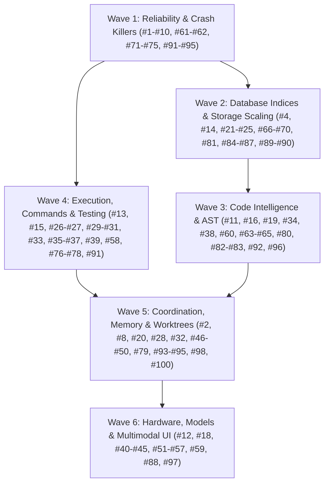

# Local AI Hub: Master Implementation Plan for 100 Ergonomics, Quality & Performance Enhancements

> **For agentic workers:** Follow the governing simplified integration process below. Execute and review bounded tasks directly; optional independent implementation agents follow the same criteria. Steps use checkbox (`- [ ]`) syntax for tracking.

**Goal:** Transform Local AI Hub into a rock-solid, ultra-fast, and deeply capable local engine for cloud and local coding agents by executing all 100 identified enhancements across 6 modular waves.

**Architecture:** The primary agent owns the 6 waves, implementation, review, and integration on current `master`, under the governing [simplified integration process](../specs/2026-10-07-simplified-worktree-integration.md). Optional parallel implementations require disjoint write scopes and isolation where needed. All unit state uses temporary databases. Apply TDD to behavior changes: failing regression, minimal implementation, passing targeted tests, review, then commit.

**Tech Stack:** Python 3.11+, SQLite 3 (WAL mode, custom pragmas, recursive CTEs), NumPy, tree-sitter / regex AST fallbacks, pytest, MCP (Model Context Protocol), Windows Process Job Objects.

---

## Development and Optional Subagent Protocol

> 📖 **Operational Playbook:** Detailed dispatch scripts, subagent prompts (Implementer, Spec Reviewer, Quality Reviewer), and worktree teardown routines are documented in [Subagent Dispatch Playbook](file:///c:/Users/Adam/.local-ai-hub/docs/superpowers/plans/2026-10-13-subagent-dispatch-playbook.md).

The October 7 governing process takes precedence over historical per-task worktree and mandatory reviewer-agent wording in this plan and all linked wave plans. Use the following isolation rules only when a separate implementation worker is warranted:

1. **Subagent Worktree Isolation:**
   - An independent writing subagent operates in an assigned isolated worktree (`git worktree add -b codex/<wave>-<task_id> ../wt-<task_id>`). Routine work stays on `master`.
   - Run verification commands against the worktree root.
2. **Database Isolation During Tests:**
   - Tests MUST use in-memory SQLite (`:memory:`) or isolated temporary state directories via `tmp_path` fixtures (`test_cfg["state_dir"] = str(tmp_path)`).
   - NEVER point unit tests to live databases in `c:\Users\Adam\.local-ai-hub\state\`.
3. **Two-Stage Review Process:**
   - The primary agent performs a specification review; a separate reviewer agent is optional:
     - Observable behavior and public contracts satisfy the task criteria; historical line numbers are navigation hints.
     - No extraneous edits or architectural drift.
   - The primary agent then performs a code-quality review:
     - Error handling, bounded timeouts, Windows process flags, type annotations, zero full-file rewrites.
4. **Integration Gate:**
   - Integrate each reviewed bounded change promptly after its relevant tests pass on integrated `master`. Run the full required suite at each wave/release gate. Preserve and classify every leftover before recoverable archival; no blanket stash/reset/rebase/merge.

---

## Wave Breakdown & Dependency DAG

### Integration checkpoint — 2026-10-15, remaining bundle

**Critical audit intake, 2026-10-15 (44 findings):** the supplied audit is snapshot-specific, not release acceptance. Prioritize F25/F41 source mutation boundaries; F01–F03/F10 DAG preservation and bounded execution; F04/F05/F38 navigation/registered contracts; F30 defaults parity; F40 lost wakeup; then remaining F06–F44 diagnostics, lifecycle, policy and performance findings. Classify each against current source before marking resolved. Existing source fixes and foreign dashboard work are not live proof. All validation remains deferred until the complete remaining source/integration bundle.

**F07/F23 source checkpoint:** `security_audit` no longer auto-dismisses test-path findings; HIGH credentials remain release blockers, MEDIUM findings remain visible, and clean/triage/scan-complete are distinct. The scanner reports visited/eligible/skipped counts, unknown total eligibility, limit hits and bounded error metadata; read/file/aggregate-byte/time bounds fail completeness. Credential-like snippet values are omitted by default. MCP protects the coverage and decision fields across both compaction layers. Deferred regressions cover plausible test credentials, MEDIUM-only results, hidden later files after the finding limit, unreadable files, and the DAG's pre-existing dirty/untracked overlay. Post-edit indexed impact for F05/F38 returned terminal transport outcome_unknown (`req_c4f0a0f110da`); no duplicate request or successful-impact claim is made. A separate `secret_scan` path shares test/placeholder triage heuristics and remains an explicit source follow-up before the final bundle gate.

**F44 source checkpoint:** Ruling: paging fields are disposable derived data in a new `artifact_paging_metadata` sidecar, with no core-table column alteration or replacement of durable IDs/tenant/binary data. The existing legacy tenant backup/recovery path remains unchanged. Source integration uses sidecar upserts in the same transaction as core writes, bounded 128-ID startup backfill (one body at a time), qualified read joins and derived-row cleanup. Tests now specify preserved legacy/current rows, NUL-safe multislice reads past the backfill boundary, no read-side writes, rollback atomicity and stale binary metadata cleanup. A missing sidecar still reads the selected legacy body's full text; large legacy-body memory use is NOT VERIFIED and is retained as an explicit final resource gate. No ArtifactStore instance, schema migration or project validation was executed; Hub retrieval and coordination bookkeeping still writes runtime state.

**F42 source checkpoint:** the old offline-weight fixture now invokes `Reranker.rerank(...allow_cpu_fallback=True)` directly to exercise its authorized offline loader failure, then asserts foreground RAG retains the CPU bypass and makes no second load attempt. Missing-weight error, unloaded state and non-reranked heuristic results remain asserted. The production CPU bypass and its dedicated regression are unchanged. This test-source correction is unexecuted until the full bundle gate.

**F43 source checkpoint:** integrated Whisper cache/download/device guard from the isolated implementation after primary source review. Immutable upstream registry pin is `04f449b8a437f1bbd3dba5c9f826aca972e7709a`; main independently checked that registry. Cache aliases and XDG handling, regular-file/identity checks, bounded chunked SHA-256 verification, strict download opt-in and explicit CPU flags are implemented. Source regressions are deferred; no cache weights were read by the agent, downloaded, loaded or transcribed. GPU transcription admission is explicitly unsupported; native WER/resource/install proofs remain open. Both default copies and bootstrap/update prompts are synchronized.

**F15/F39 source checkpoint:** README no longer promises zero cloud tool/context tokens, fixed 95% savings, or impossible OOM immunity; example foreground routes match the model capability matrix and installed inventory remains a separate gate. Windows broker strings use native Unicode `CommandLineToArgvW`/`LocalFree` (Microsoft API contract); structured invocation serialization uses `subprocess.list2cmdline` on Windows. Deferred native Windows argv regressions cover inline paths with spaces, empty/Unicode values, quotes/backslashes and literal metacharacters without launching child processes. No Windows runtime proof is claimed until final validation. F05/F38 source commit: `e3fddd37`.

**F08/F09 source checkpoint:** integrated `c45d7828` rejects batches above 16 before routing/delegation, reports exact counts and a full rejected range with at most 64 listed indices, and marks preflight rejection as terminal/not sent. Database maintenance counts only successful stores, handles busy checkpoint results as failures, reports partial state and a top-level error summary, and closes owned connections. Deferred tests use fake providers and temporary stores; no maintenance ran against live state.

**Audit source integration checkpoint:** F01–F03/F10 DAG preservation and brokered execution integrated as `63dd9c5f` + `383d080e`; F40 event capture/recheck and signal-before-eviction integrated as `cf543f95`; F41 readonly/root-confined/bounded type generation integrated as `33b6089c`. Primary specification and code-quality source reviews required corrections before integration (async lock order and test waiter isolation, DAG cancellation/deadline and argv handling, type-source growth/read bounds). These are source results only, with all authored regressions still unexecuted. The three isolated worktrees were verified clean and removed; their branch refs retain original commits for recovery.

**F05/F38 source checkpoint:** Ruling: publish one explicit `local_ai_artifact(action="source")` contract; artifact `get`/`slice` keep artifact-ID semantics. The unreachable path shortcut and undocumented source line aliases are removed. File/range/output bounds and workspace containment precede reads; exact bytes have SHA-256 provenance; source text and identity survive projection or the request fails explicitly. A newline-dense source uses streamed line iteration rather than a repository-sized line list. Every published output-envelope field is validated before FastMCP conversion, naming malformed fields without coercing unknown booleans. Deferred regressions exercise actual registered MCP calls, absolute/relative/symlink scope, budget rejection and nullable-flag errors. Live adapter behavior, complete registered surface parity and original unknown producer remain unverified until the final bundle gate.

**F04 source checkpoint:** exact Git search now sorts/deduplicates tracked plus untracked paths after successful process completion, under independent 128,000-path/32-MiB raw-path bounds and the existing Git/search deadlines. The 8,000 eligible-file scan cap remains separate. Deferred regressions cover mixed order, duplicate paths, Unicode and inventory overflow. Current-root exact query and memory/latency measurements remain unexecuted final-bundle gates. Broker source commit: `0a83fdf4`; attempted semantic diff review did not complete and is not review/validation proof.

**F25/F30 source checkpoint:** mandatory classification denial now precedes cache/identity/process handling. Explicitly opted-in unknown code follows mutation worktree/write-set/fence/private transaction gates; default unknown execution is disabled. Root defaults now match packaged defaults including idle release, Ruff daemon pooling and task-context warmup. New boundary regressions are authored but unexecuted; registered MCP mutation probes, allowed mutation behavior and release parity check remain final-bundle gates. OOM recovery committed separately as `4dae62ac`.

**Latest execution instruction, 2026-10-15:** the operator explicitly requires tests only after the whole remaining implementation/integration bundle. This supersedes per-task red/green execution for the remaining work. Continue implementation, source review, patch classification and integration; defer further test/build/benchmark acceptance commands until that bundle is implemented. Previously recorded test results remain historical candidate evidence, not final release acceptance.

Existing durable execution contract: `lead-remaining-bundle-20261015`, last confirmed status active / phase implementation (`req_77184827860d`). Hub retrieval/checkpoint access returned during the pubsub continuation; prior transport outcomes below remain recorded and were not reused as acceptance evidence. The contract supplements these plans and does not replace their task criteria.

**Read-only lifecycle finding, 2026-10-15:** `hubctl status` reported Hub online in active mode, listener PID 24124, with managed Windows launcher PID 23588 under supervisor PID 22208. Creation time of listener/launcher was 06:28:30 local. `state/supervisor.status.json` reported running/ready, zero restarts and empty last error. Historical supervisor logs contain repeated startup probe timeouts/recycling through 00:48; the stderr file (last written 00:44:31) contains an import-time `IndentationError` in `worktrees.py`. Commit `577c3159` already repairs that syntax error. These records identify a historical startup failure, not proof that every old timeout had the same cause. No current restart, configuration change, test, build or benchmark was performed during this diagnosis. Installed code/runtime parity and longer stability remain final acceptance work.

- Full local inventory: 244 branches and 106 registered worktrees; 105 worktrees clean, only the current master checkout dirty. No stashes. No worktree status errors.
- 56 branch refs are not ancestral to master. `git cherry` finds no patch-unique changes on `gemini/wave-6-task-77`, `gemini/wave-8-task-84`, `gemini/wave-9-task-87`, `gemini/wave-9-task-88`, or `gemini/wave-9-task-94`.
- The remaining 51 refs include unique patches and overlapping ancestry. In particular, tasks 100–127 form one stack ending at `gemini/wave-11-task-127`; refs are not independent implementation units.
- Preserve all refs and worktrees pending task-criterion and patch review. Ancestry or patch novelty alone does not authorize integration or deletion. No blanket merge, reset, stash, rebase, or cleanup was performed.

**Patch dispositions from source review (2026-10-15):**

- `gemini/wave-7-task-79` / `d0706fd5`: adapted the needed lifecycle fixes instead of importing its silent topic eviction/incomplete idle-subscriber policy. `SwarmPubSub` now caps cached topics (500), serialized cache charge (8 MiB), live subscriptions (256), aggregate queue slots (4096) and JSON message envelope bytes (64 KiB), with bounded 4096-node/32-level defensive snapshots. Cache byte accounting is serialized-data charge, not a claim about actual Python heap/RSS. Ephemeral capacity failure is explicit and preserves admitted history. Durable append/replay and strict idempotency continue when optional cache admission fails; opaque idempotency key bytes remain unchanged. TTL compaction reclaims cache and reports possible missing ephemeral history without disconnecting active subscribers. Input/cache/poll/fanout ownership is separated by bounded copies; existing live gap-marker logic is retained. Deferred temporary-DB/in-memory cases cover each limit independently, payload ownership, replay/restart/collision, expired retention, ring pagination and 30 default subscribers. No tests or benchmarks executed in this source phase. Original branch/tests retained; real concurrency/RAM/CPU and final integrated acceptance remain open.

**2026-10-15 continuation routing evidence:** root remains `C:\Users\Adam\.local-ai-hub`. Prior T93 solve returned terminal `outcome_unknown` (`req_d804966b8212`, exec cell 195); its result is not acceptance evidence and was not repeated. New branch-integration adaptive context (`req_42965c33dc84`) failed before send with `terminal=true`, `retryable=false`, `request_not_sent=true`; one bounded health attempt returned 503/transient unavailable. No retry/health loop, daemon restart or test execution followed. Continued exact native Git patch/source inspection and scoped edits under the allowed bounded fallback. `79ef6fa1` integrated the previously dirty dashboard/status/telemetry scope before this continuation; it is source provenance, not a current release or runtime-validation receipt.

- `gemini/wave-8-task-86` / `f6ff2d50`: adapted bounded breaker/key handling and stale-probe status into current master. The branch evicts open circuits when full and allocates uncapped new entries in `success`/`reset`; that can forget protective failures while claiming bounded capacity. Current adaptation caps all allocation paths and refuses unknown resources at capacity without evicting tracked open circuits/probes; existing resources can still probe/recover. Deferred cases cover churn, capacity/probe ownership and invalid keys. Unused reset/latency-window API extensions remain optional in the preserved branch. No test or live inference executed; final scheduler/provider acceptance remains open.

- `gemini/wave-8-task-82` / `050056dc`: integrated unified-content prefix cleanup across Python/TS/C#/Go/Rust and multiline Python signatures, with explicit header rejection and deferred cases. Did not import the branch's optional-export TypeScript regex: these helpers describe public API changes and treating internal functions/classes as public would change their contract. Current T49 Python AST structural diff remains independent and retained. Original branch kept; no test run or whole-branch replacement.
- `gemini/wave-8-task-83` / `f9df9677`: no required merge for `global_row_counts` error category; current missing-table failure is already `sqlite3.OperationalError`, a `sqlite3.DatabaseError` subclass accepted by current callers. Branch adds an unused initialization predicate and rephrases the exception without a demonstrated missing contract. Preserve optional helper/tests as a unique ref; do not expand the production API solely to absorb the commit.
- `gemini/wave-7-task-78` / `83449551`: preserve optional JSON sanitizer/BOM/memoryview work rather than import wholesale. Its new cycle/depth string sentinels and non-finite-to-null conversion can change payload data, while string-BOM stripping broadens stdlib parsing behavior. No current sanitizer caller or required lossful-serialization contract has been established; existing serializers reject unsupported/cyclic values. The patch is not evidence for current T90 OOM recovery despite its subject's item number.

- `gemini/wave-8-task-85` / `0fb83c08`: adapted pin validation and requested-context upper bound into current VRAM balancer, strengthening the branch to reject non-string/empty model names and non-positive/non-finite/bool TTL without changing an existing pin. Context recommendations now reject invalid base sizes and never grow a caller's requested window; invalid/non-finite hardware factors degrade conservatively. Deferred cases use mocked status, no GPU calls. Did not import branch fallback pairing changes: its fallback target `fast_code` / draft `draft_code` literals are not installed-model/capability evidence and cannot authorize altering operator model roles. Existing status-driven pairing remains. Original ref retained; final GPU/runtime acceptance open.

- `gemini/wave-7-task-80` / `b1b5d177`: integrated the reviewed patch into current transaction snapshots: both manifest scan and private copy reject repeated directory identity and excessive depth, and snapshot creation propagates the same limit through source/copy/revalidation. Retained existing Windows reparse/symlink rules, private Git index handling and exact dirty-input comparison. Added strict integer depth validation (1..512, default 64) before snapshot/Git operations; copied branch regression source and extended invalid-limit cases. Test execution remains deferred. This is transaction hardening, not the unrelated current T80 visual-diff criterion; original ref retained.

- `gemini/wave-8-task-81` / `d8afd721`: adapted ANSI OSC/private CSI/character-set stripping and correct zero/odd head-tail limits into current `token_economy.py`, preserving newer offline-tokenizer provenance. Replaced branch whole-input list materialization with a single-pass head/deque tail (retained line count bounded by requested output), and applied case-insensitive generated-directory pruning to both repo-map and tokcount. Deferred cases cover stream memory retention and edge outputs. Source integrated only; no tests executed and no performance acceptance claimed. Original branch retained.

- `codex/wave-2-task-26-repair` / `b5cf8bcc`: bounded four-worker lexical snapshot reads and both candidate/fallback call-site changes are already represented by master commit `aa11c0f4`; master also tracks `tests/unit/test_parallel_lexical_search.py`. Current `repo_tools.py` contains later exact-pagination and policy changes, so replacing it with the branch snapshot would regress newer work. Preserve the reference; no additional source merge is required for these hunks. This is source equivalence assessment, not a new runtime/performance result.
- `gemini/wave-5-task-62` / `6047e7fd`: adds a separate `StreamMultiplexer` and `run_parallel` API, absent from current master. The branch retains all output/events and partial lines without limits, submits every command future at once, permits duplicate IDs to overwrite results, and returns full aggregate output. Importing it wholesale would violate bounded-memory/response requirements. Preserve the unique patch as optional unaccepted work. This branch's task number does not establish a current requirement: actual Oct-13 T62 is arbitrary-revision Git diff, while #30 belongs to process-tree termination. Do not add a new parallel-command API solely to absorb this branch; current broker streaming already has bounded capture and callback queues. Its existing behavior still belongs in final command/concurrency validation.
- `gemini/wave-9-task-89` / `d6321759`: the directory/base validation and temporary-root `samefile` hunks are already present in the master-side `cf1cf9b2` lineage. Current master additionally contains later worktree functionality and the `577c3159` syntax repair. Do not replace the current file with this older branch. Its branch/test ref remains preserved; no merge or deletion performed.
- `gemini/wave-9-task-98` / `d917845b`: this mixed commit includes a worktree syntax correction already supplied by `577c3159`, plus optional logging helpers/config coercion. Its rollover reopening branch only runs when `delay=False`; the Hub creates its handler with `delay=True`. Current CPython 3.13 `FileHandler.emit` already reopens a missing append-mode stream. No demonstrated required runtime fix justifies importing this entire mixed commit. Preserve it as deferred optional API work; do not merge or delete it wholesale.
- Remaining unique patches, including the task-100–127 stack, still require actual hunk/criterion review. Commit subjects are an inventory aid, not proof of equivalence or acceptance.

**Current source-only integration checkpoint:** includes source through `46d334de` (earlier T44/T47/T51/T52, subsequent Wave 3/4/6 implementations, T91 pool integration `510ed511`, native context/stream repairs `da300903`, T92 trace parity `0418168c`, T93 schema fixes `4b7acbef`, bounded branch adaptations `bd1a490a` / `628f7dbd` / `88b520df` / `12314464` / `46d334de`), pubsub lifecycle integration `b073e42a` and the integrated T90 recovery implementation described in Wave 6. Deferred regression source is not an executed result. Biome daemon disposition, remaining unique branch review/integration and API coverage source work still remain open, alongside pubsub/native OOM integrated acceptance and all relevant final release/runtime gates. No current installed-runtime or full-release acceptance is claimed.
- T79 source is committed as `6ce835de`; T74–T78 source was integrated via `da0ac0bb` and `4b1956c2`. Historical focused regression result: 86 passed (`req_b5c8cca96a18`) on the earlier candidate. It is not verification of the later integrated source; no repeat was run during this bundle deferral.



---

## Wave Manifest & Document Links

Each wave is detailed in its dedicated, fully specified plan document containing exact code diffs, failing tests, and verification steps:

1. **[Wave 1: Reliability & Bottlenecks Plan](file:///C:/Users/Adam/.local-ai-hub/docs/superpowers/plans/2026-10-13-wave-1-reliability-and-bottlenecks.md)**
   - Tasks: #1, #2, #3, #5, #6, #7, #8, #9, #10, #61, #62, #71, #72, #73, #74, #75, #91, #92, #93, #94, #95.
   - Focus: Removing GIL lockups in `dead_code`, 403 errors in `skeletonize`, 66s CPU reranker timeout bypass, parameter normalizers, projection data loss fixes.
2. **[Wave 2: Performance & Storage Plan](file:///C:/Users/Adam/.local-ai-hub/docs/superpowers/plans/2026-10-13-wave-2-performance-and-storage.md)**
   - Tasks: #4, #14, #17, #21, #22, #23, #24, #25, #66, #67, #68, #69, #70, #81, #84, #85, #86, #87, #89, #90.
   - Focus: SQLite B-Tree point index on `edges` (3000x speedup), GC & auto-vacuum of 75 dead worktrees (22.8 GB -> 8 GB), `orjson` serialization, multi-slice artifact reading, batch embedding lookups.
3. **[Wave 3: Code Intelligence & AST Plan](file:///C:/Users/Adam/.local-ai-hub/docs/superpowers/plans/2026-10-13-wave-3-code-intelligence-and-ast.md)**
   - Tasks: #11, #16, #19, #34, #38, #60, #63, #64, #65, #80, #82, #83, #96, #99, #100.
   - Focus: Exposing `callees`, `implementations`, `declaration` in MCP, AST-aware regex chunker for TS/C#/Rust on Windows, symbol signatures in index, overlapping line deduplication.
4. **[Wave 4: Execution & Testing Plan](file:///C:/Users/Adam/.local-ai-hub/docs/superpowers/plans/2026-10-13-wave-4-execution-and-transactions.md)**
   - Tasks: #13, #15, #26, #27, #29, #30, #31, #33, #35, #36, #37, #39, #58, #76, #77, #78.
   - Focus: Exposing `env` in `local_ai_command`, pipe buffer deadlock protection in subprocesses, interactive `stdin` support, structured test failure summarizer, in-memory patch dry-run, git diff between arbitrary revisions.
5. **[Wave 5: Coordination & Memory Plan](file:///C:/Users/Adam/.local-ai-hub/docs/superpowers/plans/2026-10-13-wave-5-agent-coordination-and-memory.md)**
   - Tasks: #20, #28, #32, #46, #47, #48, #49, #50, #79, #98.
   - Focus: Agent-to-human question channel, lease zombie auto-reaper, CAS updates on blackboard and memory, swarm DAG support, git worktree uncommitted change detection, verification receipt markdown exporter.
6. **[Wave 6: Hardware, Models & UI Plan](file:///C:/Users/Adam/.local-ai-hub/docs/superpowers/plans/2026-10-13-wave-6-hardware-models-and-ui.md)**
   - Tasks: #12, #18, #40, #41, #42, #43, #44, #45, #51, #52, #53, #54, #55, #56, #57, #59, #88, #97.
   - Focus: Exposing `browser_bridge` headless DOM & screenshots in MCP, local visual diffing via Qwen-VL, ephemeral port binding for mock server, non-blocking GPU telemetry, calibrated code tokenizer.

---

## Global Verification & Quality Matrix

Before declaring completion of all 100 items:

```bash
# 1. Compilation
python -m compileall -q src tests tools

# 2. Strict release check
python tools/release_check.py --allow-installed

# 3. Unit & Integration test suite
python -m pytest -q

# 4. Hub selftest
python tools/selftest.py

# 5. Doctor diagnostics
python tools/doctor.py
```


**Audit source checkpoint F14/F24/F31:** lifecycle operation/job/request identity and acceptance/completion flags now survive generic projection and budget protection; mutation budget preflight and full wire acceptance remain OPEN. Checkpoint memory audit is documented in the public nested schema and diagnostics name checkpoint validation accurately. Skill setup/uninstall preserves unmanaged or modified shared trees, records exact content ownership, stages replacements and restores the previous version on failure. Source review found and repaired sibling-import and rollback issues before integration. Deferred regression source added; no project tests, compile, build, install or restart executed in this checkpoint. F31 replacement concurrency/hostile filesystem races and final installed-instance behavior remain unverified.

**F36 source checkpoint:** the CPU preprocessing failure handler called dict.get on sqlite3.Row before invoking telemetry, a concrete source-level AttributeError path. Row indexing replaces it; failed projects report recovered=false. Reporting failures increment lost_error_count and emit phase/type/fingerprint metadata without exception payload. Telemetry is attempted independently of failure-state persistence. Deferred in-memory row/callback-failure coverage added; historical runtime errors are not claimed fully localized or repaired until final validation.

**F37 source checkpoint:** deterministic command summaries reserve the final framework tail. Explicit pytest invocations parse bounded captured final summary lines into test_summary counts/elapsed metadata, protected across MCP projection and both budgets. Missing final output never infers counts from progress or fabricates a log artifact. Deferred long-skip/ANSI/incomplete-output fixtures added; transport and command execution remain unverified until the full bundle gate.

**F07/F23 secret-scan source checkpoint:** bounded traversal/reads/findings and explicit incomplete coverage replace unbounded collection and silent success. Dotfiles including .env and comment credentials are scanned; test/placeholder/low-entropy matches retain severity and require triage. File descriptor, regular-file, containment and post-read identity checks protect reads; snippets omit credential values. MCP protects scan coverage and clean/count state. Git-history scanning is deliberately fail-closed as unsupported until bounded process capture is implemented; this functional scope remains OPEN. Source review repaired omitted dotfiles, physical line numbers, file growth and findings-cap completeness. All regression source remains unexecuted.

**F20/F33 source checkpoint:** CI now measures existing configured branch coverage into runner-temp JSON and retains per-platform artifacts; no fabricated baseline threshold added. Wheel smoke installs declared dependencies and checks installed CLI help outside the source checkout. F33 smoke source uses one explicit installed inventory request, configured foreground routes, exact expected outputs and terminal async evidence; unavailable output/route is NOT_VERIFIED. No CI, wheel, smoke, model or test execution occurred. Installed MCP/HTTP round-trip, supported optional backend cohorts, measured coverage and quality remain OPEN.
