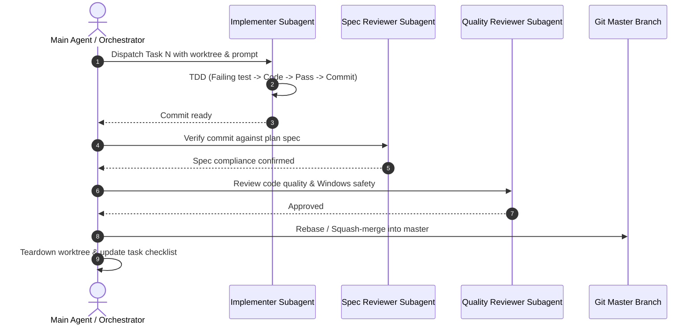

# Subagent Dispatch Playbook: 100 Items Implementation

> **Purpose:** Canonical orchestration guide for dispatching autonomous subagents to implement the 100 Local AI Hub improvements across all 6 waves.

---

## 1. Subagent Lifecycle & Worktree Setup

Every task MUST be executed in an isolated git worktree to prevent workspace contamination and race conditions on untracked test databases.

### Launch Script (PowerShell)

```powershell
param(
    [string]$Wave = "wave-1",
    [string]$TaskId = "task-01"
)

$Branch = "feature/$Wave-$TaskId"
$WorktreePath = "../lah-wt-$TaskId"

Write-Host "Creating worktree at $WorktreePath on branch $Branch..."
git worktree add -b $Branch $WorktreePath master

Write-Host "Worktree ready. Dispatch subagent with working directory: $WorktreePath"
```

### Teardown Script (PowerShell)

```powershell
param(
    [string]$TaskId = "task-01"
)

$WorktreePath = "../lah-wt-$TaskId"
Write-Host "Cleaning up worktree $WorktreePath..."
git worktree remove --force $WorktreePath
git worktree prune
```

---

## 2. Standard Subagent Prompts

### A. Implementer Subagent Prompt

```markdown
You are an autonomous engineering subagent executing Task [TASK_NUMBER] from Wave [WAVE_NUMBER].
Your task specification is in: docs/superpowers/plans/2026-10-13-[WAVE_NAME].md under Task [TASK_NUMBER].

STRICT RULES:
1. Follow Test-Driven Development (TDD):
   - Step 1: Write the failing test in tests/unit/
   - Step 2: Run pytest to confirm it fails as expected
   - Step 3: Implement minimal code in the specified file
   - Step 4: Run pytest to confirm it passes
   - Step 5: Commit with the exact message from the plan
2. DO NOT modify any files outside the files explicitly listed in the task.
3. Use temporary directories (tmp_path) for all SQLite databases in unit tests. Never touch state/*.sqlite3.
4. On Windows, use helpers from process_utils.py (e.g. hidden_run_kwargs).
5. When complete, reply with a summary of the commit hash and test verification output.
```

### B. Spec Reviewer Subagent Prompt

```markdown
You are a Spec Compliance Reviewer subagent for Task [TASK_NUMBER].
Compare the implementation commit against the task specification in:
docs/superpowers/plans/2026-10-13-[WAVE_NAME].md

CHECKLIST:
- Did the subagent modify the EXACT files and lines specified in the task?
- Did they add tests verifying the required edge cases?
- Did they preserve all existing unrelated comments and docstrings?
- Are any unexpected files modified or added?
Reply with PASS if fully compliant, or FAIL with a list of specific gaps to fix.
```

### C. Code Quality Reviewer Subagent Prompt

```markdown
You are a Code Quality Reviewer subagent for Task [TASK_NUMBER].
Inspect the git diff of the commit for:
- Deadlock risks (SQLite busy timeouts, subprocess pipe draining)
- Windows compatibility (long paths, backslashes vs forward slashes, process kill on exit)
- Type annotations and docstrings
- Error handling (never bare `except Exception: pass` without logging or telemetry)
Reply with APPROVE or REQUEST_CHANGES.
```

---

## 3. Wave Execution & Merge Sequence



---

## 4. End-of-Wave Global Integration Gate

At the end of each wave before proceeding to the next wave, run the full validation suite:

```bash
# 1. Compilation
python -m compileall -q src tests tools

# 2. Strict release check
python tools/release_check.py --allow-installed

# 3. Unit test suite
python -m pytest tests/unit/ -q

# 4. Hub selftest
python tools/selftest.py

# 5. Doctor diagnostics
python tools/doctor.py
```
