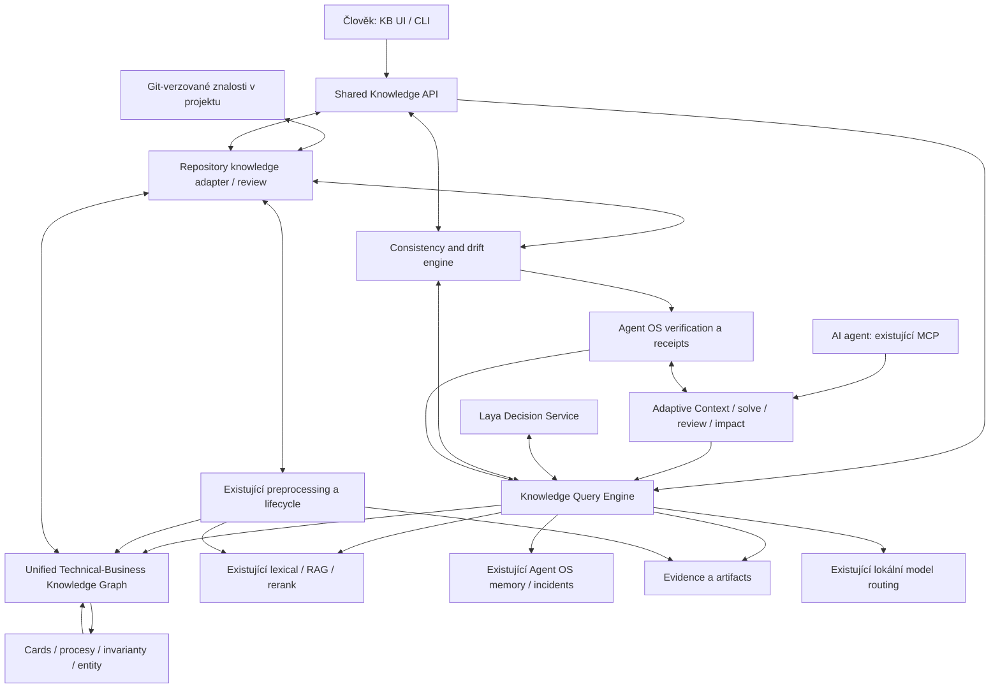
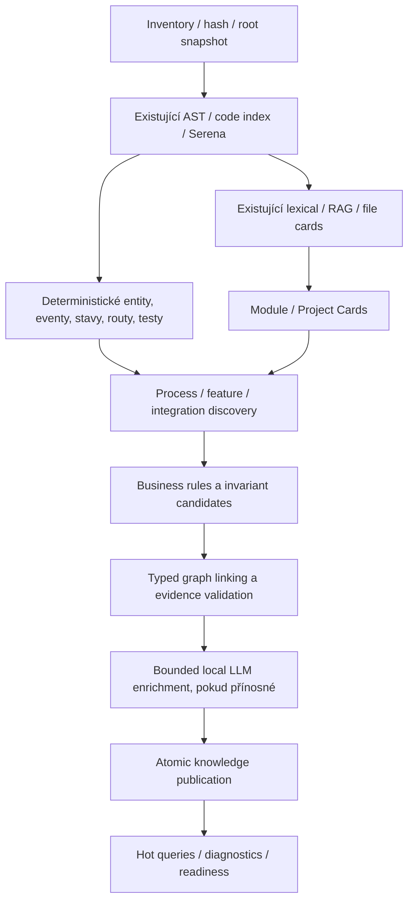
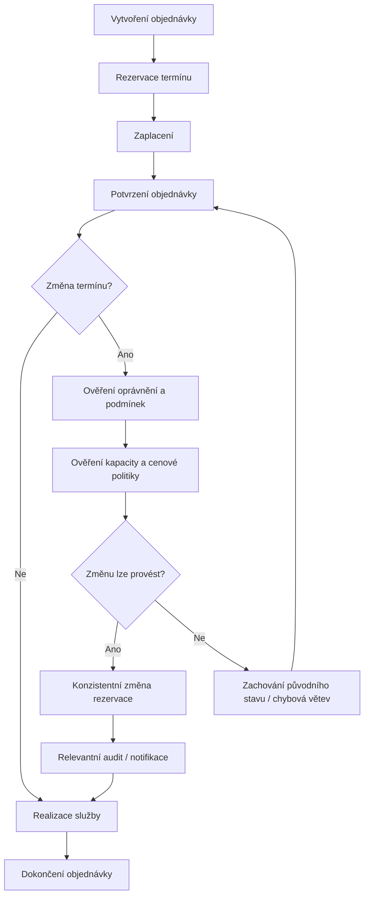
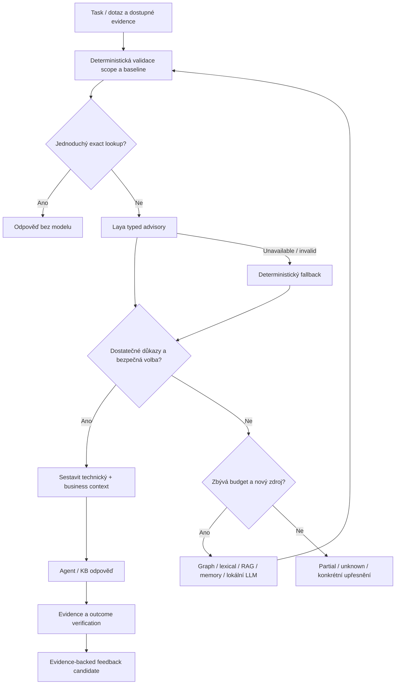
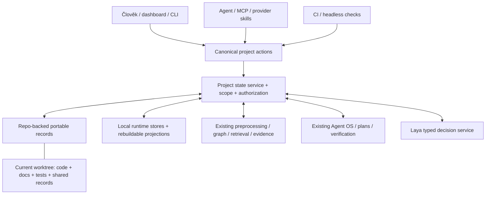
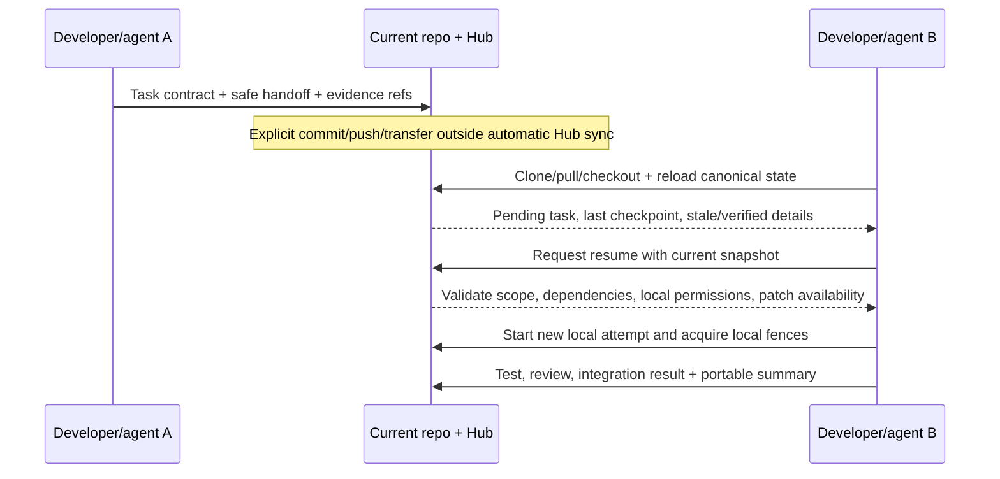
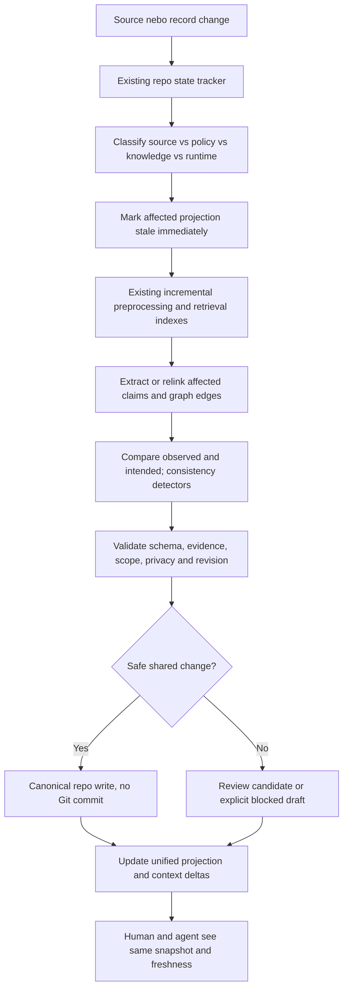

# Local AI Hub — Git-first Unified Project Intelligence, Knowledge & Business Intelligence

**Typ dokumentu:** technická a produktová specifikace rozšíření  
**Datum:** 2026-11-25  
**Projekt:** [Harfusha/local-ai-hub](https://github.com/Harfusha/local-ai-hub)  
**Referenční stav:** větev `master`, commit `718b1eba521069411308b3e6d5e19c6b39db7325`, README deklaruje verzi 8.1.0  
**Revize specifikace:** 4 — Git-first Unified Project State, repository-native Agent OS, native lifecycle, knowledge, business a quality intelligence  
**Status:** návrh k implementaci; nové kontrakty a datové modely v tomto dokumentu nejsou tvrzením o již existující funkcionalitě.

---

## Jak číst revizi 4

Tato revize je samostatná, úplná specifikace nahrazující V1–V3. Zachovává požadavky všech dřívějších revizí a doplňuje závazné Git-first kontrakty (§28–39): úplná storage taxonomie, defaultní safe automatic writes po jednorázové autorizaci projektu, jednoznačný canonical ownership, přenositelné evidence/artefakty, sémantický merge, workflow, CI, migrace a testy. §28–39 mají přednost před staršími ilustrativními defaulty, paths a storage policy; §24–26 nadále platí v nezměněných částech. Zejména dřívější `review_required` není cílový default pro bezpečné sdílené záznamy po bootstrapu; review je potřebné pro schválení autority, konflikty, citlivé nebo rizikové kroky, nikoliv každý rutinní zápis. Git-first neznamená automatické Git commit/push. KI, UPS a GIT položky tvoří jeden implementační plán; překrývající se položky mapovat na stejný canonical deliverable. Implementovat jeden Hub, nikoliv dva systémy.

## 0. Executive summary

Rozšířit Local AI Hub z lokálního nástroje pro optimalizaci práce coding agentů na platformu, která rozumí softwarovému projektu současně na technické, funkční, procesní a business úrovni.

Knowledge Base (KB) pro člověka není samostatný RAG chatbot ani izolovaný produkt. Je jedním z rozhraní nad **Unified Project Knowledge Intelligence** — společnou znalostní vrstvou, kterou automaticky využívají i běžné agentní tasky, existující Adaptive Context Pack, `solve`, impact analysis, review, testování a Agent OS. Znalostní vrstva se buduje průběžně nad existujícím preprocessingem, indexy, kartami, grafy, RAG, projektovou pamětí a evidence systémem.

Laya se má stát adaptivní rozhodovací vrstvou, která vybírá relevantní znalosti, identifikuje význam zadání, posuzuje dostatečnost důkazů, navrhuje další retrieval krok, detekuje potenciální drift, doporučuje odpovídající verifikaci a v případě nejistoty eskaluje na deterministické nástroje, další retrieval, lokální LLM nebo člověka. Nesmí se stát autoritou pro business fakta, bezpečnostní rozhodnutí ani pravdivost vlastních výstupů.

Klíčovým výsledkem je situace, kdy agent při úpravě jedné metody chápe nejen její volající a volané symboly, ale také celý dotčený business proces, jeho účastníky, stavové přechody, invarianty, transakce, vedlejší účinky, oprávnění, závislé funkcionality a potřebné testy. Člověk se může nad stejnými znalostmi ptát přirozeným jazykem v češtině či angličtině, procházet živou dokumentaci, diagramy a zdrojové důkazy.

Závazná rozšíření revize 2: sdílené projektové znalosti žijí v Git-verzovaných souborech přímo v cílovém repozitáři, obdobně jako plány; lokální index je odvozená projekce. Člověk může editovat business logiku a posuzovat nekonzistence, agent může dostat explicitně autorizovaný opravný task. Staleness a observabilita platí napříč celým lifecycle. Detailní kontrakty jsou v §12.1–12.9 a jsou součástí P0/P1, nikoli volitelné budoucí rozšíření.

Závazné rozšíření revize 3: sjednotit znalosti, požadavky, procesy, quality findings, plány a trvalý sdílitelný Agent OS stav přes canonical Project State a repo-backed records. Zachovat existující lokální runtime, indexy a bezpečnostní hranice. Využít `.local-ai.toml`, `WorkspaceSettings`, repo-plan storage primitives a existující identity, nepřidávat duplicitní registry či stores. Společný workflow člověk ↔ agent ↔ code change ↔ evidence ↔ review ↔ knowledge update je popsán v §24–26.

Závazné rozšíření revize 4: Git-first je default pro všechny bezpečně přenositelné projektové informace po jednorázovém bootstrapu. Lokální DB je pro sdílená data odvozená projekce, nikoliv paralelní autorita; live execution, citlivá data a rebuildable indexy zůstávají lokální. Úplný katalog, policy a acceptance jsou v §28–39.

## 1. Cíle, principy a rozsah

### 1.1 Produktové cíle

- Projektová KB pro člověka: otázky, odpovědi, vyhledávání, interaktivní dokumentace, procházení procesů a grafů, historie a rozhodnutí.
- Projektová KB pro AI: kompaktní typované informace, citace, evidence IDs, revize, lazy artefakty, stejné znalosti jako v lidském rozhraní.
- Automatické business-aware obohacení existujících tasků bez povinného dalšího tool callu.
- Pochopení kódu i jeho významu v širším kontextu aplikace.
- Snížení regresí, přehlédnutých závislostí, opakovaného discovery, tokenové režie a opakovaného vysvětlování stejných procesů.
- Evidence-first a deterministic-first architektura, lokální inference a adaptivní výběr hloubky analýzy.
- Inkrementální, verzované, ověřitelné znalosti, které se nepřegenerují celé po každé změně.
- Podpora PHP/CakePHP jako důležitého referenčního scénáře, zároveň jazykově a frameworkově rozšiřitelná architektura.
- Kvalitní dotazování v češtině a angličtině nad českou i anglickou dokumentací a anglickými identifikátory kódu.

- Git-verzované znalosti, lidské korekce a consistency findings sdílené mezi vývojáři, automaticky načítané z aktuálního worktree.
- Detekce driftu a nekonzistencí, správa výjimek s odůvodněním, agentní remediation a auditovatelná observabilita.

### 1.2 Výslovné non-goals a omezení

- Žádný paralelní preprocessing, druhá RAG databáze ani druhý nezávislý systém paměti.
- Žádná povinná externí grafová databáze, SaaS, cloudová inference nebo externí analytická služba. Lokální SQLite a existující úložiště jsou preferovaný základ. Volitelná rozšíření musí být oddělená, lokálně provozovatelná a vypnutelná.
- Žádné automatické vydávání odhadů LLM za business fakta. Neznámé požadavky a runtime chování se musí označit jako neznámé.
- Žádné automatické změny kódu, spouštění příkazů, síťové operace ani eskalace oprávnění z KB dotazu. Běžné tasky nadále používají stávající explicitně autorizované nástroje.
- Žádná povinná plná analýza pro každý jednoduchý task; změna CSS barvy nesmí automaticky přinést celou fakturační doménu.
- Žádné nekonečné agentní smyčky, redundantní volání nástrojů nebo nekontrolované učení na vlastních odpovědích.
- Žádné vydávání statického grafu za skutečný runtime trace nebo důkaz úplného pokrytí.
- Neprohlašovat celý projekt za bezpečný, kompletní či bezchybný jen na základě indexu, testů nebo absence detekovaných nálezů.

## 2. Referenční stav a možnosti reuse

Před implementací ověřit aktuální HEAD, skutečné call sites, konfiguraci, testy, feature flags, aktivní provider a runtime kontrakty. Přítomnost modulu není důkazem jeho zapojení do produkční cesty. Původní analýza kontrolovala README, dokumentaci, strom repozitáře a vybrané zdrojové soubory, nikoli živou instalaci nebo kompletní test suite.

| Oblast | Existující základ | Potřebné rozšíření |
|---|---|---|
| Preprocessing | Registry, inventory, hash, AST, Serena, lexical, RAG, file/module/project cards, hot queries | Business extrakce, závislosti znalostí, inkrementální invalidace |
| Code Intelligence | Tree-sitter, symboly, reference, callers/callees, call graph, routy, ORM, test mapping, import resolution | Sémanticky typované vztahy procesů, stavů, efektů, business pravidel |
| GraphRAG | `graphrag_communities.py`, `preprocess_graph.py` | Ověřit reálné zapojení, správnost hierarchie, zachování členství, aktualizaci a retrieval; rozšířit společný graf |
| Retrieval | Lexical, dense RAG, hybrid search, reranking, context packs | Intent-aware graph traversal, knowledge retrieval, cross-lingual relevance, retrieval plán |
| RAG ingestion | `local_ai_rag` index/search/docset/ingest_document/ingest_diagram | Správa zdrojů, provenance, životní cyklus a propojení dokumentů s doménou |
| Cards | File/module/project cards, `project_card_summary.py` | Process/Entity/Feature/Rule/Decision/Incident/Integration/Runbook/Glossary cards |
| Evidence | Evidence IDs, exact source slices, artifacts, root/revision scope | Claim-level citace, ověření čerstvosti, evidence pokrytí procesů a pravidel |
| Paměť | Agent OS, scoped memory, negative knowledge, incidents, promotion/revalidation | Typované dlouhodobé znalosti, konflikty, lidské potvrzení a audit změn |
| Lokální LLM | `local_ai_task`, `local_ai_repo(action="solve")`, explorer/reason/review, model routing | Strukturovaná extrakce a evidence-grounded syntéza pro KB i tasky |
| API | HTTP a 7 veřejných MCP nástrojů | Sdílené knowledge operace, odpovědní kontrakt, UI/agent projekce |
| Konverzace | `/api/delegate`, `/api/reason`, `/api/conversations/continue` | Projektově izolované trvalé KB konverzace; existující obecné konverzace jsou dle dokumentace in-memory |
| Dashboard | 11 provozních stránek, Projects, Models & search, Memory & Facts | Knowledge Base pro člověka, procházení znalostí, citací a procesů |
| Laya | Typované decisions, runtime/gateway, heuristiky, kolekce kandidátů | Business rozhodnutí, skutečné provider wiring, kalibrace, omezený feedback loop |

### 2.1 Důležité existující kontrakty

- Zachovat sedm veřejných MCP nástrojů: `local_ai_status`, `local_ai_task`, `local_ai_repo`, `local_ai_rag`, `local_ai_coord`, `local_ai_work`, `local_ai_artifact`.
- Zachovat cheapest-first routing a stávající canonical Adaptive Context; nepřidávat druhou povinnou discovery pipeline.
- `local_ai_repo(action="solve")` již podle dokumentace podporuje semantic wording typu explain/why/compare s omezeným lokálním průchodem.
- `local_ai_rag(action="search")` je podle MCP dokumentace sémantický retrieval, zatímco repo search podporuje lexical/rag/hybrid; nezaměňovat jejich pokrytí nebo přesné počty.
- Současný dokumentový ingest přijímá neprázdný text; SVG text lze indexovat s provenance, raster diagramy jsou dle kontraktu metadata-only. Skutečné OCR či porozumění diagramu je nové rozšíření, nikoli již doložená funkce.
- Projektová paměť má stávající pravidla scope, promotion, staleness, konfliktů a revalidation; použít je, nikoli obejít.
- Laya typované rozhodování a jeho role v runtime musí být zkontrolováno proti implementaci. README popisuje shadow-only rollout, zatímco novější integrační specifikace popisuje aktivní nízkorizikové návrhy. Rozpor v dokumentaci vyřešit podle skutečného stavu; nová business rozhodnutí nejdříve vyhodnocovat bez ovlivňování výstupu a zapínat pouze evidence-gated.
- Výchozí embedding `BAAI/bge-small-en-v1.5` je primárně anglický; češtinu nepovažovat za ověřenou jen proto, že je možné zadat český text.

### 2.2 Orientační odhad z předchozí diskuse (nikoli metrika)

Přibližně 70–80 % technologických základů základní KB a 45–60 % základů pokročilé business-aware KB bylo odhadnuto jako přítomných. Dílčí odhady: preprocessing 90 %, retrieval/RAG 85 %, analýza kódu 80 %, paměť 75 %, generování odpovědí 65 %, živá dokumentace 40 %, Business Process Intelligence 30 %, KB UI 10 %. Jedná se o subjektivní architektonický odhad, nikoli pokrytí testy, měřenou dokončenost či akceptaci. Implementátor musí vytvořit evidence-backed inventory místo použití těchto procent jako release gate.

## 3. Cílová architektura



### 3.1 Technický a business pohled

| Technical Intelligence | Business Intelligence |
|---|---|
| Symboly, metody, třídy, kód | Význam funkcionality a účel procesu |
| Call graph a závislosti | Business vazby, stavové přechody, lifecycle |
| Routy, API, UI entry points | Aktéři, uživatelské scénáře, workflow |
| Schéma DB, ORM, transakce | Význam entit, konzistence, invarianty |
| Eventy, fronty, integrace | Vedlejší efekty, business odpovědnost |
| Testy, oprávnění, konfigurace | Očekávané scénáře, pravidla, výjimky, rizika |
| Git diff, technická historie | Doložené důvody rozhodnutí, změny pravidel |

Nejde o dvě izolované databáze. Vztahy, důkazy a identita revize mají být sdílené. Business vrstva odkazuje na skutečné technické artefakty; změna technického uzlu může invalidovat navázané business znalosti.

### 3.2 Logické služby (názvy návrhové)

- Knowledge extraction orchestrator: využívá existující preprocessing scheduler a storage writer.
- Knowledge graph repository: typovaný graf uložený nad stávající lokální storage architekturou.
- Process/entity/rule discovery: frameworkové extraktory + omezené LLM enrichment.
- Knowledge query engine: intent, retrieval, graph expansion, evidence assembly, synthesis, verification.
- Business context provider: rozšíření existujícího adaptive context compileru.
- Business impact/verification service: využití existujícího impact, test mapping, diff a receipts.
- Laya decision adapter: jednotný existující typed decision runtime, ne nový model daemon.
- Knowledge presentation: API, MCP projekce, dashboard, CLI, export.

Preferovat malé rozšiřitelné moduly, explicitní kontrakty, stávající servisní hranice a jednu canonical cestu pro každou schopnost. Konkrétní názvy souborů a tabulek přizpůsobit skutečné architektuře.

## 4. Datový model a provenance

### 4.1 Typy uzlů

Projekt/repozitář/worktree/revize, modul, soubor, symbol, route, UI action, command, scheduled job, event, listener, queue, API endpoint, integration, DB table/column/constraint, entity, entity state, actor/role, permission, feature, business process, process step, transition, business rule, invariant, test/scenario, configuration, document/section, glossary concept, ADR/decision, incident/lesson, runbook, evidence reference.

Znovu používat existující identity technických uzlů, evidence, memory records a artifacts. Nekopírovat celé zdrojové soubory do knowledge tabulek. Reference na zdroje musí být resolvable a root-scoped.

### 4.2 Typy hran

`contains`, `defines`, `calls`, `references`, `imports`, `implements`, `routes_to`, `triggers`, `publishes`, `consumes`, `reads`, `writes`, `validates`, `authorizes`, `transitions_to`, `part_of`, `precedes`, `branches_to`, `compensates`, `depends_on`, `affects`, `enforces`, `verified_by`, `documented_by`, `explained_by`, `contradicts`, `supersedes`, `related_to`.

Každá hrana má směr, druh, případnou podmínku, evidence IDs, původ, revizi, freshness, confidence/coverage a rozlišuje přímý, nepřímý či hypotetický vztah. Hypotetickou hranu nelze zobrazit jako ověřenou závislost ani použít jako jediný podklad pro blokaci tasku.

### 4.3 Společný knowledge record

Návrhový kontrakt (adaptovat na existující wire modely, evidence store a identitu repository):

```yaml
knowledge_id: stable-scoped-id
kind: process | entity | feature | invariant | decision | incident | integration | runbook | glossary
scope:
  repository_id: canonical-id
  worktree_id: canonical-worktree-id
  revision: commit-or-working-tree-fingerprint
schema_version: 1
extractor_version: versioned-producer
title: Human-readable name
aliases: []
summary: bounded description
claims:
  - claim_id: stable-id
    text: atomic assertion
    epistemic_status: observed | documented | human_confirmed | inferred | hypothetical | unknown
    evidence_ids: []
    verification_status: verified | partial | unverified | conflicting | stale
relationships: []
source_dependencies: []
coverage:
  complete: false
  limitations: []
freshness: current | stale | unknown | unavailable
created_at: timestamp
updated_at: timestamp
provenance:
  producer: parser | index | document | human | local_model | runtime
  producer_version: version
  model_id: optional
  source_hashes: []
review:
  status: candidate | approved | rejected | superseded
  reviewer: optional
```

Epistemic status, verification, review a freshness jsou různé dimenze. Lidské potvrzení požadovaného business pravidla není důkazem, že jej aktuální kód skutečně dodržuje. Kód může doložit současné chování, ale ne vždy úmysl stakeholdera. Test existence není úspěšný test run. Runtime observation potvrzuje jen pozorovaný scénář.

### 4.4 Evidence a citace

- Každé podstatné faktické tvrzení odkazuje na jednu či více platných evidence IDs. Uživatel může otevřít konkrétní soubor, rozsah řádků, symbol, dokumentovou sekci, verifikační receipt či potvrzené rozhodnutí.
- Evidence reference obsahuje root/worktree, revision/fingerprint, locator, hash, typ a případně line range. Ověřit, že locator stále odpovídá zdroji.
- Citace ke změněnému zdroji se nesmí tvářit jako aktuální; buď revalidate, nebo uvést historical/stale.
- Model smí navrhovat tvrzení a kandidátní citace, ale server musí ověřit existenci, scope a relevantní podporu. Pouhá přítomnost evidence ID neprokazuje entailment.
- Rozlišit tvrzení podložená zdrojovým kódem, dokumentací, historií, testem, runtime trace, lidským potvrzením a hypotézou. Při konfliktu uvést obě tvrzení se zdroji a stavem; nikdy bezdůvodně nezvolit novější text jako pravdu.
- Pro silná tvrzení vyžadovat dostatečné pokrytí a odpovídající důkazy; pokud chybí, vrátit partial/unknown, nikoli falešnou jistotu.
- Confidence z modelu není kalibrovaná pravděpodobnost. Používat měřené signály a explicitní omezení místo libovolných procent.

## 5. Živá projektová dokumentace a knowledge cards

### 5.1 Katalog karet

| Karta | Obsah |
|---|---|
| Project Card | Účel projektu, architektura, vstupní body, subsystémy, testy, konfigurace, rizika |
| Module Card | Odpovědnost, rozhraní, závislosti, související procesy |
| File Card | Účel souboru, symboly, evidence, odpovědnost |
| Symbol Card | FQN, signatura, role, reference, efekty a testy |
| Process Card | Aktéři, trigger, pre/postconditions, kroky, větve, výjimky, stavy, transakce, závislosti |
| Entity Card | Význam dat, ORM/DB vazby, lifecycle, stavy, constraints, pravidla |
| Feature Card | Uživatelská funkcionalita napříč technickými moduly a procesy |
| Business Rule / Invariant Card | Normativní pravidlo, implementační důkazy a metody ověření |
| Decision Card | Proč bylo řešení zvoleno, varianty, tradeoffs, ADR, autorita, důkazy |
| Incident Card | Problém, okolnosti, příčina, řešení, prevention/negative knowledge, verifikační evidence |
| Integration Card | Poskytovatel či interní služba, kontrakt, trigger, data, oprávnění, retry, failure modes |
| Runbook Card | Nasazení, provoz, diagnostika, recovery; doložené kroky a předpoklady |
| Glossary Card | Doménový pojem, synonyma CZ/EN, odkazy na entity, procesy a identifikátory |

První typy již mají existující základ; ostatní přidat nebo materializovat jako projekce existujících records. Například Decision/Incident Card nemá vytvářet kopii paměti. Každá karta má jednoznačnou identitu, revizi, provenance, seznam závislostí, freshness a limitations. Zajistit kvalitativní schema validation, atomické publikování a uchování poslední ověřené verze jako historical, nikoli aktuální.

### 5.2 Process Card — požadavky

- Název, účel, alternativní názvy, feature a aktéři.
- Vstupní body: HTTP route, UI akce, CLI, cron, event, queue consumer, webhook nebo další proces.
- Precondition, postcondition, relevantní entity a stavy.
- Směrovaný graf kroků, podmínek, smyček, větví, paralelních a asynchronních akcí; nevnucovat falešně lineární pořadí.
- Autorizace, validace, transakční hranice, DB změny, cache, eventy, notifikace, externí integrace, idempotence, retry, rollback/kompenzace, chybové větve, concurrency.
- Vazba na konkrétní technické uzly, relevantní testy, invariants, dokumenty a potvrzená rozhodnutí.
- Unknown/unresolved hrany (např. dynamický dispatch, DI binding, plugin, konfigurace podle prostředí).
- Přímé a nepřímé business dopady, související procesy, coverage a evidence každého kroku.

Příklad struktury:

```yaml
process_id: service_order.reschedule
kind: process
status: illustrative_only
actors: [customer, operator]
trigger_candidates: [http_route, admin_action]
entities: [service_order, reservation, payment]
steps:
  - id: authorize
    evidence_ids: []
  - id: check_availability
    evidence_ids: []
  - id: update_reservation
    evidence_ids: []
  - id: notify
    evidence_ids: []
transitions: []
invariant_refs: [reservation.capacity, payment.no_duplicate_charge]
unknowns: [price_change_policy, cutoff_time]
coverage: {complete: false}
```

Tento příklad nepopisuje skutečnou aplikaci. Neověřené hypotézy nesmějí být v reálné publikované kartě označené jako verified.

### 5.3 Entity lifecycle a state machines

Detekovat deklarované enumy, status fields, switch/match větve, guard podmínky, stavové aktualizace, workflow definice, DB constraints a testy. Rozlišit deklarované a odvozené stavy, povolené přechody a skutečně testované přechody. Zachytit iniciační a koncové stavy, aktéry, efekty, časové podmínky, stavové přechody při selhání a návratové cesty. Nedoplňovat chybějící přechody bez důkazů.

### 5.4 Business Rules & Invariants

Business invariant je stabilní pravidlo, které má platit bez ohledu na konkrétní implementaci. Příklad hypotetické aplikace:

```yaml
id: reservation.capacity
kind: business_invariant
description: Rezervace nesmí překročit kapacitu termínu.
processes: [order_creation, order_rescheduling, manual_reservation]
severity: critical
requirement_status: proposed
implementation_status: unknown
verification:
  status: unverified
  evidence_ids: []
  receipts: []
```

V produkčním systému musí být oddělené potvrzení požadavku, nalezení enforcement bodů a ověření aktuální implementace. Možné metody: constraint existence, deterministická kontrola, konkrétní test nebo autorizovaná lidská revize. Laya může navrhnout relevantní invariant nebo mezeru, nemůže sama mintovat verifikační receipt.

Při změně enforcement symbolu, konfigurace, schématu, testu či souvisejícího pravidla invalidovat odpovídající implementační verifikaci. Explicitně plánovaná změna business pravidla vyžaduje identifikaci změny, příslušné schválení dle existujícího task kontraktu a aktualizaci testů; nesmí se tiše vydávat za regresi ani za povolenou výjimku.

## 6. Preprocessing a průběžná aktualizace

### 6.1 Canonical pipeline

Existující logická posloupnost: inventory → hash → code_index → deterministic → serena → lexical → rag → files → modules → project → hot_queries → diagnostics → complete.

Rozšířit o logické operace, jejichž skutečné umístění v pipeline určí závislosti a existující scheduler:



Nejde o povinné sekvenční přidání dlouhých fází za každý projekt. Znovu využívat načtený AST, hash, index entries, metadata, karty, batch inference a model scheduling. Zpracovávat pouze relevantní změny. Laya může prioritizovat obohacování či doporučit získání dalších dat, nikoli přeskočit povinnou kontrolu důkazů.

### 6.2 Deterministické extraktory

- Reuse existujících parserů, LSP/Serena, frameworkových adaptérů a DB/route/test intelligence.
- Extrahovat entry points, volání, eventy, subscribery, fronty, role/permissions, validace, persistence, transakce, konfiguraci, stavové změny, test assertions, integrace.
- PHP/CakePHP: routes, controllers/actions, middleware, components, policies, Table/Entity, associations, validation, rules checker, lifecycle callbacks, ORM transactions, migrations/constraints, command/event/listener, templates/forms a test fixtures. Nepředpokládat, že všechny jsou již extrahované ve stejné kvalitě.
- Pro ostatní podporované jazyky (Python, JS/TS, C#, Go, Rust, Java, C/C++ a další) přidávat adaptéry podle jejich skutečné parser coverage. Explicitní capability matrix místo tvrzení univerzální podpory všech frameworků.
- Graph traversal používat typované hrany, omezené depth/node budgety, cycle detection, relevance a evidence scope. Hierarchické komunity ověřit proti grafovým fixtures a běžnému retrieval; architektonické shluky nejsou automaticky business procesy.
- U dynamického chování (reflection, DI, config-driven routes, polymorfismus, dynamic dispatch) uvést unresolved či candidate relation; runtime evidence může později doplnit.

### 6.3 LLM enrichment

Malý lokální model vytváří omezené strukturované kandidáty shrnutí, názvů procesů, pravidel a glossary; složitější model pro vícezdrojovou syntézu. Vstup jsou omezené evidence a již extrahované struktury, nikoliv bezúčelné opakované čtení všech souborů. Vynutit schema, allowed types, evidence IDs, validaci odkazů a token budget. Při chybě zachovat deterministický výsledek, nepublikovat falešně kompletní kartu. Lokální model nesmí bez oprávnění vykonávat nástroje s vedlejšími účinky.

### 6.4 Inkrementální invalidace a lifecycle

- Stable identity a dependencies pro každou kartu, claim a hranu; používat content hashes a root/worktree/revision identity.
- Při změně souboru aktualizovat technický index a pouze dotčené znalosti plus tranzitivně relevantní závislosti. Při přejmenování/přesunu přemapovat identitu jen s ověřitelnou vazbou.
- Zohlednit git switch, dirty/untracked soubory dle stávající inclusion policy, smazání, rollback, změnu parser/model/schema verze, změny dokumentů či potvrzené paměti.
- Generační/snapshot fencing: výsledky starého jobu nesmí přepsat novější knowledge snapshot. Atomická publikace, bounded retries, cancellation, checkpoint, recovery po restartu.
- Stale informace lze ukázat jako historické, ale nesmí vstoupit do aktuálního verified contextu. Neznámé pokrytí není `complete=true`.
- Respektovat stávající scheduler, resource profiles, preprocessing/active/gaming modes, admission, GPU residency, cache, write actor a omezení paralelismu; neblokovat interaktivní requesty dlouhým obohacováním.
- Readiness per project a capability: not indexed / partial / ready for bounded queries / stale / degraded / unavailable; UI zobrazí důvod, revizi, zpracování a coverage. Knowledge retrieval může fungovat před úplným dokončením, pokud korektně uvádí omezení.

- Povinná dependency-based staleness pro repozitářové znalosti, manual overlays, findings a jejich review, včetně read-time guards a změn při pull/checkout: viz §12.1 a §12.6. Vlastní knowledge soubory nesmí vyvolat reindex loop.

## 7. Knowledge Query Engine

### 7.1 Typy dotazů

Exact fact/location, symbol, explanation, process walkthrough, architecture, entity/lifecycle, business rule, permission, configuration, integration, history/why, comparison, impact/what-if, troubleshooting, test coverage, documentation drift, onboarding, operational runbook, technical debt a cross-project (explicitně autorizovaný).

Příklady: Jak funguje registrace zákazníka? Co se děje po zaplacení faktury? Kdo smí měnit termín služby? Kde se ukládají objednávky? Jak funguje preprocessing? Proč bylo rozhodnuto používat tuto službu? Co ovlivní změna DPH? Jakými testy je proces pokryt? Proč se úloha může zaseknout? Jak projekt nasadit?

### 7.2 Postup zpracování

1. Validovat root, worktree, scope, authorization, budget, requested projection a revizi.
2. Normalizovat dotaz; zachovat původní znění a exact identifiers. Určit intent, jazyk, cílovou úroveň detailu, případně navazující konverzační kontext.
3. Reuse čerstvých relevantních evidence, knowledge cards a cache.
4. Cheapest-first deterministic lookup a code index. Pro přesná fakta zastavit, jakmile jsou dostatečně doložená; nevolat LLM povinně.
5. Podle relevance rozšířit typovaným grafem o procesy, entity, enforcement a testy; Serena pro unresolved symbol/reference.
6. Doplnit chybějící informace lexical/hybrid/RAG/rerank, dokumenty, pamětí, decisions a incidenty; historie pouze pokud relevantní.
7. Posoudit evidence sufficiency, konflikty, freshness, coverage a chybějící otázky; Laya může doporučit další krok.
8. Sestavit omezený evidence pack a případně lokální LLM syntézu. Výstup strukturovat podle typu otázky a příjemce.
9. Ověřit claim references, scope, fresh evidence a relevantní podporu; odstranit nepodložená tvrzení nebo označit unknown/inferred.
10. Vrátit odpověď, citace, limitations, relevantní diagram/data, související otázky a případně potřebné upřesnění. Uložit cache jen s bezpečnou revision identity a invalidation dependencies.

Iterace 4–7 jsou omezené podle policy, deadline, model/token budgetu a zisku nových důkazů. Bez pokroku zastavit. Laya ani query engine nesmí čekat na kompletní preprocessing, pokud lze vrátit korektní partial odpověď. Pokud je lokální model nedostupný, nabídnout deterministický/strukturovaný výstup; žádný automatický cloud fallback.

### 7.3 Odpovědní kontrakt (návrh)

```json
{
  "status": "complete|partial|unknown|unavailable",
  "knowledge_revision": "snapshot-id",
  "intent": "process_explanation",
  "answer": "Text srozumitelný člověku nebo kompaktní projekce pro agenta",
  "claims": [{"claim_id":"c1","text":"...","evidence_ids":["E..."],"status":"verified"}],
  "process_refs": [],
  "entity_refs": [],
  "invariant_refs": [],
  "conflicts": [],
  "unknowns": [],
  "coverage": {"complete":false,"limitations":[]},
  "freshness": "current",
  "artifacts": [],
  "related_questions": [],
  "warnings": [],
  "budget": {"truncated":false}
}
```

Status complete se vztahuje k zodpovězení daného dotazu v deklarovaném scope, nikoli k úplnému pochopení celého projektu. Citace a omezení zachovat i při MCP response compaction. Velké seznamy a diagramy poskytovat lazy artifact mechanismem.

### 7.4 Čeština a angličtina

Testovat retrieval nad českými dotazy a anglickým kódem, českou dokumentací, českou diakritikou, mixed-language promptem a přesnými identifikátory. Reuse `laya_crosslingual_reranker.py`, glossary aliases a query expansion; ověřit, zda jde o heuristiku či skutečný model. Otestovat lokální multilingual embeddings a rerankery proti současnému BGE baseline. Nevyžadovat změnu modelu bez měření relevance, latence, paměti a dopadu na anglické dotazy. Exact identifiers nepřekládat ani nerozbíjet expanzí.

## 8. Nativní integrace do běžných agentních tasků

### 8.1 Business-aware Adaptive Context Pack

Rozšířit existující `local_ai_repo(action="context")` a canonical context compiler o business provider. Běžný task musí získat relevantní business kontext automaticky, bez další povinné MCP operace, pokud je pro daný intent přínosný. Stávající API klienti musí fungovat i bez znalosti nových polí. Zachovat existing context ID, repo revision, delta, reuse, guard warnings, evidence IDs, token budget a response projection.

Návrhové pole `business_context` v existujícím packu:

```json
{
  "business_context": {
    "status": "partial",
    "intent": "reschedule_paid_service_order",
    "processes": [{"id":"service_order.lifecycle","relevance":"direct","evidence_ids":["E..."]}],
    "entities": [],
    "business_rules": [],
    "invariants": [],
    "affected_features": [],
    "side_effects": [],
    "verification_candidates": [],
    "unknowns": ["Policy for changing a paid order to a differently priced slot"],
    "conflicts": [],
    "coverage": {"complete":false},
    "freshness": "current",
    "evidence_ids": [],
    "artifact_refs": []
  }
}
```

Příklady jsou návrhové, nikoliv skutečné evidence. Pack musí rozlišovat doložené a kandidátní informace; žádná hypotetická pravidla nesmějí být vložena jako povinné verified constraints.

### 8.2 Adaptivní režimy hloubky

| Typ tasku | Business kontext |
|---|---|
| Přesný dotaz na symbol nebo cestu | Žádný nebo pouze přímo relevantní údaj |
| Kosmetická změna CSS / textu | Minimální; žádný modelový průchod bez důvodu |
| Lokální bug / malý refactoring | Compact: přímo dotčený proces a invarianty |
| Běžná implementace / úprava business logiky | Standard: proces, entity, dopady, vedlejší efekty, testy |
| Stavové změny, peníze, rezervace, oprávnění, data integrity | Expanded podle budgetu: více procesů, negativní scénáře, konflikty, kritické ověření |
| Audit, rozsáhlá změna, cross-project dopad | Explicitní scope, evidence budget, lazy artefakty a omezená expanze |

Nejde o pevné nové režimy existujícího API; zachovat canonical adaptive mode. Laya může doporučit budget a relevance. Kritické doložené constraints a povinná verifikace mají přednost před kosmetickou kompresí; pokud se nevejdou, vrátit warning, odkazy na detail a neprohlašovat kontext za kompletní. Rozpočet zahrnuje technické i business informace, ne dva nezávislé plné token budgety.

### 8.3 Integrační body životního cyklu

| Fáze | Knowledge Intelligence | Laya doporučení | Výstup a kontrola |
|---|---|---|---|
| Intake | Identifikace intentu, procesů, požadavků | Intent a retrieval route | Scope, relevantní knowledge refs |
| Discover | Technický + business graf, evidence, pravidla | Evidence sufficiency, další zdroj | Bounded context pack |
| Plan | Business impact, constraints, scénáře, dependencies | Mezery plánu, nejasnost | Plan/acceptance candidates; schválení podle stávajícího kontraktu |
| Edit | Delta pack při změně scope/revize, relevantní invarianty | Drift, další zdroj, budget | Relevantní informace při editaci; bez nutnosti znovu číst vše |
| Review | Diff proti známým pravidlům a očekávaným procesům | Potenciální mismatch, rizika | Evidence-backed findings a unknowns |
| Test | Test mapping, kandidátní integrační/scénářové testy | Test gaps a verifikační hloubka | Test plan, receipts skutečných runů |
| Completion | Kontrola acceptance, relevantních invariantů a verifikace | Completion gap / clarification | Existing completion gate; doporučení samo není důkaz |
| Post-task | Invalidate/rebuild ovlivněných znalostí, potvrzené lesson/decision candidates | Kandidáti učení a reuse | Aktualizované knowledge snapshot, audit provenance |

Integrovat s existujícími `solve`, `impact`, `refactor_impact`, review/diff, test mapping, Agent OS context compilation, verification receipts a `local_ai_work` (při explicitně autorizované delegaci). Nevytvářet druhou orchestration platformu. Provider skills a instrukce mají učit stejný canonical workflow bez závislosti na konkrétním hostu.

### 8.4 Integrace s `solve` a běžnými modelovými úlohami

- Reuse existující planner pro bounded evidence steps, ne paralelní duplication.
- `solve` dostane business kontext ze stejného provideru jako `context`; pokud již pack existuje a revize/scope odpovídají, reuse místo nového discovery.
- Lokální explorer, drafter a critic mají přístup pouze k read-only knowledge retrieval a relevantním evidence slices.
- Jednoduchý deterministic lookup nepoužívá Laya/LLM zbytečně; gating podle skutečných měření.
- Agent pracující mimo Hub není automaticky pozorovatelný. Drift a completion se hodnotí pouze z autorizovaných lifecycle eventů, task state, dostupných diffs či receiptů; nehalucinovat sledování kroků externího klienta.
- V Codex, Antigravity/Gemini, Claude, Cursor, Windsurf, VS Code/Copilot, OpenCode a dalších podporovaných klientech aktualizovat canonical generování skills, tool descriptions a policies. Hooks/plugins využívat pouze pokud daný host skutečně poskytuje daný lifecycle signal; jinak fallback na MCP context a task workflow. Zachovat sedm nástrojů a jednotné schéma.

## 9. Referenční scénář: změna objednávky zaplacené služby

Tento scénář je ilustrační a slouží jako acceptance fixture, nikoliv popis konkrétní existující aplikace.

**Zadání agenta:** „Umožni zákazníkovi změnit termín objednané služby, i když ji již zaplatil.“

### 9.1 Technický pohled

Relevantní kandidáti: `OrdersController`, `OrderService`, `ReservationService`, `PaymentService`, `InvoiceService`, `NotificationService`, policy, table/entity/migrations, UI formulář, event/listener, integrační testy a případné queue workers. Skutečné názvy a vazby získat z indexu, nikoliv předpokládat.

### 9.2 Business pohled



Diagram zachycuje hypotetický požadovaný scénář. Neříká, že všechny hrany existují v reálném kódu, ani že platba automaticky zůstává zachována.

| Oblast | Otázky a kandidátní rizika, která má Hub identifikovat |
|---|---|
| Kapacita | Dostupnost nového termínu, rezervace více zákazníky, concurrency |
| Původní rezervace | Kdy a jak bezpečně uvolnit původní slot? |
| Platba | Lze zachovat platbu, nehrozí duplicitní charge nebo refund? |
| Cena | Co když se nový termín liší cenou, DPH či slevou? |
| Fakturace | Je potřeba nový doklad, oprava, dobropis? |
| Oprávnění | Zákazník vs. operátor, vlastnictví objednávky, tenant isolation |
| Čas | Cutoff pro změnu termínu, časová zóna, realizovaná/zrušená objednávka |
| Stav | Povolené přechody, terminal states, cancelled/refunded |
| Transakce | Atomicita rezervace, rollback/kompenzace, idempotence |
| Notifikace | Koho a kdy informovat, co když odeslání selže? |
| Historie | Audit, reporting, změna naplánované práce |
| Testy | Happy path, nedostupný slot, souběh, ownership, rollback, cena, duplicity |

### 9.3 Očekávaný workflow

1. Hub rozpozná, že task mění business proces, nikoli pouze UI nebo signaturu metody.
2. Najde order lifecycle, reservation a payment process; dohledá ověřené enforcement body, entity a testy.
3. Pokud není doloženo pravidlo změny ceny zaplacené služby, Laya doporučí další evidence retrieval. Hub dohledá fakturaci, dokumentaci a decision memory.
4. Pokud ani po bounded retrieval není politika známá, agent obdrží konkrétní unresolved business otázku. Pokud je pro správnou implementaci zásadní, požádá člověka o rozhodnutí; nevymyslí ji.
5. Pack přinese technické symboly, ověřené constraints, relevantní kandidátní dopady, warnings, test plan a evidence. Hypotetický návrh pravidla nebude zaměněn za ověřenou skutečnost.
6. Agent vytvoří plán a změny v rámci stávajících oprávnění. Review znovu posoudí dotčené procesy a ověří aktuální zdroje po změně.
7. Skutečně provedené testy a receipts doloží ověření relevantních business scénářů; nepodporované kontroly zůstanou unknown nebo manual review required.
8. Hub aktualizuje pouze dotčené karty a vazby. Schválené business rozhodnutí se může uložit do existující paměti s provenance. Laya training candidate obsahuje reálný výsledek, nikoli self-asserted success.

### 9.4 Očekávaný lidský dotaz

„Jak funguje změna termínu zaplacené objednávky a co se stane s platbou?“

KB odpoví srozumitelným popisem procesu, diagramem, business pravidly, stavy, zdrojovými citacemi, důkazem pokrytí testy a případnou informací, že cenová politika není z projektu spolehlivě doložitelná. Člověk a agent pracují se stejným knowledge snapshotem.

## 10. Laya — adaptivní rozhodovací vrstva

### 10.1 Reuse současných komponent

| Soubor / komponenta | Požadované využití |
|---|---|
| `laya_decisions.py` | Typed categories, closed options, validation, baseline |
| `laya_runtime.py`, `app_laya_runtime.py`, `laya_lifecycle.py` | Sdílený runtime, admission, lazy load/unload, failure isolation |
| `laya_active_gateway.py` | Retrieval/model routing a deterministic fallback |
| `laya_unified_coordinator.py` | Reuse koordinace; ověřit skutečné runtime wiring |
| `laya_edit_intent.py` | Edit intent, blast radius, validation depth; rozšířit o business intent |
| `laya_crosslingual_reranker.py` | Czech/English expansion a relevance; porovnat s baseline |
| `laya_budget_allocator.py` | Sdílený context budget |
| `laya_test_suggester.py` | Kandidáti scénářů, ne automatické potvrzení coverage |
| `laya_antipattern_detector.py`, `laya_code_scorer.py` | Doplňkové signály při review, ne ověření invariantů |
| `laya_semantic_dedup.py` | Kandidátní reuse a dedup; ověřovat scope/freshness |
| `laya_training_collector.py`, `laya_candidates.py` | Provenance, candidate capture, label a evaluation pipeline |
| `laya_rl.py` | Prověřit skutečnou roli; žádné nekontrolované online RL nebo automatický fine-tuning |

Některé moduly jsou heuristické a jejich confidence může být pevně zvolená. Přítomnost názvu `Laya` nebo docstring s latency claimem nedokládá neural inference. Telemetrie musí oddělit deterministic baseline, heuristic suggestion, actual model inference, abstention, applied recommendation a verified outcome.

### 10.2 Stávající a nové decision categories

Nejdříve posoudit, které potřeby lze vyřešit rozšířením existujících kategorií `context_source`, `context_budget`, `model_route`, `redundant_step`, `next_step`, `delegation`, `completion_gap`, `watchdog`, `retrieval_strategy`, `subagent_budget`. Nevytvářet duplicitní význam jen kvůli názvu. Pro zbývající významy navrhnout typované kategorie, versioned schema, uzavřené možnosti, server-side baseline, verified options, abstain path, test fixtures, evaluation data a rollout gate.

Následující tabulka definuje návrhové kategorie a příklady uzavřených labelů (finální enumy sladit s existujícím typed runtime):

| Kategorie | Možnosti / účel | Bezpečnostní hranice |
|---|---|---|
| `business_intent` | `technical_only`, `process_change`, `rule_change`, `process_explanation`, `unknown` | Jen klasifikace, ne určení skutečných faktů |
| `process_relevance` | `direct`, `indirect`, `irrelevant`, `unknown` | Výběr pouze z ověřených kandidátních procesů |
| `business_impact` | `local`, `cross_process`, `cross_project_candidate`, `unknown` | Neuděluje přístup k jinému projektu |
| `invariant_relevance` | `required_candidate`, `related`, `not_relevant`, `unknown` | Povinný doložený invariant nelze odfiltrovat pouze modelem |
| `knowledge_source` | `code_index`, `graph`, `lexical`, `rag`, `memory`, `history`, `runtime_evidence` | Jen autorizované a dostupné zdroje |
| `knowledge_sufficiency` | `sufficient`, `retrieve_more`, `synthesize`, `clarify`, `unknown` | Server musí validovat evidence; nelze deklarovat verified bez důkazů |
| `knowledge_conflict` | `possible_conflict`, `needs_revalidation`, `no_detected_conflict` | Model navrhuje kontrolu, nerozhoduje která strana je pravdivá |
| `clarification_required` | `continue`, `clarify_optional`, `clarify_blocking` | Rozhodnutí podle skutečného rizika a důkazů; nevymýšlet pravidla |
| `process_drift` | `aligned_candidate`, `possible_drift`, `missing_context`, `unknown` | Nesmí sama ukončit task nebo rozšířit oprávnění |
| `business_test_gap` | `unit_candidate`, `integration_candidate`, `e2e_candidate`, `manual_candidate`, `no_detected_gap` | Povinnou verifikaci nelze zrušit pomocí modelového labelu |
| `knowledge_staleness` | `revalidate`, `refresh_dependency`, `no_additional_refresh` | Hash/revision mismatch je deterministický, nelze přepsat |
| `knowledge_promotion` | `candidate`, `reject_candidate`, `needs_human_review` | Skutečná promotion podle existujícího approval kontraktu |
| `implementation_mismatch` | `possible_mismatch`, `needs_test`, `no_detected_mismatch`, `unknown` | Finding vyžaduje evidence; není důkazem bezchybnosti |
| `reasoning_escalation` | `deterministic`, `small_local`, `stronger_local`, `human_clarification`, `partial_answer` | Bez cloud fallbacku, oprávnění a budgetu navíc |

Kategorie mohou být vícekolové nebo posuzovat jednotlivého kandidáta. Kandidátní ID a allowed labels sestavuje server; model nevymýšlí existující process IDs. `unknown`/abstain je normální výsledek. Model nesmí libovolně předávat parametry příkazů nebo vybírat nepovolené operace.

### 10.3 Bounded JEV-like rozhodovací smyčka



Smyčka má explicitní `max_decision_steps`, `max_retrieval_rounds`, `max_local_input_tokens`, `max_local_output_tokens`, časový deadline, max graph nodes/depth, progress fingerprint a cancellation. Navrhovaný konzervativní počáteční limit: nejvýše tři dodatečné retrieval rounds a jeden model synthesis/escalation pass pro standardní KB dotaz; upravit až na základě benchmarku a profilu. Jde o navrhovaný výchozí limit, nikoli současnou konfiguraci. Jednoduchý dotaz končí deterministicky, komplexní task může mít odlišný explicitní budget. Při opakovaném stejném rozhodnutí, chybě nebo nulovém zisku nových evidence ukončit loop. Nepoužívat busy polling.

Při nejistotě rozlišit:

- Nedostatečný retrieval → dohledat další existující zdroj.
- Nedostatečné propojení známých faktů → bounded lokální LLM.
- Nedostatečné nebo protichůdné business požadavky → konkrétní otázka pro člověka nebo partial answer.
- Nedostupný model → deterministic fallback a jasný status.
- Chybějící oprávnění → odmítnout daný zdroj, žádná automatická eskalace.

### 10.4 Model tiers a odpovědnost

| Vrstva | Odpovědnost |
|---|---|
| Deterministické nástroje | Scope, index facts, source locators, hash, vztahy, policy, test/receipt verification |
| Laya | Rychlé typované klasifikace a doporučení, relevance, routing, abstention, rizikové signály |
| Malý lokální model | Strukturovaná extrakce kandidátních znalostí, jednoduchá syntéza |
| Silnější lokální model | Komplexní evidence-grounded syntéza, konflikty a obtížné otázky |
| Hlavní agent | Plánování a implementace podle oprávnění, komunikace neznámých požadavků |
| Člověk | Potvrzení business požadavků, schvalování znalostí a významných změn |

Využít existující lokální model routing, hardware profile a scheduler. Žádné nové povinné modely, nové per-provider model services ani paralelní inference bez admission a resource budgetu. Posoudit CPU/ONNX a akcelerované varianty Laya podle skutečného checkpointu a měření, ne podle marketingové latency.

### 10.5 Rollout a feedback

- Nové kategorie nejprve advisory / shadow podle reálného stávajícího runtime kontraktu: vyhodnocení návrhu na skutečném požadavku bez automatického přepisování baseline, bez paralelního zbytečného inferování nad každým eventem.
- Aktivní inference jen tam, kde dává měřitelný přínos. Případná pozdější aplikace nízkorizikového doporučení musí být explicitně feature-gated per category, scope, valid options, calibration a rollback.
- Uchovávat deterministic baseline, model/provider identity, candidate options, evidence IDs, revision, bounded input/features, actual output, abstention, applied state, latency, verified outcome a nezávislý label, pokud existuje.
- Trénovací signál nesmí pocházet pouze ze self-asserted completion, LLM hodnocení vlastní odpovědi nebo existence testu. Model review a human label jsou oddělené.
- Příklady cenných labelů: relevance procesu, potřebný zdroj, skutečně chybějící invariant, potvrzená clarifying question, nalezená regrese, vhodnost testovací úrovně, business mismatch, správný Czech-English retrieval, přínos dalšího kontextu.
- Trénovací data lokální, redigovaná, omezená, provenance-scoped. Oddělené train/validation/test snapshots, dedup, group split podle projektu/task family/revize a prevence leakage. Držet samostatné evaluation sady pro CZ/EN, jednoduché/složité dotazy a kritické scénáře.
- Nepovolovat automatický fine-tuning, export nebo nasazení modelu bez explicitního rozhodnutí a stávajících training approval pravidel. Rollout threshold musí být stanoven před měřením; při regresi návrat na baseline.

## 11. Business Impact Analysis, review a testování

### 11.1 Impact analysis

Rozšířit existující impact API a grafovou analýzu o business dopady. Vstup: task intent, dotčené symbols/files/paths, diff nebo navrhovaná změna. Výstup: přímé, nepřímé a hypotetické dopady, procesy, feature/entity/invariant refs, evidence path, relevantní testy a unknowns.

Např. změna termínu může ovlivnit objednávky, rezervace, platby, fakturaci, notifikace a reporting. Výsledkem není automatický seznam všech těchto dopadů; každý má mít doloženou vazbu nebo jasně označený kandidátní charakter. Graph traversal má bounded depth, cycle handling, edge weights podle ověřené relevance a předvídatelný ordering. Chybějící cesta v grafu neprokazuje neexistenci dopadu.

### 11.2 Business-aware code review a plánování

- Před změnou zachytit relevantní current business constraints, expected behavior a unresolved požadavky.
- Po změně provést diff-aware analýzu enforcement bodů, změněných stavů, podmínek, transakčních hranic, eventů, oprávnění, datových zápisů a testů.
- Porovnat skutečné požadované nové chování s původním a rozlišit schválenou změnu pravidla od nechtěné regrese.
- Finding má severity, konkrétní změnu, source references, affected process/invariant, důvod a doporučený verification krok; hypotéza má být označená jako taková.
- Laya navrhuje kontrolu, ale finding musí mít evidence a případné modelové komentáře nesmí obejít existing review/verification policy.

### 11.3 Business test mapping

Mapovat testy na proces steps, entity lifecycle, invariants, happy paths, failure/rollback paths, permission boundaries, time/currency/quantity edge cases, concurrency/idempotency, event handling a integration contracts. Rozlišit nalezený test, relevantní assertion, naplánovaný test, skutečně spuštěný test, passed/failed/skipped a neznámý výsledek. Laya může navrhnout testovací úroveň, test gap či potřebu stronger local analysis. Stávající host-native test runner a verification receipts zůstávají autoritativní pro skutečný běh.

### 11.4 Agent OS completion

Doplnit volitelný typovaný business verification summary do task contract/checkpoint/receipt projekce. Povinné checks vycházejí z explicitního acceptance contractu a schválených doložených pravidel; nové blockers vyžadují deterministickou policy nebo autorizované rozhodnutí, ne pouhé doporučení Laya. Neznámé nebo konfliktující kritické pravidlo se musí komunikovat; nelze ho potichu obejít. Test pass nedokládá úplnost všech možných scénářů. Změna nebo invalidace evidence po receipt vyžaduje odpovídající revalidation podle existujících pravidel.

## 12. Projektová paměť a správa znalostí

Použít stávající Agent OS memory/incident system a jeho scope, provenance, versioning, approval, tombstones a revalidation. Přidat potřebné knowledge record typy a vztahy, nikoliv novou nezávislou databázi lidských a agentních poznatků. **Kanonickým přenosným úložištěm sdílených projektových znalostí jsou soubory přímo v repozitáři; stávající index a paměť poskytují odvozenou projekci a runtime služby.** Viz §12.1 pro přesné rozdělení odpovědností.

- Ukládat skutečná architektonická rozhodnutí, důvody, alternativy, schválená business pravidla, doménové termíny, známá omezení, ověřené lessons, runbooks, potvrzené odpovědi a relevantní změny v historii.
- Candidate lifecycle: proposed → reviewed → approved/rejected → superseded/stale. LLM extraction a odpovědi v chatu jsou kandidáti, ne automaticky autoritativní paměť.
- Oprava uživatelem musí mít revision/provenance, scope, audit změny a případné explicitní potvrzení. Při nesouladu s kódem zachovat obě strany jako požadavek vs. implementace.
- Git History Intelligence: commit/diff/ADR mohou doložit co a kdy se změnilo; pouze explicitní dokumentované vysvětlení doloží proč. Nepřisuzovat autorům hypotetické motivy jako fakta.
- Retence, export a smazání znalostí a chatů; mazání skutečného záznamu invaliduje derived karty/cache. Respektovat existující memory ownership a root isolation.

### 12.1 Repository-native Knowledge Store (P0, závazný kontrakt)

Projektové znalosti musí být přenositelné společně s projektem, stejně jako současné plány v `.local-ai-hub/plans/`. Nestačí je ukládat do globální SQLite databáze instalace. Každý autorizovaný projekt/worktree musí mít vlastní kanonické, verzované a Git-friendly úložiště. Člověk i agent musí být schopni převzít znalosti po clone/pull, upravit je v rámci stejného PR jako kód a vidět historii změn v Git. Úložiště se načítá automaticky při registraci projektu, otevření worktree, startupu a relevantní změně souborů; není nutný ruční import ani centrální server.

Navrhovaná struktura z revize 2 (sjednocený layout celého Hubu v §24.4 je závaznější; použít `WorkspaceSettings`, zejména existující `decisions_dir`, bez paralelního decisions store):

```text
<repository>/.local-ai-hub/
  plans/                         # existující kontrakt, neměnit
  knowledge/
    # logical project identity/schema: společný project.json (§24.4)
    processes/<stable-id>.json   # procesy a jejich ruční úpravy
    entities/<stable-id>.json
    features/<stable-id>.json
    rules/<stable-id>.json       # pravidla a invarianty
    # decisions: použít existující workspace decisions_dir (§24.4)
    integrations/<stable-id>.json
    glossary/<stable-id>.json
    runbooks/<stable-id>.json
    observations/<stable-id>.json # sdílená pozorování, ne raw runtime logy
    findings/<stable-id>.json    # kurátorované nesrovnalosti a jejich stav
    reviews/<stable-id>.json     # potvrzení, očekávané výjimky, korekce
    schemas/                     # pouze pokud vyžaduje projektový kontrakt
```

- Primární repozitářová vrstva obsahuje strukturované znalosti (včetně automaticky detekovaných, které jsou publikovány jako kandidáti), ruční korekce, potvrzená pravidla, sdílená pozorování, nálezy, rozhodnutí a výjimky. Musí být možné je Git verzovat; žádné implicitní ignorování celé složky. Lokální pracovní kandidáty před publikací lze držet v existujícím derived store. Po jednorázovém autorizovaném bootstrapu je default `shared`: schema-valid/redacted bezpečné kandidáty publikovat automaticky do pracovního stromu, s transparentním provenance; přísnější `review_only` je volitelná policy (§28). Nikdy automaticky commit/push.
- SQLite/FTS/vector/graph/cache zůstává rychlou **odvozenou projekcí** stávajících indexů; není jediným zdrojem pravdy pro sdílené znalosti. Nezavádět druhou nezávislou paměť/RAG. Stávající Agent OS použije repository-backed adapter/projekci pro sdílené knowledge records i trvalé projektové tasks, handoffs, memory, incidents a verification summaries podle §24.3–24.6; živá execution/session memory zůstává lokální. Při rozdílu lokální projekce a repo obsahu ji obnovit, ne přepsat lidský záznam.
- Do Git neukládat embeddings, databáze, celé zdrojové soubory, raw traces, osobní konverzace, lokální absolutní cesty, tokeny, secrets, běhové metriky ani objemné generované payloady. Trvale sdílené záznamy mají přenositelné relativní locators, stabilní ID, zdrojové hashe a revizi. Lokální E-ID není globálně přenositelné: při načtení znovu resolve/mint lokální evidence ID na základě přenositelného locatoru a ověření obsahu; neplatný odkaz je unknown/stale, nikoli aktuální důkaz.
- Stabilní identity nezávislé na názvu složky, absolutní cestě a branch; repo scope/worktree identitu přesto vynucovat v každém lokálním dotazu. Branch A a B mohou mít rozdílná pravidla; checkout/worktree nikdy nesmí převzít autoritu z jiného snapshotu. Nový clone nevytváří nové ID existujících znalostí. Import cizích záznamů vyžaduje explicitní scope a validaci.
- Jeden malý deterministicky serializovaný JSON záznam na logickou entitu (UTF-8, stabilní řazení, newline, žádné globální counters nebo volatile timestamps při no-op). Schema version, migrations a explicitní handling neznámých verzí. Vyloučit generované knowledge soubory z extrakce vlastních business kandidátů, zabránit feedback cyklům; načítat je samostatnou kanonickou fází a případně indexovat jako typovaný zdroj.
- Revision/fingerprint nesmí zahrnout vlastní automaticky generované výstupy způsobem, který způsobí nekonečné přegenerování. Oddělit source dependency fingerprint od knowledge manifest generation. Při změně jen review poznámky aktualizovat relevantní projekci, ne celý code index.
- Integrace s Git: běžný clone/pull/fetch+checkout/merge/rebase, rename/delete, souběžné worktrees, dirty changes i offline práce. Nepředpokládat síť ani Git credentials. Knowledge změny jsou normální soubory v working tree; ukázat diff, zahrnout do PR, umožnit explicitní export patch. Žádné automatické stage, commit, push, reset, stash ani checkout.
- Konflikty: před zápisem ověřit očekávanou content revision/ETag a relevantní snapshot, použít existující leases/locks a atomický zápis; pro více souborů využít journal/rollback nebo manifest fencing. Lokální procesové zámky nejsou distribuované zámky: Git merge konflikt řeší vývojář. Nabídnout třícestné porovnání base/ours/theirs, bezpečný merge nezávislých polí, explicitní konflikt při změně stejného pravidla. Nevolit last-write-wins u schválených znalostí. Nevalidní/conflict-marker soubor izolovat a reportovat; nesmazat ho ani nepřevzít starý obsah jako current.
- Import/reload je idempotentní, respektuje rename/tombstones a smazání; odstraněný záznam se nesmí tiše obnovit ze staré SQLite. Pro vědomě potlačené auto-discovery použít explicitní fingerprinted rejection/tombstone. Rebuild derived cache zachovává repo znalosti. Backup/restore vychází z Git a případných lokálních artefaktů, nikoli z předpokladu, že Git zachraňuje necommitnuté změny.
- Repository soubory jsou nedůvěryhodná data, nikoli příkazy ani autentizační doklad. Reviewer attribution rozlišuje deklarovaného autora v Git, lokálního autorizovaného operátora a skutečně ověřenou identitu; nepřisuzovat podpis nebo autorizaci pouze z JSON pole. Zápisy pod explicitní knowledge-write permission a root boundary, symlinky/junctions fail-closed; žádná propagace tajemství nebo osobních údajů do sdíleného Git.

### 12.2 Editace, kurátorství a autorita znalostí (P0)

Člověk musí být schopen opravit automaticky detekovanou business logiku přímo z dashboardu i editací repo souboru. Stejnou validovanou write cestu používá autorizovaný agent. Rozhraní umožní vytvořit, upravit, rozdělit, sloučit, přejmenovat, propojit, odebrat a znovu detekovat procesy, entity, vztahy, kroky, podmínky, výjimky, invarianty, aliasy, dokumentované požadavky a citace; batch review jen s preview a explicitním výběrem. Nabídnout formulář a raw structured diff pro pokročilého uživatele, undo jako novou revizi; invalidní editace nesmí částečně změnit stav.

**Oddělit tři vrstvy:**

| Vrstva | Význam | Aktualizace |
|---|---|---|
| Observed | Co lze doložit z kódu, testu nebo skutečného runtime | Preprocessing/revalidation; ruční editace nenahrazuje důkaz |
| Intended | Jak se má aplikace chovat podle člověka, specifikace nebo ADR | Lidská korekce, schválená změna v Git |
| Interpretation | Výklad, popis či mapování z extraktoru/modelu | Kandidát; ruční override, následná evidence validation |

Ruční oprava typu „objednávka se smí měnit po zaplacení“ nesmí přepsat observed fakt „controller změnu po zaplacení odmítá“. Uchovat obě tvrzení, vysvětlit původ, vytvořit finding a umožnit rozhodnout, zda opravit kód, dokumentaci nebo znalost. Preprocessing smí aktualizovat detected vrstvu, nikoliv smazat či nahradit human override. Nový rozpor vyvolá revalidation; lidský záměr se uchová, jeho implementační ověření se může stát stale. Business text schválený člověkem neznamená, že systém správně funguje.

Navržený přenosný záznam (lokální evidence IDs jsou odvozené):

```json
{
  "schema_version": 1,
  "id": "rule.order.reschedule.paid",
  "kind": "invariant",
  "title": "Změna termínu zaplacené služby",
  "intended": {"text": "Zákazník může změnit termín za definovaných podmínek", "review_status": "approved", "review_ref": "review.reschedule.001"},
  "observed": [{"text": "Zaplacená objednávka je odmítnuta", "source_refs": [{"path": "src/Service/OrderService.php", "symbol": "OrderService::reschedule", "content_hash": "<hash>"}], "verified_revision": "<revision>"}],
  "interpretation": {"summary": "Změna termínu objednávky", "origin": "human_override"},
  "dependencies": ["process.order.reschedule", "entity.order", "rule.reservation.capacity"],
  "record_revision": 3
}
```

Review musí zachytit původní hodnotu/diff, důvod a případné poznámky, cílovou část znalosti, source snapshot a explicitní rozhodnutí. Lze potvrdit i „nevíme“; nevyřešený konflikt zůstává viditelný. Review historie v Git a podle potřeby v malých audit records; žádné přepisování historie bez stop. Vymazání nebo odmítnutí kandidáta neodstraní skutečnost ze zdrojového kódu. Katalog všech lidských korekcí, přepínač původní detekce vs aktuální stav, filtrování podle autora/stavu/zdroje, a možnost vrátit override k automatické detekci.

### 12.3 Knowledge Consistency & Drift Detection (P0/P1)

Zavést nativní **Knowledge Consistency Engine** využívající existující preprocessing, evidence, diff, graph, RAG, test mapping, incidents a Laya. Nejde pouze o kontrolu dokumentace. Pravidelně i při změně zdrojů hledat nesoulady, anomálie, mezery, podezřelé chování a desynchronizaci technického a business pohledu. Výsledek je evidence-backed nález, nikoli automatické tvrzení, že jde o bug.

| Kategorie | Příklady |
|---|---|
| Docs ↔ code | README tvrdí, že se platba zachová, kód ji resetuje; rozdílná API cesta, parametry, defaulty, oprávnění |
| Intended ↔ observed | Schválené pravidlo povoluje změnu, kód ji blokuje; pravidlo není implementováno |
| Code ↔ code | Dvě vstupní cesty vynucují různé limity, rozdílná validace controller/service, konfliktní stavové přechody |
| Process ↔ process | Rezervace uvolní termín, objednávka zůstane potvrzená; asynchronní event chybí nebo je emitován dvakrát |
| Schema/config ↔ behavior | Nesoulad ORM/migrací/constraints, feature flags a defaults, odlišné jednotky, měny, timezone, enumy |
| Tests ↔ behavior/spec | Test očekává starý výsledek; chybí test kritického invariantu; testy ověřují jen happy path |
| Permissions/security | Chybějící authorization check, obcházení invariantů alternativním endpointem, nekonzistentní role |
| Runtime ↔ static | Pozorovaný trace nesouhlasí s modelem procesu; odlišný runtime/config snapshot; nedostatečná observace |
| Knowledge ↔ knowledge | Duplicity, rozporné karty, chybějící odkazy, orphan nodes, neplatné evidence, stale manual decisions |
| Anomaly / potential problem | Nedosažitelný stav, neočekávaný rollback, potenciální race, chybějící idempotence, podezřelé side effects |

- Nejprve deterministická pravidla (schema/API kontrakty, enumy, stavové grafy, evidence hashes, constraint/test mapping, explicitní deklarace), následně bounded graph traversal, lexical/RAG a lokální LLM k identifikaci sémantických konfliktů. Laya volí relevantní kontrolu a prioritu; její skóre není důkaz. Přirozený jazyk dokumentace může popisovat jinou verzi, záměr, příklad nebo jinou konfiguraci. Porovnávat scope, branch, revision, environment, actor, podmínky a čas; nehlásit konflikt jen kvůli jinému slovníku.
- Každý finding musí mít stabilní fingerprint z typu, relevantních identit, scope a normalizovaných porovnávaných tvrzení; oddělit occurrence fingerprint zdrojového obsahu. Deterministická deduplikace, více zdrojů/locations, first/last observed, severity a confidence/coverage odděleně, proč je věc podezřelá, co chybí k potvrzení, možný dopad, suggested repair options a odkazy na evidence. Rozlišit confirmed mismatch, suspected anomaly, unverifiable gap a obsolete/historical finding. Absence nálezů není důkaz správnosti.
- Kontroly spouštět po relevantní změně code/docs/knowledge/tests/config, po ingest nových důkazů, na požádání, a v relevantních `context`, `solve`, impact, review a completion fázích. Inkrementální dirty dependency set a bounded scheduling; full rescan pouze explicitně nebo dle existující maintenance policy. Žádný blokující full scan při každém tasku. Detekční pravidla mají vlastní verzi, testy, coverage a opt-out se zdůvodněním.
- Změna dokumentace bez změny kódu může být skutečný drift; relevantní změna souboru sama o sobě není důkaz chyby. Zobrazení nálezu rozlišuje detekční výsledek a freshness. Bez dostatečné inference vrátit partial/degraded s důvodem, ne „0 problémů“.

### 12.4 Finding lifecycle, lidské posouzení a výjimky (P0/P1)

Nález musí být samostatně procházetelný, komentovatelný a spravovatelný. Oddělit stav lidského posouzení, aktuálnost důkazů a skutečný výsledek ověření opravy. Výchozí `open`, nikoliv automatické zavření modelem.

| Stav posouzení | Význam |
|---|---|
| `open` | Nový/neposouzený nález |
| `confirmed_issue` | Není OK, potvrzený problém k opravě |
| `expected` | Rozdíl existuje, ale je záměrný; požadovat důvod a podmínky platnosti |
| `acceptable` | Posouzeno jako OK / přijaté omezení či riziko; důvod, případná expirace |
| `false_positive` | Detekce byla chybná; evidovat proč a případný návrh zlepšení detektoru |
| `deferred` | Problém se řeší později; poznámka, volitelný termín a owner |
| `in_progress` | Existuje provázaný opravný task |
| `resolved_verified` | Oprava doložena čerstvou evidence a relevantní verifikací |
| `superseded` | Nález nahrazen jiným, s odkazem |

Vedle toho `freshness = current | stale | unknown | unavailable` a `verification = unverified | partial | verified | conflicting`; přechody server validuje. `expected` ani `acceptable` nemění pozorovanou skutečnost a nesmí obcházet bezpečnostní nebo povinné testovací gates. Potlačení platí jen pro konkrétní fingerprint, scope, důkazy a review conditions. Při materiální změně znovu otevřít k posouzení nebo označit decision stale, nikoliv odstranit historii či tiše zachovat výjimku. Při nerelevantní změně zbytečně neotvírat. Expirace, opětovné otevření, komentář, historie, evidence before/after, actor a review revision; poznámky jsou verzované v repu. Automatické uzavření pouze při skutečném prokázání, že rozpor zmizel, s jasným rozlišením od lidského akceptování a s evidencí původní detekce; chybějící pokrytí znamená unknown, ne resolved.

### 12.5 Oprava prostřednictvím agenta (P1)

Dashboard u nálezu nabídne akce **Opravit agentem**, **Vytvořit plán/task**, **Zkopírovat prompt**, **Opravit znalost**, **Označit jako očekávané/OK** a **Znovu ověřit**. Před opravou zobrazit obě strany konfliktu, evidence, dopady a volbu zdroje autority (upravit kód, dokumentaci, ruční znalost, test nebo kombinaci). Pokud není jasné, co má být správně, vyžádat lidské rozhodnutí nebo vytvořit analysis-only task; agent nesmí svévolně rozhodnout o business záměru.

- Reuse současného `.local-ai-hub/plans/`, Agent OS task contracts, `local_ai_work` (jen při explicitním povolení), provider skills/MCP a existujícího patch/review/test workflow. Předat strukturovaný finding ID, snapshot, root/worktree, zdroje, acceptance criteria, invarianty, očekávaný write scope, priority, test candidates, review notes a unresolved questions. Vztah task ↔ finding ↔ knowledge records musí být obousměrně dohledatelný. Žádné nové paralelní task úložiště.
- Lokální dashboard nemá automaticky schopnost spustit externího coding agenta. Pokud provider podporuje skutečný handoff, použít jeho autorizovaný kontrakt; jinak vytvořit plán/task a nabídnout kopírovatelný prompt s cestami a ID. UI rozlišuje task vytvořený, předaný, běžící, selhaný a ověřený; nikdy nepředstírat úspěšné spuštění. Samotný read-only KB dotaz nesmí provádět editace.
- Agent revaliduje finding proti aktuálnímu snapshotu před plánováním/editem. Použije business context a invarianty, minimal scope, cílené testy, review diff, žádné automatické commit/push. Oprava nesmí spočívat v odstranění nálezu, vypnutí detektoru nebo bezdůkazném přepsání dokumentace. Změna pravidla musí být explicitně schválena.
- Po opravě spustit cílený preprocessing/revalidation, znovu porovnat oba zdroje, ověřit testy a receipts. Finding zůstane open/stale/partial, pokud důkaz chybí. V UI ukázat before/after, změněné soubory, výsledky kontrol, zbývající rizika. Pokud oprava vytvoří nový konflikt, provázat nálezy a nezavírat neověřený problém. Git diff musí zahrnovat i schválené aktualizace knowledge records, pokud jsou relevantní.

### 12.6 Freshness napříč sdílenými znalostmi (P0)

Rozšířit §6.4: staleness je povinná vlastnost **každého** detekovaného i ručně upraveného claimu, evidence, hrany, karty, process state, review výjimky, findingu, odpovědního cache a aktivního task contextu. U manuálního business záměru se nemění jeho autorita automaticky; mění se aktuálnost důkazu a implementačního ověření. Tři odlišné časové údaje: poslední změna záznamu, poslední pozorování zdroje, poslední úspěšné ověření.

1. Existující watcher/inventory/hash/diff zaznamená relevantní změnu, včetně dirty worktree a změn z jiného vývojářského procesu. Reverse dependency index určí přesný nebo konzervativní blast radius (soubor, symbol, dokumentová sekce, pravidlo, test, konfigurace, transitive edges). Pokud rozsah nelze prokázat, označit dotčený scope jako freshness unknown.
2. Ještě před odpovědí z potenciálně zastaralého indexu markovat affected records stale/unknown a invalidovat cache/pack. Read path musí kontrolovat relevantní verzi i při ztraceném watcher eventu; nevystačí pouhé datum posledního full scan.
3. Z existujícího scheduleru naplánovat bounded re-extraction/revalidation, deduplikovat a prioritizovat taskem používané znalosti. Nezávislé záznamy zůstávají current. Failed nebo cancelled job zachová stale/degraded důvod a poslední validní historickou hodnotu.
4. Publikovat výsledky atomicky proti aktuálnímu source fingerprintu a knowledge revision, starší job nesmí přepsat novější review. Načíst ruční overlay a identifikovat nové rozpory. Recompute finding occurrence; změněné exceptions/approvals vyžadují nové posouzení dle §12.4.
5. Synchronizovat lokální projekci a podle publikační policy také Git-friendly repozitářové záznamy. Nepřepisovat source snapshots jiného worktree. Stale je především runtime projekce vypočítaná pro aktuální checkout; nepřepisovat všechny repo JSON při každém přepnutí branche. Trvale zapisovat smysluplné změny, nové validované baselines a explicitní review.
6. Agent dostane compact delta: changed knowledge IDs, důvody, dotčené invarianty/findings, freshness, co vyžaduje revalidation. Člověk vidí stav, source revision, zastaralé zdroje, důvod a možnost revalidate item/process/project (bounded). Nepoužívat stale finding jako důkaz aktuální chyby ani stale výjimku jako důvod ignorovat nové riziko.

### 12.7 Observabilita a ovládání znalostní vrstvy (P0/P1)

Observabilita je produktová funkcionalita, nikoliv pouze několik počítadel. Dashboard musí umožnit sledovat, jak znalosti vznikly, kdy a proč se změnily, které detektory jsou aktivní, co ověřily a co nevědí. Sdílet lidsky relevantní poznámky a potvrzená pozorování v repu; provozní telemetry a raw debug traces zůstávají lokální a respektují existující opt-in, retenci a ochranu citlivého obsahu.

| Pohled | Požadované údaje a akce |
|---|---|
| Knowledge health | Ready/partial/stale/degraded, coverage per capability, počty podle typu a freshness, poslední aktualizace, backlog, nejstarší stale, chyby |
| Repo sync | Vybraný root/worktree/branch, loaded manifest/version, změněné soubory, dirty records, pending publications, merge conflicts, invalid schema, source vs projection generation |
| Knowledge history | Evidence, lidské korekce, provenance, zdrojové revize, diff, kdo/co změnilo záznam, proč byl invalidován |
| Consistency inbox | Filtry podle severity, stavu, freshness, typu, procesu, modulu, owner; current vs historical, drill-down, bulk review s preview |
| Detector health | Verze a rozsah detektoru, počet prověřených a neprověřených zdrojů, nálezy, false positives, accepted/expected, runtime/latency, poslední chyby |
| Execution trace | Fáze extraction/retrieval/validation, použité zdroje a rozhodnutí Laya, deterministic vs actual neural provider, fallback/abstention, limits, latency/token counts |
| Remediation | Provázané tasky/plány, stav předání, test/receipt evidence, before/after, opakované výskyty, unresolved risks |
| Revalidation controls | Revalidate item/process/module/project, cancel, bounded retry, preview diff/publish, rebuild derived index bez ztráty repo dat |

Metrics podle §17 rozšířit o time-to-stale, time-to-current, počet stale records servírovaných pouze jako historical, publication conflicts, invalid repo records, detector precision z posouzených případů (ne z celkového počtu), reopening rate, remediation outcomes, review backlog, false positive rate s denominator a sample count, missed findings z označených fixtures, knowledge-use v agent tasku, náklady na aktualizaci. Per-project IDs s omezenou kardinalitou a metadatovou telemetry; žádné plošné ukládání dotazů, kódu, evidence textu nebo komentářů do telemetry. Zobrazit neúplnost, okno měření, nuly vs unavailable, nezaokrouhlovat neověřené metriky na „100 %“. Audit historie repozitářových záznamů není totéž co runtime debug log.

### 12.8 Laya a běžné tasky nad kurátorovanými znalostmi (P1)

Rozšířit kategorie z §10.2 o návrhové `consistency_check_strategy`, `finding_relevance`, `finding_triage`, `revalidation_priority`, `repair_route`, `review_conflict_escalation` s uzavřenými options (např. deterministic_compare / graph_expand / semantic_compare / request_review / abstain, include / omit / inspect, revalidate_now / enqueue / unrelated / abstain). Reuse existující knowledge_source, knowledge_conflict, knowledge_staleness, business_impact a clarification_required tam, kde kontrakt již postačuje; nevytvářet redundantní modely. Nové kategorie pouze pokud mají jednoznačnou baseline, validovatelný výstup a měřitelný přínos. Laya může doporučit relevantní finding, doplnění důkazů nebo člověka, nikdy sama označit expected/acceptable, schválit override, upravit Git ani uzavřít finding bez důkazu.

Business-aware Adaptive Context Pack standardně obsahuje pouze relevantní current pravidla, kurátorované intended claims, observed claims, otevřené rozpory, platné schválené výjimky, evidence IDs a krátké odkazy na detail. Při změně v průběhu tasku přidat delta a nové relevantní warnings. `expected` výjimka se zobrazí i s důvodem/platností, ne jako chybějící pravidlo; stale výjimka se nesmí použít jako autoritativní. U skutečně kritického konfliktu využít existující guarded workflow a explicitní approval, ale neblokovat nepříbuzné tasky. Completion ověřuje relevantní invarianty a findings, nikoli absenci všech nálezů v projektu. Trénovací kandidáti vycházejí z ověřených outcome/review labels, source version a provenance; lidská akceptace rizika není pozitivní label správnosti kódu.

### 12.9 Referenční kolaborační scénář a akceptace (P0/P1)

1. Vývojář A v projektu detekuje proces objednávky služby. Hub vytvoří schema-valid process/rule kandidáty s portable evidence. A je zkontroluje, opraví chybný popis, potvrdí intended pravidlo, zvolí publish a zahrne znalosti do PR spolu s kódem.
2. Vývojář B provede clone/pull na jiné absolutní cestě. Hub automaticky načte znalosti obdobně jako plány, remapuje evidence, zachová identity i review a nevytváří nové duplicity. Lokální rebuild nesmaže ruční úpravy.
3. B upraví controller tak, že zaplacenou objednávku již nelze měnit. Watcher/read guard označí dotčený claim, proces, finding review a context stale; nezávislé procesy zůstanou current. Cílený preprocessing ukáže observed chování a rozpor s intended pravidlem a dokumentací.
4. A/B v Knowledge Review uvidí oba zdroje, dopady a důvod. Mohou označit expected s poznámkou a konkrétními podmínkami, false positive, nebo confirmed issue. Vybraný stav se verzovaně uloží. Pokud později dojde k relevantní změně ceny/platby, expected review se znovu ověří; poznámka se neztratí.
5. V případě confirmed issue vytvoří z UI agentní task. Agent získá evidence, business context, platné výjimky, nejasnosti a acceptance criteria. Po opravě ověřit souběh rezervací, zachování platby a rollback, spustit cílené consistency checks a publikovat ověřený nový snapshot. Jen prokázaná oprava přejde do resolved_verified.
6. A a B současně upraví stejné business pravidlo v různých worktrees. Lokální stale write se odmítne, Git konflikt se reportuje a řeší explicitně. Merge nesmí potichu přepsat ruční korekci ani použít autoritu z jiné větve. Při schema mismatch, chybějícím modelu nebo neplatné evidence zobrazit partial/degraded místo falešného ready.

## 13. KB rozhraní pro člověka

### 13.1 Dashboard

Přidat samostatnou sekci `Knowledge Base` do existujícího dashboardu s reuse navigation, komponent, theme, API clienta a capability states. Nezavádět samostatný povinný web server. Zachovat stávající provozní stránky.

| Pohled | Funkce |
|---|---|
| Ask AI | Projektový chat, citace, navazující otázky, odpovědi v CZ/EN, volba technického/business detailu |
| Project overview | Účel projektu, architektura, subsystémy, readiness, coverage, glossary |
| Architecture | Moduly, technické vazby, interaktivní graf, evidence a rizika |
| Processes | Vyhledání procesů, process cards, flow/state diagrams, actors, steps, errors |
| Features & entities | Funkcionality, entity lifecycle, relationships, DB/ORM references |
| Rules & invariants | Pravidla, provenance, enforcement, verification, review status, conflicts |
| Documentation | Živá dokumentace a importované dokumenty, navigace podle karet a symbolů |
| Decisions & incidents | Existing Agent OS records, důvody, lessons, known issues, historie |
| Integrations & operations | Integrace, eventy, API, runbooks, diagnostika |
| Impact / what-if | Read-only analýza hypotetické změny, označení přímých a kandidátních dopadů |
| Knowledge review | Editace procesů a pravidel, původní detekce vs. ruční korekce, revision-checked review a publish |
| Consistency inbox | Docs/code/knowledge/runtime drift, anomálie, review OK/expected/issue s poznámkou, evidence, agent remediation |
| Knowledge observability & sync | Repo/worktree synchronizace, stale důvody, detektory, historie, revalidation, task links |

UI může používat subtabs místo přidávání každé položky do hlavní navigace. Konkrétní layout je návrhový.

### 13.2 Chat a browsing UX

- Výběr autorizovaného projektu/worktree, zobrazení aktuální revize, stavu indexu a freshness.
- Persistent conversation identity a historie v lokálním úložišti, root-scoped; reuse stávajících conversation komponent, ale ne závislost pouze na jejich současném in-memory TTL.
- Volitelná historie, rename/delete, restart recovery, export; omezená retence, pagination, cancellation, limit velikosti vstupu a concurrency.
- Klikatelné claim-level citace do autorizovaného source inspectoru, řádek/symbol/dokument, historical vs. current. Nesmí odhalit soubory mimo scope.
- Strukturované odpovědi: stručné vysvětlení, process flow, business pravidla, výjimky, stav ověření, zdroje, unknowns, related questions. Přepínač úrovně detailu pro netechnického člověka/vývojáře.
- Zobrazit partial, stale, degraded, unavailable, loading, empty, cancelled, error bez falešného ready. Pokud LLM není dostupný, zobrazit strukturované fakta, ne prázdný úspěch.
- Bezpečné renderování Markdown a diagramů; žádné raw HTML/script injection, externí obrázkové požadavky nebo spouštění kódu z dokumentu. Mermaid nebo lokální grafový renderer v bezpečném režimu.
- Responsivní, klávesově ovladatelné UI, rozumné empty/error states, paging a lazy detail při velkých grafech. Nezahlcovat dashboard plošným pollingem všech projektů.

- Editace a remediation musí používat autorizované repository-backed write operace s preview diff, expected revision a explicitním potvrzením; detail §12.1–12.7.

### 13.3 Živá dokumentace

Karty zobrazovat jako odvozenou, verzovanou dokumentaci. Uživatel si může otevřít flow diagram, přejít na entity, invariant, relevantní symbol a evidence. Human-authored dokumentace má být zachovaná; automatická dokumentace ji nepřepisuje. Rozpory zobrazit v Knowledge Review. Export Markdown, HTML, Mermaid a JSON s revision/provenance a omezeními. Export nepřepisuje repozitář bez explicitního oprávnění.

## 14. HTTP, MCP a CLI kontrakty

### 14.1 Zásady

Jeden shared service pro KB UI, API, MCP a context provider. Neimplementovat separátní odpovědní pipeline pro každého konzumenta. Použít existující typed operation contracts, validators, root authorization, response projections, artifact store, request tracking a capability gating. API pojmenování níže je návrh; implementátor má sladit s existujícím routerem a vygenerovat dokumentaci/schema coverage.

### 14.2 Nové operace

| Návrhový endpoint | Funkce |
|---|---|
| `POST /api/knowledge/query` | Přirozený dotaz nebo evidence-only retrieval |
| `POST /api/knowledge/process` | Process card detail a bounded graf |
| `POST /api/knowledge/impact` | Read-only business impact / what-if |
| `POST /api/knowledge/search` | Vyhledávání typed cards s filtry |
| `POST /api/knowledge/graph` | Bounded graph traversal |
| `GET /api/knowledge/status` | Autorizovaný projektový status/readiness |
| `POST /api/knowledge/conversations` | Konverzační lifecycle, start/continue/list/detail/delete podle existující konvence |
| `POST /api/knowledge/review` | Kandidáti, korekce, potvrzení, poznámky a výjimky; existing approval a repository-backed write permission |
| `POST /api/knowledge/records` | List/detail/create/update/delete/merge-preview/publish dle typed action a explicitního write oprávnění; expected revision |
| `POST /api/knowledge/findings` | List/detail/scan/review/reopen/revalidate; scoped evidence a review revision |
| `POST /api/knowledge/remediation` | Preview/create task/handoff podle explicitní volby; reuse plans/Agent OS |
| `POST /api/knowledge/revalidate` | Cílená bounded revalidation item/process/project |
| `GET /api/knowledge/sync` | Repo/projection status, freshness, conflicts a publikace |
| `GET /api/knowledge/observability` | Scoped bounded health, detector metrics a audit metadata |
| `POST /api/knowledge/export` | Scoped export nebo artifact |

Lze konsolidovat operace do menšího počtu endpointů, pokud to odpovídá stávajícím konvencím. Root/worktree identity je explicitní a autorizovaná; conversation ID není authorization token. Query a impact jsou read-only z pohledu repozitáře a nástrojových side effects.

### 14.3 MCP

Zachovat veřejný seznam sedmi nástrojů. Nové samostatně vyvolatelné knowledge akce umístit do `local_ai_repo`, ideálně s minimálním počtem dobře typovaných polí a reuse stávajících `query`, `root`, budget, projection a `extra_fields`. Candidate promotion případně přes `local_ai_coord` memory workflow. Velké výsledky přes `local_ai_artifact`. Pokročilé akce nemají být povinné pro běžnou práci; business context se automaticky kompiluje již přes existující `context`/`solve`.

Návrhové příklady (nové akce zatím nejsou doložené v současném MCP schématu):

```python
local_ai_repo(action="knowledge_query", root="/projects/application",
              query="Jak funguje proces fakturace?")
local_ai_repo(action="knowledge_process", root="/projects/application",
              query="invoice_creation")
local_ai_repo(action="knowledge_impact", root="/projects/application",
              query="Změna výpočtu DPH")
```

Pro kompatibilitu zachovat stávající `local_ai_repo(action="context", ...)` a `solve`; přidat volitelné výstupní struktury a feature-gated capabilities. Compact odpověď pro agenta obsahuje klíčové claims, evidence IDs, warnings, process refs, relevantní invariants, unknowns a lazy artifact references. Nevracet celý lidský esej v každém tool callu. Vygenerované MCP schéma, provider manifests, skills, CLI a HTTP docs musejí odpovídat živému kontraktu; nenabízet neimplementované akce.

Knowledge record mutations, finding review a remediation musí využívat stejné typed HTTP/MCP service kontrakty a explicitní write permission. Agent může číst findings a navrhnout korekci; nemá implicitní právo potvrdit lidské rozhodnutí. Případné nové akce `knowledge_findings`, `knowledge_review`, `knowledge_revalidate` nebo `knowledge_remediation` konsolidovat dle stávajících schémat bez osmého MCP nástroje.

### 14.4 CLI

Volitelné rozšíření `hubctl` například `knowledge ask`, `knowledge status`, `knowledge process`, `knowledge export`; reuse stejného API, scoped roots, machine-readable JSON a lidské zobrazení. CLI není povinný způsob použití pro agenta. Nezavádět druhé úložiště.

## 15. Pokročilé funkce

| Funkce | Požadované chování |
|---|---|
| Knowledge Graph Explorer | Interaktivní bounded traversal, filtry edge/node types, citace, přímý/nepřímý/hypotetický vztah |
| Runtime Process Discovery | Volitelný lokální instrumentovaný trace/test import se souhlasem a redakcí; korelace s technickými a business uzly; trace je pozorování, ne úplný model |
| Git History Intelligence | Revizní porovnání procesů a pravidel, důvody pouze z doloženého ADR/commit textu |
| Knowledge Gap Detection | Chybějící důkazy, dokumentace, unresolved routes/events, neověřené invarianty, limity parserů |
| Documentation Drift | Porovnání tvrzení v dokumentaci s kódem a testy; evidence a human review, žádný automatický přepis |
| Cross-project KB | Explicitní seznam autorizovaných projektů, service/API/contracts, evidence per root, žádné implicitní cross-root leakage |
| What-if analýza | Hypotetické změny, impact graph, candidates a uncertainty; ne tvrzení, že simulace proběhla bez runtime evidence |
| Onboarding | Personalizovaný read-only walkthrough podle role, navigace ke zdrojům, terminology, test/setup guide |
| Export | Markdown, HTML, Mermaid, JSON, revision, provenance, coverage; scoped, bezpečný a obnovitelný |
| Import | Lokální Markdown/TXT, PDF, DOCX, technické specifikace, diagramy, ADR; bounded extrakce, OCR/vision pouze pokud potřeba a lokálně dostupné |
| Feedback | Uživatel může označit chybu, chybějící zdroj, potvrdit business pravidlo či navrhnout změnu; oddělené potvrzení a modelové hodnocení |
| Business E2E scenarios | Kandidátní scénáře z process/state graphu; actual code/test generation jen autorizovaným agentem |

Pokročilé funkce stavět až na verified P0/P1 core. Runtime telemetry a import dokumentů mohou obsahovat citlivé údaje; default minimal capture, explicitní scope, secrets filtering a retence.

## 16. Bezpečnost, soukromí a spolehlivost

- Local-first a současný loopback-only server contract; nepřidávat remote-access override. Případný budoucí multi-user deployment je samostatný bezpečnostní projekt.
- Explicitní canonical root/worktree authorization na každé operaci, včetně cache, evidence/artifact reads, conversation history, graph traversal a knowledge promotion. Žádné implicitní cross-project joins. Ověřit path traversal, symlinks, junctions, deleted roots a stale identities.
- Oddělit read-only query, knowledge state write (např. chat history), explicitní memory promotion a existující task mutations. KB nesmí vykonat edit, příkaz ani síťový request jen na základě obsahu otázky nebo nalezeného dokumentu.
- Zdrojový kód, dokumenty, paměť a model outputs jsou nedůvěryhodná data, nikoli instrukce. Odolnost proti prompt injection, malicious files, tool-output injection a podvrženým evidence IDs. Context assembler nesmí měnit oprávnění.
- Respektovat repo exclusions, secrets policy a safe document extraction. Žádné secrets v training/telemetry/export/cache mimo výslovně určený lokální a chráněný state. Debug traces se řídí existujícím opt-in a retencí, nikoliv tichým rozšířením.
- Metadata-only telemetry pro metriky; persistent chat je samostatná uživatelsky očekávaná funkce se zřetelnou správou a mazáním.
- Zabezpečit UI proti XSS a unsafe links, MIME/content mismatch, path/file read injection. Bounded document sizes, archive expansion, rendering a graph result size.
- Graceful degradation: parser/model/Serena/RAG nedostupný, DB lock, restart, timeout, cancellation, corrupted derived index, resource pressure. Zachovat explicitní status, deterministic fallback, bounded recovery a možnost obnovy derived state.
- Zachovat existing task gates, leases, rollback journals a verification receipts pro write work. Laya nesmí mintovat receipts, měnit scope, udělit oprávnění, schvalovat high-risk změny nebo obcházet mandatory checks.
- Migration musí být verzovaná, kompatibilní, bezpečně obnovitelná. Derived knowledge index lze rebuildnout; lidská rozhodnutí a schválené memory records nesmějí být smazány při rebuild derived state.

- Repository-backed records: bezpečný parsing, schema/path validation, expected revision, atomic writes, untrusted Git data, explicitní publish policy, merge handling, local evidence remapping a ochrana lidských korekcí; §12.1–12.6.

## 17. Výkon, tokeny a observabilita

- Reuse-first, deterministic-first, stop when sufficient; žádná duplicitní retrieval pipeline pro business a technické informace.
- Preprocessing: inkrementální invalidace, dependency-driven scheduling, single-flight, batching, safe cache, backpressure, relevantní hot queries a lazy enrichment. Vždy měřit cold/warm a invalidation scénáře.
- Query: shared token budget, bounded graph expansion, paged data, lazy artifacts, compact projection, request deadline a cancellation. Odpovědi cacheovat s root/revision/config/model/locale/projection/knowledge dependency identity; nepoužívat nepřesné semantic cache pro kritická fakta bez revalidace.
- Laya runtime: lazy model lifecycle, admission, calibrated gating, deterministic fallback, nulová povinná modelová režie pro jednoduché dotazy, bounded escalation. Reportovat reálné p50/p95/p99, cold/warm latency, inference calls, abstention a applied decision rates.
- Dodržet existující signed token economics: net cloud token delta = doložený gross cloud avoidance − tool call/response cost. Cache reuse lokálního compute odděleně; nezapočítávat úsporu bez explicitní baseline ani vícekrát za stejný retrieval. Přidání MCP schématu má vlastní režii.
- Dashboard metrics: knowledge readiness per project, coverage per capability, stale/unknown/conflict counts, cards/edges, cache hits, evidence resolution failures, query status, retrieval route, latency, local model load, scheduler wait, Laya decision provenance, feedback candidates, business context tokens a net overhead/savings.
- Neměnit hardware profiles a maximální concurrency naslepo. Porovnat CPU-only, běžný NVIDIA profil a volitelnou akceleraci dle dostupného hardware; reportovat environment a chybějící runtime ověření.

- Povinné observability pohledy a metriky z §12.7, včetně freshness latency, sync conflicts, detector review outcomes, coverage a remediation.

## 18. Testovací a evaluační specifikace

### 18.1 Funkční a regresní testy

| Oblast | Minimální akceptační scénáře |
|---|---|
| Datový model | Schema validation, unknown vs verified, stable IDs, dedup, provenance, graph cycles, stale evidence |
| Scope | Dva projekty se stejnými názvy/soubory/symboly; cross-root cache/evidence/conversation leakage nesmí nastat |
| Revision | Změna/smazání/přejmenování souboru, dirty tree, branch switch, rollback, dokument update; stale výsledky se netváří aktuálně |
| Preprocessing | Cold start, unchanged rerun, incremental refresh, concurrent writes, restart/resume, stale job fencing, model failure, no duplicate full parse |
| Process extraction | Route → service → DB/event, větvení, async, výjimka, transaction/rollback, dynamic dispatch unknown |
| State discovery | Allowed transitions, terminal states, missing transition, runtime/config uncertainty |
| Business invariants | Explicitní pravidlo vs inferred rule, enforcement existence vs passed test, changed rule revalidation, conflict handling |
| Query | Exact lookup bez inference, process explanation, why bez doloženého důvodu, mixed evidence, insufficient data, stale source, read-only guarantee |
| Adaptive context | Auto business context bez extra MCP callu, simple task bez zbytečného kontextu, budget, delta, reuse, artifact lazy access |
| Impact/review | Přímý/nepřímý/hypotetický dopad, diff změna enforcementu, schválená změna pravidla vs regrese |
| Agent OS | Receipt z reálného testu, stale receipt, completion gap, missing coverage, disabled Agent OS fallback |
| Laya | Valid/invalid label, unavailable runtime, malformed output, abstain, low confidence, deterministic fallback, no privilege escalation, bounded loop, no false applied claim |
| Laya evaluation | Actual runtime vs heuristic separation, blind labels, split leakage, baseline comparison, per-category rollback |
| CZ/EN | Czech diacritics, mixed-language names, exact symbol preservation, relevance across languages |
| HTTP/MCP | Validation, auth, schema, projections, cancellation, rate/size limits, backward compatibility, disabled feature structured errors |
| Dashboard | Keyboard/mobile, project switch, chat persistence/restart, source links, loading/partial/error, XSS payloads, stale response isolation |
| Import/export | Document provenance, unsafe input, size limits, revision-aware refresh, secrets filtering, cross-root restrictions |
| Failure modes | No LLM, no Serena, no RAG, no preprocessing, DB error, timeouts, cancelled jobs, degraded state without false success |

**Doplňující povinné regresní a integrační scénáře (revize 2):**

- Dva samostatné klony stejného repozitáře na různých absolutních cestách; clone/pull/checkout načte stejné stabilní knowledge IDs, korekce, review a výjimky, evidence se lokálně remapuje. Bez modelu musí fungovat čtení platných záznamů.
- Deterministický serialization/no-op diff, deletion/tombstone, schema migration, corrupt JSON, conflict markers, malicious repository records, symlink/path traversal, root/worktree authorization, secret redaction a disabled feature.
- Concurrent writers a stale ETag, nezávislé merge vs conflict, rollback po pádu, source/knowledge generation fencing, worktree izolace, rebuild lokální DB bez ztráty Git znalostí a bez resurrect smazaného záznamu.
- Lidské opravy detected procesu a invariantů přežijí preprocessing, restart a pull; observed/intended/interpretation zůstanou oddělené, ruční potvrzení nedokazuje chování kódu.
- Změna kódu, dokumentace, testu, konfigurace a knowledge-only edit: cílené stale, cache/pack invalidation a revalidation; lost watcher event/read-time check, unrelated edit bez staleness, old background job nesmí přepsat novou korekci.
- Consistency fixtures pro docs↔code, business rule↔implementation, code↔code, state machine, config/schema, tests, runtime, knowledge conflicts; negative controls pro legitimní feature flag, historical docs, odlišné prostředí, synonymum a partial coverage.
- Finding review OK/expected/false positive/confirmed/deferred s poznámkami, reopen na změnu relevantních důkazů, unchanged evidence bez opakovaného alertu, expiry, invalid scope, superseded a resolved_verified jen po verifikaci.
- UI browser test: edit procesu, preview/publish, diff, review finding, stale indicator, source inspector, remediation task preview/create, copy prompt bez provideru, revalidate, before/after, degraded/error states a ochrana proti XSS.
- Agent task integrace: automatický business context + relevantní findings a platné výjimky, stale výjimka nepoužitelná, aktualizace delty, oprava kódu/dokumentace dle explicitní volby, re-test a receipts; unrelated task bez nadbytečného kontextu.
- Observabilita: coverage, freshness/backlog, sync conflict, detector failure, zero vs unavailable, Laya provenance, metadata-only telemetry, task handoff honesty a výpočet metrik s denominator.
- End-to-end kolaborační scénář §12.9 je povinnou akceptací, ne pouze mock testem. Testovat reálný Git clone/worktree a reálnou aktualizaci indexu v izolovaném prostředí.

### 18.2 Povinná end-to-end fixture

Vytvořit lokální malý CakePHP nebo reprezentativní frameworkový fixture s objednávkou služby, termínem, kapacitou, platbou, oprávněním, změnou ceny jako nejednoznačnou policy, eventem, notifikací, transakcí, testy a dokumentovaným invariantem. Doložit, že:

1. Preprocessing získá technické a business uzly s citacemi a přizná unresolved dynamickou vazbu.
2. Český i anglický dotaz z KB zodpoví stejný proces se stejnými zdroji a označí chybějící cenovou politiku.
3. Běžný agentní `context`/`solve` pro změnu termínu zaplacené služby automaticky vrátí relevantní process/invariant/test context bez samostatného povinného knowledge callu.
4. Drobné CSS zadání nemá zbytečný business pack nebo modelový round-trip.
5. Záměrně vadný diff (např. odebrání kontroly kapacity) je detekovatelný přes evidence-backed review nebo test failure; pouhá heuristika se neprezentuje jako verifikovaná regrese.
6. Neznámá business politika způsobí konkrétní unresolved warning/clarification, ne vymyšlené pravidlo.
7. Ověřený test run vytvoří existující receipt; absence test runu se neprezentuje jako verified.
8. Inkrementální refresh aktualizuje pouze relevantní znalosti, staré evidence nezůstávají current.
9. Při vypnutí Laya i LLM zůstává deterministický základ použitelný a výstup přizná omezení.
10. Jiný projekt/worktree se stejnými názvy nemůže získat cizí data ani přes conversation/evidence ID.

Přidat druhý fixture v jiném podporovaném jazyce/frameworku, aby se zabránilo hardcoded CakePHP-only architektuře. Referenční scénáře rozšířit o fakturaci, registraci, oprávnění, konfiguraci a async proces.

### 18.3 Benchmark a evidence-gated quality

Před implementací sestavit reprezentativní baseline současného Hubu. Porovnat stejné tasks s vypnutou a zapnutou Knowledge Intelligence, poté s Laya advisory a případně evidence-gated applied routing. Stejná revize projektu, budget a comparable hardware/model; oddělit cold/warm, CZ/EN, jednoduché a složité otázky. Eval dataset obsahuje human-reviewed ground truth, evidence locations, relevantní procesy, známé unknowns, nutné invarianty a expected scenarios. Nevytvářet benchmark jen ze syntetických snadných příkladů nebo z dat tréninkové sady.

Metriky:

- Claim support precision, citation validity, factual answer quality, appropriate abstention, hallucination rate a conflict handling.
- Process/entity/rule retrieval precision/recall, invariant recall zejména pro high-risk tasks, relevance získaných testů a coverage unknown handling.
- Business regression detection na seeded diffs; false positives, task completion a first-pass validation.
- Retrieval rounds, redundant calls, relevant context per token, signed net cloud-token delta, latency p50/p95/p99, CPU/RAM/VRAM, incremental preprocessing cost.
- Laya per-category accuracy/balanced accuracy, precision/recall, calibration, abstention, actual vs baseline gain, decision latency a failure/fallback rate; měřit i downstream task výsledek.
- Vliv na jednoduché tasks: overhead bez přínosu musí být omezen a viditelný.

### 18.4 Release gates

Tvrdé gates: žádný známý cross-root access, žádné falešné verified receipts, žádné označení invalid/stale evidence jako current verified, žádná neautorizovaná side-effect operace z KB, žádný unbounded decision loop, žádné nepravdivé tvrzení o runtime pokrytí. Relevantní existující regression suite musí projít; neprovedené testy označit explicitně.

Pro kvalitativní a performance metriky stanovit číselné prahy před benchmarkem podle baseline a kohort. Návrhový požadavek: nezhoršit exact fact lookup a kritický invariant recall, prokázat lepší process-context retrieval a downstream business correctness na srovnatelných tasks; přijatelnou overhead hranici definovat per profile. Nepoužívat odhady dokončenosti ani pevná confidence čísla heuristik jako důkaz. Laya automatické routování zapnout jen pro kategorii, která splní vlastní gate, s explicitním schválením a rollback switch.

## 19. Implementační plán a priority

**Revize 3:** KI položky níže zůstávají závazné. UPS položky §26 rozšiřují a zpřesňují jejich závislosti; společné práce implementovat jednou. Nejprve identity/storage/migration a Agent OS reuse, potom vertikální slice a hlubší funkcionalitu. Nezavádět dočasný paralelní produkční store.

### P0 — Sdílené jádro a použitelný vertikální slice

| ID | Dodávka | Závislosti / výstup | Stav (viz §40) |
|---|---|---|---|
| KI-001 | Evidence-backed inventory současné implementace, actual runtime call graph, baseline | Seznam reuse, gaps, rizik, ověřených API a Laya paths | ČÁSTEČNĚ |
| KI-002 | Versioned knowledge contracts, typed graph extensions a provenance | Stable IDs, scope, revision, migrations, schema validation | ČÁSTEČNĚ |
| KI-003 | Inkrementální extraction/linking v existujícím preprocessingu | Process/Entity/Feature candidates, dependency invalidation, atomická publikace | ČÁSTEČNĚ |
| KI-004 | Business Rule/Invariant model a Process Cards | Enforcement references, claim states, test mapping a unknowns | ČÁSTEČNĚ |
| KI-005 | Shared Knowledge Query Engine a evidence verification | Deterministic-first, graph expansion, RAG/memory reuse, bounded synthesis | ČÁSTEČNĚ |
| KI-006 | Business Context Pack v `context`/`solve` | Automatické využití pro běžné tasks, shared budget, delta, reuse | ČÁSTEČNĚ |
| KI-007 | Minimální HTTP/MCP knowledge operations a KB UI | Read-only query, project selection, answer, sources, partial state | ČÁSTEČNĚ |
| KI-008 | End-to-end fixture a bezpečnostní/regresní gates | Referenční změna objednávky, dva rooty, model unavailable | ČÁSTEČNĚ |
| KI-009 | Repository-native knowledge store a sync adapter | Git-friendly záznamy, reuse plans storage, load/publish/revision checks, clone/worktree isolation | ČÁSTEČNĚ |
| KI-010 | Editace business znalostí a human overrides | Intended/observed/interpretation, diff, review, durable repo persistence | HOTOVO (úzký kontrakt) |
| KI-011 | Základní consistency detection a finding lifecycle | Docs/code/knowledge mismatch, evidence, OK/expected/issue, poznámky, revalidation | ČÁSTEČNĚ |
| KI-012 | Dependency freshness a základní knowledge observabilita | Source/knowledge generations, stale badges, lost watcher guards, sync status a kolaborační E2E | ČÁSTEČNĚ |

P0 musí přinést současně základní použitelnou KB pro člověka i business-aware agent task; nepřijatelné je dokončit pouze chatbot a odsunout agentní integraci na neurčito.

### P1 — Produktová a agentní hloubka

| ID | Dodávka | Závislosti / výstup | Stav (viz §40) |
|---|---|---|---|
| KI-101 | Laya knowledge categories a bounded adaptive decision loop | Reuse typed runtime, baseline, advisory, evaluation hooks | NEHOTOVO |
| KI-102 | Business Impact Analysis | Direct/indirect/hypothetical paths a evidence | ČÁSTEČNĚ |
| KI-103 | Business-aware planning/review a test gap detection | Diff-aware invariants, evidence-backed findings, test mapping | ČÁSTEČNĚ |
| KI-104 | Agent OS lifecycle a completion integration | Task state, delta context, receipts, candidate lessons | ČÁSTEČNĚ |
| KI-105 | Rozšířené cards a živá dokumentace | Entity, feature, integration, rule, glossary, decisions/incident/runbook projections | ČÁSTEČNĚ |
| KI-106 | Full KB dashboard, trvalý chat, browsing a source inspector | Process/state diagrams, revision, feedback, accessible UI | ČÁSTEČNĚ |
| KI-107 | Knowledge review a documentation drift | Approval, conflicts, staleness, no overwrite | ČÁSTEČNĚ |
| KI-108 | CZ/EN retrieval a model evaluation | Otestované query expansion, multilingual baseline, exact identifiers | ČÁSTEČNĚ |
| KI-109 | Provider integration a CLI | Aktualizované generované skills/MCP schemas, validace provider handshake kde dostupné | ČÁSTEČNĚ |
| KI-110 | Performance, observability a release evidence | Benchmarks, feature flags, rollback, telemetry a docs | ČÁSTEČNĚ |
| KI-111 | Agentní remediation z findings | Reuse plans/Agent OS, explicitní autorita a handoff, verification receipts a re-open | ČÁSTEČNĚ |
| KI-112 | Pokročilá consistency/drift a anomaly detection | Typované detektory, graph/semantic checks, scope a negative controls | ČÁSTEČNĚ |
| KI-113 | Kompletní review/sync/observability dashboard | Merge preview, source/record history, detector health, revalidation a audit | ČÁSTEČNĚ |
| KI-114 | Laya pro consistency a freshness v běžných taskech | Evidence-gated relevance, triage, escalation, delta context a outcome evaluation | ČÁSTEČNĚ |

### P2 — Pokročilé rozšíření

| ID | Dodávka | Stav (viz §40) |
|---|---|---|
| KI-201 | Knowledge Graph Explorer a pokročilé architektonické procházení | NEHOTOVO |
| KI-202 | Runtime Process Discovery a lokální trace korelace | NEHOTOVO |
| KI-203 | Git History Intelligence a porovnání historických business procesů | ČÁSTEČNĚ |
| KI-204 | Cross-project Knowledge/Business Intelligence s explicitním scope | NEHOTOVO |
| KI-205 | Knowledge Gap Detection a pokročilé what-if scénáře | ČÁSTEČNĚ |
| KI-206 | Onboarding mode, runbook generation a pokročilé exporty | NEHOTOVO |
| KI-207 | Lokální import PDF/DOCX/diagramů a optional OCR/vision | NEHOTOVO |
| KI-208 | E2E scénářové návrhy ze state/process graphu | NEHOTOVO |
| KI-209 | Laya feedback dataset, offline evaluation a volitelný explicitně schválený fine-tuning | NEHOTOVO |
| KI-210 | Evidence-gated aktivní Laya routing per category, pokud splní požadavky | NEHOTOVO |

Priority určují pořadí a závislosti, nikoliv povolení vynechat P2 z cílové specifikace. Nepřidávat složitost jen kvůli počtu komponent. Po každé fázi zkontrolovat regresní testy, scope, runtime skutečnost a aktualizovat evidence-backed stav. Pokud se ukáže existující implementace některého bodu, ověřit ji a rozšířit místo přepisování.

## 20. Konfigurace a rollout

Rozšířit existující `.local-ai.toml` resolver a `WorkspaceSettings` pro repo policy a per-project storage. Installation feature flags níže nesmějí samy měnit kanonickou autoritu po migraci; cutover/rollback podle §24.7. Citlivé a machine-specific hodnoty zůstávají mimo Git.

Navrhnout feature flags ve stávajícím `defaults.toml` a typed configuration systému. Následující názvy jsou ilustrativní a musí být sladěny s existujícími konvencemi:

```toml
[features]
knowledge_intelligence = false
knowledge_business_context = false
knowledge_dashboard = false
knowledge_laya_advisory = false
knowledge_repository_store = false
knowledge_consistency = false
knowledge_remediation = false

[knowledge]
# Ilustrační cílový default po explicitním bootstrapu/autorizaci projektu (§28).
# Safe workspace writes only; nikoli Git commit/push ani automatické schválení.
repository_publish_mode = "shared"
max_retrieval_rounds = 3
max_synthesis_passes = 1
# Další bounded limity podle canonical scheduleru, token budgetu a profilů.
```

- Disabled behavior musí být jasný: nezapínat nové retrieval/mutations/persistence mimo explicitně povolené funkce. Existing Hub behavior zůstává kompatibilní.
- Aktivovat P0/P1 po ověření kontraktů a postupném rollout včetně rollbacku. Výchozí hodnoty a promotion do default-on zvolit podle release policy a výsledků benchmarku, nikoli podle příkladu TOML.
- Laya active decisions mají nezávislé per-category gating a fallback; vypnutí Laya nesmí vypnout deterministic knowledge.
- Dokumentovat storage location, backup/restore, derived rebuild, migration, retention, feature flags, diagnostics a omezení jednotlivých providerů/frameworků.

## 21. Definition of Done

Platí společně s rozšířenou DoD a hard release gates §26.2–26.3.

Rozšíření lze označit za dokončené v deklarovaném rozsahu pouze pokud:

- Existuje společná technická a business znalostní vrstva nad současným Hubem, bez paralelní architektury a zbytečné duplicity.
- Člověk může přes dashboard vybrat projekt, položit otázku v CZ/EN, pokračovat navazujícím dotazem a procházet citace, procesy, pravidla a stav ověření; konverzace se podle nastavení obnoví po restartu.
- AI agent automaticky získá relevantní business context při běžné implementaci, review, plánování a testování; jednoduché tasky nezískávají zbytečný velký pack.
- Process Cards, entity lifecycle, features, invariants a relevantní další karty mají evidence, revision a lifecycle; unknown/conflicting/stale nejsou vydávány za facts.
- Změny kódu invalidují pouze dotčené knowledge dependencies a výsledky starých jobů nemohou přepsat novější stav.
- Laya skutečně využívá sdílenou typed decision cestu v deklarovaných integračních bodech, s honest runtime provenance, bounded uncertainty loop, fallback a vyhodnocením per category. Žádný label nesmí obejít bezpečnostní/verification gates.
- Business impact, review a test mapping fungují na reálných source/diff fixtures; verification receipts pocházejí ze skutečných kontrol.
- HTTP/MCP/UI/CLI používají stejný canonical knowledge service, root auth a evidence contract; zachováno sedm MCP tools a zpětná kompatibilita.
- Lokální provoz funguje bez povinné externí služby; chybějící inference či parser vede k explicitní degraded/partial odpovědi, nikoliv k falešnému úspěchu.
- Prošly deklarované testy, security/failure scénáře a baseline benchmarky. Report obsahuje commit, environment, model identities, přesné příkazy, skutečné výsledky, neprovedené testy, otevřené problémy a limity.
- Dokumentace, generované MCP kontrakty, provider skills a dashboard odpovídají skutečnému runtime. Nedořešené body nejsou označené za implementované pouze kvůli stubu, test mocku, docstringu nebo UI placeholderu.

**Další závazné DoD revize 2:**

- Sdílené znalosti a review jsou v repozitáři, automaticky se načtou podobně jako plány, fungují mezi klony a worktrees a přežijí rebuild lokálního indexu. Žádná automatická manipulace s Git historií.
- Člověk může editovat detekované business procesy a pravidla, potvrdit nebo odmítnout kandidáty; preprocessing zachová ruční korekce a oddělí záměr od pozorovaného chování.
- Consistency engine detekuje doložené konflikty a kandidátní anomálie, zobrazuje zdroje, pokrytí a severity. Nálezy lze posoudit OK/expected/issue s poznámkami a trvalým Git review. Výjimky se revalidují po relevantní změně.
- U nálezu lze vytvořit konkrétní autorizovaný opravný task pro agenta; provedení a oprava se nepředstírá, resolved jen na základě skutečné nové evidence a relevantních testů.
- Změny relevantních částí kódu, docs a knowledge records invalidují příslušné znalosti, citace, výjimky i findings, stale je viditelné v UI a agent packu; nesouvisející znalosti zůstanou current.
- Knowledge observabilita umožňuje inspekci zdroje, provenance, změn, sync, detektorů, staleness, Laya rozhodnutí a oprav; nepublikuje citlivé runtime traces do Git.
- Kolaborační E2E §12.9 a regresní testy §18.1 jsou doložené reálnými výsledky.

## 22. Strategické zařazení v Local AI Hubu

| Pilíř | Odpovědnost |
|---|---|
| Code Intelligence | Rozumí technické implementaci a zdrojovým důkazům |
| Knowledge Intelligence | Rozumí fungování projektu, procesům, business pravidlům a jejich vazbám |
| Agent Intelligence | Laya a další rozhodovací komponenty; řízení relevance, kontextu, nejistoty a dalšího kroku |
| Agent OS | Task state, memory, koordinace, verification a oprávnění |
| Unified Project State | Sdílený repository-native projektový stav, identita, evidence a lokální runtime projekce |
| Quality & Change Intelligence | Nekonzistence, intentional change vs regression, traceability a společný workflow |
| Local Inference | Lokální extrakce, syntéza a bounded reasoning |
| Token Economy | Evidence-backed omezení režie a měření skutečných úspor |

**Hlavní princip:** KB je lidský pohled nad znalostní infrastrukturou, kterou běžní agenti používají automaticky. Laya řídí, kolik a jakých znalostí je potřeba, ale jejich pravdivost se odvozuje od důkazů, nikoliv od modelového sebevědomí.

## 23. Referenční zdroje v repozitáři

Odkazy jsou připnuté k referenčnímu commitu z předchozí kontroly, aby bylo možné později porovnat změny. Při implementaci ověřit novější HEAD a skutečnou konfiguraci.

- [README.md](https://github.com/Harfusha/local-ai-hub/blob/718b1eba521069411308b3e6d5e19c6b39db7325/README.md)
- [Architecture](https://github.com/Harfusha/local-ai-hub/blob/718b1eba521069411308b3e6d5e19c6b39db7325/docs/ARCHITECTURE.md)
- [MCP and Agents](https://github.com/Harfusha/local-ai-hub/blob/718b1eba521069411308b3e6d5e19c6b39db7325/docs/MCP_AND_AGENTS.md)
- [HTTP API](https://github.com/Harfusha/local-ai-hub/blob/718b1eba521069411308b3e6d5e19c6b39db7325/docs/HTTP_API.md)
- [Dashboard](https://github.com/Harfusha/local-ai-hub/blob/718b1eba521069411308b3e6d5e19c6b39db7325/docs/DASHBOARD.md)
- [GraphRAG communities](https://github.com/Harfusha/local-ai-hub/blob/718b1eba521069411308b3e6d5e19c6b39db7325/src/local_ai_hub/graphrag_communities.py)
- [Preprocess graph](https://github.com/Harfusha/local-ai-hub/blob/718b1eba521069411308b3e6d5e19c6b39db7325/src/local_ai_hub/preprocess_graph.py)
- [Project Card summary](https://github.com/Harfusha/local-ai-hub/blob/718b1eba521069411308b3e6d5e19c6b39db7325/src/local_ai_hub/project_card_summary.py)
- [MCP RAG implementation](https://github.com/Harfusha/local-ai-hub/blob/718b1eba521069411308b3e6d5e19c6b39db7325/src/local_ai_hub/mcp_tools_rag.py)
- [Operation contracts](https://github.com/Harfusha/local-ai-hub/blob/718b1eba521069411308b3e6d5e19c6b39db7325/src/local_ai_hub/operation_contracts.py)
- [Laya decision contracts](https://github.com/Harfusha/local-ai-hub/blob/718b1eba521069411308b3e6d5e19c6b39db7325/src/local_ai_hub/laya_decisions.py)
- [Laya unified coordinator](https://github.com/Harfusha/local-ai-hub/blob/718b1eba521069411308b3e6d5e19c6b39db7325/src/local_ai_hub/laya_unified_coordinator.py)
- [Laya active gateway](https://github.com/Harfusha/local-ai-hub/blob/718b1eba521069411308b3e6d5e19c6b39db7325/src/local_ai_hub/laya_active_gateway.py)
- [Laya edit intent](https://github.com/Harfusha/local-ai-hub/blob/718b1eba521069411308b3e6d5e19c6b39db7325/src/local_ai_hub/laya_edit_intent.py)
- [Laya cross-lingual reranker](https://github.com/Harfusha/local-ai-hub/blob/718b1eba521069411308b3e6d5e19c6b39db7325/src/local_ai_hub/laya_crosslingual_reranker.py)
- [Laya provider integration specification](https://github.com/Harfusha/local-ai-hub/blob/718b1eba521069411308b3e6d5e19c6b39db7325/docs/superpowers/specs/2026-11-23-laya-full-provider-integration.md)

---

**Poznámka k rozsahu původních sekcí:** Dokument konsoliduje oba předchozí návrhy a revizi 2 (repository-native znalosti, ruční korekce, consistency/drift, observabilita a stale lifecycle) a doplňuje implementační kontrakty, security, testy, akceptaci a rollout. Názvy nových endpointů, polí, enumů, limitů a komponent jsou navržené, nikoli potvrzené současné API. Nebyla provedena nová runtime analýza ani implementace v repozitáři. Před zahájením práce ověřit aktuální stav a nesoulady zdrojového kódu s dokumentací, zejména kolem Laya rollout a skutečného GraphRAG zapojení.

---

## 24. Unified Project State — sjednocení celého Hubu (závazné, revize 3)

### 24.1 Produktový záměr a architektonický řez

Hub není dvě aplikace (agent tooling + KB). Jde o jednu projektovou platformu s několika projekcemi jednoho stavu: člověk vidí procesy, pravidla, úkoly a důkazy; agent dostává přesně omezený kontext; CI ověřuje strojově vyhodnotitelné kontrakty; maintainer spravuje kurátorství a stav projektu. Stav projektu je přenositelný spolu s kódem. Změna požadavku, business pravidla, implementace, testu, plánu a nálezu patří do jednoho sledovatelného lifecycle.

Zavést **Unified Project State (UPS)** jako společný logický model a service contract nad stávajícími stores, nikoliv jako další produkt, daemon, nezávislou databázi nebo paralelní Agent OS. Refaktorovat sdílené storage primitives a canonical project context, využít stávající TaskStore, memory/incident/verification services, repo plans, evidence, graph a indexy. Veřejné akce, API, dashboard i interní consumer musí pracovat přes tentýž scope, identitu, aktuální stav a authorization; projekce nejsou samostatné autority. Pokud je funkce vypnutá, canonical state zůstane čitelný podle policy, nevzniká druhý model dat ani skrytý fallback na starou autoritu.



**Jedna pravda pro každou otázku, nikoli jedna absolutní pravda pro všechno:** skutečná implementace je doložená kódem/konkrétním runtime; požadované chování je doložené schváleným požadavkem či pravidlem; stav práce je určen task contractem a integrací; fakt, že test prošel, je historická evidence pro konkrétní snapshot a prostředí. Konflikty musí zůstat viditelné. KB nesmí fungovat jako další databáze kopírující vše z Agent OS. Knowledge graph propojuje existující ID a typované records; UI, context pack a dokumentace jsou projekce týchž records.

### 24.2 Doložený výchozí stav a konkrétní reuse

Kontrola zdrojů na referenčním commitu uvedeném na začátku dokumentu (nikoli runtime test):

| Soubor/komponenta | Zjištění | Důsledek návrhu |
|---|---|---|
| `app_runtime.py` | Instancuje `agent_state.sqlite`, `BlackboardStore`, `ScopeLeaseStore`, `WorkspaceMemoryStore`, `SemaphoreStore`, work orchestrator a recovery journal ze state_dir | Rozdělit trvalou projektovou pravdu od runtime; nelze pouze přesunout celý SQLite soubor do Git |
| `agent_tasks.py`, `agent_task_core.py` | TaskStore, SQLite a vazba na worktree, repository revision, mutation generation | Zachovat lifecycle, přidat portable task/hand-off a local execution overlay; žádný druhý task manager |
| `agent_memory.py`, `agent_identity.py` | Typed scopes GLOBAL/REPOSITORY/CLONE/WORKTREE/BRANCH/TASK/SESSION, approval a provenance | Přenosné repo/branch/task facts oddělit od neveřejné session a globální paměti; zachovat scope checks |
| `agent_incidents.py`, `agent_verification.py` | Incident store a verification receipts, evidence/command binding a mutation generation | Sdílet kurátorované lessons a historické receipt summaries, ne bezpodmínečné právo dokončit task na jiném snapshotu |
| `repo_plan/storage.py` | Durable revision-checked atomic writes, fencing, journal, bezpečné cesty; lokální interní journal | Refaktorovat reuse storage primitives, zachovat plánový kontrakt a data; nevytvářet konkurenční repo store |
| `project_config.py`, `project_policy_adapter.py` | `.local-ai.toml`, WorkspaceSettings již obsahuje plans/specs/decisions/knowledge/local/intents dirs; ProjectSettings má excludes, commands, verification rules, pinned context, entry points, retrieval weights, path hints atd. | Rozšířit existující schema/resolver; nepřidávat samostatnou KB konfiguraci ani druhou složku decisions |
| `preprocess_registry.py`, `repo_state.py` | Lokální registry/index a revision tracking | Napojit reload a invalidaci na stejný tracker a canonical project snapshot, ne nový watcher |
| `app_bundle.py` | Portable bundle export/import, scope a limity | Reuse pro explicitní offline migraci/export; normální clone/pull nepotřebuje bundle import |
| `leases.py` | SQLite leases a waits, path scope | Lokální runtime fencing; Git nikdy není distribuovaný lock server |

Před refaktorem vypracovat skutečný inventář persistence všech stores a registrů, včetně WorkOrchestrator, recovery journal, job queue, blackboard, session briefings, semaphores, artifacts, Laya candidates, path hints, repo config, command definitions a debug traces. Pro každý typ zapsat canonical owner, fyzickou lokaci, schema, scope, lifecycle, citlivost, retention, přenositelnost a consumers. Pro neklasifikovaný typ defaultně zákaz publikace do Git. Změnit skutečné read/write callsites; samotný export nebo dashboard tab není splnění.

### 24.3 Tři vrstvy úložiště a úplná storage policy

| Data | Canonical durable owner | Přenos / Git policy |
|---|---|---|
| Kód, testy, docs, ADR, migrace, OpenAPI | existující soubory projektu | bez duplicity; referencovat |
| Projektová identita, doménový scope, policy, schema verze | existující project config + malý project manifest | Git; bez credentials a lokálních cest |
| Nastavení preprocessingu, exclusions, entrypoints, model profile hint, retrieval weights, pinned context, sdílené path hints | `.local-ai.toml` / existující resolver a typované project records | Git; hardware-specific override lokálně |
| Command definitions, test mapping, verification rules, CI policy, acceptance templates | existující project config/test/CI soubory | Git; příkazy nejsou automaticky autorizované; env reference pouze názvy |
| Plány, specs, milestones, dependencies | existující repo plan storage | Git; reuse; task link, nikoli druhý checklist |
| Požadavky, procesy, business pravidla, entity, glossary, feature, integration, runbooks, rozhodnutí a review | repo-backed knowledge/decisions records | Git; stable IDs, human approval a source hashes |
| Agent OS task contracts, goal, owner hint, acceptance criteria, dependency graph, plan mapping | repo-backed task records | Git; schema, CAS, automatický safe write po bootstrapu podle §28 |
| Poslední bezpečný checkpoint, progress summary, blockers, open questions, handoff, integration result | repo-backed task checkpoint/handoff | Git; redacted, bounded, non-executable; bez live PID/session token |
| Repository/branch/task-scoped facts, conventions, constraints, approved lessons, negative knowledge | repo-backed memory/incident records nebo odkaz na canonical knowledge record | Git; žádný duplicate fact; safe typed project facts automaticky podle policy; authority promotion nadále explicitní |
| Nálezy, risks, exceptions, remediation links, reviewer decisions | canonical findings/reviews | Git; revalidation a expiry; ne dva incidenty pro tutéž skutečnost |
| Verification result summaries, acceptance evidence, changed paths, source/environment digest, durable integration receipt | repo-backed verification/handoff records | Git; historická attestace, bez raw logs; validity znovu ověřit |
| Dlouhodobé rozhodnutí blackboard/coordination, důležitý inter-agent memo | promotion do canonical fact, decision nebo handoff | Git jako safe typed durable summary podle §29; ne celý blackboard |
| Work order goal/contract, durable summary, safe checkpoint, remediation task link | existující Agent OS task/handoff, work adapter | Git; ne transactional execution internals |
| Lokální task sessions, trajectory details, raw prompts/outputs, transient memos a chat history | local private durable store | lokálně; sdílet jen explicitně vybrané redacted Q&A jako knowledge record |
| Aktivní leases, semaphores, heartbeat, fencing tokens, queue/scheduler, swarm runtime, workers, worktree machine mapping, running processes, in-flight jobs | stávající lokální runtime stores | lokálně, nikdy Git; přenosný takeover vytváří nový execution attempt |
| Rollback journal, staging patch, transaction intent, temp backup, dirty workspace recovery | stávající crash recovery, soukromé local/ state_dir | lokálně, nikdy Git; před handoff potvrdit bezpečný checkpoint |
| Indexy AST/Serena/FTS/RAG, embeddings, caches, derived graphs/cards, local evidence IDs, projection DB | stávající derived state | lokálně; deterministicky obnovitelné, optional local bundle |
| Sdílená detekovaná knowledge candidates a baseline výstupy | repo records pouze po schema/privacy policy | Git; automatic safe publication po bootstrapu, stabilní serialization, bez churnu; transient kandidáti lokálně |
| Trénovací inboxy Laya, preference pairs, triplets, raw labels/runtime outputs | lokální privátní training stores | lokálně; jen explicitně kurátorované redacted fixtures/dataset manifest lze Git verzovat |
| Project-level quality baseline, schválené eval fixtures, detector suppressions, test reports summary | repo eval/policy records | Git; bez per-user telemetry; výsledky přesně pinned |
| Globální uživatelská paměť, hardware, model weights, autentizace, secrets, osobní nastavení, telemetry | existující lokální owner/global state | lokálně; nikdy automaticky nesdílet |
| Volitelné cross-project mappings | explicitně autorizované repo dependency descriptors | Git pouze veřejně sdílitelná metadata; cizí root se neautorizuje přítomností manifestu |

**Pravidlo pro Agent OS:** veškerý projektový stav potřebný k porozumění, spolupráci, auditu a bezpečnému pokračování je přenositelný. Živý stav exekuce je úmyslně lokální. Přenesený `running` task není běžící proces. Handoff není přenos oprávnění ani důkaz, že necommitnutý patch existuje na druhém počítači. Pokud podmínky k resume nesedí, task je `needs_revalidation`/`blocked` v projekci, nikoliv falešně dokončený či běžící.

### 24.4 Repository layout, identity a canonical reference model

Výchozí strukturu odvodit z existujícího `WorkspaceSettings`. Cesty níže jsou návrh, ne nová pevná konfigurace. Respektovat stávající custom workspace paths, repository-relative safety a branch overrides, zpracovat je před importem. Nezavádět druhou `.local-ai-hub/knowledge/decisions` vedle existujícího `decisions_dir`; při migraci sjednotit ID a references. Podobně `memory` nesmí kopírovat obsah Process Cards/Rule Cards; memory record může obsahovat jen jejich referenci a scope.

```text
repo/
  .local-ai.toml                      # existující project configuration
  .local-ai-hub/
    project.json                     # stable project ID, schema, record protocol
    plans/                           # existující plánové soubory, beze změny kontraktu
    decisions/                       # existující workspace convention, ADR refs
    knowledge/
      processes/ entities/ features/ rules/ integrations/
      glossary/ runbooks/ requirements/ observations/
      findings/ reviews/             # canonical quality/knowledge records
    agent-os/
      tasks/                         # task contracts, task revision, plan references
      handoffs/                      # portable checkpoints + integration references
      memory/                        # long-lived notes only, typed references
      incidents/                     # distinct operational lessons / finding refs
      verification/                  # portable historical verification summaries
    quality/
      baselines/                     # versioned thresholds and reviewed evaluation summaries
      fixtures/                      # curated synthetic/redacted test fixtures as appropriate
    local/                           # ignored, journals, locks, machine overrides as existing
```

Nezakládat prázdné adresáře zbytečně. Přesné ownership a formáty ověřit a zapsat do ADR; všechny záznamy musí jít validovat bez Hubu. `project.json` obsahuje persistent logical project UUID (vytvořen explicitním bootstrapem, beze změny mezi clones), schema/protocol, optional aliases. Remote URL, fork URL, directory a branch nejsou bezpečnostní identity. Při fork/copy nabídnout explicitní volbu retain lineage vs new project ID; klony téhož projektu mohou sdílet logickou identitu, lokální authorization a snapshot se nikdy nesdílí pouze na základě UUID. Repo bez manifestu funguje lokálně a bootstrap nenastává skrytě. Repo mimo Git používá explicitní workspace identity a stejný file contract, ale UI neslibuje Git sync.

Každý sdílený record má `schema_version`, `kind`, `id`, `project_id` (nebo ověřený manifest scope), revision/content digest, provenance, lifecycle a typované references (`kind`, `id`, optional expected digest). Portable source locator: relative path, symbol/AST anchor, content/semantic fingerprint, relevant commit/tree fingerprint, line hint, evidence type, dependency scope, optional environment predicate. Lokální E-ID se resolve po importu, nikdy se nepředstírá že je globální. Cykly povolit jen pro neacyklické vztahy (call graph); task dependencies a requirement containment validovat jako DAG. References na chybějící nebo nevalidní record jsou explicitní broken/unknown, nikoliv automaticky vygenerované objekty. ID nepřidělovat na základě samotného názvu nebo path; rename/split/merge zachovává alias/supersedes a historii.

Identitu snapshotu oddělit od record revision: `project_id`, local authorized root, clone/worktree ID, HEAD/tree hash, dirty content dependency fingerprints, project config digest, relevant record versions, extractor schema version a environment profile, pokud relevantní. Nezahrnovat vlastní generované metadata do source hash; u dirty files nestačí HEAD hash. Nepřenášet local path jako canonical identity. Checkout odlišného obsahu přepíná projekci, ne přepisuje historie jiné větve. Branch jméno je jen locator. Evidence invalidace musí zahrnout relevantní dependencies, ne každý commit mechanicky.

### 24.5 Read/write, synchronizace a kolaborace

- Načítání: resolve authorized root a config, ověř manifest a record schemas, snapshot, scope, provenance a dependencies; v transakci publikuj lokální projekci pro snapshot. Použij stejný repo state watcher/fingerprint service a scheduler jako preprocessing. U jiného worktree nepoužívej data z primary root, pokud nejsou explicitně zděděným a validovaným nastavením. Detekuj stale/unknown/invalid/import conflict bez tichého fallbacku na předchozí validní obsah jako current.
- Zápis: canonical service validuje policy/authorizaci, očekávané revisions celého write setu a relevantní snapshot, normalizuje obsah, skenuje secrets/citlivé informace, zobrazuje preview; využije repo-plan atomic write/fence/journal primitives. Cross-record transakce musí mít recovery a detekci částečné publikace. Git commit je jednotka review, nikoliv runtime transakce. Necommitovat, nepushovat, nestagovat, neprovádět rebase/checkout bez zvláštní explicitní akce.
- SQLite je pro shared records materializovaná projekce; authoritative write je repo commit-to-working-tree podle storage contractu. Použít monotonic local projection generation, idempotentní op IDs a outbox/intent recovery pro aktualizaci projekce. Pád po file replace před DB publish se opraví reloadem; pád po DB publish bez odpovídajících validních records nesmí vytvořit phantom state. Žádné dual writes bez fence a reconciliation.
- Git je **eventuální** spolupráce. Dva offline vývojáři mohou editovat stejné pravidlo; nepředstírat distributed CAS. Použít base/ours/theirs, field-aware semantic three-way merge, explicitní conflict resolution a review. Disjoint independent records merge bez globálního counteru. Same-field divergent edit, delete-vs-edit, competing handoff/receipt, schema conflict nebo approval-vs-change vyžaduje review. Neprovádět automatický merge bez proof disjoint semantics. Conflict markers a nepodporované schema izolovat. Nikdy znovu automaticky schválit důkazy z jiného snapshotu.
- Sync status rozlišuje local dirty, committed, upstream divergence (jen při skutečně dostupném lokálním remote tracking ref), conflict, pending projection a stale evidence. Bez fetch neprohlašovat remote up-to-date. UI nabízí diff, export patch, revalidation, merge preview a explicitní publish changes; bez automatického síťového přístupu.
- Git blame/commit metadata nejsou ověřené oprávnění. Importovaný `approved` record reprezentuje repository claim; policy určuje kdy lze v projektu jeho obsah použít jako intended, nikdy nedává runtime permission. Citlivá pravidla, waiver a portable receipt mohou vyžadovat review/trusted provenance podle policy. Reálné přístupové řízení zůstává na Hubu a Git hosting review mechanismech, které mohou být volitelné.
- Metadata writes nemají samy spouštět plný preprocessing; source changes a metadata changes mají odlišné dependency channels. Relevantní aktualizace se coalescují, no-op nemění soubor. Bounded indexing, stale-first publication, incremental graph repair. Concurrent old jobs jsou fenced. Změna metadata může invalidovat context, task acceptance, findings nebo tests i bez změny kódu.
- API a UI musí zobrazit problémy zápisu (read-only filesystem, disk full, denied, stale revision, merge markers, unknown schema) jako konkrétní failure; read-only dotazy a lokální runtime mohou pokračovat s označenou degradací, ne vytvořit shadow authoritative DB.

### 24.6 Agent OS portable lifecycle, resume a bezpečné ověření

Task má dva ortogonální stavy: **project workflow** (draft/ready/in-progress/blocked/review/verification/integrated/done/abandoned podle mappingu stávajících enumů) a **execution attempt** (local queued/running/paused/failed/cancelled/expired/finished). Stavový automat implementovat jako rozšíření stávajícího TaskStore a plan bridge, ne nový engine; status názvy jsou koncepty, zachovat wire compatibility. Plan item a Agent OS task mají explicitní relation; plan progress je odvozený, ne třetí editovatelný status. Explicitně definovat zdroj pravdy pro goal/criteria/dependencies, konfliktní duplicitu detekovat.

Portable task contract zahrnuje requested change, rationale, requirements/feature/process/rule IDs, scope, criteria, expected evidence/test policy, risks, prerequisites, open questions, plan item link, revision, owner/assignee hint (nikoli lock). Safe checkpoint zahrnuje last completed step, next step, unresolved blockers, decision refs, affected paths, expected base/target fingerprints, changes reference (commit nebo explicitně přenositelný patch), previous attempt summary a required revalidation. Do handoff neukládat raw chain-of-thought ani transcript, pouze věcný souhrn a důkazy.



Resume na jiném hostu nebo po checkoutu: ověř kompatibilitu contract revision, actual changed code/patch available, expected dependencies a task lineage. Předchozí execution attempt neobnovuj jako running; nové execution ID, nový lease a validace. Pokud jsou změny pouze v nepřeneseném dirty tree, vysvětli missing patch/commit. Dva paralelní attempts lze později odhalit a sloučit work výsledky, ne automaticky přepsat. Konfliktní task progress/ownership se řeší v Git/review; volitelný skutečný sdílený coordinator může být budoucí explicitně nakonfigurovaný transport, ale žádná povinná externí služba ani záruka cross-machine locku v offline Git režimu.

**Receipts:** portable receipt obsahuje origin task/attempt, criterion, source fingerprint, test/command identity a normalizovaný safe command descriptor, exit/result status, test selection, toolchain/env/fixture digest, proof references, date a trust provenance. Raw log/command ID/token/secret/local E-ID může být jen lokální reference, která je na druhém hostu unavailable. Historické pass není lokální validní completion gate. Importované receipt se nesmí proměnit ve fresh receipt prostým mintingem ID; policy může využít ověřenou CI attestaci pro stejný snapshot a kompatibilní prostředí, jinak požadovat rerun. Mutace nebo změna relevantní dependency invaliduje gate. `done` vyžaduje stávající integration criteria, nejen green tests na jiném branchi. Stale receipt zůstává historicky viditelný.

Task close produkuje kompaktní handoff/lessons/knowledge delta candidates, zkontroluje otevřené nálezy a relevantní intended vs observed rules. Změna kódu a schválená změna pravidla se mohou reviewovat v jednom PR. Není povinnost ukládat každou tool call, prompt, transient failure nebo status tick do Git. Retention: open tasks plně, uzavřené v kompaktním stavu, explicitní archiving (Git history zachová dřívější verze; secret deletion z Git working tree nezaručuje odstranění z historie). Neztrácet durable blockers při kompakci.

### 24.7 Migrace, kompatibilita, recovery

1. Inventář current schemas, local paths, read/write callsites a scopes; zaznamenat reálné baseline testy. Přidat repository state adapter a shared primitives pod existujícími services; build projekce bez migrace dat.
2. `doctor` / migration dry-run per authorized repo: spočítat eligible records, identity mapping, duplicity, unresolved references, neportable data, citlivost, konflikty, bytes a proposed write set. Žádné automatické zkopírování všech records ze state_dir nebo z jiného rootu. Repo assignment musí být doložený, ne odvozený ze shody názvu.
3. Snapshot/backup starého store a migration report; explicitní potvrzení. Exportovat pouze povolené records se stabilní mapou legacy ID → portable ID, zachovat provenance, approved review history, tombstones, plan links; normalizovat local paths a remap evidence. Active jobs zůstanou lokálně nebo se bezpečně quiesce; žádné změny běžícího tasku v půlce přepnutí.
4. Validovat schemas, graph refs, lossless semantic projection a scope parity. Jedna autorita per category per repo; při selhání nezměnit původní stav. Cutover přes durable migration intent; reopen ověří new canonical files, rebuild projekci a všechny consumer reads. Pokud files neexistují/poškodí se po cutoveru, reportovat error, nepřepnout potichu na starou DB. Migrace idempotentní po pádu.
5. Rollback explicitně: zastavit mutations daného scope, ověřit/uložit post-cutover změny, exportovat safe delta a restore kompatibilního store pouze po schválení; ne zahodit shared edits. Lokální legacy DB zachovat po retenční okno read-only pro ověření, poté bezpečný explicitní cleanup. Žádná migrace přepisující `.local-ai.toml` nebo existující plány bez preview.
6. Testovat old repos bez manifestu, mixed clients, schema downgrade rejection, migrations z reálných fixture SQLite, recovery po každém fault point, Windows/Linux/macOS a různé cesty/filesystems. Changelog, docs, provider schemas a CLI status přesně popisují schopnosti a omezení.

## 25. End-to-end project lifecycle — lidé, procesy, agenti a kvalita

### 25.1 Requirement-to-code traceability a změna záměru

Chybějícím článkem v revizi 2 je explicitní **požadavek a change intent**. Nestačí vědět, jak systém dnes funguje. Hub má vědět, která část chování je požadována, kdo ji schválil, v jakém rozsahu, jak se ověřuje a co bude změněno. Nezavádět kopii issue trackeru: využít existující specs/plans/task contracts, volitelný read-only locator externího issue (bez povinného konektoru) a typovaný Requirement record pouze tam, kde je potřeba strojová identita. Markdown zůstává lidský zdroj; strukturované record je odkaz a rozklad, nikoli konkurenční text. U editace obou zdrojů detekovat mismatch, ne automaticky přepisovat autora.

Povinné graph relations (rozšíření §4, názvy návrhové): `requirement -> specifies -> feature/process/rule`, `rule -> constrained_by -> policy`, `process -> realized_by -> symbol`, `rule -> enforced_by -> code/constraint`, `rule -> verified_by -> test/receipt`, `task -> implements/changes -> requirement`, `task -> affects -> process`, `finding -> contradicts -> claim`, `finding -> addressed_by -> task`, `decision -> justifies/supersedes -> rule`, `handoff -> records -> task/snapshot`. Každá hrana má evidence/provenance a freshness. Explicitně oddělit normative `must` od observed `does`; proposal není approved requirement. Doplnit cross-cutting constraints: role/permissions, tenant boundaries, privacy, transactional consistency, accessibility, performance/SLO, error recovery, compatibility, legal requirements pouze ze skutečně doložené specifikace. Externí pravidla bez doloženého zdroje nejsou fakta.

### 25.2 Společná smyčka od požadavku po integrovanou změnu

| Fáze | Člověk | Hub/Laya | Agent |
|---|---|---|---|
| Discover | popíše cíl, vybere proces nebo finding | zobrazí intended/observed, unknowns, relevanci | načte compact context, ne celý repo |
| Define | rozhodne nejasné business výjimky, potvrdí desired change | uloží requirement/decision, naváže plan/task; impact preview | doplní otázky a navrhne acceptance criteria |
| Plan | schválí risk/scope dle policy | mapuje invarianty, affected features/test coverage | připraví změny a ověření |
| Implement | může sledovat stav a řešit blocker | context delta, scope guards, stale detection, safe checkpoint | edituje autorizované soubory, zaznamená důležité změny |
| Review | posuzuje diff, business záměr, případné výjimky | before/after model, consistency delta, test gap, review queue | opraví příčiny a doplní testy |
| Verify | akceptuje neautomatizovatelné kritérium explicitně | evidence/receipts, source fingerprint, unresolved checks | spouští testy oprávněným nástrojem |
| Integrate | Git review/merge podle vlastního workflow | revaliduje skutečně integrovaný snapshot, links a derived knowledge | předá kompaktní verified handoff |
| Maintain | může opravit model, později znovu otevřít finding | inkrementálně aktualizuje relevantní znalosti; otevře znovu neplatnou výjimku | využije dřívější znalosti bez rediscovery |

Tento lifecycle je stejný pro běžný coding task, agentní remediation, ruční úpravu kódu i KB editaci. Nesmí být nutné nejdříve vytvořit KB task a poté Agent OS task pro tutéž věc. U změn provedených mimo Hub se evidence aktualizuje automaticky, ale Hub nevymýšlí chybějící requirement nebo task history. U legacy projektů je observed initial baseline užitečná i bez schválených business pravidel; bez potvrzení nesmí být vydávána za intended.

### 25.3 Intentional change vs regression; semantic diff

Při změně kódu sestavit před/po technický i business diff nad relevantním snapshotem: nové/odstraněné kroky, změněné role, data dependencies, přechody, side effects, guards, test coverage, integration contracts a rule enforcement. Ukázat `intended_change`, `observed_change`, `unexplained_change`, `unknown`, `pre_existing_issue`. Nepovažovat každý nový diff za regresi. Task contract může deklarovat vědomou změnu invarianty, ale existence tasku sama není schválením změny. Approval scope je konkrétní rule revision + change predicate; změna jiného pravidla se nesmí maskovat. Pokud approval chybí, doporučit clarification nebo review, ne zpětně upravit intended aby odpovídalo kódu.

Quality gate rozlišuje baseline findings (existovaly před taskem) a nově zavedené/regressed findings; existující critical issue může blokovat jen podle explicitní project policy. Nepotlačovat pre-existing issues, ale nezahltit malý task neúměrnými blokery. Mechanismus semantic delta nemá být pouze diff textu v dokumentaci; musí používat existující graph, evidence a process card dependencies.

### 25.4 Process model jako použitelný pracovní nástroj

Rozšířit Process Cards o role/aktéry, entry conditions, happy path, alternativní větve, failure/compensation, state transitions, concurrency, transaction boundary, event ordering, retry/idempotency, data reads/writes, cross-service dependencies, configurable variations, pre/postconditions, visibility, test links a known unknowns. Každý krok má stable step ID a evidence. Nabídnout pohledy business flow, sequence, entity state, data flow, dependency impact; generovat vizualizace deterministicky z typed graph (Mermaid nebo existující UI SVG), nikoliv neověřeným textem LLM. U dynamických volání, reflection, pluginů a externích integrací uvádět `possible`/`unresolved`. Vnitřní implementační detaily nezatěžují business pohled, ale jsou dostupné po rozkliknutí.

Člověk může upravit krok, rozdělit/sloučit proces, přidat actor, expected transition, výjimku a navázat evidence bez ruční editace JSON. Editor ukáže dopad změny, které odkazy zůstanou nevalidní a kdo musí změnu reviewovat. Generované observed prvky se refreshují odděleně od intended. Odstranění kroku z intended neodstraní jeho observed evidence. U modelové chyby opravit interpretation a alias/edge mapping, nikoliv automaticky měnit source code. Business process je přístupný z tasku, feature, rule, finding i odpovědi KB; opačné odkazy dohledatelně generuje stejný graph.

### 25.5 Knowledge gaps, otázky a lidská rozhodnutí

Otevřené business otázky se mají stát skutečnými typed records/Agent OS task questions, ne ztracenými položkami chatu. Reuse existující task questions a owner scope. Obsah: question, why important, evidence sought, choices if grounded, affected processes/rules/tasks, severity, source, status, assignee hint, decision reference. Dedup přes stable semantic key + scope, ne jen podobnost textu. Člověk zodpoví otázku v dashboardu, response vytvoří candidate intended rule/decision podle policy; agent dostane context delta a obnoví task, nikoliv povinné nové discovery. Důvěrný chat se do Git nepřenáší, sdílí se pouze explicitně schválený decision record. Nízkorizikovou nejasnost může agent řešit deklarovaným bounded assumption, pokud policy dovoluje; kritický payment/security invariant neodhadovat.

KB při otázce umí nabídnout `vytvořit otázku`, `navrhnout korekci`, `vytvořit nález`, `otevřít existující task`, `navrhnout změnu`, `kopírovat podklady`; žádná akce neprovádí implicitní write/execution. Akce jsou dostupné z libovolného pohledu nad stejnými IDs, permissions a preview. Obecné personální či osobní preference z chatu nesmí být automaticky klasifikovány jako shared project rule.

### 25.6 Quality Intelligence: consistency, anomaly, requirements coverage

Rozšířit §12.3 a existing deterministic diagnostics/negative knowledge, nikoliv založit samostatnou sadu nekontrolovaných AI auditů. Detektory mají registry, stable detector ID/version, coverage predicate, evidence contract, severity rationale, baseline, failure handling, reproducible fixture a explicitní `not_applicable/unknown` výstup. Typy:

| Třída | Příklady | Ověření |
|---|---|---|
| Requirement/code drift | docs slibuje editaci zaplacené objednávky, kód odmítá | explicitní claim a exact source/branch, možná dynamická výjimka |
| Rule/test gap | schválená invariant nemá relevantní test; test assertuje opak | mapování guardů, assertion evidence; missing mapping není důkaz absence |
| State-machine anomaly | chybí transition, orphan state, unreachable/missing rollback | typed state/guard model, test nebo bounded static proof |
| Data/contract drift | ORM/migration/schema, API spec vs routes, event contract vs consumer | parsed definitions a snapshot, kompatibilita |
| Security/authorization drift | obdobné entrypoints mají odlišné checks | source evidence, role scope, žádný automatický exploit |
| Integration/side-effect drift | missing notification, duplicitní publish, retry bez idempotency | explicitní expectation, code/test, possible race označit jako candidate |
| Architecture drift | nečekaná závislost, violation boundary/convention | approved policy/architecture contract, exact dependency |
| Task/plan drift | acceptance contract se liší od aktuálního goal, stale verification, done bez integration | canonical record links a receipts |
| Knowledge drift | stale citations, broken refs, conflicting intended, duplicate facts, expired reviews | deterministic schema/dependency checks |
| Model/extractor anomaly | chybné process mapping, nová karta vylučuje známý krok | compare evidence and prior version; lidská korekce |
| Runtime/static disagreement | trace ukazuje odlišný path nebo config | anonymizovaný local runtime evidence + environment, nikdy generalizace bez pokrytí |
| Project hygiene | neúplné handoffs, invalid metadata, nepodporovaná verze, excessive churn | deterministic repo state validation |

Finding nemá automaticky značit chybu: oddělit `confidence/evidence_strength`, `severity`, `coverage`, `review_disposition`, `remediation_status`, `freshness`. Zachovat stable fingerprint based on detector + semantic entity + conflicting propositions a separate occurrence digest based on relevant evidence. Znovu detekovaný fingerprint s jinou occurrence nezdědí waiver bez ověření jeho predicate. Scope waiver na konkrétní process/version/environment, optional expiry/review trigger, reason, reviewer; broad suppression jen explicitní policy. `acceptable`, `expected`, `false_positive`, `deferred`, `confirmed_issue` nejsou totéž co `resolved`. `resolved` vyžaduje re-run relevantního detectoru a evidence; pokud již nelze detekovat kvůli chybě backendu, `unknown`, ne resolved. Ruční close odlišit od verified fix.

Z jednoho root cause vytvořit group s několika occurrences/references, propojit s existujícím incidentem/taskem, nevytvářet spam. Nabídnout prioritizaci podle business severity, affected users/process criticality, evidence, recurrence a fix dependencies; unknown data se nezapočítává jako nula. Laya navrhuje dedup/triage, deterministicky validované identity a člověk potvrzuje suppressions. Pro kritické pravidlo nepoužívat Laya jako jediný gate.

### 25.7 UI a role: jedna pracovní plocha projektu

Rozšířit existující Projects/Tasks/Coordination/Memory & Facts/Incidents views společným project selector a scoped routes. KB může mít samostatnou navigační položku, ale nesmí mít vlastní project registry, task management, memory editor či finding database. Globální Inbox/Quality view je agregovaná autorizovaná projekce per-project records. Každá akce vede do stejného detailu entity. Zobrazit current worktree, branch/snapshot, dirty state, sync a index status, stale/coverage odděleně. Nikdy neukazovat globální data cizího scope.

| Pohled | Co člověk potřebuje |
|---|---|
| Project Home | business overview, důležité procesy, pending reviews/questions, otevřené nálezy, task/plan progress, freshness a sync health |
| Knowledge / Ask | CZ/EN dotazy, citations, evidence preview, related entities, možnost navrhnout korekci nebo otázku; explicitní observed/intended toggle |
| Process/Feature Detail | kroky, role, varianty, rules, source/test links, change history, open tasks/findings, edit preview |
| Quality Inbox | seskupené findings, rozdíly zdrojů, severity/evidence, baseline vs new, review actions a remediation handoff |
| Work / existing Agent OS | task contract, checkpoints, dependency graph, knowledge deltas, affected processes, verification, scope; resume nebo handoff |
| Decisions & rules | canonical editor, approval/waiver, conflicting evidence, revision history a affected tasks |
| Change review | semantic before/after, code/doc/knowledge diff, test and rule impact, explicitní review, metadata change preview |
| Project sync & diagnostics | invalid records, pending rebuilds, schema conflicts, stale propagation, local vs Git states, migration/export, no-op and recovery |

Role jsou UX a skutečné permissions odděleně: developer/analyst/maintainer může mít stejný lokální OS account, proto nezavádět fiktivní enterprise RBAC. Použít současné auth/permission contracts, project policy a případně trusted Git review; read-only, knowledge-write, task-write, approval, execution a Git actions jsou odlišné schopnosti. Přístup ke KB nemá automaticky povolit commands. UX: desktop i mobile, keyboard accessibility, consistent existing style, optimistic UI jen s explicitním pending a server confirmation, failure/retry, stale indicator, empty vs unavailable, progressive disclosure, pagination. Agent output používá stejná data v compact form, lazy detail artifact, evidence IDs; nikdy oddělenou verzi truth.

### 25.8 CI/headless, docs-as-code a review bez běžícího Hubu

Lokální-first nesmí znamenat, že repo metadata lze ověřit pouze s běžícím LLM. Přidat headless schema/reference/snapshot validation a deterministic consistency checks přes existující CLI (`hubctl` nebo stávající entrypoint; naming ověřit). Příklad: `hubctl project validate`, `project diff --base`, `knowledge check`, `project migration --dry-run`; nepovažovat tyto názvy za existující. Machine-readable bounded JSON + human output + documented exit codes pro invalid/confirmed failure/unknown. CI policy volitelná a explicitní, žádná povinná externí služba ani model pull; běží lokálně stejně jako v existujícím CI. Strojově ověřitelné chyby (schema, broken mandatory refs, missing required approval, deterministic invariant violation) mohou blokovat podle policy; semantický suspect/LLM-only kandidát reportovat, ne automaticky blokovat. Review unknown coverage explicitně. Přidat PR-ready summary s affected processes/rules, changed knowledge, new findings, tests/receipts. Nevytvářet PR ani postovat komentáře bez autorizace. Při validaci nespouštět příkazy z repo dat bez existing trust gate.

### 25.9 Laya napříč UPS (reuse, ne další modelová vrstva)

Rozšíření §10 a §12.8: rozhodování má probíhat v existující typed pipeline podle potřeb a risk budgetu. Reuse business intent, knowledge sufficiency, retrieval strategy, context budget, conflict relevance, process drift, test gap, escalation a completion gap. Přidat nebo namapovat na existující kategorie následující bounded decisions: `change_intent_alignment` (expected/possible_regression/unknown), `question_relevance` (ask/retrieve/defer), `finding_grouping` (same_root_candidate/distinct/unknown), `handoff_readiness` (resume_candidate/revalidate/blocked), `knowledge_update_scope` (affected_only/expanded/unknown), `review_priority` (normal/high/needs_evidence). Názvy návrhové; zabránit duplicitním kategoriím, pokud existující typed contract stačí. Každý vstup je minimální redacted structured features + authorized evidence refs; Laya nesmí mint evidence, schválit pravidlo, změnit task status, vyřešit merge, udělit lease, ověřit receipt ani publish Git. Deterministic policy vlastní konečný efekt. Pokud si není jistá, bounded retrieve → re-evaluate → optional local LLM → abstain/ask human. Žádná inference pro jednoduché exact facts, no-op refresh nebo nepodporovanou kategorii. Aktivní categories až po evidence-gated quality, calibration, abstention a rollback; ověřit rozpor současných docs o režimu. Zachovat model provenance (heuristic vs neural) a per-category evaluaci na autentických outcomes. Nevyvozovat, že successful task automaticky potvrzuje label.

### 25.10 Provozní observabilita a produktová kvalita

Jednotná existující telemetry, trace/evidence IDs a dashboards: měřit end-to-end flow od source change/task/KB question po published projection, impacted records, stale age, queue wait, rebuild duration, no-op rate, partial/degraded coverage, detector precision na reviewed sample, waiver reopen rate, unresolved questions, review burden, context usefulness, regression/test gaps, cross-checkout hydration, storage churn, migration failures, Laya abstentions a signed token delta. Zobrazit numerator/denominator, window, source, missing data, model/parser versions; health nesmí tvrdit že nula findings = bezchybný projekt. Sdílené durable audit trail je v records/Git; runtime telemetry zůstává lokální. Žádné raw prompts/PII do Git ani defaultní detail trace. Využít existing scheduler/admission/telemetry, coalescing, budgets a debug policy, ne nový background daemon. Knowledge UX má ukazovat čas posledního ověření, důvod stale, relevantní změnu, actual evidence a co chybí, nikoli jen barevný health score.

## 26. Integrační acceptance, roadmap revize 3 a hard release gates

Revize 3 nemění závaznost KI-001 až KI-210 z §19; doplňuje povinné prerequisity a cross-system acceptance. P0 je platformní základ: nepokračovat k produktovým features nad dvěma autoritami. P1 dokončuje workflow, P2 pokročilé moduly. Nepovažovat existenci adapteru nebo feature flag za hotovou migraci; všechny relevantní consumer paths musí používat canonical state.

| ID | Priorita | Dodávka a akceptace | Stav (viz §40) |
|---|---|---|---|
| UPS-001 | P0 | Kompletní inventory persistence, authority matrix a ADR; každý existující store klasifikován a scope ověřen | ČÁSTEČNĚ |
| UPS-002 | P0 | Reuse project config/workspace settings, logical identity + snapshot, stable references, schema validator | ČÁSTEČNĚ |
| UPS-003 | P0 | Sdílené repo storage primitives, CAS/fences/journal, local projection a watcher integration | ČÁSTEČNĚ |
| UPS-004 | P0 | Repo-backed Agent OS task contract, safe checkpoint/handoff, task/plan mapping, local attempt separation | ČÁSTEČNĚ |
| UPS-005 | P0 | Repo-backed memory, decisions, incidents, negative knowledge, approved fact reuse; no duplicates | NEHOTOVO |
| UPS-006 | P0 | Portable verification summaries + fresh completion gates, source/env trust, stale handling | ČÁSTEČNĚ |
| UPS-007 | P0 | Migration dry-run, scoped import, crash-safe cutover/rebuild/rollback, backwards compatibility | ČÁSTEČNĚ |
| UPS-008 | P0 | Repo-native sharing of project policy, path hints, commands, verification, pinned context via existing resolver | ČÁSTEČNĚ |
| UPS-009 | P0 | Cross-clone/worktree collaboration, conflict UI, delete/tombstone, explicit sync status and offline support | ČÁSTEČNĚ |
| UPS-010 | P0 | Requirement/intent records + graph traceability, canonical task/finding/rule links, no-op stable writes | ČÁSTEČNĚ |
| UPS-011 | P1 | Unified task lifecycle, semantic delta and business-aware review/acceptance, intentional changes | ČÁSTEČNĚ |
| UPS-012 | P1 | Process editor and linked project workspace; shared questions/decisions, agent remediation | ČÁSTEČNĚ |
| UPS-013 | P1 | Quality registry, dedup/reopen, baseline/new classification, issue workflow, trust/coverage | ČÁSTEČNĚ |
| UPS-014 | P1 | CLI/headless validation/CI & human diff, no mandatory inference, local-first | ČÁSTEČNĚ |
| UPS-015 | P1 | UI/API/MCP integration parity, scope, read-only operation and accessibility, no second managers | ČÁSTEČNĚ |
| UPS-016 | P1 | Laya bounded typed decisions, category benchmarks, evidence gated rollout and safe abstention | NEHOTOVO |
| UPS-017 | P1 | Integrated observability, performance budgets and storage growth checks, metadata privacy | ČÁSTEČNĚ |
| UPS-018 | P2 | Cross-project, runtime trace, history and advanced what-if on same model; curated learning/eval reuse | ČÁSTEČNĚ |

### 26.1 Povinné E2E scénáře (skutečné soubory, dva independent local state dirs, ne pouze mocks)

| ID | Scénář | Povinný výsledek | Stav acceptance (viz §40.4) |
|---|---|---|---|
| E2E-UPS-01 | Developer A bootstrap legacy fixture, vytvoří Process Card, intended rule, finding, task/plan; commit v test fixture. Developer B provede skutečný clone/pull bez bundle importu | B vidí stejné logical IDs, rules, pending tasks, decisions a findings; source locators resolve, žádné autoritativní staré local E-ID | NEHOTOVO |
| E2E-UPS-02 | A upraví termín zaplacené objednávky, uloží safe checkpoint; B získá commit/patch a resume | B vytvoří nový attempt, scope revalidation, získá stejný business context, doplní testy; bez přenosu patch explicitně blocked | ČÁSTEČNĚ |
| E2E-UPS-03 | A má green receipt na branch X, B checkout Y s relevantní změnou; unrelated edit jako kontrola | Relevantní receipt stale, historical visible; nelze forged fresh pass; unrelated change nepřegeneruje celý KB | ČÁSTEČNĚ |
| E2E-UPS-04 | A/B offline mění disjoint records, pak stejnou invariant; delete-vs-edit a divergent task checkpoint | Disjoint merge bez zbytečných konfliktů, divergent explicit conflict, no silent overwrite, stale approval invalid | ČÁSTEČNĚ |
| E2E-UPS-05 | Docs říkají A, kód B, člověk schválí intended A; agent navrhne opravu B -> A, test selže/pak projde | finding se neuzavře po editaci metadata, pouze po relevantním detector rerun + evidence; linked task, process, receipt, review a source snapshot | NEHOTOVO |
| E2E-UPS-06 | Člověk označí výjimku expected, následně změní relevantní guard; změní také irelevantní CSS | Relevantní change reopen/revalidate, irelevantní change nezruší waiver; occurrence fingerprints rozlišují | ČÁSTEČNĚ |
| E2E-UPS-07 | Branch/worktree switch uprostřed indexing, old job dokončí později; dirty docs a symlink attack | Fenced old publication, isolation, no old current claims, fail-closed paths | ČÁSTEČNĚ |
| E2E-UPS-08 | Delete local derived DB, restart, rebuild; invalid shared JSON, schema mismatch, disk full při multi-record write | Shared facts/handoffs survive, transparent degraded/conflict, atomic recovery, žádná silent DB fallback authority | ČÁSTEČNĚ |
| E2E-UPS-09 | Migration se starými memories/tasks/incidents/receipts pro dva repo roots a global/session secrets, crash v každé fázi | Dry-run report, exact scope, no private leaks, idempotency, recoverable cutover/rollback a stable mapping | ČÁSTEČNĚ |
| E2E-UPS-10 | Člověk CZ otázkou otevře source, upraví intended, agent EN task získá delta, CI ověří stejná records | Same canonical truth; no extra mandatory agent call, no duplicate memory, CLI offline without model | ČÁSTEČNĚ |
| E2E-UPS-11 | Vypnout Laya, RAG, inference nebo backend; zkusit malicious approved metadata/command, root from another clone | deterministic useful partial with warnings; auth unaffected; no arbitrary execution or cross-root reads | ČÁSTEČNĚ |
| E2E-UPS-12 | Jednoduchý CSS task, komplexní billing change, task měnící intended business pravidlo, ruční změna mimo Hub | Cheap path, targeted rich context, intentional vs regression, external edit update without fake task | ČÁSTEČNĚ |
| E2E-UPS-13 | Dva machines offline oba prohlásí owner a startují execution | No fake cross-machine exclusivity; later detect competing attempts, no inherited lease, deterministic local safety | NEHOTOVO |
| E2E-UPS-14 | Public repo publishing dry-run obsahující PII, absolute paths, secret, training raw log, private session notes | Publication rejected/redacted as policy, no data leak; reviewed safe metadata portable | ČÁSTEČNĚ |

### 26.2 Release gates, quantitative quality a integration proof

- Source-backed matrix: current components → new canonical service → UI/MCP/HTTP/CLI/Agent OS/preprocessing consumer paths; každý claim podložen call site a skutečným testem. Žádné paralelní read/write path, žádné split-brain po feature toggle. Testovat existing public tool schemas a provider skills. Reuse explicit contracts a build outputs, nikoli jen README.
- Před/po benchmark na reprezentativních projects (CakePHP, Python, TypeScript a alespoň jedno supported alternative), CZ/EN task queries, small/large/monorepo; compare current adaptive retrieval vs business-aware pipeline. Měřit evidence precision/recall na ručně ověřené fixture, citation support, task regression outcomes, stale detection correctness, relevant context inclusion, net cloud token cost, p50/p95 latency, CPU/RAM/disk, Git churn, sync/rebuild timing, review burden. Pre-register thresholds a minimum sample counts před measurement, ne po něm. Neprohlašovat universal improvement z pár fixtures. Testovat hardware profiles a offline/degraded path.
- Hard safety gates: žádná scope leakage, unauthorized writes, credentials v publikovaných metadata, fake receipt, false current stale claim na known fixture, silently lost human edits nebo silent task completion. Tyto chyby blokují release. Neznámé evidence/coverage je explicitní stav, ne success. Quality metrics nesmí nahradit přesné contract tests.
- Security/privacy review: untrusted repo metadata, injection, symlinks/junctions, path traversal, TOCTOU, merge conflicts, schema bombs, size limits, malicious commands, fork identity spoofing, data retention/secret handling a authorization by scope. Role/approval attribution truthful.
- CI/release: existing test suite, migration tests, real local clone/worktree E2E, dashboard browser checks, actual runtime MCP parity and representative live Laya inference if advertised. Document actual execution results, supported modes, skipped hardware/model paths and unresolved limitations. Neprohlašovat software za absolutně bezchybné; cílem je complete declared scope s ověřitelnými behavior contracts, nikoli marketingová záruka.

### 26.3 Závazná DoD revize 3

1. Člověk a agent vidí stejný projektový stav z aktuálního checkoutu. Všechny přenositelné části Agent OS jsou repo-backed, automaticky načítané a editovatelné v rámci stávajících interfaces; lokální runtime zůstává chráněný a oddělený.
2. Project plan, task, requirement, process, rule, finding, decision, receipt a handoff jsou dohledatelně propojené, mají jasnou autoritu a stable IDs. Task progress, approvals a findings nejsou duplicitní nezávislé registry.
3. Knowledge, Agent OS a Quality jsou native Hub features nad stejným context compilerem, schedulerem, auth, evidence, preprocessingem, storage primitives, API/MCP a telemetry; existuje testovaný integrated workflow, nikoli standalone KB chat.
4. Nový vývojář může z autorizovaného klonu bez staré lokální DB zjistit intended/observed chování, proč se rozhodlo, co zbývá, a bezpečně pokračovat v tasku. Všechny potřebné přenositelné podklady jsou přítomné nebo explicitně označené missing; žádný live runtime lease se nedědí.
5. Relevantní změna invaliduje process/rule/evidence/receipt/waiver/context a znovu vyhodnotí consistency; staleness je rychle viditelný i před dokončením preprocessingu. No-op a unrelated change nemění sdílené files zbytečně.
6. Ruční korekce, reviewed exceptions a intended changes přežijí rebuild, merge a migraci; konflikt se nezamlčuje. Opravný task je založen na důkazech a skutečné verifikaci, ne na přepsání finding statusu.
7. Git-friendly records jsou validovatelné headless, bez povinného LLM nebo remote serveru. Migration, rollback, privacy a sync semantics jsou zdokumentované a otestované. User-facing UI rozlišuje local vs shared, dirty vs committed, unknown vs current.
8. Laya je jeden typed advisory decision service, transparentně použitý napříč běžnými tasks/KB/quality; nový modelový návrh nemá vyšší autoritu než deterministic constraints. Outcome metrics a fallback ověřené, bez povinné inference u jednoduchých dotazů.

## 27. Další referenční zdroje a omezení revize 3

Následující soubory byly zkontrolovány při rozšíření návrhu o repository-native Agent OS (stejný referenční commit):
- [app_runtime.py](https://github.com/Harfusha/local-ai-hub/blob/718b1eba521069411308b3e6d5e19c6b39db7325/src/local_ai_hub/app_runtime.py)
- [agent_tasks.py](https://github.com/Harfusha/local-ai-hub/blob/718b1eba521069411308b3e6d5e19c6b39db7325/src/local_ai_hub/agent_tasks.py)
- [agent_task_core.py](https://github.com/Harfusha/local-ai-hub/blob/718b1eba521069411308b3e6d5e19c6b39db7325/src/local_ai_hub/agent_task_core.py)
- [agent_memory.py](https://github.com/Harfusha/local-ai-hub/blob/718b1eba521069411308b3e6d5e19c6b39db7325/src/local_ai_hub/agent_memory.py)
- [agent_incidents.py](https://github.com/Harfusha/local-ai-hub/blob/718b1eba521069411308b3e6d5e19c6b39db7325/src/local_ai_hub/agent_incidents.py)
- [agent_verification.py](https://github.com/Harfusha/local-ai-hub/blob/718b1eba521069411308b3e6d5e19c6b39db7325/src/local_ai_hub/agent_verification.py)
- [agent_identity.py](https://github.com/Harfusha/local-ai-hub/blob/718b1eba521069411308b3e6d5e19c6b39db7325/src/local_ai_hub/agent_identity.py)
- [repo_plan/storage.py](https://github.com/Harfusha/local-ai-hub/blob/718b1eba521069411308b3e6d5e19c6b39db7325/src/local_ai_hub/repo_plan/storage.py)
- [project_config.py](https://github.com/Harfusha/local-ai-hub/blob/718b1eba521069411308b3e6d5e19c6b39db7325/src/local_ai_hub/project_config.py)
- [project_policy_adapter.py](https://github.com/Harfusha/local-ai-hub/blob/718b1eba521069411308b3e6d5e19c6b39db7325/src/local_ai_hub/project_policy_adapter.py)
- [repo_state.py](https://github.com/Harfusha/local-ai-hub/blob/718b1eba521069411308b3e6d5e19c6b39db7325/src/local_ai_hub/repo_state.py)
- [preprocess_registry.py](https://github.com/Harfusha/local-ai-hub/blob/718b1eba521069411308b3e6d5e19c6b39db7325/src/local_ai_hub/preprocess_registry.py)
- [leases.py](https://github.com/Harfusha/local-ai-hub/blob/718b1eba521069411308b3e6d5e19c6b39db7325/src/local_ai_hub/leases.py)
- [app_bundle.py](https://github.com/Harfusha/local-ai-hub/blob/718b1eba521069411308b3e6d5e19c6b39db7325/src/local_ai_hub/app_bundle.py)

Revize 3 je cílová specifikace, nikoliv audit kompletního runtime nebo implementace. Přesný storage schema a wire contract je nutné potvrdit z aktuálního HEAD a actual tests. Nepřesouvat fyzický SQLite soubor Agent OS do Gitu; přenosná je logická projektová část stavu. Navrhované paths, enumy, priority a rollout jsou architektonická rozhodnutí k ověření implementačním agentem. Git není synchronizační server ani záruka souběžné koordinace; bez pull/merge či explicitního přenosu nemá jiný host aktuální data.

---

## 28. Git-first Project Intelligence — normativní zpřesnění V4

### 28.1 Jedno pravidlo pro celý produkt

**Git je výchozí trvalý domov všech bezpečně sdílitelných projektových informací, nikoli volitelný export lokální databáze.** Po jednorázové autorizaci workspace a inicializaci projektu mají být nové přenositelné záznamy vznikající při normální práci zapisovány do pracovního stromu automaticky prostřednictvím canonical project-state API. Není požadováno ruční exportování, importování ZIP, opakované potvrzování každé rutinní aktualizace ani ruční volání knowledge nástroje agentem. To platí pro znalosti i Agent OS, koordinaci, kvalitu, požadavky a konfiguraci. Git commit/push je odlišná operace a nadále vyžaduje explicitní povolení v souladu se stávajícím workflow.

- **Trvalý projektový fakt:** v Git, případně odkaz na existující soubor kódu/testu/dokumentace, pokud je již canonical. Nevytvářet kopii téhož faktu ve třech systémech.
- **Trvalý výsledek práce:** v Git jako kompaktní, přenositelný a verzovaný záznam včetně evidence a omezení.
- **Strojově odvozený, ale významný znalostní model:** v Git jako reprodukovatelná, srozumitelná a stabilní reprezentace, pokud přináší hodnotu jinému člověku/agentovi bez nového preprocessingu. Automaticky publikovat jako `observed` či `candidate`, nikdy automaticky jako potvrzený záměr. Původní code files zůstávají pravdou o implementaci.
- **Pomocný výpočet, velký rebuildable index, soukromá informace, živý proces:** lokálně. Může existovat přenosný manifest či souhrn, ale ne kopie celé databáze nebo runtime.
- **Nepodporovaná nebo neklasifikovaná data:** žádné automatické sdílení, explicitní důvod a položka inventáře k rozhodnutí. Nesmí to být permanentní výmluva pro ponechání podstatného projektového stavu v lokální DB.

Tři nezávislé otázky pro každý record: (1) je vhodné jej uložit do workspace files? (2) kdo může měnit jeho epistemickou autoritu a workflow status? (3) kdo smí provést Git stage/commit/push? Ano u první otázky neznamená ano u dalších dvou. Uložení kandidáta není schválení business pravidla. Schválení pravidla není oprávnění provádět příkazy. Commit není důkaz správnosti. Push není autorizován pouhým vytvořením souboru.

### 28.2 Režimy projektu a default

| Režim | Chování |
|---|---|
| `uninitialized` | Read-only discovery a nabídka bootstrapu s preview, žádné skryté zapsání projektové identity do cizího repa |
| `shared` | Cílový doporučený default po explicitním bootstrapu: canonical reads z aktuálního worktree, automatické safe writes sdílitelných typů, review pouze pro autoritu, konflikty, citlivost nebo rizikové operace |
| `review_only` | Volitelný přísnější režim: strojové návrhy jsou staged jako review candidates nebo local drafts podle policy; již publikovaný canonical state zůstává canonical |
| `read_only` | Žádné repo writes; reads, evidence a lokální odvozené projekce; jasně viditelná omezení |
| `degraded` | Zápis/validace selhaly, lokální návrh je pending a NESMÍ být zobrazen jako sdílený či dokončený; recovery/retry po odstranění příčiny |

Explicitní policy opt-in platí na úrovni autorizovaného projektu a kategorií dat, nikoliv každé jednotlivé rutinní změny. Instalace nebo otevření neznámého repa není implicitní trust. Režim zapisování do repo files a povolení konkrétních Git akcí musí být oddělené. Nepovolovat změnou `.local-ai.toml` obejití machine-level auth/privacy. Repo policy může požadovat přísnější pravidla, nikdy rozšířit lokální oprávnění. Rollout feature flagy a případný shadow mode mohou dočasně omezit funkčnost před release; konečná acceptance vyžaduje skutečný shared default po autorizaci, ne permanentní opt-in export pro každou komponentu.

### 28.3 Canonical ownership a odstranění duplicity

Každý logický record má právě jednoho ownera. Plan obsahuje dlouhodobou dekompozici a vazbu na task; task nese jeho canonical execution contract; process/rule má vlastní znalostní model; rozhodnutí je append-only významový záznam o změně autority; finding je jediný workflow záznam ke konkrétnímu problému. Projekce, UI karty a agentní kontext odkazují na existující ID. Pokud současný plan schema již obsahuje goal, criteria či task status, implementovat owner mapping a odvozený read view, nikoli dvě editovatelné kopie. Výsledky migrace doložit testem editace z obou UI/API cest, které musí končit na stejném canonical recordu.

Agent OS je orchestrátor práce, ne konkurenční databáze knowledge. Quality Intelligence je společný detektor a správce findings, ne druhý incident tracker. KB je read/write UI pro vybrané záznamy; ne její vlastní paměť. Laya je advisory decision service nad všemi těmito rozhraními; ne vlastník znalostí. Existing RAG, preprocessing a evidence services jsou jediná retrieval a proof infrastruktura. Žádné vytvoření samostatného webového serveru nebo paralelního MCP katalogu jen kvůli V4.

## 29. Úplná Git-first storage taxonomie a acceptance inventář

### 29.1 Klasifikace

Níže uvedený katalog rozšiřuje §24.3. Každá položka musí být při implementaci namapována na skutečný existující store, field, lifecycle a call site, nebo označena jako nový record type. Katalog není tvrzení, že všechny současné stores už existují. Fyzické cesty vycházejí z resolveru `WorkspaceSettings`, viz §24.4. `G` = canonical Git soubor nebo odkaz na existující Git soubor; `G+L` = trvalá přenositelná část v Git, lokální projekce/exekuce; `L` = pouze lokální; `C` = Git pouze po explicitní kuraci/exportu citlivých nebo potenciálně objemných dat. `G` neznamená automatický commit ani neomezené zveřejnění.

| Objekt či pole | Třída | Závazný obsah / hranice |
|---|---|---|
| Projektová identita, schema/protocol a podporované features | G | Stable ID, lineage, compatibility; bez lokální identity hosta |
| Workspace cesty, exclusions, text extensions, file size, entrypoints, language/framework hints | G+L | Sdílené defaults v `.local-ai.toml`, machine-specific override lokálně |
| Retrieval weights, pinned context, ručně ověřené path hints a reusable discovery maps | G+L | Sdílet relevantní relativní hint s provenance, TTL a dependency; hot search cache lokálně |
| Definice příkazů, test suites, test mapping, validation policy, environment requirements | G | Použít existující config/CI; žádné credentials, arbitrary command grant ani aktuální hodnoty env |
| Projektové modelové preference, budgets, kvalifikační požadavky | G+L | Logické profily, nikoli lokální cesty k váhám, installed inventory, fyzická VRAM |
| Agent instructions, repo-specific skills, workflow templates a approval policy | G | Reuse AGENTS.md a existující provider instructions; pouze jeden canonical obsah a generated adapters |
| Požadavky, acceptance criteria, scope, non-goals, release cíle | G | Traceability; odkaz na canonical specs/plans/requirements |
| Plány, milestones, backlog, dependencies, priority, owner hints | G | Existing repo-plan contract; progress derived z task stavů |
| Business glossary, entity, domain events, feature, integration, invariant, process a state machine | G+L | Strukturovaná znalost, evidence, lifecycle, coverage; lookup/index lokálně |
| Architektura, významné module/file/symbol summaries, system/component maps | G+L | Sdílet kompaktní stabilní summary s prokázanou hodnotou, ne kompletní duplikát AST/source; běžné granular cards lokálně |
| Detekované procesy, observed rules, evidence-backed observations | G+L | Auto-publish jako candidates/observed při splnění policy; low-quality transient variants lokálně |
| Lidské korekce, potvrzení, interpretace, zamítnutí, výjimky a poznámky | G | Revision-bound, auditovatelné; no silent overwrite, explicitní authority |
| ADR, business decisions, assumptions, alternatives, důvody a supersedes | G | Reuse decisions_dir / existující ADR, references místo kopie |
| Runbooks, troubleshooting, onboarding, supported operations | G | Canonical docs/reference; secrets ani osobní runtime data neukládat |
| Externí referenční dokumenty nezbytné pro projekt | G/C | Licenčně a privacy povolené zdroje v existujícím docs, jinak safe descriptor s checksums a explicitní missing source; žádný tajný cloud sync |
| Otevřené otázky, ambiguity, knowledge gaps, rizika a jejich odpovědi | G | Typed questions v Agent OS, decision link; transient chat clarifications lokálně |
| Task contract, current revision, accepted criteria, dependencies, requested effects, status | G+L | Jediný canonical task; local execution projection |
| Task plan, review outcome, verified steps, milestones a outstanding work | G | Sémantické checkpointy, nikoli každý interní tick |
| Safe handoff, progress, blocked reason, next action, patch/commit reference | G | Přenositelné a redacted; bez falešného resume, pokud změny chybí |
| Execution attempt summary (start/end/outcome, tool family, safe errors, affected records) | G+L | Jeden omezený immutable summary na významný attempt/terminální výsledek; live attempt state lokálně |
| WorkOrchestrator contract a safe work result | G+L | Task/handoff adapter; local transactional staging, rollback, permissions a process state nejsou Git |
| Projektová/task/branch paměť, konvence, bezpečně sdílitelná fakta, poznatky | G+L | Automaticky pokud typed, relevantní, scoped a policy-valid; osobní/session/global memory lokálně |
| Durable blackboard message, inter-agent decision, unresolved dependency, briefing summary | G+L | Canonical task note/handoff/decision/fact, pouze významný přenosný obsah; message bus a transient board lokálně |
| Negative knowledge a Incident OS root-cause, prevention rule, reprodukce, fix | G+L | Bez raw výpisů a PII; seskupit podle cause, evidence a relevantního scope |
| Knowledge/quality finding a detekovaná occurrence | G+L | Stable logical finding, evidence fingerprints, review, remediation links; noisy raw detections a opakování lokálně |
| Findings accepted/expected/false-positive/deferred, expiry, reviewer decision | G | Append-only review, validity proti occurrence a změnám dependencies |
| Risk register, technical debt, known limitations, rollout exceptions | G | Jednotný quality/requirements record, ne třetí tracker |
| Verification receipts a test outcomes pro task/requirement/invariant | G+L | Přenosné historical summaries a evidence descriptors; raw logs, process IDs, live verification fence lokálně |
| Quality gate baseline, test fixture, eval thresholds, golden expected output | G | Versioned fixture/protocol a reviewed manifest, bez benchmark výstupu z každé lokální session |
| Evidence locator, source fingerprint, dependency selector, trust metadata | G+L | Portable reference v relevantním record; resolve lokální E-ID, přesná content kontrola |
| Artefakt nutný pro pochopení, reprodukci či pokračování | G/C | Preferovat odkaz na již verzovaný soubor/commit; malý safe artifact nebo zvolený patch výslovně uložit; velké/soukromé blob lokálně a missing state explicitně |
| KB chat, user notes, session memory, raw prompts a transcript | L/C | Default private persistent; share konkrétní redacted Q&A/decision/runbook, ne celý chat |
| Runtime knowledge trace, per-request observations | L/C | Minimal safe aggregate/process evidence může být G; raw logs, PII, runtime environment values L |
| Preprocessing phase flags, index revision, progress per host | L | Strojový stav; repo může nést stable extractor provenance/coverage manifest bez heartbeat |
| Project registry, watched paths, clone/worktree mapping, local trust | L | Project identity/policy v G; absolute paths a permission grant L |
| File/symbol index, AST, FTS, vectors, embeddings, graph projection, RAG chunks | L | Rebuildable; významné summary a canonical edges G; žádné ukládání SQLite WAL či vector store do Git |
| Shared cache seed, bulky offline bundle | C/L | Volitelný lokální import/export z existujícího bundle; nesmí nahradit native Git sync |
| Active leases, semaphores, fences, queues, jobs, scheduler, pubsub, swarm locks | L | Výhradně lokální runtime; owner hint a stav tasku v G nejsou distribuovaným lockem |
| Recovery intents, backup copies, staging sandbox, transient diffs | L | Nutné pro crash recovery, nikoli přenos execution authority; safe handoff explicitně obsahuje references |
| Redacted curated Laya eval samples, accepted labels, dataset schema/manifest, evaluation protocol | G/C | Synthetic nebo ručně povolené project examples; raw inbox, prompt, rejected examples, model output a personal labels lokálně |
| Laya rollout per-category project policy, supported model capability contract | G+L | Sdílené pravidlo; actual loaded model, latency, ONNX files a machine eligibility L |
| Telemetry, detailed traces, model latency, token stats, host utilization | L/C | Lokální; explicitní redacted report či release evidence může být committed artifact, ne automatický per-request stream |
| Secrets, API keys, user identity credentials, production/customer data, PII, raw DB dump, global personal memory | L | Nikdy automaticky publikovat; raw secrets/PII nejsou projektová knowledge; env var name/fixture schema ano |

### 29.2 Storage inventory gate

Před zahájením migrace vygenerovat source-backed `storage-inventory` report: component, type/fields, physical location, current owner, consumers, lifetime, scope, classification, target owner, privacy rule, migration mapping, fallback, validation test. Inventarizovat i feature-specific a provider-specific stores, nejen `agent_state.sqlite`. Search po write/read operations, app initialization, settings, bundle handlers, file I/O, sqlite schema a state cleanup. Žádný dosud neklasifikovaný durable project field nesmí být silently excluded. Report a migration design patří mezi projektové implementační artefakty; skutečný export uživatelských dat report neobsahuje.

Prokázat, že po wipe lokálního state_dir a clone do jiného adresáře se obnoví všechny G/G+L položky v rozsahu shared policy. Pro L/C musí být jasné proč nejsou přenosné a jak je lze bezpečně znovu získat. Kritériem není počet přesunutých tabulek, ale schopnost bezpečně pokračovat v reálné práci bez původního zařízení.

## 30. Canonical records, provenance a portable artefakty

### 30.1 Datový model s granularitou a merge semantics

Rozšířit existující repo-plan schema validation a storage primitives na typované Project State Records. JSON canonical serialization, UTF-8, trailing newline, stabilní field/order policy, jeden logický record na soubor; zachovat existující formát plánů a docs. Nezakládat globální měnící se `manifest` seznam všech digestů, pokud by byl merge hotspot; malý manifest pouze identity/schema/policy, lokální catalog index odvozen z validních files. Pro collections preferovat ID-keyed elements, stable ordering a explicitní field owners. Immutable meaningful events/approval records mohou být samostatné files; revision history je Git, ne neomezený JSON event log duplikující historii. U set-valued polí definovat union pouze kde je sémanticky bezpečný (např. disjoint evidence refs); u pravidel, statusů, criteria, deletion, approval a handoff nepoužívat mechanický union nebo last-write-wins.

Příklad návrhového portable envelope (nepřidávat druhý envelope kolem existujícího plan contractu):

```json
{
  "schema_version": 1,
  "kind": "business_rule",
  "id": "rule-reservation-capacity-01",
  "project_id": "<stable-project-uuid>",
  "payload": {
    "statement": "Kapacita termínu nesmí být překročena.",
    "scope": {"process_ids": ["process-reschedule-01"]},
    "observed_refs": ["observation-reservation-guard-01"],
    "intended_decision_ref": "decision-reservation-capacity-01"
  },
  "provenance": {"origin_kind": "human_review", "review_ref": "review-rule-01"},
  "evidence": [{"path": "src/Service/ReservationService.php", "symbol": "reserve", "content_digest": "<digest>", "dependency_selector": "<selector>"}],
  "relations": [{"type": "verified_by", "target_kind": "test_case", "target_id": "test-reservation-concurrency-01"}]
}
```

Record ID není content digest; stable ID přežije editaci, rename či přenos mezi branches. Content digest se počítá z normalizovaného obsahu mimo self-referential digest. Volatilní freshness status je projekce, ne nutně každý časový přechod Git write. Approval a historical verification mohou uložit explicitní digest konkrétního schváleného subjectu a dependencies. Chybějící review/evidence ref se nikdy automaticky nemintuje. Pro rename/move symbolu nabídnout candidate rebind a source matching; pokud je význam nejasný, revalidate. Smazaný record není automaticky obnovován lokálním cache. Tombstone či supersedes se ukládá, pokud má sémantický význam (rejection, deletion vs later rediscovery, aliases), nikoli mechanicky pro každý odstraněný derived chunk.

### 30.2 Dvě identity evidence: přenosná a exekuční

Evidence reference v Git musí být řešitelná bez staré databáze: project identity, repo-relative path, source anchor, content/semantic digest, optional revision locator, source kind, scope a dependency set. Git commit/tree pomáhá dohledání, ale HEAD hash alone nestačí pro dirty tree ani porovnání relevantních dependency fingerprints. Raw local `E...`, run IDs a disk paths mohou být pouze lokální korelace, nikdy canonical references. Import nesmí z pouhého JSON tvrzení mintovat důkaz o úspěšném běhu. Historický zdroj lze zobrazit, pokud Git objekt skutečně existuje a je autorizovaný; shallow clone, chybějící commit či externí dokument jsou explicitně `unavailable`. Žádné neautorizované síťové stahování důkazů.

Oddělit source/semantic digest (kód, tests, docs, schema, relevantní config), project-record digest (requirements, decisions, waivers, tasks) a environment/toolchain digest. Výpočet verification fingerprint nesmí záviset na souboru samotného receipt, jinak commit receipt invaliduje sám sebe. Repo manifest nesmí hashovat celý strom s vlastním digestem. Exclude generated outputs pouze podle známé allowlist, nikoli všechny docs či testy. Při změně intended bez změny kódu se aktualizují criteria, consistency a context, nikoli zbytečně AST index.

### 30.3 Portable artifact policy a handoff fidelity

Pokud agent ukládá handoff odkazující na artefakt, musí klasifikovat jeho dostupnost: `in_repo`, `git_object`, `explicitly_shared_blob`, `local_only`, `missing`, `redacted`. Sdílený handoff nesmí být formálně ready, pokud kritický artefakt existuje pouze v cache předchozího stroje. Preferovat odkazy na skutečný kód, test, spec nebo committed revision; bezpečné malé reprodukce, patch, benchmark fixture či diagram lze explicitně uložit vedle canonical recordu s digestem, limitovanou velikostí a redakcí. Nezapisovat každou tool response do Git. U necommitnutého kódu lze připravit explicitní portable patch jen s oprávněním, bez automatické aplikace při importu; validate base, path write-set a content. Staging Git changes, Git objects, backup a local rollback journal jsou rozdílné koncepty. Nikdy neprovádět restore na cizí dirty tree bez revalidation.

## 31. Synchronizace, souběh a state integrity bez kompromisů v bezpečnosti

### 31.1 Čtyři reality, které se nesmí zaměnit

1. **Current working tree**: autorita pro lokálně editované projektové records v daném checkoutu po schema/trust validation; může být dirty a odlišný od HEAD.
2. **Committed snapshot**: reprodukovatelný Git stav; neznamená automaticky sdílený s ostatními.
3. **Upstream known snapshot**: pouze poslední lokálně dostupný remote tracking ref s časem posledního známého fetch; skutečný remote může být jiný.
4. **Local runtime projection**: odvozená od aktuálního worktree, může být pending/stale, není canonical source truth.

UI a MCP musí zřetelně odlišovat `saved_to_worktree`, `committed`, `known_upstream`, `projection_ready`, `conflict`, `pending_write` a `unavailable`. Netvrdit, že kolega změnu má, dokud není jeho snapshot znám. `git status` respektovat worktree/index, untracked shared records a `.gitignore`; `.gitignore` nesmí skrýt canonical records a pak systém tvrdit, že jsou sdílené. Doctor odhalí ignored/untracked kritické záznamy a vysvětlí rozdíl, nesmí sám měnit index.

### 31.2 Lokální crash safety a konkurence

Canonical store musí implementovat revision-check + authorization + schema validation + safe path + secret/privacy guard + atomic replace + cross-record intent journal + snapshot fence + incremental projection/outbox. Pro existující repo-plan primitives ověřit možnost reuse po extrakci společné storage služby; nepřidávat paralelní méně robustní implementaci. Write intents jsou lokální a nepatří do Git. Multi-record změny musejí být během recovery viditelné jako incomplete; readers nesmějí označit napůl publikovaný graph jako current. Cross-file atomická transakce není zaručena běžným filesystémem nebo Git; recovery, local lock a read fences musí tento fakt řešit. Ověřit timeouty, Windows sharing violations, POSIX symlink/race, disk full, readonly a externally modified files. Lock nesmí blokovat neomezeně. Po chybě zachovat draft, nevytvářet tajný autoritativní SQLite fallback.

### 31.3 Semantické merge a autorita

- Oddělit factual observation, intended claim, machine interpretation, review, task state a operational attempt; strojová aktualizace smí přepsat pouze svůj machine-owned payload se stejnou lineage a expected revision. Human-owned fields jsou chráněné i při re-indexu, regeneration a importu.
- Pro disjoint record changes běžný Git merge. Pro stejný record porovnat base/ours/theirs podle field semantics; automatický merge pouze při doložené nezávislosti, validních refs a zachování review preconditions.
- Změna stejného intended rule, delete-vs-edit, evidence change vs approval, task criteria vs completion, dvě dokončení stejného tasku, duplicate ID s různým významem, rename-vs-edit a schema downgrade jsou explicitní conflict/gap; člověk rozhodne z existujícího dashboardu nebo pomocí CLI. Laya může doporučit prioritu, nikdy vyřešit autoritu.
- Neopravovat Git conflict markers automatickým zahozením jedné strany; zadržet dotčené records, umožnit read-only unaffected views, zobrazit důvod. Nabídnout semantic merge preview bez automatické změny Git indexu. Volitelný merge helper nesmí být povinný k tomu, aby obyčejný Git clone a edit fungoval.
- Offline dva vývojáři mohou deklarovat zájem o stejný task. Sdílený assignee/claim je advisory; žádná záruka locku napříč klony. Lokální leases zůstávají povinné. Po synchronizaci detekovat competing attempts a provést re-review, nikoliv přenést cizí fencing token. Volitelný budoucí local-network coordinator musí být explicitní, ne podmínka základního produktu.

### 31.4 Změny mimo Hub a branch boundaries

Použít existující watcher/fingerprint a bounded fallback scanning. Zachytit editace z IDE, CLI, Git checkout/pull/merge/rebase/cherry-pick, external delete, rename, index reset, config change i přímé editace JSON. Fenced old jobs nesmějí po checkoutu zapsat do nové větve. Snapshot identity zahrnuje local worktree authorization a dirty content; branch label je pouze locator. Fork/copy lineage oddělit od access control; project UUID není autentizace. Při sparse checkout, shallow clone, submodule, monorepo nested roots, symlink/junction, worktree a non-Git workspace explicitně reportovat coverage a root boundary. Nikdy nečíst neautorizovaný sibling root proto, že má stejné UUID či remote.

## 32. Automatická údržba, publikace a freshness end-to-end

### 32.1 Pipeline změny, nikoliv druhý preprocessing



Rozdělit invalidaci podle druhu závislosti: source symbol/body, route/entry point, schema/migration, test assertion/fixture, docs claim, configuration/policy, intended rule, review/waiver, task contract, integration/environment. Reverse dependency index v existujícím graph/indexu. Invalidovat relevantní claims a descendants tranzitivně s bounded traversal, cycle detection a explicitní `coverage_unknown`, pokud limit/unsupported syntax brání úplnosti. Při přejmenování bez semantic change rebind evidence a preserve ID, při změně významu revalidate. Změna review poznámky nemá spouštět všechny embeddings. No-op refresh nemění Git soubory, timestamps ani ID. Generované records nesmí být zdrojem vlastních observed facts; explicitně typované čtení intended records je legitimní input. Nepoužívat content hash závislý na vlastních výstupech.

### 32.2 Auto publication contract

Po bootstrapu `shared` mode zapisuje automaticky schema-valid, redacted, scope-valid safe durable records: machine-owned observations, curated-quality process candidates, stable findings, task contract a významné workflow transitions, safe checkpoints, known issue summary, relevant verified receipt summary, decisions již schválené autorizovaným operátorem a projektové preference výslovně zadané člověkem. Safe automatic write nesmí změnit human-owned intended, schválit candidate, waive finding ani uzavřít task bez stávajících completion gates. Při nejasném scope, konfliktu, privacy flagu, low coverage, unsupported schema nebo chybě zápisu vytvořit explicitní local pending draft/review item s důvodem; neuplatňovat jako shared truth. Policy může striktněji vyžadovat review určitého typu, ale default nevyžaduje hromadný ruční export všech records.

Zápis provádět po sémantické změně, coalescovat burst, publikovat pouze stabilní normalizovaný obsah. Task checkpoint po dokončeném kroku nebo před safe handoff, ne po každém tool callu. Findings persistovat logical fingerprint a meaningful state changes; opakovaná identická occurrence zvyšuje lokální count, ne vytváří nové Git files. Automatic candidate extraction musí mít jasný machine provenance, coverage a evidence; deterministic no-op je byte-identical. Automaticky znovu nepublikovat lidsky zamítnutý candidate, pokud se nezměnily jeho relevantní fingerprinty.

### 32.3 Freshness a význam lidského potvrzení

Oddělit authority (observed/intended/interpretation/reviewed), lifecycle (active/superseded/rejected/etc.), freshness (current/stale/unknown/unavailable), coverage a workflow (open/accepted/fixed/etc.). Jediný status enum nesmí schovávat kombinaci: schválený intended rule může být stále platný jako požadavek, i když důkaz o jeho implementaci je stale. Po relevantní změně nezrušit automaticky legitimní business záměr; označit jeho implementation support, verification a případnou waiver applicability jako stale a vytvořit drift finding, pokud je doložen. Lidská korekce samotného observed fact může potřebovat revalidation; neprezentovat ji jako aktuální implementaci bez ověření.

Stale označení je vypočítávané ihned z current dependency fingerprintu při čtení/změně, ne závislé na dokončení LLM či zápisu do Git. Historický approval, receipt a waiver zůstávají v Git; pouze jejich platnost pro aktuální checkout je odvozená. Relevantní code change + stale waiver -> vyžadovat re-review; unrelated change -> waiver zůstává použitelná, pokud deps dostatečně pokryty. Při chybě indexu nebo chybějících deps raději `unknown` než falešně `current`. Aktualizace musí být pozorovatelná v existujícím dashboardu i agentním response metadata. Rebuild kompletní projekce nesmí vymazat ruční rozhodnutí ani reclassify human claims jako machine candidates.

## 33. Human-first, agent-first a process-first jako jeden workflow

### 33.1 Jeden review inbox a jasná next action

Rozšířit existující Projects/Tasks/Coordination/Memory & Facts, ne přidat tři různé backlogy. Project Workspace sjednocuje přehled: aktuální branch/dirty state, freshness/coverage, otevřené otázky, needs-review claims, findings, blocked tasks, stale exceptions a nepublikované změny. Každý řádek odkazuje na canonical ID a detail, odkud je přímý přechod na process, source, decision, task, test a history. Inbox je filtrovaná projekce canonical records; změna statusu v detailu i seznamu používá stejnou API transakci. Role UX (business analyst, developer, maintainer, agent) mění úroveň detailu, ne data ani oprávnění.

Povinné user journeys: vyhledat proces českým termínem, otevřít diagram a pravidla s důkazy, opravit špatnou interpretaci, zadat nový business záměr, zobrazit rozdíl proti observed, vytvořit issue/task s criteria, rozhodnout expected exception s poznámkou, prohlédnout Git diff, znovu ověřit po code change, předat jinému vývojáři. Není nutné rozumět SQLite, MCP schemas nebo interním evidence IDs. Každý destructive/publishing action musí mít srozumitelný preview scope a důsledek; běžná safe auto-update ukazuje změny bez potvrzovacího spamu. Empty states odlišují no records, no findings, unavailable, partial coverage a not configured.

### 33.2 Findings jako řízená práce, ne spam

Jednotný finding model: detector/version, logical fingerprint, actual occurrence fingerprint, category, affected processes/requirements/paths, evidence sides, severity/risk, uncertainty, reproduction, suggested next action, linked task a lifecycle. Detekce `potential` není automatický bug. Rozlišovat confirmed issue, expected behavior, accepted risk, false positive, deferred a resolved verified. `accepted` není totéž co `fixed`. Review obsahuje reason, exact scope, reviewed evidence fingerprints, expiry/revalidation triggers a approver provenance. Waiver potlačuje jen odpovídající occurrence, ne celou kategorii. Neplatná či stale waiver se objeví v review inboxu. Repeated detection aktualizuje stávající finding, ne zakládá stovky duplicates.

Remediation flow: vyber nález -> evidence comparison -> člověk/agent navrhne cílový stav (upravit kód, docs, test, rule či detektor) -> reuse Agent OS task contract -> plan/review/test -> detector rerun na aktuálním snapshotu -> linked verification -> vyřešení pouze při skutečném splnění. Hromadné opravy povolit po explicitním scope a risk review; žádné hromadné zavření jen změnou statusů. Agent nesmí upravit intended pravidlo nebo acceptance criterion pouze proto, aby test prošel; změna záměru má vlastní review. Pokud detector nedokáže ověřit fix, stav `needs_verification`, nikoli done. U nejasnosti založit typed question a předat uživateli konkrétní options a evidence.

### 33.3 Nativní automatická integrace do tasku

Při ordinary `context`/`solve`/Agent OS task create: resolve aktuální project snapshot, task intent a scope, načíst relevantní canonical state, cheap exact facts, affected processes/invariants/findings/decisions/open questions/test obligations, případně bounded graph/retrieval a Laya advice. Vytvořit jediný adaptive pack s technical + business + quality + work context; dedup evidence, stale warnings a compact projection. Žádný povinný `knowledge_query` call navíc pro běžný coding task. Task se standardním context budgetem nesmí dostat kompletní dump Git znalostí. Při jednoduché změně pouze relevantní constraints a přímé důkazy; při rizikové změně expand scope a otázky.

Během tasku reuse stejné context IDs/snapshot delta, při code mutation invalidovat affected knowledge a receipts, získat aktualizovaný delta před review/test. Business impact zahrnuje code references, shared entities, state transitions, permission rules, events, API contracts, notifications, reporting a integrations; direct/indirect/inferred effects odlišit. Agent OS completion použije relevantní acceptance criteria a existing verified receipts; nová business gate je závazná jen pokud policy/contract ji skutečně vyžaduje, ne podle náhodného LLM doporučení. Vysoce rizikové unknowns explicitně blokují podle policy, ne automaticky každá chybějící card. Po completion uložit safe handoff, verification, decisions a meaningful new facts přímo do repo. Integrace ordinary paths musí fungovat i bez KB UI a s vypnutým Laya/model backendem.

### 33.4 Živá dokumentace, onboarding a procesní diagramy

Auto-generated view je projekce evidence-backed records, ne další ručně editovatelná kopie. Diagramy zobrazují happy path, guards, branches, failure/rollback, participants, state transitions a coverage; neznámé hrany jsou explicitní. Uživatel může upravit intended model nebo opravit interpretation přes canonical editor a zobrazit, co to ovlivní. Export do Markdown/Mermaid/HTML je explicitní publishing do zvolené docs cesty, deterministický, s ownership markers pro generated sections a ochranou ručních změn. Nevytvářet automaticky rozsáhlou druhou dokumentaci vedle stávající, když stačí link/preview. Onboarding view přebírá current processes, architecture, conventions, known risks, setup/runbooks a open work; role/skill filters bez ztráty evidence. CZ/EN glossary mapuje synonyma a code identifiers, zůstává verzovaná a editovatelná.

## 34. Laya, lokální modely a automatizace jako jedna adaptivní vrstva

### 34.1 Reuse, nejistota a rozhodování

Rozšířit existující typované decision contracts místo zavádění business-specific Laya runtime. Každá nová decision kategorie má closed options, server-derived available options, deterministic baseline, risk class, required features/evidence, calibration cohort, fallback a actual outcome record. Mapovat navržené kategorie §10, §12.8 a §25.9 na existující, pokud se jejich význam překrývá. Nové kategorie V4 pouze tam, kde je měřitelný přínos: `context_delta_relevance`, `consistency_evidence_sufficiency`, `handoff_missing_dependency`, `review_triage` a `publication_candidate_quality`. Poslední smí pouze doporučit kvalitu kandidáta, nikoli rozhodnout o privacy, autorizaci nebo skutečném Git zápisu. Model nikdy nedává final approval ani nepřebírá runtime permission. Nepředpokládat, že třída s názvem Laya opravdu volá neurální model; potvrdit call sites, model provenance a latency. Reuse skutečné provider integrations a typed evaluation infrastructure.

Rozhodovací smyčka má bounded time/retrieval/token budget a stop conditions: exact fact -> bez inference; relevantní pack připraven -> vrátit; missing evidence -> cheapest next source; uncertain -> získat další structured data a re-evaluate; komplexní syntéza -> lokální LLM; unresolved conflict/high-risk ambiguity -> typed human question. Model output je advisory a nemá měnit source proof. Opakovaný stejný intent a stejný snapshot využije validní cache; nový rule revision nebo task scope invaliduje relevantní cached decision. Laya abstention a disabled/unavailable path musí mít stejně bezpečnou funkčnost jako deterministic baseline. Je-li požadavek pouze na lidské čtení či KB odpověď, žádné tool execution/mutation.

### 34.2 Sběr a sdílení znalostí pro evaluaci

Projektový versioned corpus může obsahovat syntetické/ručně schválené CZ/EN gold cases, expected decision labels, business scenario fixtures, task regression examples, detector false positives a benchmark protocols s review provenance. Ty mají vysokou týmovou hodnotu a patří do Git po privacy/licenční kontrole. Do Git se automaticky nesmí dostat raw training inbox, actual chat transcripts, source excerpts obsahující secrets nebo zákaznická data, per-user preference traces ani interní model reasoning. Export pouze schválených minimálních feature/label samples; oddělit evaluation a training data, group split podle project/task/semantic lineage, zabránit train/test leakage a duplikaci. Schema a sample provenance sdílet, actual training run, model weights a host-specific metrics lokálně. U veřejného repozitáře musí být curated fixtures bezpečné pro zveřejnění. Hodnota labels a dataset snapshots je reprodukovatelnost, nikoliv sdílení celého interního kontextu.

Nové aktivní decision rollout až po per-category quality gates, měřeném přínosu, calibration/abstention a rollback policy. Actual outcome a baseline se vyhodnotí z reálných volání; samostatné testy na false negatives v critical invariants a privacy. Nikdy nezaměňovat deterministic heuristické skóre za kalibrovanou pravděpodobnost neurálního modelu. Žádné automatické trénování/download/deployment jen proto, že je corpus v Git; lifecycle podle současné policy.

## 35. Bezpečnost, důvěra, Git review a automatizace CI

### 35.1 Git-first není public-first

Autorizovaný zapisovat do repozitáře není totéž co schválený zveřejnit libovolný text. Policy rozlišuje safe project metadata, sensitive project content (výslovně kurátorované), private runtime a never-share secrets. Všechny automatic writes mají bounded payload, schema allowlist, content/privacy screening, relativní paths a provenance. Redaction ani secret scan nezaručují stoprocentní detekci: raw transcripts/logs/dumps jsou zakázané nezávisle na výsledku skenu. U uncertain content local-only pending, bez tichého leak. U public nebo neznámého visibility pracovat s konzervativní publish policy; repo může být později zveřejněno, proto sensitive values nepovažovat za bezpečné ani v private Git. Projektové znalosti mohou samy odhalovat obchodní tajemství; jejich sdílení musí respektovat trust scope tohoto repozitáře a nesmí přesahovat jiné projekty. Uživatel dostane přehled kategorií a dopad bootstrapu. Git history může uchovat dříve zveřejněné soubory i po smazání; incident response se řídí skutečnou bezpečnostní politikou, ne běžným `delete` záznamu.

### 35.2 Repo obsah je nedůvěryhodný input

Manifest, JSON record, documentation, agent instructions i command definition se považují za data. Nesmí autorizovat vlastní import, root, změnu identity, credential, network, Git operations, command execution, approval nebo privilege escalation. `.local-ai.toml` může zúžit oprávnění, nikoliv rozšířit machine trust. Všechny entry points HTTP/MCP/CLI/dashboard používají stejné existující auth/root boundary a per-operation capabilities. Source citations nesmí opouštět authorized root, zabránit symlink/junction/TOCTOU/path traversal, archive bombs, unbounded schemas, prototype/prompt injection a command injection. Vyžadovat explicitní execution permission a existující command validation. Git author/email ani `approved_by` v JSON nejsou ověřená identita. Volitelný trusted signature/CI attestation policy může zvýšit důvěru, ale local record nepřiděluje oprávnění.

### 35.3 Headless workflows a PR review

Rozšířit existující `hubctl` / CLI o společnou project state validaci (navržené názvy, sladit s §14): `project inspect`, `project validate`, `project diff`, `project hydrate`, `project doctor`, `project migrate --dry-run`, `project conflicts`, `project export-handoff` a `project verify`. `validate` a `diff` jsou read-only a mohou běžet bez LLM a běžícího Hubu; nevyžadují síť. `hydrate` pouze local projection, `migrate` explicitní write workflow s reportem. Pokud existující CLI má analogické příkazy, rozšířit je, ne založit druhý namespace. JSON mode a lidský output používají stejné contracts. CLI exit codes rozlišují success, invalid/conflict, missing coverage, denied, internal error; exact codes dokumentovat a testovat.

CI: schema/identity/refs/merge-marker validation, unsafe data policy, authoritative source vs duplicate record, test/verification dependency fingerprints, affected business rules a detector output. Porovnání base/head produkuje business diff: intended changes, observed behavioral changes, new/resolved findings, stale waivers/receipts, requirement/test traceability a coverage limits. Přísné gate pouze na definovaných invariant/risk/schema policy, ostatní warnings. CI nikdy nemintuje evidence o netestovaném kódu. Ověřený run summary může být portable historical receipt; vyžaduje trusted provenance podle project policy. PR comment/report je derived view; žádný povinný GitHub service/API. Lokální git a standard CI commands stačí. Repo-native fixtures a policy jsou reviewovatelné jako kód. Implementace musí fungovat i bez remote a bez provider hooks; provider capability matrix popíše, kde se lifecycle aktualizuje přes existující MCP/API a kde native integration skutečně funguje.

## 36. Observabilita, ergonomie a efektivita

### 36.1 Jedna observability vrstva

Reuse existing dashboard, telemetry, endpoint stats, evidence/artifact a scheduler. Zobrazit per-project/checkout: last local projection revision, source/record invalidation reason, freshness/coverage by type, pending safe writes, conflicts, shared/ignored/untracked/dirty status, relevant upstream info, failed validation, detector state, review backlog, unresolved questions, task handoff readiness, verification validity, actual extraction backend/model, Laya decisions/abstention, cache hit/no-op rate a resource usage. Každá metrika má provenance, window, denominator a unknown state; 0 findings není proof no bugs. Current project state a historical telemetry se nesměšují. Raw trace a credentials zůstávají lokálně pod existing debug/retention policy. Durable meaningful audit/review záznamy jsou v Git, ne export telemetrie.

UX: `why stale?` ukazuje konkrétní dependency change a affected records; `why this context?` ukazuje relevant rule/process refs a retrieval provenance; `why not shared?` ukazuje klasifikaci/blocked reason; `what will change?` zobrazuje semantic diff a planned writes. Agent response vrací compact metadata a lazy detail. U automatického zápisu ukázat pending vs saved, bez nekonečných modalů. U failure říci, jak pokračovat, ne vytvořit prázdný úspěšný seznam. Stejný workflow funguje bez modelu, když lze získat exact source data.

### 36.2 Performance a Git hygiene

Nepřidávat povinný LLM call ke každému tasku, změně souboru nebo read-only query. Existing scheduler, batching, cancellation, single-flight, hardware profiles, token economy a context reuse zůstávají canonical. Při prvním clone načíst portable state dřív než plný index; pokud důkazy ještě nejsou ověřené, odpověď explicitně označí stale/unknown/partial. Prioritizovat task-relevant revalidation, background incremental preprocessing bez duplicitního parsování. Use existing CAS/preprocess graph; reuse content hashes mezi worktrees bezpečně, ne scope/approval authority. SQLite local projection indexuje validated records a link traversal; žádná opakovaná deserializace celého repa na každý tool call.

Git churn: měřit počet souborů a bytes změněných per source edit/task, no-op diff rate, Git repo růst, merge conflict rate, sync/rebuild duration, automatic candidate review burden. Definovat configurable bounded record/artifact limits, archive policy a summary retention. Výchozí hodnoty stanovit na real baselines před rollout, ne marketingové odhady; testovat large monorepo. Compact historical work summaries nepřepisují staré decisions ani neodstraňují blocker evidence. Git history je dlouhodobý audit významných změn, nikoli log každého inference callu. Při generated-summary churn porovnávat semantic structure a deterministic canonical content; nedělat lossy normalizaci, která schová změnu business významu.

## 37. Migrace a implementační postup V4

### 37.1 Strangler migration do existujících services, žádný dual system

1. **Inventory and contracts:** aktuální HEAD, callsite graph, config precedence, current data/schema/owners, permissions, Git paths, test baselines, compatibility. Upřesnit scope mapping a explicit storage inventory z §29.2. Vytvořit ADR o canonical record ownership (včetně plán/task status a memory/finding overlap) a společné schema contracts. Reuse stávající `RepoPlanStorage`, project config resolver, scope identity, state tracker, verification a telemetry.
2. **Shared core:** rozšířit canonical storage primitives o typed repo records, stable identity/refs, CAS, recovery, projection, watcher, sync diagnostics, privacy gate a headless validator. Nejdřív běžet na test fixture a opt-in pilot; read-only validation bez LLM.
3. **First vertical slice:** existující plan -> Agent OS task -> relevant process/invariant -> finding -> decision -> receipt/handoff -> second clone hydration. Prokázat skutečné ordinary context/solve integration, ne jen nový endpoint. První užitečný výstup pro člověka i agenta, bez druhého persistence ownera.
4. **Agent OS cutover:** per-root dry-run, backup, reviewed migration mapping, validované exports, projection parity, explicit activation. Existing legacy local records nesmějí po cutover tiše přepisovat shared records. Migrace je idempotentní, restartable, rollback má explicitní source-of-truth policy; export není acceptance. Runtime/live attempts ponechat v existing local store a bezpečně quiesce/migrate boundary. Identifikovat global vs repo vs task/branch/sessions a neexportovat cizí/soukromé records.
5. **Extend storage coverage:** všechny další vhodné typy z §29, včetně path hints, work results, relevant durable coordination, lessons, findings, receipts, safe artifact refs, project settings a curated fixtures. Reportovat každou položku `implemented/covered`, `already Git-native`, `local intentionally`, `blocked` s evidence. Žádné zbývající local-only durable state bez zdůvodnění.
6. **Business extraction and quality:** actual preprocess reuse, incremental dependency graph, knowledge cards, semantic diff, consistency engine a test mapping. Review UX, exceptions, correction, remediation a automatic revalidation. Human-owned state chráněný od prvního pilotu.
7. **Native workflow and UI:** shared workspace v existujícím dashboardu, same API and MCP contracts, automatic ordinary agent context, end-to-end review/verification, shared default po bootstrapu, CI/headless. Update all installed provider skills to canonical tools and root policy; skutečný handshake tests kde podporované, bez slibů universal hooks.
8. **Evaluation and rollout:** Laya per-category shadow/advisory evaluation, baseline vs new context, cross-language benchmarks, real two-clone/worktree recovery, privacy/security tests, performance/churn measurement, release gates. Enable qualified features; rollback nevrací autoritu k zastaralému DB. Document unresolved limitations.

### 37.2 Rozšířený backlog (navíc k KI/UPS položkám; ne samostatný projekt)

| ID | Priorita | Deliverable | Akceptační důkaz | Stav (viz §40) |
|---|---|---|---|---|
| GIT-001 | P0 | Complete storage inventory a canonical ownership ADR | Všechny actual stores/consumers klasifikované, žádné nezdůvodněné durable local data | ČÁSTEČNĚ |
| GIT-002 | P0 | Shared project bootstrap/default policy a trust separation | Safe automatic writes bez per-record export; read-only a untrusted root nepíšou | ČÁSTEČNĚ |
| GIT-003 | P0 | Unified repo record storage primitives | CAS, atomic/recovery, migration, path/security tests; existující plans beze ztrát | ČÁSTEČNĚ |
| GIT-004 | P0 | Portable identity/evidence/refs and separate digests | Druhý clone resolve, receipt neinvaliduje sám sebe, dirty snapshot tested | ČÁSTEČNĚ |
| GIT-005 | P0 | Agent OS canonical task/workflow/checkpoint migration | Bez staré DB pokračovat bezpečným novým attemptem; no dual owner | ČÁSTEČNĚ |
| GIT-006 | P0 | Memory, incidents, decisions, questions a durable coordination | Původní API/UI změny čtou a píšou stejný record; no private session leak | NEHOTOVO |
| GIT-007 | P0 | Portable receipt/attempt/artefact manifest a completion gates | Historical vs current, stale tests, missing patch blocked, forged receipt rejected | ČÁSTEČNĚ |
| GIT-008 | P0 | Cross-worktree watcher, freshness a projection rebuild | Old background job fenced; stale immediately; no resurrection | ČÁSTEČNĚ |
| GIT-009 | P0 | Git sync diagnostics a semantic conflict handling | Two clones disjoint/divergent edits, ignored/untracked visibility, no Git side effects | ČÁSTEČNĚ |
| GIT-010 | P0 | Auto-publish safe observations/task summaries/findings | Byte-identical no-op, no approval escalation, human edits survive | ČÁSTEČNĚ |
| GIT-011 | P0 | Project privacy/auth/secret guard a pending failure UX | Public repo fixture, malformed imports, denied writes, filesystem failures | ČÁSTEČNĚ |
| GIT-012 | P1 | Shared project path hints, policies, test mappings, workflow preferences | Clone gets same safe config; machine overrides remain local | ČÁSTEČNĚ |
| GIT-013 | P1 | Unified human review inbox and semantic PR diff | Correction, expected waiver, requirements drift, agent remediation with verification | ČÁSTEČNĚ |
| GIT-014 | P1 | Native ordinary-task context/review/test integration | No additional mandatory MCP call, same graph and source refs, disabled Laya fallback | ČÁSTEČNĚ |
| GIT-015 | P1 | Headless validation, CI and schema evolution | Offline validation from checkout, unsupported schema fail-closed, no LLM dependency | ČÁSTEČNĚ |
| GIT-016 | P1 | Curated project evaluation corpus and Laya routing integration | Reviewed redacted labels, no raw training sync, per-category quality evidence | NEHOTOVO |
| GIT-017 | P1 | Observability, archive, performance/churn controls | Measured no-op, p95, size, reviewer burden, repair priorities and clear sync states | ČÁSTEČNĚ |
| GIT-018 | P1 | Two-clone E2E across real agent adapters and browser UI | All scenario assertions and provider capabilities documented; no invented parity | ČÁSTEČNĚ |

Mapovat GIT položky na již existující KI/UPS ID, aby se neimplementovala jedna schopnost dvakrát. P0/P1/P2 jsou pořadí dodávky, nikoliv povolení vypustit deklarovaný požadavek. Aktivní nedokončené kroky evidovat v existing repo plans s dependencies a acceptance evidence. Spec není pokyn automaticky commitovat nebo pushovat. Skutečné API, enumy, schema and paths odvodit z aktuálního zdrojového kódu a zachovat public compatibility tam, kde je to možné.

## 38. V4 release acceptance a Definition of Done

### 38.1 Povinné dodatečné E2E testy

Použít reálné Git repozitáře, nejméně dva independent clones s odlišnými local state dirs a autorizacemi, linked worktrees, skutečné soubory a relevantní HTTP/MCP/CLI paths; browser testy pro dashboard. Testy musí fungovat bez remote serveru a bez mandatory cloud model. Model-backed scenarios ověřit navíc na dostupném lokálním runtime, se skutečnými výsledky, nikoliv mocked latency claim.

| ID | Scénář | Povinný výsledek | Stav acceptance (viz §40.4) |
|---|---|---|---|
| V4-E01 | Bootstrap shared, ordinary task, process extraction, new finding, verification | Všechny safe durable records jsou v working tree automaticky, bez ručního exportu; Git index/HEAD zůstaly beze změny | NEHOTOVO |
| V4-E02 | Commit/přenesení do jiného klonu bez původního state_dir | Projektová identita, tasky, plan links, memory, decisions, findings, evidence, relevant hints a safe handoff dostupné bez bundle/importu | ČÁSTEČNĚ |
| V4-E03 | Nový clone, missing patch/local artifact, shallow history | Přesně označené missing dependencies, žádný falešně ready resume, lokální permission znovu získána | ČÁSTEČNĚ |
| V4-E04 | Two independent offline developers edit same intended rule, disjoint rules a competing task attempts | No silent overwrite; disjoint merge, conflict review, same IDs, no cross-machine lock claim | ČÁSTEČNĚ |
| V4-E05 | Relevant source edit, unrelated source edit, human rule correction, same receipt committed | Correct affected stale set, unrelated no-op, receipt se neinvaliduje vlastním zápisem, intended zůstává intended | ČÁSTEČNĚ |
| V4-E06 | Rebuild/wipe projection, rename/delete source and records, rejected candidate | Ruční korekce/review přežijí; deleted record se neobnoví ze SQLite; rejected fingerprint se neopakuje bez změny | NEHOTOVO |
| V4-E07 | Git branch/worktree checkout během old asynchronous job, external IDE write, direct JSON edit | Snapshot fence, correct reload, no old state overwrite, unauthorized root inaccessible | ČÁSTEČNĚ |
| V4-E08 | Crash po částečném write setu a před DB projection, disk full/readonly | Recover/reload nebo explicit pending, žádný phantom success ani shadow DB authority | ČÁSTEČNĚ |
| V4-E09 | Legacy migration s repository, branch, task, global, session a secret records; interrupted migration | Eligible records portable, private data excluded, mapping stable, retry idempotent, no cross-root leak | ČÁSTEČNĚ |
| V4-E10 | Imported historic pass, stale waiver, forged approved/receipt JSON | No fabricated proof, no authority escalation, current validation based on evidence/policy; unrelated waiver preserved | ČÁSTEČNĚ |
| V4-E11 | Docs/code discrepancy, expected waiver, relevant change, agent fix | Same finding, review revalidation, linked task, actual detector rerun and tests before fixed | ČÁSTEČNĚ |
| V4-E12 | CSS-only task versus payment/order logic change | Compact cheap path versus evidence-backed business context, no mandatory new tool call, no critical omitted rule on fixture | ČÁSTEČNĚ |
| V4-E13 | Public/unknown visibility, malicious config/record, raw prompt/PII/credentials, ignored canonical file | No unsafe publication or exec grant, explicit blocked reason; doctor identifies unsynced state | ČÁSTEČNĚ |
| V4-E14 | KB question CZ/EN, intended edit by analyst, code update by agent, headless review by developer | Same IDs/truth across interfaces, relevant context delta, reproducible semantic diff and verification | ČÁSTEČNĚ |
| V4-E15 | No model, no Laya, RAG degraded, no network | Deterministic exact results where possible, honest partial/unknown, canonical records still accessible | ČÁSTEČNĚ |
| V4-E16 | Repeated no-op preprocessing, repeated identical finding, thousands of records | Stable bytes, dedup, bounded latency/size; no per-tick Git churn or global manifest hotspot | NEHOTOVO |
| V4-E17 | Repository trusted vs untrusted/fork/copy/nested repo, local owner change | Logical lineage separate from authorization; no import/execution by manifest alone | ČÁSTEČNĚ |
| V4-E18 | Shared curated evaluation fixture, private runtime training sample | Safe curated schema/labels accessible; private raw input and outputs absent from tracked files | NEHOTOVO |

### 38.2 Mandatory release evidence

- Source-backed coverage matrix for every storage category and current component, actual routes and consumer call sites. Show which is Git-native, projected, private/local or explicitly curated and why. Verify no accidental alternative canonical write path after cutover. Regression tests for existing public MCP schemas, configuration, project settings, plans, Agent OS, preprocessing, evidence, dashboard and providers.
- Reproducible before/after benchmark (small/large repos, CakePHP/Python/TS, CZ/EN, hardware profiles). Measure source citation precision, business rule relevance and critical recall on curated fixtures, regression/test completeness, unnecessary context overhead, signed net cloud token delta, p50/p95 latency, memory/disk, no-op writes, Git bytes/file churn, hydration and detector review burden. Predeclare sample requirements and thresholds, document limitations, report raw counts; no invented global improvement.
- Zero tolerated in targeted safety/contract tests: cross-root leak, unsafe shared secret, unauthorised write, human correction overwritten, forged fresh receipt, old-job write after checkout, hidden shadow DB authority, lost durable handoff, false `shared` status or silent semantic conflict. Any failing mandatory gate blocks release. Unknown/partial coverage cannot be reported as pass; unsupported optional model/hardware is a documented limitation, not fabricated success.
- Migration/rollback and user documentation: one-time bootstrap, repository policy, default safe auto writes, Git diff/commit boundaries, conflict resolution, developer onboarding, wipe/rebuild, local-only data, retention/secret incident caveat, actual supported languages/frameworks/agents, and how to verify current evidence. Existing repo instructions/skills updated once through canonical generator where available.

### 38.3 Final acceptance criteria

1. Clone-first: po běžném clone/pull oprávněný developer bez původní Hub DB dostane veškerý významný sdílitelný project state; evidence je revalidated nebo označená unavailable/stale. Žádný nutný ruční export/import.
2. Git-first: po autorizaci běžné workflow ukládá safe project knowledge, Agent OS, quality, decisions, handoffs a relevantní config přímo do working tree; automatic write nikdy není automatický Git commit/push ani business approval. Všechny durable data types mají zdokumentovaného canonical ownera.
3. One Hub: stejné services, graph/index, scheduler, evidence, auth, adaptive pack, API/MCP, Agent OS, project config a dashboard; žádná nová nezávislá KB paměť/task tracker/preprocessor. Ordinary tasks automaticky využívají relevantní business a quality context.
4. Human-centered: člověk opraví interpretation, schválí intended, posoudí finding/waiver, zadá question a předá task agentovi, sleduje výsledek a Git diff v jednotném workspace. Agent může navrhnout změnu, nemůže obejít autoritu. Process diagrams a documentation jsou odvozeny z canonical records a evidence.
5. Always fresh within stated coverage: source/record change ihned invaliduje relevantní current proof, následně bounded incremental refresh; no-op stable, uncertain coverage explicit, human-approved history retained. Findings se neřeší skrytím. Actual verification gates a safe handoff fungují i napříč vývojáři a checkouty.
6. Local-first: žádná povinná externí služba, grafová DB nebo cloud LLM. Sensitive/private data, indexes a live execution state zůstávají chráněné lokálně. Git nikdy nepředstírá distributed lock nebo instant sync. Laya skutečně využívá typed advisory a měřený rollout, fallback zachová funkčnost.
7. Release evidence pro celý declared scope: všechny povinné KI/UPS/GIT položky mapované na actual tests a call sites; žádné TODO nebo stub prezentované jako hotová funkcionalita. Neověřené platformy/modely a remaining limitations explicitně dokumentovat. Absolutní bezchybnost nelze garantovat; požadovaná je ověřená completeness deklarovaných kontraktů a absence známých release-blocking chyb.

## 39. Revize V4 — zdroje a rozsah ověření

V4 vychází z kompletní V3, jejího source-backed inventáře a předchozích diskusí. Zachovává referenční commit a odkazy §23/27; nebyl proveden nový runtime audit ani ověření aktuálního HEAD. Nové storage classification, publish defaults, schema, merge, CLI a release contracts jsou návrh požadovaného cílového stavu. Před implementací ověřit aktuální repozitář, existující read/write call sites, jejich public contracts, schema a skutečné testy. Samotný repozitář v rámci této revize specifikace není měněn.

## 40. Implementační stav a akceptační evidence (živý registr)

Audit 2026-11-25, referenční HEAD `c1e6c6c3474f5ed01bb3c13adf23ccd571260c0b`, PR #9 (64 commitů, 62 změněných souborů). Tento oddíl je stav implementace, nikoli změna normativních požadavků. HOTOVO = doložený úzký kontrakt s relevantními zelenými testy; ČÁSTEČNĚ = existuje implementace nebo test, ale alespoň jeden požadavek/akceptace chybí; NEHOTOVO = žádná doložená V4 implementace požadovaného kontraktu. Existující obecná schopnost Hubu sama o sobě není V4 acceptance. Žádná položka neznamená release-ready celý produkt.

Součet 72 backlogových ID: ČÁSTEČNĚ: 58; HOTOVO (úzký kontrakt): 1; NEHOTOVO: 13. Jde o překrývající se ID, nikoli procento práce.

### 40.1 Backlog evidence a zbývající práce

Cesty bez prefixu jsou v `src/local_ai_hub/`, CLI v `tools/`, testy v `tests/`. Ověření musí být vždy vázané na konkrétní HEAD.

| ID | Stav | Evidence / implementace | Zbývá k akceptaci |
|---|---|---|---|
| KI-001 | ČÁSTEČNĚ | §40; app_runtime.py, změněné soubory PR a CI logy | Kompletní callsite/storage inventář, baseline master a runtime. |
| KI-002 | ČÁSTEČNĚ | repo_knowledge.py, repo_knowledge_graph.py, evidence.py | Schema evolution, plná typologie, canonical refs a migration. |
| KI-003 | ČÁSTEČNĚ | repo_knowledge_discovery.py, preprocess_cards.py, pipeline.py | Skutečné process/entity extraction, dependency graph, pending recovery. |
| KI-004 | ČÁSTEČNĚ | repo_knowledge_graph.py, repo_knowledge_assertions.py | State machines, guards, enforcement, vícejazyčné/framework extractors. |
| KI-005 | ČÁSTEČNĚ | repo_knowledge.py query_repository_knowledge | RAG/graph fusion, bounded semantic answer s citacemi; velké katalogy. |
| KI-006 | ČÁSTEČNĚ | service_context.py, service_hybrid_context.py, task_context.py | Task create/checkpoint delta, risk adaptation a E2E. |
| KI-007 | ČÁSTEČNĚ | mcp_tools_repo.py, http_routes_post.py, dashboard_projects_trace.ts | Sémantická odpověď, source inspector; browser E2E. |
| KI-008 | ČÁSTEČNĚ | tests/test_repo_knowledge_*.py, test_portable_source_locator.py | Celý order fixture, dva state dirs, real adapters; CI neprošlo. |
| KI-009 | ČÁSTEČNĚ | repo_knowledge.py, repo_plan/storage.py, repo_knowledge_sync.py | Hydration/projection, custom paths, worktree acceptance. |
| KI-010 | HOTOVO (úzký kontrakt) | repo_knowledge_management.py + test_repo_knowledge_management.py: CAS edit, intended/observed/interpretation, preview, review | Plná lifecycle/merge/human provenance zůstává v GIT-013, KI-107. |
| KI-011 | ČÁSTEČNĚ | repo_knowledge_quality.py, assertions, test_repo_knowledge_assertions.py | Durable occurrences, semantic docs/code drift, linked verified resolution. |
| KI-012 | ČÁSTEČNĚ | repo_knowledge_graph.py, repo_knowledge_sync.py, dashboard | Watcher, full invalidation, large graph, cross-clone E2E. |
| KI-101 | NEHOTOVO | Existující Laya runtime; nové categories neprokázány | Closed options, baseline, uncertainty loop, eval. |
| KI-102 | ČÁSTEČNĚ | repo_knowledge_quality.py knowledge_impact | Hypothetical/inferred impacts, code graph refs, coverage. |
| KI-103 | ČÁSTEČNĚ | service_review.py, static test targets, remediation | Runtime tests and actual gate/requirements traceability. |
| KI-104 | ČÁSTEČNĚ | repo_task_handoff.py, hubctl.py, HTTP preview | Canonical task, mutation delta, local verified completion linkage. |
| KI-105 | ČÁSTEČNĚ | repo_knowledge.py declarations, preprocess source candidates | Full cards, generated docs/onboarding. |
| KI-106 | ČÁSTEČNĚ | Projects browser/editor/inbox/handoffs | Persistent private chat, diagrams, rich history and browser tests. |
| KI-107 | ČÁSTEČNĚ | revision-bound review, static assertion and conflict classifier | Rich approval lifecycle, docs drift, merge editing. |
| KI-108 | ČÁSTEČNĚ | laya_crosslingual_reranker.py lexicon reuse, query expansion | CZ/EN measured benchmark and model evaluation. |
| KI-109 | ČÁSTEČNĚ | hubctl.py, operation_contracts.py, mcp_tools_repo.py | Provider-specific install/handshake and real E2E. |
| KI-110 | ČÁSTEČNĚ | bounded context, sync diagnostics, CI | Performance baselines, rollout evidence, clean release. |
| KI-111 | ČÁSTEČNĚ | build_remediation_contract, existing task creation | Canonical links, actual verified resolution and reopen workflow. |
| KI-112 | ČÁSTEČNĚ | process flow, dependency and static detectors | Semantic anomalies, typed registry, negative controls. |
| KI-113 | ČÁSTEČNĚ | Projects sync/review/handoff UI | History, semantic merge preview, detector health. |
| KI-114 | ČÁSTEČNĚ | task_context.py revalidation input to existing next-step | Dedicated categories and outcome evaluation. |
| KI-201 | NEHOTOVO | One-hop graph retrieval only | Interactive explorer. |
| KI-202 | NEHOTOVO | No V4 runtime extraction proven | Trace correlation and privacy. |
| KI-203 | ČÁSTEČNĚ | compare_knowledge_revisions | Historical semantic process evolution and UI. |
| KI-204 | NEHOTOVO | Existing cross-project code tools not V4 business parity | Scoped shared business graph. |
| KI-205 | ČÁSTEČNĚ | quality report unmapped paths/unverified candidates | Typed gaps and what-if. |
| KI-206 | NEHOTOVO | No V4 onboarding/export implementation proven | Derived docs/runbooks with ownership. |
| KI-207 | NEHOTOVO | Existing document tools not integrated V4 | Licensed local import, OCR/vision evidence. |
| KI-208 | NEHOTOVO | Declared flow graph only | Scenario generation and traceable coverage. |
| KI-209 | NEHOTOVO | Existing Laya curation not V4 curated dataset | Shared eval fixtures and offline measured feedback. |
| KI-210 | NEHOTOVO | Existing active next-step only | Evidence-gated rollout per category. |
| UPS-001 | ČÁSTEČNĚ | §40.3 initial actual owner inventory | Exhaustive field/consumer inventory and ADR validation. |
| UPS-002 | ČÁSTEČNĚ | project_config.py, repo_knowledge.py, evidence.py | Unified snapshot/refs, schema evolution. |
| UPS-003 | ČÁSTEČNĚ | RepoPlanStorage.save_knowledge_file and fences | Projection, watcher, multirecord recovery proof. |
| UPS-004 | ČÁSTEČNĚ | repo_task_handoff.py, TaskStore still SQLite | Canonical task contract and plan mapping; cutover. |
| UPS-005 | NEHOTOVO | agent_memory.py, agent_incidents.py still local owner | Git-backed memory/decisions/incidents and original consumer cutover. |
| UPS-006 | ČÁSTEČNĚ | attach_historical_verification, existing VerificationStore | Canonical receipt lineage, fresh proof/attempt/patch policy. |
| UPS-007 | ČÁSTEČNĚ | preflight_task_handoffs | Scoped migration of all types, backup/rebuild/cutover/rollback. |
| UPS-008 | ČÁSTEČNĚ | project_config.py shared hints and existing .local-ai.toml | Full policy and verification mapping coverage. |
| UPS-009 | ČÁSTEČNĚ | repo_knowledge_sync.py, test_repo_knowledge_sync.py two clones | Delete/merge resolution, projection and worktree acceptance. |
| UPS-010 | ČÁSTEČNĚ | knowledge rules/relations, findings | Canonical task/finding/requirement links and lifecycle. |
| UPS-011 | ČÁSTEČNĚ | service_review.py, knowledge diff, remediation | Unified task lifecycle and verified intentional change. |
| UPS-012 | ČÁSTEČNĚ | Projects editor and corrective task preview | Process editor, typed questions/decisions. |
| UPS-013 | ČÁSTEČNĚ | quality_report stable candidate IDs and reviews | Durable registry, occurrence history, verified resolution. |
| UPS-014 | ČÁSTEČNĚ | hubctl knowledge validate/audit/diff, CI focused tests | Headless PR gate, schema evolution, full CI. |
| UPS-015 | ČÁSTEČNĚ | existing HTTP/MCP/CLI/Projects | Parity and accessibility/browser acceptance. |
| UPS-016 | NEHOTOVO | No new evaluated decision categories | Typed baselines and safe rollout. |
| UPS-017 | ČÁSTEČNĚ | sync/freshness status and bounds | Metrics, archive, p95 and churn. |
| UPS-018 | ČÁSTEČNĚ | committed declaration diff only | Cross-project/runtime/what-if/eval. |
| GIT-001 | ČÁSTEČNĚ | §40.3 | Complete actual stores/fields/consumers, validated authority ADR. |
| GIT-002 | ČÁSTEČNĚ | RepoKnowledgeStore.bootstrap, mode, opt-in discovery | Authorized shared default auto writes; no manual export. |
| GIT-003 | ČÁSTEČNĚ | RepoPlanStorage CAS, journal, fences | All typed records, migration/recovery acceptance. |
| GIT-004 | ČÁSTEČNĚ | portable source locators, project UUID | Logical task/attempt refs and dirty snapshot identity. |
| GIT-005 | ČÁSTEČNĚ | portable handoff + preflight + resume | Git canonical task and local attempt separation. |
| GIT-006 | NEHOTOVO | Current Agent OS still SQLite | Memory, incidents, decisions, questions and coordination cutover. |
| GIT-007 | ČÁSTEČNĚ | historical digest summaries, resume revalidation | Patch dependencies, attempt/artifact manifests and real receipts. |
| GIT-008 | ČÁSTEČNĚ | read-time dependency freshness and existing journal fences | Watchers, hydration/rebuild, no resurrection. |
| GIT-009 | ČÁSTEČNĚ | sync diagnostics and two-clone conflict classification | Resolution workflow, full disjoint/divergent acceptance. |
| GIT-010 | ČÁSTEČNĚ | opt-in preprocessing source-card publication | Default safe auto task/findings/checkpoints; pending/no-op proof. |
| GIT-011 | ČÁSTEČNĚ | scope checks, secret patterns, journal isolation | Visibility policy, PII, pending failure UX and full adversarial tests. |
| GIT-012 | ČÁSTEČNĚ | shared hints, config, explicit Python test targets | Workflow preferences and complete mappings. |
| GIT-013 | ČÁSTEČNĚ | review inbox + declaration diff | Semantic behavior diff and actual verified remediation. |
| GIT-014 | ČÁSTEČNĚ | context/delegate/solve/review paths | Task lifecycle and actual verification integration. |
| GIT-015 | ČÁSTEČNĚ | CLI validator/audit/diff, CI wiring | Schema evolution and reproducible clean release gate. |
| GIT-016 | NEHOTOVO | Existing Laya and lexicon not V4 eval corpus | Curated labels, category eval. |
| GIT-017 | ČÁSTEČNĚ | bounded diagnostics | Measured performance, archive, churn and pending state. |
| GIT-018 | ČÁSTEČNĚ | real two-clone Git conflict fixture | Full two-state-dir/provider/browser E2E. |

### 40.2 Skutečné CI a release blockery

[CI 45612996800](https://github.com/Harfusha/local-ai-hub/actions/runs/45612996800) na referenčním HEAD: lint, typing, fast-contract a všech 12 platform-smoke jobs prošly; 11 z 12 integration jobs zelených (ne všechny běží plnou sadu). Plná Ubuntu 3.14 sada: 17 844 passed, 574 failed, 231 skipped, 66 errors. Critical coverage: 1 119 passed, 6 platform skips, ale kontrola baseline selhala (shutdown.py 8/12 vs 10/12 branches; missing commands.py; chybějící baseline CommandBroker.run v command_broker.py; staré názvy Handler._require_authorized, Handler._authorized a commands.py::CommandBroker.run). Nezmenšovat coverage floor ani nevyřazovat selhávající testy. Ověřit baseline na master, rozlišit zastaralé fixture od skutečných regresí, přesun coverage mapping pouze s důkazem ekvivalence. Release skipped. Full logs ukazují mimo jiné chybějící centrality_score v preprocess schema, zastaralé imports/route fixtures a chybějící config_schema_version; kauzalita vůči tomuto PR dosud neprokázána. Žádný nový runtime/provider nebo browser benchmark nebyl proveden. Release BLOCKED.

### 40.3 Počáteční inventář skutečných vlastníků (§29.2, NEKOMPLETNÍ)

| Komponenta / fyzická vrstva | Aktuální owner a consumer | Cílová třída | Stav / cutover podmínka |
|---|---|---|---|
| Project identity, knowledge, review, handoff: .local-ai-hub/project.json, knowledge/, agent-os/handoffs/ | RepoKnowledgeStore; repo_knowledge_management, CLI, HTTP/MCP, context | G | Git files canonical pro deklarace; handoff pouze export, ne task authority |
| Spec/plan, journal | RepoPlanStorage, agent_task_plan.py; local/intents | G+L | Reuse CAS/fences; ověřit recovery a task mapping |
| Project config a path hints | project_config.py, .local-ai.toml, ProjectPathHintStore | G+L | Shared hint subset; local overrides/registry zůstávají L |
| agent_state.sqlite task events/projection | app_runtime.py -> AgentStateStore, TaskStore; agent_task_core, agent_task_plan, lifecycle, mutation, HTTP tasks | G+L | SQLite authoritative dnes; migrate contract/checkpoint/status s odděleným runtime attempt; žádný dual owner |
| agent_state.sqlite memory/relations | MemoryStore (agent_memory.py), task memory, HTTP/MCP context | G+L / L | Projekt/task/branch durable subset dosud SQLite; user/global/session private |
| agent_state.sqlite incidents | IncidentStore (agent_incidents.py), incident HTTP | G+L | Root-cause/prevention summaries potřebují scope/redaction; raw local |
| agent_state.sqlite verification/change/outcome | VerificationStore (agent_verification.py), completion, HTTP export | G+L | Handoff summary only; fresh receipts/command IDs local; migrate historical lineage |
| agent_state.sqlite blackboard, swarm | BlackboardStore, SwarmCoordinator, app_runtime.py | G+L / L | Durable decisions/briefings missing; locks/messages/live coordination local |
| WorkOrchestrator, RecoveryJournal, ScopeLeaseStore, SemaphoreStore | app_runtime.py, work_orchestrator, agent_events, recovery | G+L / L | Safe work results missing; local execution, locks, intents never Git |
| EvidenceStore, artifacts, bundle export/import | app_runtime.py, evidence.py, app_bundle.py | G+L / C/L | Portable source locator exists; artifacts/patch missing contract; bundle not canonical sync |
| code-index.sqlite3, rag.sqlite3, preprocess.sqlite3, cache.sqlite | app_runtime.py + existing retrieval/preprocess | L | Rebuildable; canonical business graph projection not yet proved |
| Laya/DPO/triplet inbox, telemetry, debug traces, endpoint stats, scheduler | app_runtime.py | L / C | Raw private; curated project eval/rollout missing |
| KB chat, glossary/onboarding, open typed questions, project decisions, risk register | Existing task questions and knowledge declarations only; no complete V4 store mapping | G / L/C | Missing canonical mapping and private chat persistence |

Toto není vyčerpávající inventář polí/tabulek. Před cutover ověřit všechny SQL writes, files, import/export, cleanup, scoped reads, provider-specific stores a runtime consumers, včetně rollback. SQLite se nesmí prostě zkopírovat do Git ani zavést automatický dvojí zápis jako náhradu cutover.

### 40.4 E2E acceptance matrix

Žádný kompletní E2E-UPS-01 až 14 ani V4-E01 až 18 nebyl doložen jako PASS. Částečný důkaz: UPS-03/06 a V4-E05/10/11 (static assertion/review invalidation, historic summaries); UPS-04 a V4-E04 (real two-clone conflict diagnosis, not merge); UPS-07/08 a V4-E07/08 (existing journal/path fences, not full migration); UPS-10/11/12 a V4-E12/14/15 (deterministic context/query/CLI subsets); UPS-14 a V4-E13/17 (scope and recognized secret guards); UPS-02 a V4-E02/03 (explicit handoff/resume only); UPS-09 a V4-E09 (read-only preflight). Vše ostatní NEHOTOVO, včetně V4-E01/06/16/18 a UPS-01/05/13. Žádný partial nesmí být započítán do release acceptance. Full scenario assertions viz §26.1 a §38.1.

### 40.5 Pořadí další práce

1. P0: opravovat plné CI podle příčin; samostatně ověřit master baseline. Neodstraňovat testy ani oslabovat gates.
2. P0: dokončit inventory/ADR a navrhnout transakční cutover podle §37.1 (Git durable state, SQLite rebuildable projection + private live attempts). Neimplementovat další nezávislý tracker.
3. P0: canonical task contract + scope mapping + restartable migration, no dual owner; dva klony a rollback. Poté memory/incident/decision/question/work/receipt coverage.
4. P0: odstranit bounded inventory false negatives, explicit partial/stale flags, watcher/recovery and safe publication policy. Ověřit large fixture a no-op.
5. P1/P2: semantic query/chat, process extraction, verification mapping to actual Agent OS receipts, complete human lifecycle; typed Laya and measured provider acceptance. Všechny původní ID zůstávají závazné.

### 40.6 Změny po referenčním auditu (2026-11-25)

- KI-005/006/012, UPS-003, GIT-008/014: [85e4386](https://github.com/Harfusha/local-ai-hub/commit/85e4386b67bf1f9fdb59cd549cbb120a2590e1a2), [998a8d3](https://github.com/Harfusha/local-ai-hub/commit/998a8d35dc7f4a1108ad6e286a3f3ffa9470a789). Bounded catalog zachová načtené records při limitu, označí inventory_limit, partial/omitted context vyžaduje revalidation; recheck manifestu a vybraných record revisions po ověření zdrojů. Testy oversize a concurrent edit. Kompletní index/projection a watcher nadále chybí.
- KI-003/110, UPS-003/017: [375ce0a](https://github.com/Harfusha/local-ai-hub/commit/375ce0af618a5294e27a5ee05b2c80a6102803e0), [9029a24](https://github.com/Harfusha/local-ai-hub/commit/9029a24bff6d188876fec42117e538a48fc5b0d5), [737572e](https://github.com/Harfusha/local-ai-hub/commit/737572ef62ccc4829a3c525fa9328e61aedaea7b), [1cca92c](https://github.com/Harfusha/local-ai-hub/commit/1cca92c0ba87abb265a5516f540812196d474bfa), [51380d0](https://github.com/Harfusha/local-ai-hub/commit/51380d01ffb66e5079fc433d9e6ff1cbd4be2024), [2253bf3](https://github.com/Harfusha/local-ai-hub/commit/2253bf314a82303c7e10fdacddd5b3fc6a833903). Additive idempotent migration centrality_score v derived preprocess SQLite inventáři; zachová rows a existing scores. Čtyři ručně konstruované staré test schemas sjednoceny s novým queue kontraktem; žádný test odstraněn. Dedicated migration test. Nelze zatím tvrdit, že všechny související full-suite failures zmizely.
- KI-011/012/107/112, UPS-013, GIT-008/013: [fc837eb](https://github.com/Harfusha/local-ai-hub/commit/fc837eb40aee9d33d81244b132e40e873c7ec276), [b1de487](https://github.com/Harfusha/local-ai-hub/commit/b1de487d2769f5d34738c10ef85b8a651c2773fa), [32b29fc](https://github.com/Harfusha/local-ai-hub/commit/32b29fcf69e403d5e7401437d8631c2474f7d31d), [3dacfcce](https://github.com/Harfusha/local-ai-hub/commit/3dacfcce0285fed51fe15e37794e91e04cc07410). Graph quality findings mají identity jednotlivých dependency edges a subject digest zahrnující aktuální target revision. Truncation >128 graph issues explicitně invaliduje úplnost katalogu. Staré generic dependency finding IDs nejsou automaticky přenášeny na nové per-edge finding IDs; stará review zůstávají v Git, vyžaduje se nové posouzení. Test ověřuje nezávislé findings a změnu digestu při dalším target edit.

Implementační HEAD pro tento doplněk: `3dacfcce0285fed51fe15e37794e91e04cc07410`. Změny jsou commitnuté, ale nový CI výsledek není ověřený. Stav backlogových ID z §40.1 zůstává konzervativně beze změny; ani nový kód nepředstavuje kompletní akceptaci. Release BLOCKED do doložení výsledků a uzavření zbývajících kontraktů.
